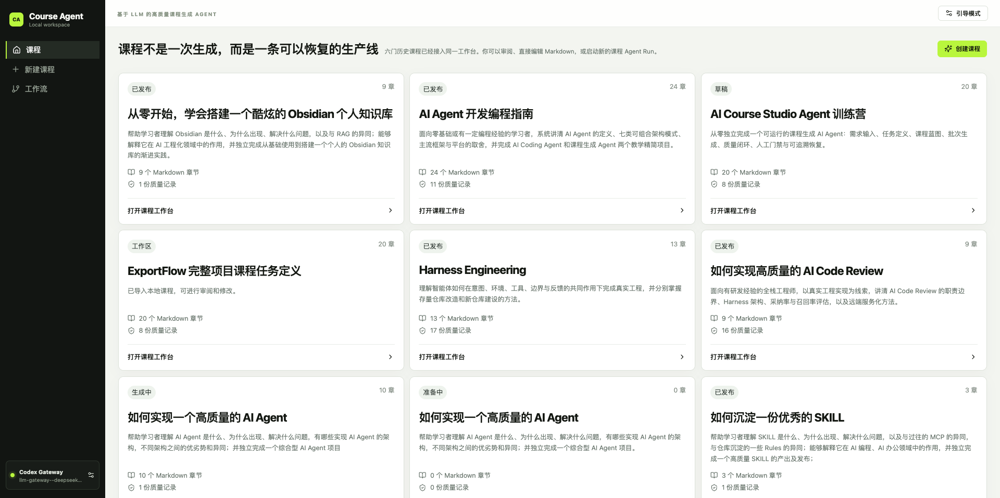
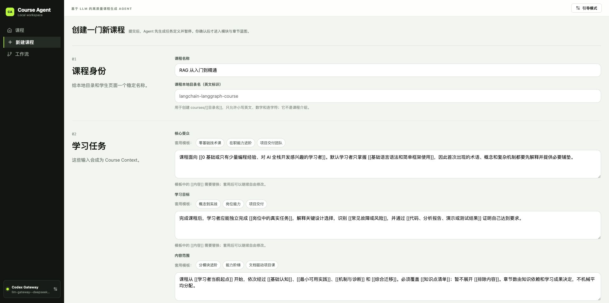
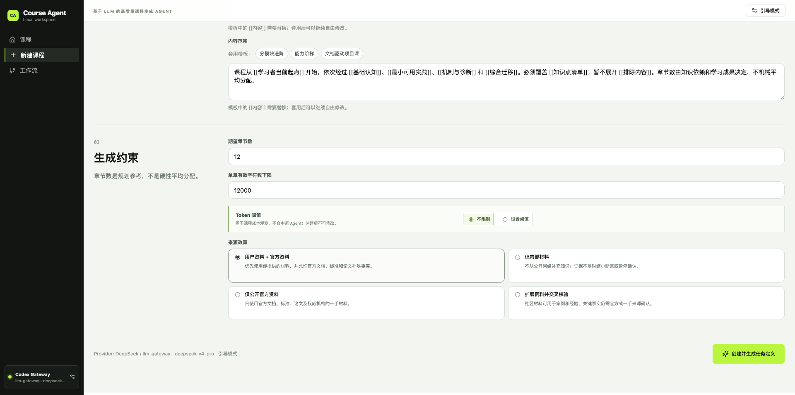
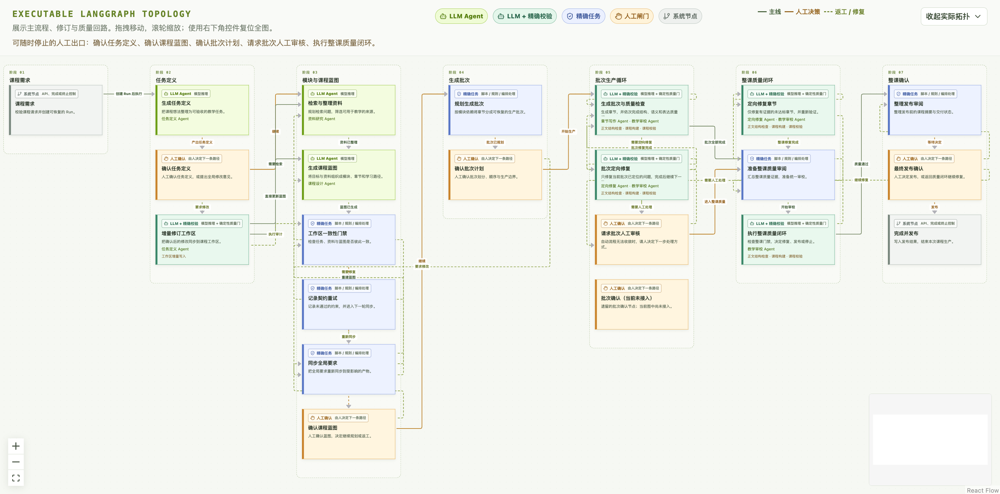
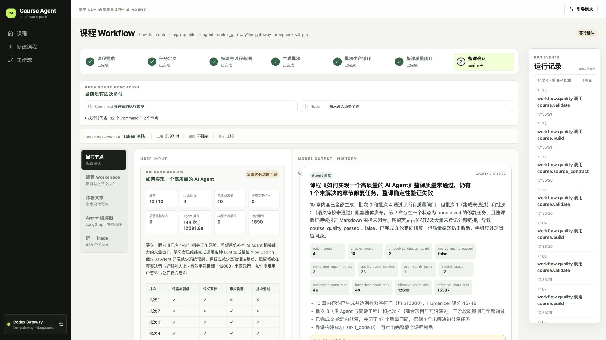
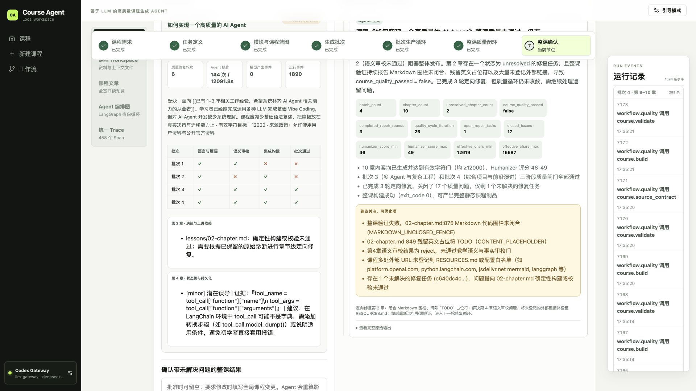
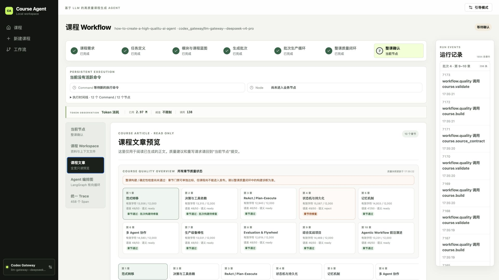

# AI 课程生成 Agent 训练营项目

这是一个本地优先的 AI Agent 教学项目。它将课程需求转化为可审阅、可人工干预、可恢复的课程生产工作流，并以内置的「从零开始，学会搭建一个酷炫的 Obsidian 个人知识库」作为可直接浏览和继续编辑的样例。

## 产品概览

AI Course Studio 不是用聊天框一次性生成长课程的工具。它以确定性 Workflow 包裹受控的多 Agent：系统代码负责步骤、权限、质量检查和人工门禁；模型只在需要理解、规划、写作与审校的节点工作。课程正文写入文件系统，运行过程与人工决策持久化到本地 SQLite，因此可以观察、恢复和审计每一次生产 Run。

首页列出本地课程及其制作状态；你可以打开既有课程做 Review，或从一个新的生产 Run 开始。



创建向导收集课程名称、目录 slug、核心受众、学习目标、内容范围、来源政策、章节数和有效字符约束。这些输入会贯穿任务定义、课程蓝图和后续 Context Pack，而不是一次性表单数据。





## 工作流与工作台

一次课程生产 Run 遵循七个阶段：`intake → mission → blueprint → batch_plan → generation → quality → release`。计划阶段把需求转化为可审阅的课程计划，生成与质量阶段执行有限次、证据驱动的返工，最终发布权始终由人工掌握。



工作台同时呈现流程、运行状态和 Token 用量：阶段状态清晰可见，长任务在 Worker 中后台执行，前端通过状态更新展示最新进度。



在 Release Review 中，可以查看整课质量结论、批次质量矩阵、模型产物与运行事件；它们是可追溯的业务记录，而不是散落的聊天消息。



课程文章视图将 Markdown 正文与章节质量状态分开呈现，便于定位有效字符、语言润色、语义审校和章节通过情况。



## 项目架构

- `apps/web/`：React + Vite 前端，提供课程创建、工作流可视化、人工确认、Workspace 文件编辑与课程输出预览。
- `apps/api/`：FastAPI + LangGraph 后端，负责 Agent 状态机、模型调用、课程文件操作、质量闭环与本地 SQLite 持久化。
- `courses/`：课程事实源。Markdown 正文位于 `lessons/`，生成的 HTML 与课程资源位于同一课程目录。
- `.agents/skills/`：课程 Agent 的核心规则：`fastapi`、`humanizer-zh` 与 `teach-generator`。
- `assets/aiagent/`：产品需求与前后端技术设计文档。

工作流依次经过：课程需求（intake）、任务定义（mission）、课程蓝图（blueprint）、分批计划（batch plan）、章节生成（generation）、质量闭环（quality）和发布准备（release）。

## 核心 SKILL：课程 Agent 如何工作

这个项目的 Agent 不是只靠一个总 Prompt 生成课程。`teach-generator` 和 `humanizer-zh` 是随仓库版本化的领域规则：前者决定“课程应该如何被生产与验收”，后者决定“中文学生正文是否自然、准确且可读”。FastAPI/LangGraph 运行时负责把这些规则放入正确的节点、持久化每次产物，并在未通过质量门时调度定向修复。

| SKILL | 在 Agent 中的职责 | 主要输入 | 主要输出 / 约束 |
| --- | --- | --- | --- |
| [`teach-generator`](.agents/skills/teach-generator/SKILL.md) | 课程生产的领域规范与质量基线 | 用户需求、`MISSION.md`、来源登记、课程规格、蓝图、相邻章节和人工反馈 | 任务定义、模块/章节蓝图、Context Pack、Markdown 正文、练习与参考资料；要求来源可追溯、前置知识连续、教学活动可验收，并通过结构、语义与集成检查。 |
| [`humanizer-zh`](.agents/skills/humanizer-zh/SKILL.md) | 中文学生可见正文的语言质量闸门 | 已生成或已修复的 Markdown 正文 | 在不改变代码块、URL、术语标记、数字和标题结构的前提下，输出可定位的散文改写补丁与评分；识别模板腔、空泛升华、机械排比、无依据权威归因和对话残留等问题。 |

### 两个 SKILL 的协作顺序

1. **`teach-generator` 定义生产边界**：Agent 先将课程需求固化到 `MISSION.md`、`COURSE-GENERATION-SPEC.md`，再规划模块、章节目标、来源政策和完成证据。人工在任务定义与蓝图阶段拥有批准、要求修改或停止的权力。
2. **Agent 依据 `teach-generator` 生成正文**：章节生成节点只读取与本章有关的 Context Pack，包括全局约束、模块上下文、相邻章节摘要、连续性台账和当前反馈；正文 Markdown 写入 `courses/<slug>/lessons/`，而不是停留在聊天记录中。
3. **`humanizer-zh` 在生成后执行语言闸门**：`reviewer.agent` 对正文做最小、可定位的中文改写，保持技术事实与结构不变。当前项目将 `45/50` 设为最低通过分数。
4. **`teach-generator` 驱动后续质量闭环**：系统继续检查有效字符、教学语义、跨章连续性、Markdown 结构与静态构建。任一门未通过时，系统创建带证据的 RepairTask，定向修改后重新运行相关门禁；同类 blocker 连续三轮仍存在则停止自动返工，转人工审核。

可以把它们理解为三个相互独立的层次：**LangGraph Workflow 决定何时运行与何时暂停，`teach-generator` 决定课程内容与教学质量，`humanizer-zh` 负责中文表达的最后一道语言质量门。** 这使课程 Agent 的行为可追溯、可测试，也让课程规则能脱离具体模型持续演进。

## 学员参考文档

在阅读代码前，建议先通过以下三份文档建立全局模型；它们已按当前仓库的可运行实现整理，不把未来重构方案当成既有能力。

1. [`PRD.md`](assets/aiagent/PRD.md)：产品问题、用户场景、七阶段 Workflow、课程数据与质量边界。
2. [`FE-TD.md`](assets/aiagent/FE-TD.md)：前端路由、工作台状态模型、API 交互边界和阅读入口。
3. [`BE-TD.md`](assets/aiagent/BE-TD.md)：Command/Worker、LangGraph、Agent Runtime、SQLite、质量闭环与后端阅读路径。

推荐顺序是 **PRD → FE-TD → BE-TD → 启动项目并观察一次 Run**。随后结合 `apps/web/`、`apps/api/` 与内置课程目录追踪一次“创建课程 → 人工批准 → 批次生成 → 质量修复 → 发布”的完整链路。

## 前置条件

- Node.js 20+（建议使用当前 LTS）
- Python 3.12
- 一个可用的模型提供方：本地 Codex Gateway，或 DeepSeek API Key

## 一键启动

```bash
cp apps/api/.env.example apps/api/.env
# 编辑 apps/api/.env：使用 Codex Gateway，或填写 DEEPSEEK_API_KEY
bash scripts/start-agent.sh
```

启动脚本会自动创建 `apps/api/.venv` 并安装 Python 依赖，也会在 `apps/web/node_modules` 缺失时安装前端依赖。启动完成后访问：

- 前端：`http://127.0.0.1:5173`
- API 文档：`http://127.0.0.1:8000/docs`

按 `Ctrl+C` 会停止前端、API 与后台 Worker。`.venv`、`node_modules` 和 `.course-agent` 均是本机生成的运行数据，不应提交或迁移。

## 手动启动

```bash
python3.12 -m venv apps/api/.venv
apps/api/.venv/bin/python -m pip install -e "apps/api[dev]"
npm --prefix apps/web install

cp apps/api/.env.example apps/api/.env
apps/api/.venv/bin/uvicorn app.main:app --app-dir apps/api --host 127.0.0.1 --port 8000
# 另开终端：cd apps/api && .venv/bin/python -m app.worker
# 再开终端：npm --prefix apps/web run dev
```

## 常用验证

```bash
npm --prefix apps/web run typecheck
npm --prefix apps/web run build
apps/api/.venv/bin/python -m pytest apps/api/tests
npm run test:contract
node .agents/skills/teach-generator/scripts/validate-course.mjs courses/advanced-learning-of-obsidian
```

## 样例课程

`courses/advanced-learning-of-obsidian/` 是内置样例。其 `workspace/` 保存任务、蓝图与上下文；`lessons/` 是可编辑的课程正文；`assets/` 保存课程页面样式与交互脚本。需要重新构建静态页面时运行：

```bash
node scripts/build-static-course.mjs advanced-learning-of-obsidian
```
