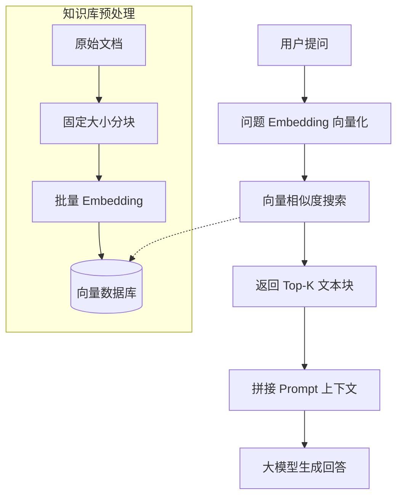
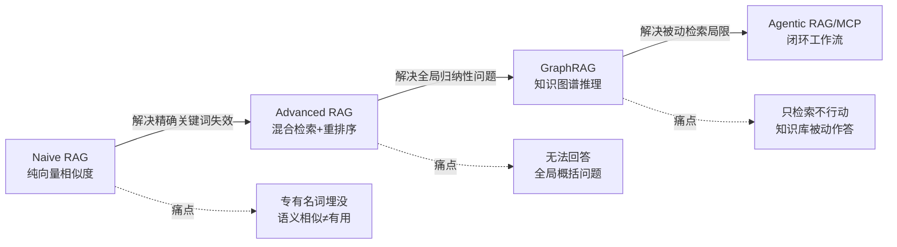
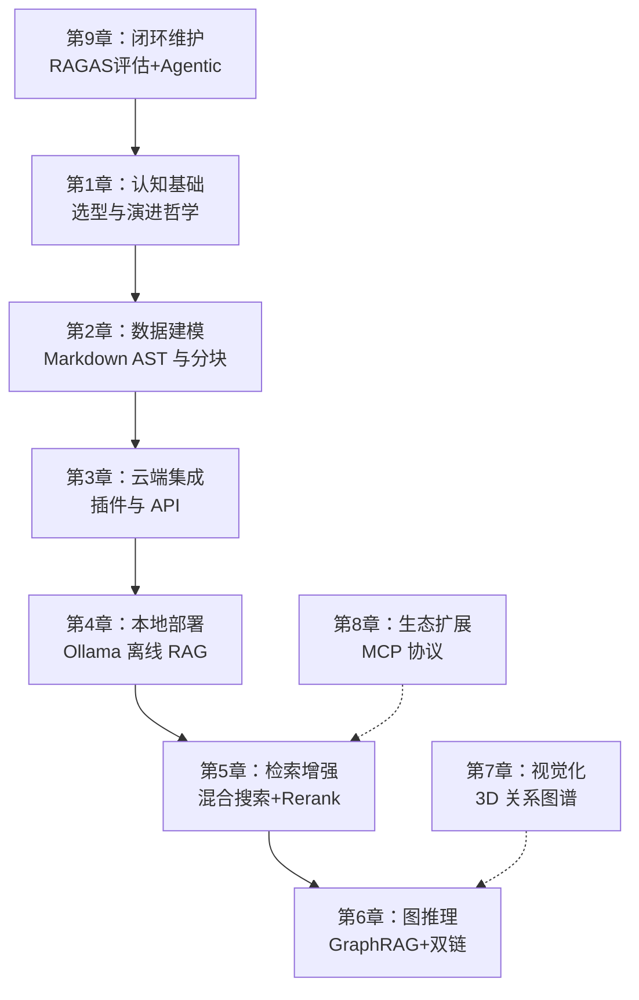

# 第 1 章 个人知识库选型与 RAG 演进哲学

> 预计学习时间：60 分钟  
> 一句话总结：从“我为什么要整理笔记”到“AI 如何理解我的笔记”，建立完整的认知地图，让你在后续八章的学习中看清技术决策的依据。

---

## 开始之前：你需要准备什么

本章是整门课程的认知起点，不要求任何编程经验。为了顺畅理解后面的内容，请确认你已经具备以下基础：

- **熟悉文件和文件夹操作**：知道如何在自己的电脑上创建、移动、重命名文件与文件夹，能区分 `.txt`、`.md`、`.pdf` 这类文件后缀。
- **知道什么是“纯文本”**：纯文本就是不包含字体、颜色等排版信息的文字内容，所有系统自带的记事本（Windows）或文本编辑（macOS）都能打开。
- **接触过命令行（可选）**：本章包含一个打开终端的极简实验，即使从未用过命令行也能跟着操作，但如果完全陌生，不妨花 5 分钟先搜索“如何打开终端”预热一下。

有了这些基础，你就能把注意力集中在知识管理的核心逻辑上，而不是被工具操作绊住。

---

## 1. 碎片化困境：信息在，知识不在

想象一下你日常的信息摄入场景：在微信公众号看到一篇技术分析，保存到“收藏”里；在 B站 看到一个开源项目介绍，截了个图放在桌面；自己动手调试了一个 bug，解决思路写在手机备忘录里，连同当时的报错信息一起贴在下面。

三个月之后，你要做一个新项目，隐约记得自己曾经整理过类似的技术方案，也记得有一个开源工具可以复用。但你打开微信收藏，发现里面堆了 300 多篇未分类的文章，标题都很吸引人，但你根本不记得哪一篇是跟当前需求相关的。你又打开备忘录，搜索关键词会出来几十条零散的片段，有些是完整的思路，有些只是半句话。桌面上的截图，文件名是“截屏 2025-03-21 下午4.32.18.png”——除了打开一个个看，你没有别的办法。

问题出在哪里？**你把信息存下来了，但没建立起检索路径。** 信息本身不稀缺，稀缺的是“在正确的时刻被召回”。

这里就引出了本课程的两个核心术语：

- **知识库（Knowledge Base）**：不是简单的文档堆砌，而是一套有结构、有索引、可检索的信息组织系统。可以把它类比成一座图书馆——书再多，如果没有分类和目录，就只是一个仓库。
- **检索增强生成（RAG，Retrieval-Augmented Generation）**：让 AI 在回答你问题之前，先去你的知识库里“翻找”相关内容，再整合这些内容生成答案。换句话说，AI 不是靠记忆硬猜，而是先查阅你的专属资料。

你可能会问：“我直接把所有文档丢给 AI 不行吗？”理论上行，但实践中会碰到上下文窗口的限制——AI 一次能“看到”的文本量是有限的。更关键的是，不加筛选地把 300 篇文章全部塞进去，AI 反而会被噪声淹没，出来的答案质量还不如你只精挑 3 篇相关度最高的。

所以，一个能服务于 AI 的知识库，必须具备两个核心能力：一是内容本身有清晰的结构（方便分块检索），二是你保有数据的完全控制权（方便本地索引）。这是我们后续一切技术选型的判断标准。

---

## 2. 工具三象限：同一道题，三种解法

现在我们把市面上主流的三种方案拿出来，做一个逐维度对比。这三种方案分别代表三类完全不同的设计哲学——它们都能“记东西”，但面向的场景和核心取舍截然不同。

我们先通过一张对比表建立整体印象，然后再逐个拆解其底层逻辑。

| 对比维度 | Obsidian（本地 Markdown） | Notion（云端 Block DB） | 企业级 RAG 系统（Dify/RAGFlow） |
|---------|--------------------------|------------------------|-------------------------------|
| 数据存储 | 本地文件夹，纯 `.md` 文件 | 云端数据库，Block 级 JSON | 远程向量数据库（Postgres/Milvus） |
| 数据所有权 | 你完全掌控，不依赖任何服务 | 存储在 Notion 服务器，受其服务条款约束 | 由企业/团队集中管理 |
| 离线可用性 | 100% 离线可用 | 需要网络连接（离线模式有限） | 依赖服务端运行状态 |
| 检索方式 | 全文搜索 + 双向链接 + 图谱 | 数据库查询 + 全文搜索 | 语义向量检索 + 混合检索 |
| AI 集成方式 | 社区插件调用 API 或本地模型 | 内置 Notion AI（需订阅） | 原生 ETL 管道 + RAG 引擎 |
| 学习曲线 | 低（上手即用）+ 中（高级功能） | 低（上手即用） | 高（需要 ML 工程背景） |
| 适合场景 | 个人长期知识积累与思考 | 团队协作、项目管理、轻量数据库 | 海量非结构化文档的企业级问答 |

表面上看，这三者都是“记笔记+搜索”，但它们的底层数据模型决定了迥异的能力边界。我们来逐一拆解。

### 2.1 Obsidian：把笔记还原成文件

Obsidian 做了一个看似“退步”的决定：它不像大多数现代笔记软件那样搞一套专有数据库，而是回归到最原始的方式——你写的每一条笔记，就是一个普通的 Markdown 文本文件，存在你电脑的文件夹里。

这带来三个关键好处：

**第一，你的数据你说了算。** 假如 Obsidian 明天倒闭了，你的所有笔记仍然完好地躺在硬盘里，任何文本编辑器都能打开。没有任何专有格式锁死你的内容。这个特性叫 **Local-first（本地优先）**，意味着本地数据永远是主副本，云端即使有同步也只是辅助。

**第二，文件系统就是你的 API。** 因为笔记就是文件，你可以用任何编程语言来处理它们。Python 脚本可以扫描你的笔记文件夹，读取 YAML 元数据，提取标题层级，做各种自动化操作。你不需要请求任何 API 权限，不需要忍受速率限制。我们会在第 8 章深入利用这个特性，把你的 Obsidian 知识库变成一个 MCP 服务器，提供给外部 AI 工具使用。

**第三，Markdown 的语义结构对机器友好。** Markdown 不是纯文本——它有标题层级（`#`、`##`、`###`），有链接语法（`[[双向链接]]`），有代码块（` ``` `），有标签（`#tag`）。这些标记构成了**抽象语法树（AST，Abstract Syntax Tree）**，让程序能精确地知道“这一段属于哪个标题下”“这个链接指向哪篇笔记”。这个特性在第 2 章会发挥重要作用——当我们对笔记做分块（Chunking）喂给 AI 时，基于 AST 的分块远比“每 500 字砍一刀”精准得多。

#### 小实验：感受 Markdown 的结构性

找一篇你已有的 Markdown 文件（如果没有，现在新建一个 `test.md`，写两段带标题的文字），然后在终端运行：

```bash
# macOS / Linux
cat your-note.md | grep "^#"
# Windows (PowerShell)
Select-String -Pattern "^#" your-note.md
```

这条命令会提取文件中所有以 `#` 开头的行——也就是标题。观察输出，你会看到笔记的标题层级一目了然。这种结构信息，将在后续章节中成为 AI 检索的“航标”。

#### 反例与边界：Obsidian 也有不擅长的

千万别以为 Obsidian 是万能药。如果你的笔记中包含大量高分辨率图片、视频等非文本资源，它们无法被 Markdown 直接检索，你仍然需要手动整理。另外，当你的知识库文件数量超过数千个，Obsidian 的启动和同步速度会有所下降（取决于磁盘性能）。这些场景需要在后续实践中用策略优化，而不是一上来就否定工具。

### 2.2 Notion：当笔记变成数据库行

Notion 走了另一条路。它的核心数据模型是 **Block（块）**——每个段落、标题、图片、表格都是一个 Block，Block 之间可以嵌套、引用、转化为数据库行。这个设计让 Notion 在灵活性和协作性上做得非常出色，也让它成为广泛使用的生产力工具。

但这条路的代价是什么？

**数据存储在云端，格式是专有的 Block JSON。** 你的笔记不是一个 `.md` 文件，而是一堆序列化的 JSON 对象，存储在 Notion 的服务器上。Notion 确实提供了 API 和导出功能，但导出过程其实是把内部结构“翻译”为 Markdown 或 CSV，这个过程不一定能保真 Block 之间的嵌套关系、数据库关联和模板结构。也就是说，你不是在访问原始数据，而是在请求 Notion 把它的内部格式转译成你需要的格式。

这个差异在 AI 应用场景下更明显。如果你用 Notion 搭建个人知识库，在引入 AI 检索时会遇到两个瓶颈：

- **API 速率限制**：Notion API 存在请求频率限制，当你需要批量索引成百上千篇笔记来生成向量 Embedding 时，很可能触发限流错误，导致你不得不编写重试逻辑、降低处理速度。而 Obsidian 的文件在本地，你爱读多快读多快——读取速度只受制于你的硬盘。
- **数据锁死风险**：你的知识库依附于 Notion 的服务。如果 Notion 调整定价、变更 API 政策、甚至停止服务（虽然短期看概率很小，但你的知识库使用周期是以年甚至十年计的），你的知识资产会受多大影响？

**Notion 不是错的，它只是为别的场景设计的。** 如果你在做团队项目管理、需要多人实时协同编辑、需要强大的数据库视图（看板、日历、时间线），Notion 是极好的工具。但它不适合作为个人 AI 第二大脑的底层数据基座——因为个人 AI 知识库的核心要求是“数据可控”和“无摩擦批量处理”，这两点恰好是云端专有格式的弱项。

### 2.3 企业级 RAG 系统：重型武器不该打蚊子

Dify、RAGFlow 这类平台能做一件很厉害的事：你把几百份 PDF、Word 文档、网页抓取结果丢进去，它自动帮你做文档解析、文本分块、向量化、存储索引，然后你通过聊天界面提问，它从知识库中检索相关内容并生成回答。它们背后通常跑着 Postgres（存结构化数据）、Milvus（存向量）、Redis（做缓存），是一套完整的企业级 ETL（Extract-Transform-Load，数据抽取-转换-加载）管道。

但把这套重型武器搬到个人场景，问题很快就暴露出来了：

**第一，运维成本高。** 跑一套完整的 Dify 需要至少 Docker 环境，需要配置数据库连接，需要管理模型密钥。对于个人学习者来说，这不只是“麻烦一点”的问题——你的目的是整理自己的思考、提升工作效率，而不是成为基础设施运维工程师。我们在第 4 章会学到用 Ollama 做本地模型部署，那条路线只需要一行命令。

**第二，粒度不适配。** 企业级系统天然面向“大量非结构化文档”的场景——比如公司的所有合同、产品手册、客服对话记录。这些场景的典型特征是“文档量大，单文档结构弱”。但个人知识库恰好相反：文档量相对少（几百到几千篇），但每篇都有明确的主题、标题层级和内部链接。这意味着你需要的是精准的语义分块和链接图谱推理，而不是粗粒度的全文检索。

**第三，思考过程被割裂。** 你在 Obsidian 里写一条笔记的过程，本身就是“思考”的过程。笔记和笔记之间通过双链产生了关系，这些关系体现了你的思维路径。但如果你把笔记导出给外部 RAG 系统检索，这些链接关系就丢失了——外部系统只看到了“一堆独立文档”，看不到“它们之间怎么联系的”。我们第 6 章会讲到，Obsidian 的双链本身就是最好的图数据源，这是外部系统无法天然复现的。

**一个快速判断标准**：如果你手头有 10,000 份毫无关联的 PDF 合同，需要一个系统来回答“关于退货政策的条款在哪”，用 Dify 是合适的。但如果你在积累的是“我对分布式系统的理解”“我研究过的所有开源调度框架”“我的写作灵感片段”，这些内容之间有千丝万缕的逻辑联系——那 Obsidian 的本地 Markdown + 双链才是天然匹配的数据模型。

### 2.4 你现在应该做出什么选择？

经过以上分析，选择的逻辑已经清晰了：

- 如果你的需求是**团队实时协作 + 结构化数据管理**（比如团队 Wiki、项目追踪），Notion 是更好的选择。
- 如果你的需求是**处理海量弱结构文档的企业级问答**，Dify/RAGFlow 更专业。
- 但如果你的需求是**搭建一个长期演进、AI 增强、完全受你控制的个人知识系统**——这正是本课程的目标——Obsidian 是最合适的载体。

接下来的 8 章，我们不是在学习“怎么用 Obsidian 记笔记”——那部分你花半小时看官方文档就够了。我们要学的是：**如何把一个 Obsidian 知识库，改造成一个 AI 可以理解、检索、推理、甚至帮你自动维护的“第二大脑”。**

在做完这个选择之后，我们需要追问一个更根本的问题：AI 到底是怎么从知识库里“找东西”的？这就要进入本章的下半场——RAG 技术从朴素到智能的演进之路。

---

## 3. RAG 演进：从“找相似句子”到“理解知识网络”

RAG 这个词你可能已经听过很多次了，但让我们从最基础的场景开始理解。

假设你有一个知识库，里面写了 100 篇技术笔记。现在你问 AI：“我之前研究过的那个用 Rust 写的流处理框架叫什么来着？我记得是跟 Kafka 对标的。”

本质上，AI 需要做两件事：（1）从你的 100 篇笔记里找到最相关的几篇；（2）基于这几篇笔记的内容生成一个准确的回答。第一步叫**检索（Retrieval）**，第二步叫**生成（Generation）**，合起来就是 RAG。

问题出在第一步。RAG 过去几年的演进，本质上就是在不断回答一个核心问题：**怎么才能从海量文档里，精准地找到真正有用的那几段？**

### 3.1 Naïve RAG：朴素开局的明显缺陷

最早的 RAG 方案——我们称之为 **Naïve RAG（朴素 RAG）**——用了一种看起来很直接的办法：

1. 把知识库里的所有文档切成一段一段的文本块（Chunk）。
2. 用一个 **Embedding 模型** 把每个文本块转化成一个向量（Vector）——你可以把这个向量理解为“该文本块在语义空间中的坐标”。语义相近的文本块，向量坐标也相近。
3. 当用户提问时，把问题也转化成一个向量。
4. 用**余弦相似度（Cosine Similarity）**等数学方法，找到向量数据库中与问题向量最接近的那几个文本块。
5. 把这些文本块塞进提示词，让大模型基于它们生成回答。

这个流程可以用一句话概括：**把问题翻译成坐标，然后在知识库里找坐标最近的片段。**

以下是它最核心的架构示意——这不是具体指令，而是Naïve RAG 中“检索与生成”的分工视图，帮助你从全局理解整个流程的运转：



#### 短小可观察示例：两个句子到底有多像？

为了让你对“语义相似度”有直觉，我们虚构两个句子和它们的简化向量：

- 句子A：“Docker 网络不通可以尝试 host 模式。” → 向量 A = [0.8, 0.1, 0.2]
- 句子B：“Docker 支持 bridge、host、overlay 网络模式。” → 向量 B = [0.7, 0.2, 0.3]
- 提问Q：“我 Docker 网络不通怎么解决？” → 向量 Q = [0.85, 0.1, 0.25]

余弦相似度衡量两个向量方向的接近程度，值越接近 1 越相似。你可以直观看出，Q 和 A 的方向非常接近（数值相似），而 Q 和 B 也接近但稍弱。如果知识库里只有 A 和 B，Naïve RAG 会优先返回句子A，因为它的向量与 Q 最相似。这正是我们期望的。

但如果知识库里还有句子C：“Docker bridge 网络的配置步骤详解” → 向量 C = [0.75, 0.15, 0.28]，它和提问 Q 的相似度也很高，内容却是教程，可能不是你想要的排错记录。这就引出下一个问题。

#### 反例与边界：相似但无用

这个方案在“找相似句子”方面表现得不错。但它在真实场景中暴露了三个明显问题：

**问题一：语义相似不等于有用。** 假设你问：“我在 Docker 里遇到的那个网络不通的问题最后怎么解决的？”Naïve RAG 会去检索与“Docker”“网络”“不通”语义相似的文本块。但你知识库里可能有 10 篇笔记都提到了 Docker 网络问题——有篇笔记是在复述官方文档的 Docker 网络基础概念，有篇笔记是你记录的一次失败的排查过程，有篇笔记是你最终找到的那个“加一行 `--network=host` 就解决”的记录。如果最相似的是第一篇，AI 给你生成的回答就会变成“Docker 支持 bridge、host、overlay 等多种网络模式……”——对，但没用。你真正需要的是第三篇。

**问题二：精确关键词完全失效。** 这是语义搜索的原罪。假设你问：“`pgvector` 和 `pgvecto.rs` 两个扩展在索引类型上有什么区别？”这两个都是专有名词，Embedding 模型可能没见过，或者见过的上下文不够充分。结果就是检索召回了跟你问的“扩展”“区别”“索引”语义相关的通用内容，却漏掉了标题就叫 `pgvector vs pgvecto.rs` 的那篇笔记。你会怀疑：“我明明写了啊，怎么找不到？”

**问题三：全局性问题无法回答。** 如果你问：“我的知识库里关于‘分布式系统共识算法’有哪些主要观点？它们之间有没有矛盾？”——这类问题需要的是**聚合理解**，而不是找相似的段落。Naïve RAG 检索出来的是“和这句话语义相似的段落”，但你要的是“跨越几十篇笔记的归纳总结”，单靠向量相似度永远做不到。

这三个问题，依次催生了三种改进方向：**混合检索（Advanced RAG）→ 知识图谱（GraphRAG）→ 智能体驱动（Agentic RAG）**。

### 3.2 Advanced RAG：关键字和语义联手

解决“精确关键词失效”的办法很朴素——同时跑两种检索，然后把结果融合：

- **语义搜索（Dense Search）**：就是前面讲的向量相似度搜索，负责抓大意。
- **关键词搜索（Sparse Search）**：基于 **BM25** 算法（一种经典的文本检索算法，通过词频和逆文档频率衡量搜索词在文档中的重要程度），精确匹配专有名词、代码函数名、缩写。

然后通过 **RRF（Reciprocal Rank Fusion，倒数排名融合）** 把两个结果列表合并成一个。RRF 的核心思想很简单：一个文档如果在两种搜索中都排名很高，那它大概率就是真正相关的；如果只在其中一种搜索中排名高，那它可能只是碰巧匹配了某一方面。

举个例子，假设我们检索“pgvector 索引类型”，语义搜索返回的前三名：
1. 《PostgreSQL 扩展索引概述》
2. 《pgvector 使用指南》
3. 《pgvecto.rs 性能对比》

关键词搜索返回的前三名：
1. 《pgvector vs pgvecto.rs》
2. 《pgvecto.rs 安装步骤》
3. 《pgvector 使用指南》

RRF 给每个排名计算得分（通常是 1/(k+rank)，k 一般取 60，这里简化成 1/rank）：
- 《PostgreSQL 扩展索引概述》：1/1 + 0 = 1.0
- 《pgvector 使用指南》：1/2 + 1/3 = 0.5 + 0.33 = 0.83
- 《pgvecto.rs 性能对比》：1/3 + 0 = 0.33
- 《pgvector vs pgvecto.rs》：0 + 1/1 = 1.0
- 《pgvecto.rs 安装步骤》：0 + 1/2 = 0.5

最终融合排名第一的就是《PostgreSQL 扩展索引概述》和《pgvector vs pgvecto.rs》并列。这个结果既包含了语义相关也包含了精确命中，双保险。

合并后的 Top-K 结果，再送入一个 **重排序模型（Cross-Encoder Reranker）** 做二次打分。Cross-Encoder 不同于向量搜索——它会同时读“问题”和“候选文档”，给出一个精确的“这个文档对回答这个问题有多大用”的分数。向量搜索是粗筛，重排序是精挑。

#### 反例：当混合检索失灵

如果你知识库里的笔记都是关于“苹果手机”的使用技巧，而你问的是“苹果的股票代码”，关键词搜索会狂返回“苹果”，而语义搜索可能也不清楚上下文。这时候重排序能帮你把语义不相关的结果压下去，但如果知识库根本就没有金融信息，那任何检索都无能为力——RAG 不能创造知识，只能召回已有的。这是你会在第 5 章实践中亲身验证的边界。

我们在第 5 章会完整实现这套混合检索管线。现在你只需要记住它解决的核心问题：**专有名词不会被埋没，同时整体语义相关性也有保障。**

### 3.3 GraphRAG：把笔记变成知识网

混合检索解决了“找什么”的问题，但它仍然无法回答：“知识库里关于某一个主题，所有的核心观点是什么？”这类全局归纳性问题。

因为这类问题要求的不是“找出某些段落”，而是“理解知识之间的关系”。举个例子，如果你在一个知识库里写了 50 篇与“微服务”相关的笔记，它们之间通过 `[[双向链接]]` 形成了一张关系网：`[[微服务架构]]` → `[[服务发现]]` → `[[Consul 原理]]`，另一条路径是 `[[微服务架构]]` → `[[API 网关]]` → `[[Kong 配置]]`。当你问“我对微服务架构的整体理解是什么？”AI 需要的不是 50 篇笔记里最相关的 3 篇，而是对这张关系网做一次**多跳推理（Multi-hop Reasoning）**——先从“微服务架构”出发，找到它链接到的核心概念，再找到这些概念链接到的具体实践，最后把整条路径上的信息聚合生成回答。

这就是 **GraphRAG** 的思想来源。它的核心流程是：

1. **实体与关系提取**：从你的 Markdown 笔记中识别出“实体”（如 Kubernetes、微服务、Docker）和“关系”（如“Kubernetes 是一种容器编排工具”、“微服务依赖容器化部署”）。
2. **知识图谱构建**：将实体作为节点，关系作为边，构建一个图数据库。
3. **图检索**：当用户提问时，不仅在向量库中搜索相似文本，还在知识图谱中搜索相关实体的邻居节点、多跳路径和社区结构。

微软在 2024 年开源了 GraphRAG 项目，首次把这个理念工程化了。而我们第 6 章会讲一个更轻量的思路：**Obsidian 原生的双链就是图**。你在 `[[Kubernetes]]` 和 `[[容器化]]` 之间建立的双向链接，本身就是最精准的“知识关系”标注——不需要用 NLP 模型去猜，你自己在写笔记时已经把关系定义好了。

#### 短小可观察示例：用双链画一张微型知识网

如果你已经安装了 Obsidian（现在装也不迟，不到一分钟），可以立刻做一个小实验：

1. 新建笔记“微服务架构.md”，写入内容：“微服务是一种将应用拆分为小型独立服务的架构风格，核心挑战包括 [[服务发现]] 和 [[API网关]]。”
2. 点击 `[[服务发现]]` 链接创建新笔记，写入：“服务发现解决的是微服务实例如何互相定位的问题，常见工具有 [[Consul]]。”
3. 再次创建 [[Consul]]，简单描述。
4. 回到图谱视图，你会看到三个节点由有向边连接，形成一个微型知识链条。

这就是 GraphRAG 的“图”在 Obsidian 里的原始形态。第 6 章会教你如何让 AI 沿着这些边进行多跳推理。

#### 反例：双链不是万能的

如果你的笔记之间很少建立双链，或者双链质量不高（比如滥用链接、指向模糊的笔记名），那么图结构反而会引入噪音，加重 AI 的推理负担。GraphRAG 的效果严重依赖你的链接习惯。

### 3.4 Agentic RAG 与 MCP：知识库活过来

GraphRAG 让检索从“向量匹配”进化到“图推理”，但它仍然有一个局限：它是**被动等待查询**的。你提问，它检索，它回答。一轮结束。

但真实的知识工作流不是这样的。你写了新笔记、改了旧笔记、删了过时内容，知识库在不断演变。AI 检索的质量会随着知识库的演变而变化——笔记多了可能“淹没了”以前的精华，某些笔记出现了矛盾观点但你还没发现，某些话题你可以自动生成一篇新笔记来组织现有笔记中的零散思想。

这就是 **Agentic RAG（智能体驱动的 RAG）** 要解决的问题。它在检索的基础上引入了一个“智能体”层，让 AI 不只检索，还能规划、执行多步操作、写回结果。比如：

- **自动维护**：检测到三篇笔记都在讨论同一个主题但相互没链接？Agent 自动建议甚至直接添加双链。
- **矛盾检测**：发现两篇笔记对同一个技术结论有不同的说法？Agent 标出矛盾并提示你核查。
- **闭环创作**：你提出一个新课题 → Agent 检索本地笔记收集素材 → 生成草稿 → 在 Obsidian 里新建笔记并自动加上双链和 Tag。

这个过程依赖一个关键协议——**MCP（Model Context Protocol，模型上下文协议）**。MCP 是 Anthropic 在 2024 年底发布的一套开放标准，定义了 AI 模型如何与外部工具（比如文件系统、数据库、API 服务）进行标准化交互。简单说，MCP 让你的 Obsidian 知识库可以变成一个“工具”，被外部的 AI 应用（如 Cursor、Claude Code）当作上下文来源来调用。我们在第 8 章会完整实现 MCP Server 的搭建。

#### 边界：Agent 的自主与你的掌控

Agent 自动写回笔记是一项强大但危险的操作。它可能产生低质内容污染你的知识库，或者在你不知情的情况下删除重要笔记。因此我们在第 9 章的实战中会严格限定写回边界（例如只写入特定文件夹），并建议你始终保持版本控制（Git）——这是后话，但你现在就应该意识到：自动化越强，安全边界的设置越重要。

到这里，整条演进路线就可以可视化地呈现出来了：



这条箭头链条，就是你接下来八章技术栈的核心主线。你不是在学一堆散装的技术点，而是在学同一个问题的四种解法——每一代解法都解决了上一代的局限性，但也都引入了新的复杂度。这也是为什么我们要从 Obsidian 这样一个简单的本地 Markdown 库出发：我们掌握了数据，才能在最合适的地方引入最合适的检索策略，而不是受工具的限制。

---

## 4. 认知锚点：这张地图将贯穿全书

学习任何技术体系最怕的，是“只见树木不见森林”——学了半本课程，记住了几十个命令、配置和工具名，却说不出它们之间的逻辑关系。所以我们用最后一个小节，在认知层面建立一个“锚点”。

你可以把本课程想象成一条流水线：



这个流水线环环相扣，但你不必现在就理解每个模块的细节——那不是本章的任务。本章只要求你在完成阅读后，记住这张全景图：

- 第 1 章（本章）是**地图**，告诉你为什么走这条路。
- 第 2-4 章是**基建**，从数据建模到云端接入再到完全本地化，让你能跑通完整的 RAG 链路。
- 第 5-6 章是**核心**，解决检索质量的两个核心瓶颈：精确匹配和全局理解。
- 第 7 章是**可视化**，把隐性的知识网络变成直观的三维图谱。
- 第 8 章是**扩展**，让你的知识库成为全开发工作流的上下文中心。
- 第 9 章是**闭环**，引入评估和自动维护，让系统可持续运转。

---

## 5. 练习与反馈：检验你的“认知地图”

### 自检清单

在进入第 2 章之前，确认你能回答以下问题：

1. 如果朋友问你“Obsidian 比 Notion 更适合做个人 AI 知识库的理由是什么”，你能从**数据所有权、离线可用、文件系统可编程性和 Markdown 语义结构**四个角度解释吗？
2. Naïve RAG 的“单一向量相似度搜索”在什么场景下会失效？你能举出一个你未来可能遇到的真实例子吗？
3. Advanced RAG → GraphRAG → Agentic RAG，每一代核心解决了上一代的什么问题？不必背术语，但能用自己的话串成一条因果关系链。
4. 你现在应该用什么标准来判断“这个知识库工具/方案适不适合我的场景”？哪个标准是最重要的？

### 动手实验（可选，但推荐立即尝试）

1. 在你的电脑上创建一个新文件夹，命名为 `MyObsidianVault`。
2. 下载并打开 Obsidian，选择刚才的文件夹作为 Vault。
3. 创建两篇笔记：一篇标题“微服务架构”，另一篇标题“服务发现”，在“微服务架构”中写入 `[[服务发现]]`（注意是英文双括号），观察它自动变成可点击链接。
4. 点击左侧的“图谱视图”图标，观察两个节点之间的连线。
5. 退出 Obsidian，用系统文件管理器进入 `MyObsidianVault` 文件夹，用文本编辑软件打开 `微服务架构.md`，你会发现它就是一个普通的文件，里面的 `[[服务发现]]` 原封不动躺在那里。

完成这个小任务后，你就能切身体会到 Local-first 和双链的便利。这比只看文字直观得多。如果你在操作中遇到任何问题，记录下来，它们会在后续章节中找到答案——眼下最关键的是你亲手摸了这份“文件即知识”的感觉。

---

## 参考文献

- Obsidian 官方帮助文档 [Obsidian Help](https://obsidian.md/zh/help/)：关于 Local-first 设计理念与 Markdown 语法的官方说明。
- IBM Developer: *Enhance RAG performance through intelligent chunking strategies* [Enhance RAG performance through intelligent chunking strategies](https://developer.ibm.com/articles/awb-enhancing-rag-performance-chunking-strategies/)：关于 Markdown 结构感知分块策略的技术分析。
- Microsoft Research: *Project GraphRAG* [Project GraphRAG - Microsoft Research](https://www.microsoft.com/en-us/research/project/graphrag/)：GraphRAG 项目的官方概述与论文入口。
- Microsoft: *GraphRAG 开源实现* [GitHub - microsoft/graphrag](https://github.com/microsoft/graphrag)：GraphRAG 的模块化官方实现，用于课程第 6 章实验。
- Ollama: *OpenAI compatibility* [OpenAI compatibility - Ollama](https://docs.ollama.com/api/openai-compatibility)：Ollama 的 OpenAI 兼容接口文档，为第 4 章本地部署提供 API 规范参考。
- Anthropic: *Model Context Protocol Specification* [Specification - Model Context Protocol](https://modelcontextprotocol.io/specification/2025-06-18)：MCP 协议规范，支撑第 8 章的 MCP Server 实现。
- Obsidian Plugin Developer Documentation [Home - Developer Documentation](https://docs.obsidian.md/Home)：Obsidian 插件开发官方文档，为第 3 章插件架构拆解提供 API 参考。
