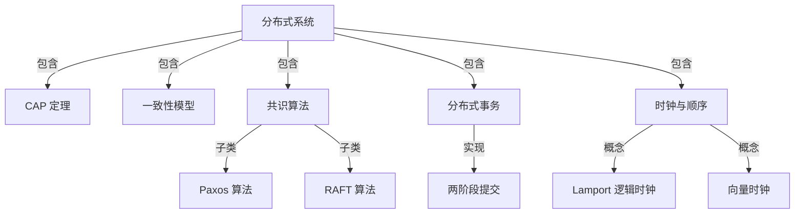
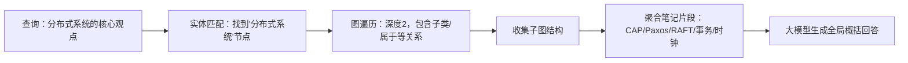
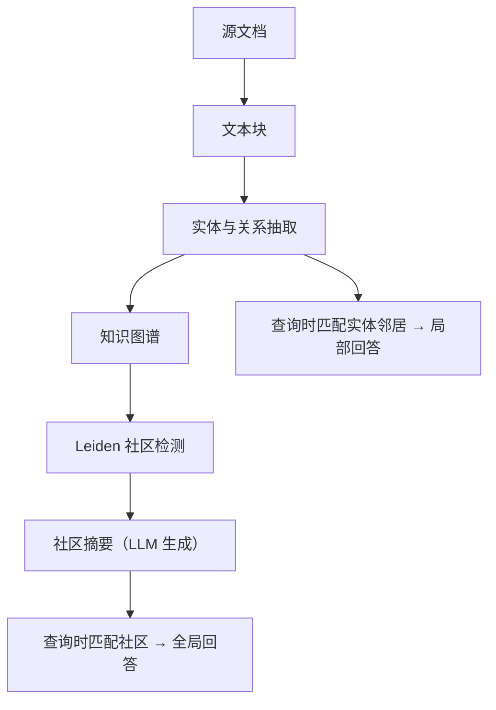
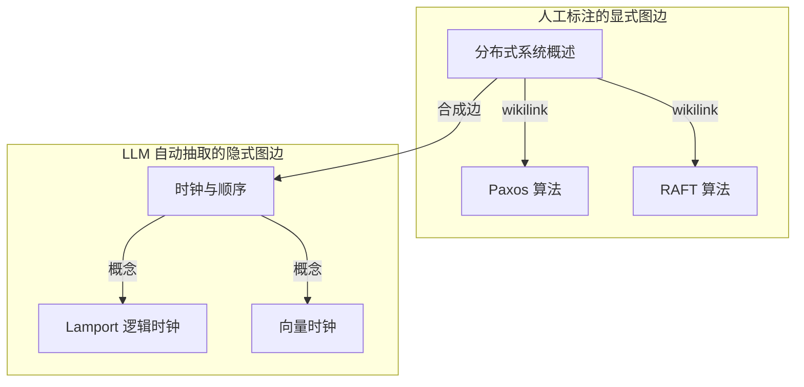

# 第 6 章 突破语义局限——基于 Obsidian 双链的 GraphRAG

> 预计学习时间：150–210 分钟  
> 一句话总结：从“全局性问题为何难倒向量检索”出发，推导 GraphRAG 的必要性与工作机制，然后在 Obsidian 中以双链为天然的显式图边，配合 LightRAG 或 Simple Graph Builder 完成本地知识图谱查询实验。

## 为什么“关于分布式系统，我都记录了什么”不是一个向量检索问题

前两章你已经搭建了一套可运行的本地 RAG 管道：笔记向量化 → 混合检索（BM25 + 稠密向量 → RRF 融合）→ 重排序 → 大模型回答。用这套管道提一个问题，比如“Paxos 算法的两阶段提交是怎么工作的？”，结果通常会令你满意——向量检索能找到包含“Paxos”“两阶段提交”“提议者”等词的笔记片段，大模型综合这些片段给出回答。

现在换一个问题：“我的知识库里关于分布式系统的所有核心观点是什么？”

你可以先试一下。打开已经配置好的本地 RAG，把这个问题提交进去。观察返回结果。常见结果是：大模型给出了一些分布式系统的概念，但明显遗漏了很多你确实记录过的内容——比如你有一篇笔记详细讨论了“分布式系统中的时钟同步问题”，还有一篇比较了“RAFT 和 Paxos 在实际系统中的取舍”，但这些都没有出现在回答里。

这不是你的向量检索管道出了 bug。这是一个更根本的问题：**这类问题本质上要求对知识库进行全局概括，而不是找到最相似的 Top-K 片段。** 向量检索的核心假设是“与查询向量最相似的片段包含答案”，这在事实性问答上很有效。但“关于 X 的所有核心观点”不是一个相似性搜索问题——它要求系统理解 X 这个概念下有哪些子话题、它们之间的关系是什么，然后从整个知识库中聚合这些分散的信息。

为了让你直观感受这个差异，我们可以在当前笔记库上做一个受控实验。假设你有以下五篇笔记：

| 笔记标题 | 内容摘要 | 双链关系 |
|---------|--------|---------|
| 分布式系统概述 | 定义、CAP 定理、一致性模型 | 链接到「Paxos 算法」「RAFT 算法」 |
| Paxos 算法 | 提议者、接受者、两阶段提交 | 被「分布式系统概述」链接 |
| RAFT 算法 | 领导者选举、日志复制、安全性 | 被「分布式系统概述」链接 |
| 分布式事务 | 2PC、3PC、TCC、Saga | 链接到「分布式系统概述」 |
| 时钟与顺序 | Lamport 逻辑时钟、向量时钟 | 未被任何笔记链接（孤立笔记） |

现在分别用向量检索和人工梳理回答“我的知识库中关于分布式系统的核心观点”。向量检索会返回与“分布式系统”语义最相似的片段——大概率是「分布式系统概述」的开头段落，加上「Paxos 算法」或「RAFT 算法」中某些段落。它不会返回「时钟与顺序」，因为这篇笔记没有显式提到“分布式系统”这四个字，即使它讨论的是分布式系统中最基础的概念之一。它也不会告诉你这些概念之间的从属和并列关系。

而人工梳理——如果一个人读完这五篇笔记——会给出这样的结构：分布式系统的基础是 CAP 定理和一致性模型；共识算法有 Paxos 和 RAFT 两个主要变体；事务处理涉及 2PC 到 Saga 的演进；时钟同步（Lamport 和向量时钟）是理解事件顺序的理论基础；其中时钟这篇是孤立笔记，可能意味着你对这个子话题的整理还不完整。

**这就是 GraphRAG 要解决的核心问题：在检索之前，先构建知识的结构化表征——知识图谱。**

## 知识图谱：把“相关”升级为“关系”

向量检索只回答一种问题：“哪些片段和查询相似？”它用余弦相似度或点积来衡量两个向量在语义空间中的距离。这是一种 **“相关”（relevance）** 判断，没有更细的语义类型区分。

知识图谱回答多种问题：“Paxos 是共识算法的一种。”“CAP 定理由 Brewer 提出。”“RAFT 和 Paxos 解决同类问题。”这三句话在向量空间中可能相似度都很高，但它们的语义角色完全不同：第一个是“属于关系”，第二个是“属性关系”，第三个是“类比关系”。

在知识图谱中，我们把这些角色显式地建模为 **实体（Entity）** 和 **关系（Relation）**。实体是现实世界或思维空间中的一个对象或概念，比如“Paxos 算法”“Leslie Lamport”“分布式共识”。关系是一个有向、有类型的边，连接两个实体，比如 `(Paxos 算法, 属于, 共识算法)` 或 `(Paxos 算法, 提出者, Leslie Lamport)`。

用 RDF 三元组（主语-谓语-宾语）的形式来表示：

```text
(Paxos 算法, 属于, 共识算法)
(共识算法, 子是, 分布式系统概念)
(分布式事务, 涉及, 一致性)
(CAP 定理, 提出者, Eric Brewer)
(两阶段提交, 实现子, 分布式事务)
```

当这些三元组组成一张图时，查询“我的知识库中关于分布式系统的核心观点”的逻辑就变了。系统不再搜索与查询最相似的文本片段，而是在图中找到“分布式系统”这个实体节点，沿着 `子是` / `属于` / `涉及` / `实现子` 等关系边遍历邻居节点，再聚合子图的结构信息。



这张图直接标注了“时钟与顺序”归属于“分布式系统”，即使该笔记的文本中没有出现“分布式系统”四个字。信息不来自字符串匹配，而来自图的拓扑结构。

### 从“相似片段”到“子图回答”：一个对比实验

为了让你切实感受到差异，我们设计一个最小可验证实验。你不需要先学会任何新工具，只需要利用第 4 章和第 5 章已经搭建好的环境，加上一小组手工构造的三元组。

**第 1 步：准备实验笔记**

在 Obsidian 仓库中新建一个文件夹 `graphrag-demo`，创建以下五篇笔记：

- `分布式系统概述.md`：包含一段 CAP 定理和一致性模型的简要说明，并在文末使用双链 `[[Paxos 算法]]` 和 `[[RAFT 算法]]`。
- `Paxos 算法.md`：包含 Paxos 的角色、两阶段流程，文末双链 `[[分布式系统概述]]`。
- `RAFT 算法.md`：包含领导者选举和日志复制，文末双链 `[[分布式系统概述]]`。
- `分布式事务.md`：包含 2PC 和 Saga 的简要说明，双链 `[[分布式系统概述]]`。
- `时钟与顺序.md`：包含 Lamport 时钟和向量时钟，**不设置任何双链**。

注意：「时钟与顺序」故意保持孤立——文本中没有出现“分布式系统”，也没有任何双链。这个设计是为了制造一个向量检索必定失败、但图谱可以补救的场景。

**第 2 步：用向量检索做查询**

使用第 5 章搭建的混合检索管道（或者直接用 Smart Connections 的对话功能），提交以下查询：

```text
我的知识库里关于分布式系统记录了哪些核心概念？
```

记录返回结果中**实际包含的笔记标题**。大概率你会看到「分布式系统概述」「Paxos 算法」「RAFT 算法」和「分布式事务」以某种形式出现。「时钟与顺序」几乎不可能出现。

**第 3 步：手工构建一个最小图谱**

在同目录下创建一个 `triplets.txt` 文件，手工写入以下三元组（每行一个）：

```text
分布式系统,包含,CAP 定理
分布式系统,包含,一致性模型
分布式系统,包含,共识算法
共识算法,子类,Paxos 算法
共识算法,子类,RAFT 算法
分布式系统,包含,分布式事务
分布式事务,实现方式,两阶段提交
分布式系统,包含,时钟同步理论
时钟同步理论,概念,Lamport 逻辑时钟
时钟同步理论,概念,向量时钟
```

这个文件仅用于教学，实际操作中实体提取由 LLM 程序化完成。现在用笔画出来：从“分布式系统”节点出发，你能通过 `包含 → 时钟同步理论 → 概念 → Lamport 逻辑时钟` 这条路径，把「时钟与顺序」检索出来。

**第 4 步：比较两种方法的覆盖**

| 方法 | 检索到的概念 | 缺漏 | 原因 |
|------|-------------|------|------|
| 纯向量检索 | CAP、Paxos、RAFT、事务 | 丢失「时钟与顺序」 | 孤立笔记没有“分布式系统”字面或语义锚点 |
| 图谱遍历 | CAP、Paxos、RAFT、事务、时钟同步 | 无（在给定三元组集合内） | 图谱显式建模了“分布式系统 → 时钟同步”的归属关系 |

这个实验的意义并不在于手工三元组比向量检索更准确——手工三元组当然更准确。它的价值在于揭示了向量检索的边界：**当笔记之间的关联存在于逻辑结构层面，而不是文本相似性层面时，向量检索做不到“理解关系”**。这正是你需要在向量 RAG 之上叠加一层图结构的原因。

## GraphRAG 的工作机制：三步把一个 Markdown 笔记库变成可推理的图

GraphRAG 不是一个特定的软件，而是一种方法论：在传统的“检索 → 生成”流程之前，增加一个“实体与关系抽取 → 图构建 → 图检索”阶段。它的标准流程可以拆解为三个步骤。

### 第一步：实体与关系抽取

给定一段文本（比如一篇 Obsidian 笔记的内容），GraphRAG 首先调用 LLM 识别文本中出现的实体和它们之间的关系。这一步通常使用一个带有明确 JSON 输出格式的提示词，要求模型从文本中提取关键实体并标注关系类型。

一个典型的抽取提示词模板如下（以英文为例，因为多数开源抽取提示词为英文，但本地模型也支持中文）：

```text
Extract entities and relationships from the following text.
Return a JSON list of objects, each with "head", "relation", and "tail" fields.

Text:
---
Paxos is a consensus algorithm proposed by Leslie Lamport. 
It ensures safety in asynchronous systems through a two-phase commit protocol. 
RAFT is an alternative to Paxos, designed for understandability.
---

Output:
[
  {"head": "Paxos", "relation": "is_a", "tail": "consensus algorithm"},
  {"head": "Paxos", "relation": "proposed_by", "tail": "Leslie Lamport"},
  {"head": "Paxos", "relation": "uses", "tail": "two-phase commit"},
  {"head": "RAFT", "relation": "is_an_alternative_to", "tail": "Paxos"},
  {"head": "RAFT", "relation": "designed_for", "tail": "understandability"}
]
```

处理时有三个常见陷阱。

**第一，实体解析（Entity Resolution）**。当同一实体在不同笔记中以不同名称出现时——比如“Leslie Lamport”“Lamport”“L. Lamport”——抽取后的图谱中会产生三个不同的节点，但它们实际指向同一个人。实体解析的任务就是把这些同义节点合并。轻量级方案可以用名称相似度 + 上下文相似度做合并判断；更严格的方案需要引入实体链接到外部知识库（如 Wikidata），但这超出了本章的范围。

**第二，关系粒度**。提示词可以让模型输出细粒度关系（`proposed_by`、`uses`、`designed_for`），但关系类型过多会导致图谱查询变得复杂。常见做法是先从一组预定义的高层关系类型（如 `belongs_to`、`depends_on`、`is_alternative_to`、`is_part_of`、`related_to`）开始，根据需求逐步扩展。不要一开始就追求几十种关系类型——维护成本会吞噬收益。

**第三，抽取质量检查**。LLM 的实体抽取不可靠，特别是对长文本、领域术语和嵌套概念。一个可复现的检查方法是：抽取出实体后，用原始文本验证每个实体和关系是否能在文本中找到支撑句。如果你使用 LightRAG 等工具，它们通常内置了这类校验。

### 第二步：图存储与索引

抽取出的三元组需要存入图数据库或图索引。对于个人笔记库的规模（通常几千到几万篇），不需要 Neo4j 这样的重量级图数据库。两种轻量级方案更适合本章场景：

- **NetworkX（Python）**：Python 的原生图库，支持有向图/无向图、图遍历、社区检测和可视化。适合实验和原型。
- **LightRAG 的内置图索引**：LightRAG 在抽取实体后自动构建图索引，支持图遍历查询，无需额外配置。
- **Simple Graph Builder（Obsidian 插件）**：直接在 Obsidian 内运行，读取本地笔记，构建图并可视化。对本章的本地实验最为友好。

对于本章的学习目标（理解 GraphRAG 原理并在本地动手验证），NetworkX 用于演示机制，Simple Graph Builder 用于快速体验，两者配合即可。

### 第三步：图检索与回答生成

当用户提交一个查询时，GraphRAG 不再直接用查询向量去检索笔记片段，而是先在图谱中找到与查询相关的实体节点和子图结构，然后将子图信息与原始文本片段结合，一起交给大模型生成回答。

具体来说，一次图检索查询包含三个子操作：

1. **实体匹配**：用查询中的关键词在图中定位起始实体节点。比如查询“分布式系统”时，先找到名为“分布式系统”的实体节点。
2. **图遍历**：从起始节点出发，按预定义的关系类型和深度遍历邻接节点。比如遍历深度为 2，关系类型包含 `belongs_to` 和 `is_part_of`，就能收集到“分布式系统 → 共识算法 → Paxos / RAFT”和“分布式系统 → 时钟同步理论 → Lamport 时钟 / 向量时钟”两条子路径。
3. **上下文聚合**：收集遍历路径上所有实体所关联的笔记片段，按图结构组织后拼接成一次 prompt，交给大模型回答。



注意：实际系统中图检索通常与向量检索并行或融合，而不是完全替代。图提供结构和关系，向量提供语义覆盖。两者互补的架构才是当前 GraphRAG 实践中效果最稳定的方案——这正是微软 GraphRAG 论文中的核心设计思路。

## 微软 GraphRAG 的理念：全局理解来自社区摘要

2024 年 7 月，微软研究院发布了 GraphRAG 论文 *From Local to Global: A Graph RAG Approach to Query-Focused Summarization*。这篇论文不只是在传统 RAG 管道前加一个实体提取步骤，而是提出了一种根本不同的全局查询策略。

传统 RAG（论文中称为“baseline RAG”）处理查询的方法是：把查询向量化 → 检索 Top-K 个最相似片段 → 拼接后生成回答。微软团队把这种方法称为 **局部检索（Local Retrieval）**，因为它只关心与查询最相似的片段，无法回答“数据集中的主要主题是什么？”这类需要全局统计的问题。

GraphRAG 的创新在于引入了一个**社区摘要（Community Summarization）**层。它的完整流程是：

1. **源文档 → 文本块**：将文档切分为适合 LLM 处理的文本块。
2. **文本块 → 实体与关系抽取**：对每个文本块调用 LLM，提取实体和关系。
3. **实体与关系 → 图聚类**：使用社区检测算法（如 Leiden 算法）将图划分为不同粒度的社区。一个社区是一组紧密关联的实体群，对应着文档中的一个主题簇。
4. **社区 → 社区摘要**：对每个社区，调用 LLM 生成一个概括性摘要，描述该社区包含的主要实体、关系和核心观点。
5. **查询时**：根据查询类型选择局部检索（匹配实体邻居）或全局检索（匹配社区摘要），生成最终回答。



**社区摘要**是 GraphRAG 全局查询能力的核心。它不依赖查询向量的相似性——它预先对整个知识库做了结构化的摘要分层。当用户问“关于分布式系统，我记录了哪些核心观点”时，系统找到与“分布式系统”相关的社区，直接返回该社区的摘要，而不是临时从 Top-K 片段拼凑。

微软开源了 GraphRAG 的实现（github.com/microsoft/graphrag），但它的目标场景是企业级文档库（数百万 token 级别），需要调用 GPT-4 级别的模型进行抽取和摘要，对个人笔记本地的资源要求过高。对于 Obsidian 用户的使用规模（几百到几千篇笔记），我们需要一种轻量级的方案。

## LightRAG：为个人知识库设计的轻量级 GraphRAG

LightRAG（github.com/HKUDS/LightRAG）是香港大学数据科学实验室开源的一个轻量级 GraphRAG 实现。它与微软 GraphRAG 共享同样的核心理念——先构建图索引，再结合图检索和向量检索生成回答——但专门为中小规模文档集做了简化。

LightRAG 与微软 GraphRAG 的关键差异：

| 维度 | 微软 GraphRAG | LightRAG |
|------|--------------|----------|
| 索引结构 | 实体图 + 社区摘要层 | 实体图 + 向量索引，无独立社区摘要 |
| 检索模式 | 局部（实体邻居）+ 全局（社区摘要） | 低（实体级）、中（邻居级）、高（主题级）三档 |
| LLM 依赖 | 需要高端模型做社区摘要 | 使用本地小模型即可完成抽取和检索 |
| 适用规模 | 百万 token 级别 | 千到万篇个人笔记 |
| 部署复杂度 | 需要 Python 环境 + 大批量 API 调用 | `pip install lightrag-hku` 即可 |

LightRAG 的索引流程是：

1. 将笔记文本分块。
2. 对每个块调用 LLM，提取实体和关系。
3. 将实体/关系的嵌入向量存入向量索引（支持本地向量数据库），同时维护图结构。
4. 不做社区检测和摘要预生成——全局性问题通过高层检索模式（遍历更多实体邻居）来回答。

这种设计使得 LightRAG 在本地 7B 模型的算力下也能运行——这也是为什么它比微软 GraphRAG 更适合个人知识库场景。代价是它的全局回答能力不如社区摘要模式精确，但配合第 5 章的混合检索管道，可以达到实用的质量水平。

对于本章，我们不会完全用 LightRAG 替代你的 RAG 管道，而是把图检索作为一个互补层加入。第 5 章的混合检索 + 重排序管道依然是精准事实查询的最佳选择；GraphRAG 层负责处理需要关系和结构推理的查询。

## Obsidian 的天然优势：双链是显式图边

到目前为止，我们讨论的 GraphRAG 都是在文本中自动抽取实体和关系——这个过程有噪声，依赖 LLM 质量，还可能出现实体解析错误。但 Obsidian 有一个其他笔记系统不具备的优势：**用户已经在手动创建图谱，用的就是双链 `[[wikilinks]]`。**

当你写 `[[Paxos 算法]]` 时，你实际上在手动声明一条图边：当前笔记指向「Paxos 算法」这篇笔记。这条边的类型是“引用/关联”，方向是从当前笔记到目标笔记。而 Obsidian 的关系图谱正是基于这些双链渲染的——在后台，这些双链被解析为有向边。

对于 GraphRAG，这意味着你的笔记库已经有一半的图谱信息是人工标注的高质量数据。你不需要让 LLM 去猜测“分布式系统概述”和“Paxos 算法”之间有没有关系——你的双链已经明确告诉系统：有。

我们来看 Obsidian 内部是如何存储这些双链信息的。打开任意一个仓库的 `.obsidian/` 文件夹，你会发现没有集中的图谱数据库文件。Obsidian 的关系图谱是实时构建的——在打开图谱视图时，它扫描所有 `.md` 文件，用正则表达式提取 `[[...]]` 模式，然后构建节点（文件）和边（双链）的图结构。它的核心逻辑可以用以下伪代码概括：

```text
graph = {}
for each markdown file in vault:
    node = file.basename
    graph[node] = []
    for each [[link]] in file.content:
        target = link.resolved_basename
        graph[node].append(Edge(from=node, to=target, type="wikilink"))
```

这意味着两件事。第一，**你的双链结构可以直接被程序化读取**，不需要依赖 Obsidian 的图谱视图。任何能读取文件系统的脚本都可以在 `.md` 文件中搜索 `[[...]]` 模式并构建图。第二，**双链边的类型是隐式的**——`[[Paxos 算法]]` 只表示“相关”，没有标注为什么会相关。这既是局限性（你不知道具体关系类型），也是优势（标注成本为零）。

### 将双链与 LLM 抽取的关系合并

最优策略是双轨并行：

- **双链作为显式图边**：精确、零成本、完全可控。覆盖用户明确感知到的关联。
- **LLM 抽取作为隐式图边**：自动发现文本中隐含的实体关系，覆盖用户没有手动加双链的关联。比如「时钟与顺序」笔记中讨论了“Lamport 时钟”，但你没有手动加 `[[Lamport 时钟]]` 双链——LLM 可以从内容中抽取出 `(时钟与顺序, describes, Lamport 逻辑时钟)` 这条边。

合并后的图谱既包括你主动建立的双链结构，也包括从文本中自动提取的隐式关系。在实际操作中，我们给双链边一个固定的关系标签 `wikilink`，给 LLM 抽取的关系使用它输出的标签。在查询时统一处理。



“合成边”是关键步骤：「时钟与顺序」这篇笔记的文本中没有“分布式系统”四个字，也没有双链指向分布式系统相关笔记，但 LLM 抽取时可能识别出 `(时钟同步, belongs_to, 分布式系统理论)` 这样的关系。通过实体的语义匹配，系统把“时钟同步”映射到笔记「时钟与顺序」，把“分布式系统理论”映射到笔记「分布式系统概述」，从而在两篇笔记之间建立一条间接的图边。

这就是 GraphRAG 与 Obsidian 双链融合的核心价值：**双链给你确定性，LLM 抽取给你覆盖率，两者互补形成一张比纯文本语义更丰富、比人工标注更完整的知识图谱。**

## 动手实践：用 Simple Graph Builder 体验 Obsidian 内的图分析

理论讲到这里，你需要一次动手实操来真正感受图谱的力量。Simple Graph Builder 是一个 Obsidian 社区插件，它能在你的笔记库内部构建知识图谱，并以交互式图形显示实体和关系的网络。与 Obsidian 自带的关系图谱（只显示仅包含笔记文件的双链图）不同，Simple Graph Builder 会读取笔记**正文中的关键词共现**来建立节点和边，因此它能发现你没有手动添加双链的隐藏关联。

### 安装与创建首个图谱

1. 打开 Obsidian → 设置（齿轮图标）→ 社区插件 → 关闭安全模式。
2. 点击“浏览”，搜索 `Simple Graph Builder`（作者：Troy）。
3. 安装并启用插件。
4. 按 `Ctrl/Cmd + P` 打开命令面板，输入 `Simple Graph Builder: Build Graph`，回车。
5. 插件会扫描当前仓库中所有 `*.md` 文件，构建全局图谱。构建完成后，右侧边栏或新面板中会显示一张交互式图谱。

首次构建时有两个问题需要留意：

- **没有出现关系连线（只有孤立的节点球）**：插件需要 `#标签` 来实现节点间的关联判断，请确保你的笔记中包含共同标签。
- **图谱过于密集无法阅读**：在插件的设置中开启过滤器功能，选择仅显示特定标签类别的节点。

### 验证双链是否被当做边

你可以在图谱中单击「分布式系统概述」节点（它会高亮显示），然后观察哪些节点通过连线与它相连。如果实验准备做得正确——你已经为 `分布式系统概述` 编写了指向 `[[Paxos 算法]]` 和 `[[RAFT 算法]]` 的双链——你应该能看到这两篇笔记作为相邻节点出现。然后找到「时钟与顺序」节点，观察它与「分布式系统概述」是否**没有**任何连线。这个节点应该是孤立漂浮的，证明你的双链缺失确实影响到了显式图的完整性。这个观察结果直接验证了此前手动测试的结论：孤立笔记在图谱中是一个可直观看出的结构空洞。

### 解读：从扁平文件到立体网络

你看到的每一个圆点都是一篇笔记，每一条连线代表它们之间的一次共同标签/关键词共现。当你旋转或缩放这幅图谱时，你所做的不再是“搜索”，而是**探索**：

- **结构感知**：哪些笔记紧密聚集在一起？那可能就是你知识库中研究最深、最成熟的主题。
- **补缺发现**：哪个应该有很多关联的主题节点，周围却空空荡荡？这就是你需要补充整理或录入新知识的地方。
- **灵感寻找**：在图谱的边缘地带，是否有两个分别属于不同知识领域的笔记被意外连接？这往往就是跨界灵感的起点。

而 Obsidian 的双链，正是你在这张网络里亲手铺设的道路。GraphRAG 的核心理念——从平面的文本相似度走向立体的结构推理——在这里变成了一种你可以在指尖旋转和点击的视觉体验。

## 用 LightRAG 在本地跑一次图增强查询

Simple Graph Builder 在 Obsidian 内部提供了图可视化和基本探索，但它不能将图结构注入到你的 RAG 查询管道中——也就是说，你没法在 Smart Connections 或 Copilot 的对话里结合图谱回答问题。要做到这一点，我们需要一个能与你的查询管道交互的图索引。LightRAG 是目前最适合个人开发者快速本地验证的选择。

### 环境准备

在终端中创建一个独立的工作目录进行测试，避免干扰你现有的笔记库：

```bash
# 创建实验目录
mkdir lightrag-lab && cd lightrag-lab

# 创建虚拟环境并激活
python -m venv .venv
source .venv/bin/activate  # Windows 用 .venv\Scripts\activate

# 安装 LightRAG
pip install lightrag-hku
```

安装完成后验证：

```bash
python -c "from lightrag import LightRAG; print('LightRAG 安装成功')"
```

### 准备测试文档

在 `lightrag-lab` 下创建 `input/` 文件夹，放入之前用过的五篇分布式系统笔记的纯文本版本。注意：这里需要将 Markdown 文件处理为纯文本，因为 LightRAG 的核心提取逻辑是基于自然语言的，即使你直接把 `.md` 文件内容丢进去，`[[双链]]` 符号也可能被当作普通字符串噪声影响提取质量。

你可以先手动把这五篇笔记的内容复制到以下五个 `.txt` 文件中：

```
input/
└── 分布式系统概述.txt
└── Paxos 算法.txt
└── RAFT 算法.txt
└── 分布式事务.txt
└── 时钟与顺序.txt
```

### 配置本地 LLM

LightRAG 需要 LLM 来完成实体抽取和回答生成。我们使用第 4 章已经配置好的 Ollama 本地服务：

```python
import asyncio
from lightrag import LightRAG, QueryParam
from lightrag.llm import ollama_model_complete, ollama_embedding
from lightrag.utils import EmbeddingFunc

WORKING_DIR = "./lightrag_index"

async def main():
    # 初始化 LightRAG，指定本地 Ollama 模型
    rag = LightRAG(
        working_dir=WORKING_DIR,
        llm_model_func=ollama_model_complete,
        llm_model_name="qwen2.5:7b",        # 使用第4章已拉取的对话模型
        embedding_func=EmbeddingFunc(
            embedding_dim=1024,
            max_token_size=8192,
            func=lambda texts: ollama_embedding(texts, embed_model="bge-m3")
        ),
    )

    # 从 input 目录插入所有文档
    import os
    for filename in os.listdir("./input"):
        if filename.endswith(".txt"):
            with open(f"./input/{filename}", "r", encoding="utf-8") as f:
                content = f.read()
                await rag.ainsert(content)
    
    print("文档已全部索引。")
```

这里使用 `qwen2.5:7b` 作为抽取和对话模型，`bge-m3` 作为嵌入模型——和第 4 章保持一致。索引完成后，`./lightrag_index/` 下会生成图存储文件。

### 执行两次查询并对比

我们设计两种查询模式，分别在 LightRAG 中执行，观察回答来源的差异。

**查询 A：精确事实查询**

```python
# 接上面代码
result = await rag.aquery(
    "Paxos 算法的两阶段提交过程是怎样的？",
    param=QueryParam(mode="local")  # 局部检索：匹配实体邻居
)
print("=== 局部检索结果 ===")
print(result)
```

**查询 B：全局概括查询**

```python
result = await rag.aquery(
    "关于分布式系统，我的知识库中包含了哪些核心主题？",
    param=QueryParam(mode="global")  # 全局检索：遍历更广的实体关系
)
print("=== 全局检索结果 ===")
print(result)
```

`mode="local"` 对应“低/中层检索”，只从与查询匹配的实体节点附近的文本中提取信息。`mode="global"` 则使用了更宽泛的图遍历，能从更多节点中提取上下文——这正是 GraphRAG 处理全局性问题的核心。你的观察重点应该放在“全局模式是否能提到时钟同步”这一项上，因为这是纯向量检索遗漏的内容。

### 将结果与前几章的管道对比

将 LightRAG 的全局模式结果，与第 5 章混合检索管道对同一查询返回的结果做对比：

| 查询类型 | 纯向量检索 | 混合检索 + 重排序 | LightRAG 图检索（全局模式） |
|---------|-----------|-----------------|---------------------------|
| Paxos 的两阶段提交细节 | 较好（能找到相关段落） | 优秀（精准匹配原文） | 良好（实体抽取可能有信息损失） |
| 分布式系统的全部核心主题 | 较差（遗漏孤立笔记和长尾主题） | 部分改善（BM25 捕获含词笔记，但仍难发现纯语义关联） | 较好（图结构捕获包含关系，不受字面匹配限制） |

你可以看到一个清晰的分工：事实性查询依然是第 5 章的混合检索 + 重排序管道更准确（因为它直接返回原始文本片段）；但全局概括性问题，GraphRAG 能利用图谱拓扑找到向量检索漏掉的知识结构。

**GraphRAG 不是替代向量检索，而是为另一类问题提供独立的能力层。**

## 多跳推理：在图谱中走两步能回答什么

让我们深入理解图检索最独特的价值：多跳推理（Multi-hop Reasoning）。一个问题需要“跳”两次才能回答时，图比向量检索更有内在优势。

### 一个需要两步推理的问题

假设有人问你：“我的知识库中，哪些算法是为了解决 Paxos 的复杂性而提出的？”

这个问题的答案（RAFT 算法）可以通过两条路径到达，但在纯文本检索中非常脆弱：

- **路径一（需要理解上下文）**：在「RAFT 算法」笔记中找到“RAFT 被设计为 Paxos 的更易理解的替代方案”这句话。但它和查询“Paxos 的复杂性”之间不存在直接的关键词重叠——查询中是“复杂性”，笔记中是“更易理解”。BM25 可能匹配不到。
- **路径二（需要跨文档推理）**：在「分布式系统概述」中找到“Paxos 因难以理解催生了 RAFT”这句总结。但如果检索只抓取某一段落，而这段落正好没提到 RAFT，召回就丢失了。

而在图谱中，这条推理路径是结构化的：

```text
查询: "为解决 Paxos 复杂性而提出的算法"
→ 匹配实体节点 "Paxos 算法"
→ 沿 "替代方案" 或 "alternative_to" 边遍历
→ 到达节点 "RAFT 算法"
→ 返回笔记「RAFT 算法」的上下文
```

只需沿着“Paxos → 替代方案 → RAFT”这条边跳一次，图谱就给出了精确答案。不需要向量相似度，也不需要文本字面匹配。

### 多跳查询的实验验证

在 LightRAG 中测试这个多跳推理：

```python
result = await rag.aquery(
    "有没有什么算法是为了解决 Paxos 太复杂的问题而设计的？",
    param=QueryParam(mode="local")
)
print(result)
```

如果你之前在用 Simple Graph Builder 测试，你也可以直观地验证这个答案来源：先在全局图谱中找到 Paxos 节点，然后观察它的邻居（连线关系）。Simple Graph Builder 支持点击节点展开其相邻笔记，这就是一次可视化的图遍历。找到 RAFT 节点后，高亮它们之间的连线，检查是否是因为笔记中使用了共同的标签或关键词而建立的隐式关联。

如果回答正确返回了 RAFT，那么你的 GraphRAG 管线已经证明了自己能够执行向量检索做不到的多跳查询。如果失败了，也不要跳过这个诊断——失败通常源于三种原因：

1. LightRAG 在抽取时没有识别出 Paxos 和 RAFT 之间的“可替代”关系。你需要检查输入文档中这段关系是否有足够明确的描述。
2. 本地 7B 模型在实体关系抽取上的能力不足。可以考虑换用 `qwen2.5:14b`，或在 API 配置中临时接入云端模型测试对比——只用对比结果来定位问题，不构成永久依赖。
3. 图遍历深度设置不够。你可以在 LightRAG 调用时将 mode 从 `local` 改为 `global` 再试一次。

**GraphRAG 的多跳能力来自于它把“推理”变成了“遍历”。** 每个关系边都是一条预编译的逻辑推理路径。当查询要求连接两个没有直接字面关联的概念时，图可以沿着路径“跳”过去，而向量检索只能在语义空间中寻找可能不存在的相似性。

## GraphRAG 的局限与适用边界

在结束本章之前，你必须清楚地知道什么时候 GraphRAG 不是正确的选择。不恰当的期待会导致失望，甚至错误地认为“GraphRAG 没有用”。

### GraphRAG 不擅长的四类场景

**第一，精确的事实跨度匹配。** 如果你要搜索“代码中 `fetch_data()` 函数的参数列表”，这是 BM25 的强项，不是图的强项。图中的实体是 LLM 抽取的摘要，不是原文的逐字备份。

**第二，新鲜信息。** 你刚写了一篇笔记，还没有重建图谱索引，那么这篇笔记在图检索中就不存在。向量索引重建通常比图索引重建快，因为图索引多了一步实体抽取。在笔记频繁更新的日常使用中，图检索的时效性天然落后于向量检索。

**第三，实体稀疏的文本。** 如果一篇笔记主要是代码块、日志输出或纯数据表格，LLM 很难从中提取有意义的实体和关系。这些笔记在图谱中可能表现为孤立节点或不准确的标签。

**第四，全局统计类查询。** 虽然 GraphRAG 的社区摘要是为全局查询设计的，但 LightRAG 没有社区摘要层——它的“全局”模式只是扩大图遍历范围，不是真正的统计聚合。如果你要问“整个知识库中出现频率最高的三个概念是什么”，图检索不如传统的词频统计直接。

### GraphRAG 与向量 RAG 是互补关系，不是替代关系

本章在多处强调了这一点，但需要在这里做一个明确的总结：

- **向量检索（含混合检索 + 重排序）适合**：事实问答、精确关键词搜索、语义相似性匹配、包含代码/表格/日志的笔记。
- **GraphRAG 适合**：关系推理、全局概括、多跳查询、探索性浏览、发现知识结构空缺。
- **两者并用的最佳实践**：将用户的查询同时发送给向量检索管道和图检索管道，各自返回结果，在 LLM 生成阶段合并上下文。这样无论是事实查询还是推理查询，都有一条最佳的检索路径。

这正是第 9 章的 Agentic 工作流要解决的问题——让系统根据查询类型自动选择或编排检索策略。在那一章之前，你现在的任务是在自己的笔记库中把两种管道都跑通，理解各自的输入输出形态。

## 章末验证实验

完成以下四个实验，用结果来检验你对 GraphRAG 机制的理解。

### 实验 1：全局性问题对比

在不修改管道配置的前提下，用同一本地模型，分别向第 5 章的混合检索管道和 LightRAG 的全局模式提问：

```text
请全面概括我的笔记库中关于“分布式系统”这个主题记录了什么。
```

记录两个回答中**共同提到的笔记**和**各自缺失的笔记**。如果 LightRAG 额外提到了某个纯向量检索遗漏的、且确实相关的笔记，找出它在你的知识图谱中的连接路径（即它是通过哪些实体/关系边与“分布式系统”关联的）。

### 实验 2：双链弥补

回到 Obsidian，在「时钟与顺序」笔记中添加双链 `[[分布式系统概述]]`。等待或强制 Simple Graph Builder 重新索引。再次在 Simple Graph Builder 中打开图谱，观察「时钟与顺序」节点是否现在连接到了主簇。

解释：为什么加一条双链就改变了图拓扑？这个操作在图谱层面完成了什么向量检索无法完成的事情？

### 实验 3：多跳查询设计

自己设计一个至少需要两步推理的查询（参考：“我的知识库中，哪些理论是理解分布式一致性的前置知识？”）。先在向量检索管道中测试，再在 LightRAG 中测试。描述两个系统回答的差异，并用你知识库中的真实笔记来验证哪一边的答案更完整。

### 实验 4：识别边界

在你自己的笔记库中找出三类笔记：
- 一篇在图谱中连接丰富的笔记（中心节点）。
- 一篇完全没有双链和被引的孤立笔记。
- 一篇内容主要是代码块/表格/日志的笔记。

分别说明这三类笔记在 GraphRAG 的图索引中会如何被处理，它们的实体抽取质量可能如何，在什么类型的查询下它们会被检索到、什么类型下不会被检索到。

完成四个实验后，你应该能够自己回答：给定一个新的查询类型，应该优先使用向量检索还是图检索，以及为什么。

## 本章小结

本章从“为什么向量检索无法回答全局性问题”出发，引入了知识图谱作为信息检索的另一种表征方式。知识图谱用实体和关系替代了“相似性”这一单一维度，使得系统能够回答需要结构推理和多跳连接的查询。

GraphRAG 的核心方法是在检索之前构建图索引：通过 LLM 从文本中抽取实体和关系，存储为图结构，查询时通过图遍历收集相关上下文。微软 GraphRAG 论文进一步提出了社区摘要层，通过 Leiden 聚类生成全局主题摘要，使得全局查询不需要实时遍历整个图。LightRAG 则提供了一个更适合个人笔记库规模的轻量级实现，可以不依赖高端模型在本地运行。

Obsidian 的独特优势在于它的双链系统——每一个 `[[wikilinks]]` 都是一条用户手动标注的图边。将这些显式边与 LLM 自动抽取的隐式边合并，就得到了一张兼具确定性和覆盖度的知识图谱。Simple Graph Builder 插件让你在 Obsidian 内部直接体验和探索这张图谱的结构，LightRAG 则让你将图检索能力整合到 RAG 管道中。

GraphRAG 擅长关系推理、全局概括、多跳查询和知识结构发现；向量检索擅长事实匹配、关键词搜索和语义相似性。两者是互补关系，不是替代关系。在实际系统中并行的双管道——图检索和向量检索各司其职——是当前的最佳实践。

第 7 章将把本章构建的图谱和双链数据作为素材，安装 3D 关系图谱插件，让整个知识网络在三维空间中旋转呈现。你亲手铺设的这些节点和边，将在立体空间中展示出新的结构和灵感。

## 参考文献

- Microsoft Research. *GraphRAG: A Modular Graph-Based Retrieval-Augmented Generation System*. https://www.microsoft.com/en-us/research/project/graphrag/. 访问于 2025-07-10。
- Microsoft GraphRAG GitHub Repository. https://github.com/microsoft/graphrag. 访问于 2025-07-10。
- HKUDS. *LightRAG: Simple and Fast Retrieval-Augmented Generation*. https://github.com/HKUDS/LightRAG. 访问于 2025-07-10。
- Obsidian Developer Documentation. *Home - Developer Documentation*. https://docs.obsidian.md/Home. 访问于 2025-07-10。
- Obsidian Community. *Simple Graph Builder Plugin*. 在 Obsidian 社区插件市场中搜索查阅。访问于 2025-07-10。
- Troy. obsidian-simple-graph-builder. GitHub 仓库。访问于 2025-07-10。


---

# 第 7 章 Obsidian 3D 视觉化——关系图谱与进阶效果

> 预计学习时间：约 60–90 分钟（含安装、配置与自由探索）  
> 一句话总结：你将在 Obsidian 中通过 3D Graph 插件，把第 6 章构建的双链知识图谱变成一个可旋转、缩放、点选的三维空间，并学会用立体视角发现笔记群落、隐藏关联和知识缺口。

## 把平面图谱变成立体世界——你能看到什么？

先看对比：左边是 Obsidian 默认的平面关系图谱，笔记散落，连线像密集的地铁图，主次难辨。右边是安装 3D 插件后的效果：同一批笔记被投射到可旋转的三维空间，笔记聚成星团，孤立节点漂在边缘。转动视角时，一条平面中被遮挡的连线可能从深处浮现，连接起原本无关的两篇笔记。

> 图示说明：2Dvs3D（外部图像地址见本章参考文献）

本章结束后，你可以对着笔记本的 3D 图谱完成三件事：

1. 用鼠标或触控板旋转、缩放、拖拽，像探索微型宇宙一样在笔记节点间漫游。
2. 通过为不同文件夹、标签或笔记群设置颜色，立刻区分“技术笔记”“读书笔记”“项目笔记”等知识群落。
3. 锁定一个“桥梁节点”——它连接了两个在平面图谱中似乎毫不相关的主题群落，你双击它，直接在 Obsidian 中打开这篇笔记，完成一次关于知识关联的创意发现。

完成这三件事，Obsidian 就多了一个立体的知识探索视图。下面我们一步步安装插件。

## 我们需要什么工具？先认识一下两个新面孔

要让平面图谱站起来，需要两个角色的协作：

- **Obsidian 2D Graph**：你已经在用的 Obsidian 内置视图。它用 Canvas 或 SVG 渲染节点和连线，支持拖拽和搜索，但永远只在 XY 平面上排布。把它看作知识网络的“建筑蓝图”——精确、可编辑，但缺少高度和深度。
- **3D Graph 插件**：我们本章安装的核心。它基于 WebGL 图形库在 GPU 上高速渲染三维场景，把相同的关系图谱投射到立体空间，增加 Z 轴。你可以把它理解为在蓝图基础上，用乐高搭出了大楼的实体模型——绕着走可以看到不同侧面，甚至能发现设计时没预料到的空间联系。

3D 图谱不会取代 2D 图谱。工作规划、快速查找链接时用 2D 界面更高效；当你想停下日常写作、换个角度审视知识库结构、寻找创意关联时，切入 3D 视图。**前者是放大镜，后者是望远镜**。

### 最小前置：确认你的知识库可以生成 3D 图谱

本章的动手环节直接依赖你已有的笔记库。下列四项如果有一项不满足，请先花 5 分钟完成补救再继续，否则 3D 图谱打开后可能只剩一个光秃秃的黑色空间。

1. 你有至少 10 篇笔记，并且彼此之间存在 `[[双向链接]]`。  
   **自检方式**：按 `Ctrl/Cmd + G` 打开 Obsidian 内置的关系图谱（Graph View），确认能看到成团的节点和相互交织的连线。如果图谱里只有几个孤立的圆点，说明双链还不够丰富。

2. 你能够流畅地在 Obsidian 中新建笔记、在正文中键入 `[[` 并选择另一篇笔记，从而创建一条链接。第 6 章已经详细练习过，如果还不熟练，现在就新建一个空白笔记，键入 `[[GraphRAG 原理]]` 试试看。

3. 你理解 Obsidian 社区插件的基本安装流程：进入 Settings → Community plugins → Browse，搜索插件名，点击 Install，然后 Enable。如果你在第 4 章已经安装并启用了 Smart Connections，这一套操作对你来说轻车熟路。

4. 你的笔记库没有因为过于庞大而在 2D 图谱中已经卡顿（例如超过 3000 篇同时展示）。3D 图谱基于 GPU，但也建议用过滤功能控制显示范围。如果你此刻的 2D 图谱已经卡到无法操作，先在 Graph View 的过滤器里隐藏部分文件夹，再去安装 3D 插件。

**如果第 1 项不通过：快速播种一批双链笔记**  
在 Obsidian 中创建一个临时文件夹 `3D-seeds`，按顺序新建下面 6 篇笔记，并在正文中按提示键入双链。每篇笔记只写一两句话，重点是建立链接。完成后打开 Graph View 确认链接出现。

- `人工智能.md`：正文写“人工智能是一个宏大领域”，并键入 `[[机器学习]]`、`[[深度学习]]`。
- `机器学习.md`：正文写“机器学习是实现人工智能的主要方法”，键入 `[[人工智能]]`、`[[监督学习]]`。
- `深度学习.md`：正文写“深度学习是机器学习的一个分支”，键入 `[[机器学习]]`、`[[神经网络]]`。
- `监督学习.md`：正文写“监督学习需要标注数据”，键入 `[[机器学习]]`。
- `神经网络.md`：正文写“神经网络受生物大脑启发”，键入 `[[深度学习]]`。
- `项目-笔记系统.md`：正文写“用知识图谱管理学习笔记”，键入 `[[人工智能]]`、`[[机器学习]]`（交叉连接不同主题，形成桥梁）。

这份种子库会在你的 3D 图谱中形成一组可辨识的技术类节点群，以及一条通往项目的连线。后续你可以随时删除这个文件夹。

## 安装前的 5 秒核验

正式下载插件前，先确认你的起点满足要求。打开 Obsidian 的“关于”面板（`Settings → General → About`），核对以下三项：

- **Obsidian 版本 ≥ 1.5.0**：3D 插件依赖该版本引入的较新的渲染支持。版本号低于此的，先到 Obsidian 官网（见本章参考文献） 下载最新安装包覆盖安装。
- **已开启社区插件模式**：在 `Settings → Community plugins` 中确认“Safe mode”处于关闭状态。如果提示安全模式保护，点“Turn off Safe Mode”即可。
- **关系图谱已有可见节点与连线**：先按 `Ctrl/Cmd + G` 打开 Graph View 确认可以看到笔记之间的连接；如果是完全空白的图谱，请先回到第 6 章建立至少 10 篇含双链的笔记节点。

如果三项全部绿灯，我们直接进入安装。**注意**：本章插件操作均在安全本地环境进行，数据不会上传到任何服务器；3D 图的数据来源仍是你电脑上的 `.md` 文件，插件只是提供新的渲染方式。

## 安装核心插件：3D Graph

### 第一步：在社区插件库中找到并安装

1. 打开 Obsidian 设置（`Settings → Community plugins`），点击 **Browse** 按钮进入社区插件列表。
2. 在搜索框中输入 `3D Graph`。你应该看到一个名为 **3D Graph**、作者为 **Apoo711** 的插件条目。目前最新稳定版本为 **1.0.5**，与本课程兼容。
3. 点击该条目，再点击 **Install**，等待安装完成（约 2–5 秒，取决于网络）。完成后“Install”按钮会变为“Enable”。
4. 点击 **Enable** 启用插件。

**可观察结果**：启用后，Obsidian 左侧功能区的 Ribbon 区（就是属性和搜索图标所在的那一列竖条）会多出一个立方体模样的新图标，鼠标悬停时提示 “3D Graph”。如果没有看到，按 `Ctrl/Cmd + P` 打开命令面板，输入 `3D Graph: Open 3D Graph` 并回车——如果能出现命令，说明插件已安装但图标被隐藏；如果搜不到命令，则安装未成功，回头检查 Community plugins 列表中 3D Graph 是否处于“Enabled”状态。

### 第二步：打开你的第一张 3D 图谱

点击 Ribbon 中的立方体图标，或通过命令面板执行 `3D Graph: Open 3D Graph`。Obsidian 将在当前工作区右侧或下侧打开一个新的视图面板——**你的 3D 图谱诞生了**。

初次打开时渲染可能需 2–5 秒，取决于笔记数量（100 篇以下瞬间完成，500 篇以上建议等几秒让节点布局稳定）。此时你看到的应该是一个深色背景上悬浮的立体节点网络，节点用半透明小球表示，连线用细线表示。如果屏幕一片空白，先检查你的笔记库是否确实有笔记且它们之间存在双链——笔记库中若多是孤立笔记，图中节点会零散分布，连线也会很稀疏。

> **反例警示**：如果你看到的是全黑背景上一个孤零零的中心点，没有任何连线，那意味着目前库中要么只有一篇笔记，要么所有笔记都尚未包含 `[[Wikilinks]]`。Obsidian 的内置图谱也一样会空荡荡。不要误以为插件坏了——回到前面的“最小前置”部分快速播种几篇双链笔记，再刷新图谱。

## 学会探索你的立体知识宇宙——基础交互

先别急着调参数。用一分钟掌握六个动作，把 3D 图谱当成一个可以用手势操控的视图：

| 动作 | 效果 | 可观察结果 |
| --- | --- | --- |
| 鼠标左键拖拽背景 | 旋转整张图谱的空间朝向 | 节点群围绕中心点如星体般转动；注意边缘节点在旋转时会沿更大半径划过屏幕边缘 |
| 鼠标滚轮滚动 | 缩进/拉远视野 | 向前滚：节点放大，看到少量节点的局部细节；向后滚：退至远处，笔记群落缩小为一个星团，连线的宏观布局浮现 |
| 鼠标右键拖拽 | 在不旋转的前提下平移视野 | 类似用手指在地图上拖动，视角不变但“相机”沿 XY 方向滑动 |
| 单机某一节点 | 选中节点，面板顶部显示笔记标题 | 节点高亮，标题出现在图谱上方横条；如果节点对应笔记同时打开预览窗，可确认它是哪篇笔记 |
| 双击某一节点 | 在 Obsidian 中立即打开该笔记 | Obsidian 自动跳转至该 `.md` 文件；3D 视图不关闭 |
| 长按某节点拖拽 | 手动重新摆布该节点在三维空间中的位置 | 节点会随鼠标移动到新位置，方便你以自定义布局观察局部关系 |

**试一下**：打开 3D 图谱后，缓慢滚轮退远，直到能看到几乎所有节点的分布轮廓；然后随意点选一个看起来处在“桥梁”位置（同时连接了多个不同颜色/群落的节点）的笔记，双击它，检查内容。如果它的确在谈论一个跨界主题（比如你的一篇名为“如何用编程思维写文章”的笔记，同时链接了技术笔记和写作笔记），那么这表示你找到了 3D 图谱的第一个实用价值：**桥梁笔记发现**。

### 交互中的边界行为

- 当你把镜头缩放到极端近处（滚轮一直向前），节点会充满整个视野甚至穿出相机后方，导致画面突然空白或出现巨大的多边形碎片，这是 Three.js 的“近裁剪面”效应。此时不急，往后滚轮退远即可恢复。
- 如果你双击一个节点却没有任何反应，请先检查 Obsidian 是否被其他弹出窗口遮挡了跳转动作。偶尔一些键盘快捷键插件会拦截鼠标事件，这时可以改为右键节点，从菜单中选择“Open in New Tab”来打开笔记。

## 为你的知识群落着色——颜色映射配置

要想一眼区分笔记类别，你需要为不同笔记分配不同颜色。默认情况下所有节点是同一个色。现在进入 Settings → Community plugins → 3D Graph 插件，找到 **Color Groups** 配置区。

### 一个最小有效的配置：按文件夹/路径分组

假设你的笔记库结构如下：

```text
Vault/
├── 1-技术/
│   └── RAG学习.md
│   └── GraphRAG原理.md
├── 2-读书/
│   └── 思考快与慢.md
├── 3-项目/
│   └── 课程笔记-第7章.md
```

你可以新增这样三条分组规则：

1. 找到 `Color Groups` 中 `Add Color Group` 按钮。
2. 第一组：`Query` 填入 `path: 1-技术`，`Color` 选择一个科技感蓝色（`#3b82f6`）。
3. 第二组：`Query` 填入 `path: 2-读书`，`Color` 选暖橙色（`#f97316`）。
4. 第三组：`Query` 填入 `path: 3-项目`，`Color` 选绿色（`#22c55e`）。

**Query 字段支持 Obsidian 搜索语法**，包括按路径 `path:`、按标签 `tag:`、按文件名 `file:` 等。保存设置后，重新打开 3D 图谱或刷新视图（关闭后再打开面板，或命令面板执行 `3D Graph: Refresh`）。节点现在应该按文件夹分色，每一个颜色代表一个知识群落。

**可观察判断标准**：技术笔记节点为蓝色，读书笔记节点为橙色，项目笔记节点为绿色。如果某个笔记不在任何规则内，它会保留默认颜色（一般为灰色），这恰好让你一眼识别缺少分类的“流浪笔记”。

### 常见着色反例：query 误写导致颜色消失

不少第一次配置颜色分组的学习者会碰到“明明填了 query，节点仍是灰色”的情况。以下是三个典型错误与纠正方法，你把它们当作快速排查清单即可：

| 错误写法 | 后果 | 为什么？ | 正确写法 |
| --- | --- | --- | --- |
| `path:1-技术`（缺少空格） | 规则不生效，节点无颜色 | Obsidian 搜索语法要求 `path:` 后跟一个空格，再写路径片段 | `path: 1-技术` |
| `path: 1-技术/`（末尾带斜杠） | 匹配不到任何文件夹 | 文件夹名称中通常不包含 `/`，除非整个路径带有子文件夹 | `path: 1-技术` 或 `path: 1-技术/RAG` |
| `Path: 1-技术`（大写 P） | 不生效 | 搜索关键词区分大小写，`path` 必须全小写 | `path: 1-技术` |

另外注意：规则顺序从上到下匹配。如果你把最宽泛的 `path: 1` 放在第一行，它会吞掉所有以“1”开头的路径，后面更细的规则（如 `path: 1-技术`）就再也没机会生效了。始终把最具体的查询放在顶部。

### 进阶：用标签着色加一层热度标记

如果你在第 2 章中为笔记 YAML 前置信息设计了 `status` 或 `type` 字段，可以通过 `tag:` 语法进一步区分，例如把“待整理”标签的笔记设为浅灰绿色以提醒自己。这里举一个针对标签的查询：`tag:#review-needed`。将此规则的颜色设为低饱和度黄绿色，并把该规则**拖拽到规则列表的最上方**，因为插件从上到下匹配，第一条命中的规则决定颜色。这样那些需要审阅的笔记即使在技术群落里也会以特定颜色标识出来。

完成分组后，你可能第一次看清你的知识库长什么样——哪些区域星团密集，哪些区域稀疏，中间有没有横跨多个群落的“星桥”。

## 调一调，让图谱更好看也更好用——参数手册

插件提供一系列调整参数，都在插件设置面板中。下表按用途分组，只列出你真正需要改动的，其他保持默认即可。

### 力导向布局参数

| 参数 | 默认值 | 作用 | 何时调整 | 可观察效果 |
| --- | --- | --- | --- | --- |
| `Link Distance` | 100 | 设定有直接双链的笔记节点之间的理想间距 | 新闻网过多、图谱看起来像一捆乱麻时，增加此值以拉伸连线；若节点太分散且相关笔记相隔很远，减小以收紧群组 | 增大后相互链接的笔记在空间中拉开，清晰显示链接结构；减小后链接紧密的节点聚合成密集簇 |
| `Link Strength` | 1 | 连接力的强度，影响布局算法拉拢节点的力道 | 希望更弱链接的节点容易漂远可以降低值；如果连接过于松散可以增加力让相关笔记靠得更近 | 从 1 调至 0.2 后一些弱关联的笔记离中心更远，浮现出几个感知上联系并不牢固的合作关系 |
| `Center Strength` | 0 | 把节点拉向图谱中心的力 | 设为 0 时完全不拉拢，图谱呈自然展开；增加可以让节点按线性程度往中心聚拢，适合整体观察 | 设为 0.5 后边缘孤立笔记会整体向视野中心收缩，在宏观视图下不易丢失于视野之外 |
| `Charge Force` | -300 | 节点之间的斥力；负数越大排斥越强，节点更趋均匀分布 | 节点太挤时减小此值的绝对值（比如改成 -150）；节点太散、间距过大时增大绝对值 | -600 会让所有节点彼此推远，面积更大； -50 则节点趋近，小群落更显密集 |

### 视觉效果参数

| 参数 | 默认值 | 作用 | 何时调整 | 可观察效果 |
| --- | --- | --- | --- | --- |
| `Node Scale` | 1 | 所有节点统一缩放因子 | 笔记多的库可能希望整体节点更小，设为 0.6–0.8 让视野容纳更多节点；重点探索某几个笔记时放大 | 设为 2 后每个球变得醒目但重叠更严重；设为 0.5 后细节变模糊但整体结构更清晰 |
| `Show Tags on Nodes` | Off | 节点上是否显示标签小徽章 | 当你在颜色方案中已按标签分组时可关闭；好奇某一节点标签时临时打开 | 开启后每个节点球上方会出现小文本标签，方便识别 |
| `Node Resolution` | 16 | 节点球体的几何细分，数值越高球体越圆滑 | 低性能集显设备可降至 8，肉眼仍可辨认为球体 | 把它临时调至 4，你能看到节点呈明显的多面体，说明渲染更省资源但看起来粗糙 |
| `Link Opacity` | 0.3 | 连线的透明度 | 连线少时可提高至 0.6 让它显眼；连线很多时可降至 0.15 减少杂乱感 | 降到 0.1 后多数连线若隐若现，只余下连接特别强或特别亮的部分 |

实操建议：**先只改 `Link Distance` 和 `Charge Force` 两项**，重新打开图谱观察改变，力度一次不要超过 ±50%。如果改后图谱变形过了头，点插件设置底部的 `Restore Defaults` 按钮即可复原。

### 小心这三个参数陷阱

有些参数组合会让 3D 图谱变成一团乱麻或者炸散的光点，它们本身不是 bug，但容易让你误以为插件坏了。读完这段你会知道哪些旋钮不能一下拧到底。

1. **`Link Distance` 设为 10 以下**：所有节点会紧密吸附在一起，形成一颗几乎不可分辨的“粒子球”。这在刻意强调整体群落密度时可以一用，但不适合日常探索。如果你发现自己图谱突然变成一颗小团子，先检查这个值。

2. **`Charge Force` 设为正值（如 +300）**：默认是负值，提供排斥。改成正数后节点不再互斥，反而彼此吸引，整体会坍缩成一个极小的核心区域，连接线也不再舒展。这个设置通常没有实用价值，仅用于理解斥力的物理表现。如果不小心手滑，改回 -300 就恢复了。

3. **`Link Strength` 与 `Charge Force` 同时极端化**：例如 `Link Strength = 0` 且 `Charge Force = -1200`，图谱会完全被斥力支配，所有节点猛地弹开，飘浮在视野极边缘，连线细得几乎看不见。这倒是一个观察纯粹排斥布局的有趣现象——你可以在片刻后恢复默认，这让你深刻体会“力导向”这个词的意思。

这三个陷阱演示了一件事：默认值不是随意选的，它在视觉辨识度和自动布局之间取得了平衡。任何大幅偏离都应有明确目的（比如专门展示某一笔记群的内部结构），否则保持原位即可。

### 与 Obsidian 主题协作

这个插件会自动采用你的 Obsidian 主题的强调色和暗色/亮色背景。但某些深色主题可能使连线几乎看不见，此时在参数中稍微上调 `Link Opacity` 或在主题设置中切换背景色亮度即可。如果你使用自定义 CSS 片段，需要注意的是 3D 图谱节点背景和文本色由主题变量 `--background-primary` 和 `--text-normal` 决定，所以不要在这些变量上做极端反差，否则 3D 视图可能变为“全白背景”。

**主题反例**：如果你安装了一个将 `--background-primary` 设定为纯白、`--text-normal` 设为浅灰的高对比主题，则 3D 图谱背景会变成晃眼的白色，浅灰色节点标签可能无法辨认。此时有两个选择：换回 Obsidian 默认暗色主题；或者在设置中将 `Link Opacity` 提高、并给节点分配合适的强色，以在高亮背景中维持可见度。

## 你的立体实验室——三个发现型小任务

现在你手上有了一把新的立体透镜。放下参数表，用下面三个任务体验它真正怎么帮你发现知识结构。

### 任务一：找出“星桥”——连接两个群落的跨界笔记

1. 颜色分组按前一小节配置为蓝（技术）、橙（读书）、绿（项目）。
2. 从远处观察图谱，找一找有没有节点同时连接了蓝色和橙色两个星系。
3. 临到近处，用鼠标左键选中其中一个这样的桥梁，确认笔记标题。
4. 双击打开笔记，检查内容里是否真的论述了技术与读书的关系。

**观察与标准**：如果你找不到这样的桥接节点，这本身就是一个发现——说明你的技术笔记和读书笔记可能缺乏交叉引用，此时考虑在你觉得有交叉点的两篇笔记中补一条 `[[双向链接]]`，再刷新 3D 图谱，观察图谱结构的改变。

**反馈思考**：找到一个星桥后，问自己——这篇笔记是刻意写来连接两个领域的，还是无意中成了桥梁？如果你的笔记中桥梁笔记数量少，是因为不同主题间确实缺少交叉灵感，还是你还没有来得及写下它们？这个自我提问会让你决定下一步的写作方向。

### 任务二：定位知识缺口——看到星团间的黑暗地带

1. 缩小图谱直到能看到全部节点的分布，注意颜色区块的边界。
2. 找到两簇大星系之间典型的“空白区域”——没有节点，没有连线，甚至没有任何灰色流浪笔记的区域。
3. 点开其中一个星系的任意笔记，检查它是否有可能连接到另一星系的主题而未连接。

**观察与标准**：比如你的“读书”星系全是关于思维模型的笔记，而“技术”星系有关于“用 AI 辅助决策”的笔记——它们之间却是空白。这是因为你没有写任何连接这两者的笔记。写一篇新笔记，标题为“《思考快与慢》中的双系统理论与 AI 推理的相似性”，并在文中主动链接到两边的笔记。保存后刷新 3D 图谱，你应该能从立体视角看到一个新节点出现在空白区域，连接了两端。

**反馈思考**：黑暗地带不一定是错误，它可能代表两个确无关联的领域。但当两个几乎“应该”有跨界的领域中间完全空白时，这往往能为你指出一些值得探索的新笔记主题。试着记录你发现的空白区，当作写作灵感池。

### 任务三：为孤立笔记找到家——收容流浪星体

1. 缩小视野，专门寻找远离任何大星群的、颜色为默认灰色的孤立节点。
2. 双击点进其中之一，检查它是关于什么主题的。
3. 思考它是否已经有潜在归属，如果是，就给那篇笔记增加文中链接或标签来将它吸附到相应星系。如果没有，保持现状并考虑它是否在未来需要单独培育为一个新星系。

**观察与标准**：做完后刷新 3D 图谱，确认被链接的节点是否向归属星系靠拢。现在你正在主动“管理知识星图”而不是被动接收 Obsidian 的默认图谱。

## 渲染原理速写——节点怎么“飞到”三维位置

插件本身用 **Three.js** 库，通过 WebGL 直接在 GPU 上用顶点和着色器画球体和线条。你的笔记、标签和链接先被 Obsidian Graph 引擎梳理成邻接列表——也就是一个庞大的“节点关系表”——然后插件将这个表传递给一个力导向布局算法，在三维坐标系中迭代求解每个节点的 XYZ 最佳位置。

这个力导向算法在三维空间同时计算以下力：

- **弹簧吸引力**：有双链的两点之间互拉，距离越远力越大。
- **库仑斥力**：任意两点都会推开对方，避免所有节点重叠。
- **中心拉力**（可选）：刚才参数中的 `Center Strength`，一个轻拉力把所有节点稍稍向原点拉回，防止它们炸散。

算法会迭代几十到上百次，每次微调节点位置，直到整体能量（称为“系统稳定度”）降到阈值以下。这就是为什么初次打开 3D 图谱时，节点会在前几秒短暂跳跃——那是它们在逐轮“寻找自己的舒适位置”。

你不需要记住这段原理细节，但尝试在 `Link Strength` 极度设为 0（取消吸引力）和 `Charge Force` 极度设到 -2000 之后打开图谱，观察节点之间近乎没有任何弹簧连接而完全被斥力推到视野边缘——这有助于你体会“力”在三维空间里的工作效果。

### 亲手制造一次“力的大爆炸”

如果文字描述还不够直观，花 3 分钟做一个小实验。它不会破坏你的笔记数据，仅仅是让力导向布局的物理过程变得可见。

1. 进入插件设置，将 `Link Strength` 设置为 **0**，`Charge Force` 设置为 **-2000**，`Center Strength` 保持 **0**。
2. 关闭旧图谱面板，重新打开 `3D Graph`。此时你会看到节点在最初几秒剧烈向外弹射，然后几乎静止在遥远的位置，连线仅有弱痕。这就是纯粹的库仑斥力统治下的宇宙。
3. 立即将 `Charge Force` 改回 **-300**，`Link Strength` 改回 **1**，再次刷新图谱——节点被吸引力拉回，彼此收束成有结构的星团。
4. 最后，把 `Center Strength` 设为 **2**，刷新图谱：所有节点会向中心回缩，形成紧凑的星系核。此时你看到的不是默认的自然分布，而是被人为聚拢的形态。

通过这三个阶段，你亲眼看到了同批笔记如何在不同力学参数下变化形态。这对理解后续章节中利用图谱发现结构很有帮助——你会知道“星团稀疏”或“节点挤作一团”究竟是数据特性的体现，还是自己参数调过了头。

## 常见杂症与排查

### 1. 3D 图谱打开后一片黑

**收集证据**：检查 Ribbon 图标能不能点击，命令面板有 3D Graph 命令却没有弹出新面板。从 `Settings → Community plugins → 3D Graph` 确认插件是否 Enabled。

**排查**：若未启用，启用后重新打开。若仍黑屏，尝试把 Obsidian 窗口的硬件加速选项关闭/开启一次（`Settings → Appearance → Hardware acceleration`）并重启 Obsidian。集成显卡用户遇到黑屏的概率稍高，这通常因为 WebGL 未暴露。在终端执行（任何终端） `chrome://gpu` 无法在 Obsidian 内访问，但一个简单的旁证是打开任何支持 WebGL 的在线 3D 演示（如 ShaderToy 首页），如果它们也无法渲染，说明是显卡驱动需要更新；如果演示能渲染而 Obsidian 内黑屏，则在 `Settings → Appearance → Hardware acceleration` 中关闭再打开该选项，给 Obsidian 一个干净的 GPU 分配。

### 2. 图谱里无节点或仅有几条线

**证据**：已安装、已启用、视图也打开了，但只有少数节点。到 Obsidian 原生 Graph View 检查：如果在那里也同样冷清，说明笔记间缺少 `[[Wikilinks]]`。回到第 6 章教程，主动创建一些双向引用。

### 3. 颜色分组不生效

**证据**：设定好了 `Query` 和颜色，重新刷新图谱，节点仍是默认色。先检查 Query 语法——`path:` 后跟的具体文件夹名不能有错，且区分大小写。其次确认这条规则的顺序：记住规则是从上到下执行，当第一条有命中节点时就不再匹配后面的。在 Color Groups 中把最具体的规则拖到顶部。

### 4. 3D 图旋转时帧率卡顿

**现象**：旋转、缩放动作不连贯，有跳帧现象。降低效果压力：在插件设置中暂时关闭 `Show Node Labels`，将 `Node Resolution` 降至 10，减少同时显示节点数（关闭全局滤器，只显示当前打开注释的子图）。卡顿也常见于同时打开了多个 Obdisian 复杂插件，已占用大量 GPU 带宽。

### 5. 超大知识库的边界处理

当你的笔记数量超过 2000 篇，即使 GPU 强劲，3D 图谱的初始布局也会变慢，因为力导向算法的点对点斥力计算量随节点平方增长。一个实用的边界策略是：在 3D Graph 插件设置中启用 **Filter by open file** 选项（如果插件提供），仅显示与当前活动笔记直接或间接关联的子图。或者，在 Obsidian 原生的 Graph View 中先用过滤功能选定你想探索的文件夹，然后关闭旧 3D 图谱面板，重新打开——部分版本的插件会沿用最后一次 Graph View 的过滤器范围。如果你希望进行宏观俯瞰但节点过多，临时隐藏笔记量最大的文件夹组，将 3D 图谱作为全局结构的阶段性抽样工具，而不是 24 小时常驻视图。

## 本章验收记录

| 核验项 | 你的结果 |
| --- | --- |
| Ribbon 中可见 3D Graph 立方体图标 | 是 / 待排查 |
| 打开 3D 图谱视图后可见多个节点与连线 | 是 / 待排查 |
| 颜色分组至少按路径将两个文件夹标为不同颜色 | 是 / 未配置 |
| 至少手动拖拽或旋转 3D 图谱且节点跟随视角变化 | 是 / 待排查 |
| 完成“星桥”“知识缺口”“流浪笔记”三个探索练习至少一个 | 是 / 待尝试 |
| 3D 图谱在缩放全程无长时间黑屏 | 是 / 待排查 |

全部“是”后，再继续下一步。此刻你已经拥有一个立体的知识空间——平面图谱给了你精确的笔记管理界面，而 3D 图谱给了你探索结构和发现新颖关联的入口。这些能力在你学习第 8 章、通过 MCP 把知识图谱暴露给外部工具时，会提供直观的交互基础。接下来你可以在 3D 图谱中自由探索；三维视角下的偶然发现，可能就是你下一篇笔记的起点。

## 快速自测

完成以下五道思考题，检验你对 3D 图谱的理解是否停留在“会旋转”层面。答案不要求逐字精确，但要点应能说清。

1. 如果你的 3D 图谱中所有节点挤成了一颗小球，最可能是什么参数出了问题？应该怎样恢复？
2. 为什么 3D 图谱能够发现平面图谱中容易被忽视的跨界关联？这与 Z 轴的存在有什么关系？
3. 你为三个文件夹设置了蓝、橙、绿三种颜色，但其中属于“2-读书”的笔记仍显示为灰色。列举两种最可能的原因。
4. 在什么时候应该使用 3D 图谱，什么时候应该回到 2D 图谱？请用“放大镜 / 望远镜”的比喻简单说明自己的使用策略。
5. 你发现一个孤立的灰色节点没有连接任何其他笔记。从知识管理的角度，你会如何处理它？至少说出两种做法并解释理由。

**参考答案要点**：
1. `Link Distance` 值过小（例如不足 10），或者 `Charge Force` 为正值导致节点相吸。恢复方法：在插件设置中点击 `Restore Defaults`，或将 `Link Distance` 调回 100、`Charge Force` 调回 -300。
2. 2D 图谱中，不同群落即使被连线跨越，也容易因视角平面化而重叠、遮挡；3D 图谱增加了深度轴，旋转时可以绕到某个角度，让原本被挡住的连线突然出现在视野中，这种立体遮挡解除效应正是 3D 探索跨界关联的核心优势。
3. 可能① query 写错了（如缺少空格、大小写错误）；可能②该规则被排在另一条命中同一笔记的更宽泛规则之后，应把具体规则上移。
4. 快速查找某笔记的直接链接、做笔记整理时用 2D（放大镜）；想要获得对知识库整体结构的直觉印象、寻找跨界灵感时切 3D（望远镜）。
5. 做法一：如果该笔记的领域已有相关笔记，在孤立笔记中添加双链，将其拉入相应星系；做法二：如果该笔记代表一个尚无其他笔记的新领域，保留孤立状态，但它提示你可能需要在未来为该领域建立一组笔记。直接删除也不是错误，只要确认那篇笔记没有保留价值。

## 参考文献

- [2Dvs3D](https://cdn.jsdelivr.net/gh/Apoo711/obsidian-3d-graph@refs/heads/main/docs/images/open-graph.png)
- [Obsidian 官网](https://obsidian.md/)

- Apoo711. [obsidian-3d-graph](https://github.com/Apoo711/obsidian-3d-graph). GitHub repository, 2025. — 本章插件核心来源。
- Three.js 项目组. [Three.js 官方文档](https://threejs.org/docs/). — 插件的底层 3D 渲染引擎。
