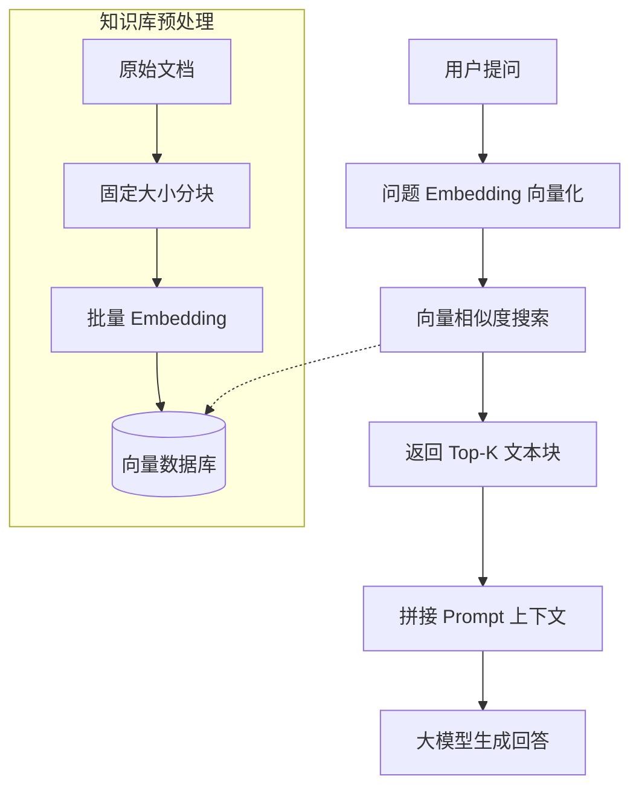
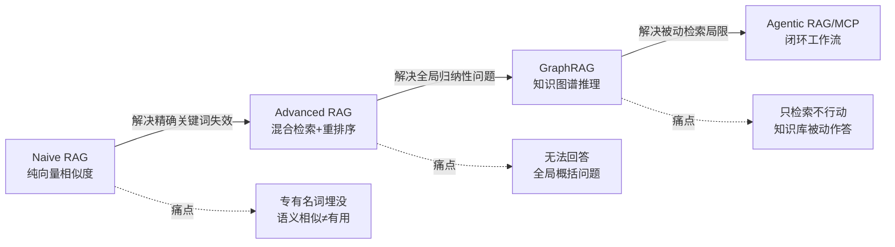
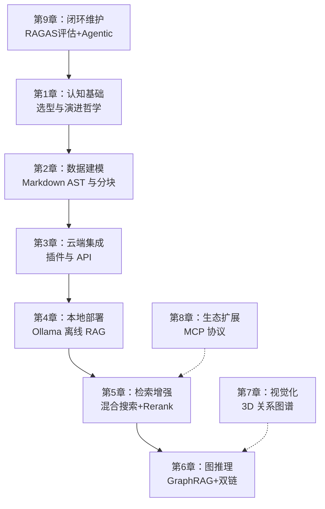
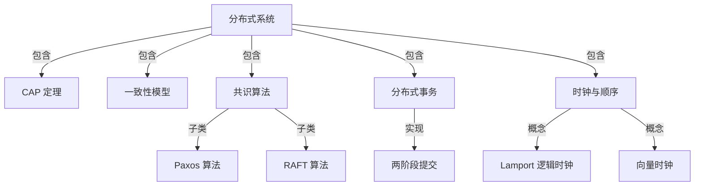
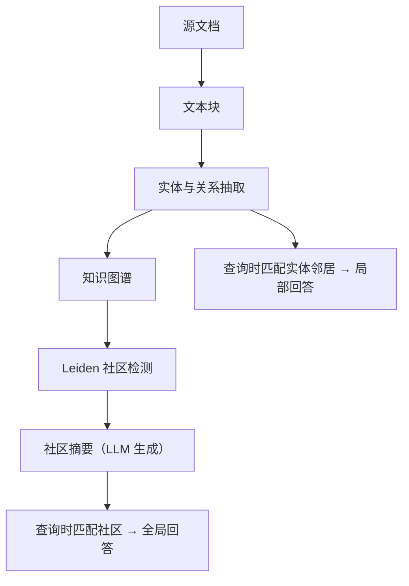
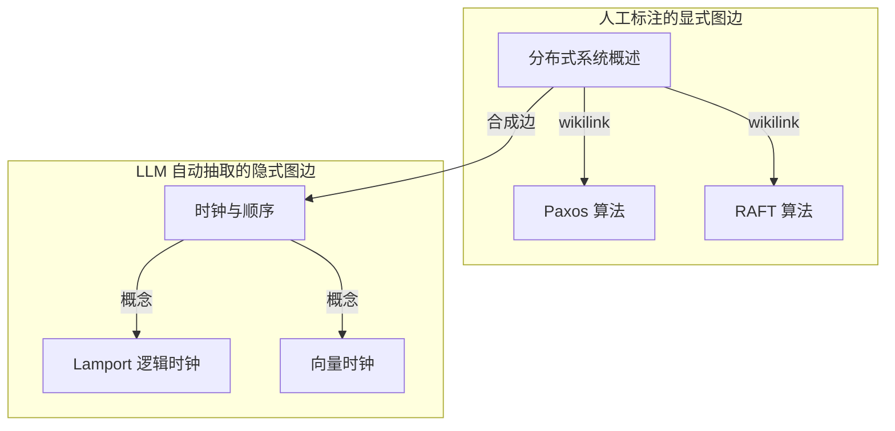

# 第 1 章 个人知识库选型与 RAG 演进哲学

> 预计学习时间：60 分钟  
> 一句话总结：从“我为什么要整理笔记”到“AI 如何理解我的笔记”，建立完整的认知地图，让你在后续八章的学习中看清技术决策的依据。

---

## 开始之前：你需要准备什么

本章是整门课程的认知起点，不要求任何编程经验。为了顺畅理解后面的内容，请确认你已经具备以下基础：

- **熟悉文件和文件夹操作**：知道如何在自己的电脑上创建、移动、重命名文件与文件夹，能区分 `.txt`、`.md`、`.pdf` 这类文件后缀。
- **知道什么是“纯文本”**：纯文本就是不包含字体、颜色等排版信息的文字内容，所有系统自带的记事本（Windows）或文本编辑（macOS）都能打开。
- **接触过命令行（可选）**：本章包含一个打开终端的极简实验，即使从未用过命令行也能跟着操作，但如果完全陌生，不妨花 5 分钟先搜索“如何打开终端”预热一下。

有了这些基础，你就能把注意力集中在知识管理的核心逻辑上，而不是被工具操作绊住。

---

## 1. 碎片化困境：信息在，知识不在

想象一下你日常的信息摄入场景：在微信公众号看到一篇技术分析，保存到“收藏”里；在 B站 看到一个开源项目介绍，截了个图放在桌面；自己动手调试了一个 bug，解决思路写在手机备忘录里，连同当时的报错信息一起贴在下面。

三个月之后，你要做一个新项目，隐约记得自己曾经整理过类似的技术方案，也记得有一个开源工具可以复用。但你打开微信收藏，发现里面堆了 300 多篇未分类的文章，标题都很吸引人，但你根本不记得哪一篇是跟当前需求相关的。你又打开备忘录，搜索关键词会出来几十条零散的片段，有些是完整的思路，有些只是半句话。桌面上的截图，文件名是“截屏 2025-03-21 下午4.32.18.png”——除了打开一个个看，你没有别的办法。

问题出在哪里？**你把信息存下来了，但没建立起检索路径。** 信息本身不稀缺，稀缺的是“在正确的时刻被召回”。

这里就引出了本课程的两个核心术语：

- **知识库（Knowledge Base）**：不是简单的文档堆砌，而是一套有结构、有索引、可检索的信息组织系统。可以把它类比成一座图书馆——书再多，如果没有分类和目录，就只是一个仓库。
- **检索增强生成（RAG，Retrieval-Augmented Generation）**：让 AI 在回答你问题之前，先去你的知识库里“翻找”相关内容，再整合这些内容生成答案。换句话说，AI 不是靠记忆硬猜，而是先查阅你的专属资料。

你可能会问：“我直接把所有文档丢给 AI 不行吗？”理论上行，但实践中会碰到上下文窗口的限制——AI 一次能“看到”的文本量是有限的。更关键的是，不加筛选地把 300 篇文章全部塞进去，AI 反而会被噪声淹没，出来的答案质量还不如你只精挑 3 篇相关度最高的。

所以，一个能服务于 AI 的知识库，必须具备两个核心能力：一是内容本身有清晰的结构（方便分块检索），二是你保有数据的完全控制权（方便本地索引）。这是我们后续一切技术选型的判断标准。

---

## 2. 工具三象限：同一道题，三种解法

现在我们把市面上主流的三种方案拿出来，做一个逐维度对比。这三种方案分别代表三类完全不同的设计哲学——它们都能“记东西”，但面向的场景和核心取舍截然不同。

我们先通过一张对比表建立整体印象，然后再逐个拆解其底层逻辑。

| 对比维度 | Obsidian（本地 Markdown） | Notion（云端 Block DB） | 企业级 RAG 系统（Dify/RAGFlow） |
|---------|--------------------------|------------------------|-------------------------------|
| 数据存储 | 本地文件夹，纯 `.md` 文件 | 云端数据库，Block 级 JSON | 远程向量数据库（Postgres/Milvus） |
| 数据所有权 | 你完全掌控，不依赖任何服务 | 存储在 Notion 服务器，受其服务条款约束 | 由企业/团队集中管理 |
| 离线可用性 | 100% 离线可用 | 需要网络连接（离线模式有限） | 依赖服务端运行状态 |
| 检索方式 | 全文搜索 + 双向链接 + 图谱 | 数据库查询 + 全文搜索 | 语义向量检索 + 混合检索 |
| AI 集成方式 | 社区插件调用 API 或本地模型 | 内置 Notion AI（需订阅） | 原生 ETL 管道 + RAG 引擎 |
| 学习曲线 | 低（上手即用）+ 中（高级功能） | 低（上手即用） | 高（需要 ML 工程背景） |
| 适合场景 | 个人长期知识积累与思考 | 团队协作、项目管理、轻量数据库 | 海量非结构化文档的企业级问答 |

表面上看，这三者都是“记笔记+搜索”，但它们的底层数据模型决定了迥异的能力边界。我们来逐一拆解。

### 2.1 Obsidian：把笔记还原成文件

Obsidian 做了一个看似“退步”的决定：它不像大多数现代笔记软件那样搞一套专有数据库，而是回归到最原始的方式——你写的每一条笔记，就是一个普通的 Markdown 文本文件，存在你电脑的文件夹里。

这带来三个关键好处：

**第一，你的数据你说了算。** 假如 Obsidian 明天倒闭了，你的所有笔记仍然完好地躺在硬盘里，任何文本编辑器都能打开。没有任何专有格式锁死你的内容。这个特性叫 **Local-first（本地优先）**，意味着本地数据永远是主副本，云端即使有同步也只是辅助。

**第二，文件系统就是你的 API。** 因为笔记就是文件，你可以用任何编程语言来处理它们。Python 脚本可以扫描你的笔记文件夹，读取 YAML 元数据，提取标题层级，做各种自动化操作。你不需要请求任何 API 权限，不需要忍受速率限制。我们会在第 8 章深入利用这个特性，把你的 Obsidian 知识库变成一个 MCP 服务器，提供给外部 AI 工具使用。

**第三，Markdown 的语义结构对机器友好。** Markdown 不是纯文本——它有标题层级（`#`、`##`、`###`），有链接语法（`[[双向链接]]`），有代码块（` ``` `），有标签（`#tag`）。这些标记构成了**抽象语法树（AST，Abstract Syntax Tree）**，让程序能精确地知道“这一段属于哪个标题下”“这个链接指向哪篇笔记”。这个特性在第 2 章会发挥重要作用——当我们对笔记做分块（Chunking）喂给 AI 时，基于 AST 的分块远比“每 500 字砍一刀”精准得多。

#### 小实验：感受 Markdown 的结构性

找一篇你已有的 Markdown 文件（如果没有，现在新建一个 `test.md`，写两段带标题的文字），然后在终端运行：

```bash
# macOS / Linux
cat your-note.md | grep "^#"
# Windows (PowerShell)
Select-String -Pattern "^#" your-note.md
```

这条命令会提取文件中所有以 `#` 开头的行——也就是标题。观察输出，你会看到笔记的标题层级一目了然。这种结构信息，将在后续章节中成为 AI 检索的“航标”。

#### 反例与边界：Obsidian 也有不擅长的

千万别以为 Obsidian 是万能药。如果你的笔记中包含大量高分辨率图片、视频等非文本资源，它们无法被 Markdown 直接检索，你仍然需要手动整理。另外，当你的知识库文件数量超过数千个，Obsidian 的启动和同步速度会有所下降（取决于磁盘性能）。这些场景需要在后续实践中用策略优化，而不是一上来就否定工具。

### 2.2 Notion：当笔记变成数据库行

Notion 走了另一条路。它的核心数据模型是 **Block（块）**——每个段落、标题、图片、表格都是一个 Block，Block 之间可以嵌套、引用、转化为数据库行。这个设计让 Notion 在灵活性和协作性上做得非常出色，也让它成为广泛使用的生产力工具。

但这条路的代价是什么？

**数据存储在云端，格式是专有的 Block JSON。** 你的笔记不是一个 `.md` 文件，而是一堆序列化的 JSON 对象，存储在 Notion 的服务器上。Notion 确实提供了 API 和导出功能，但导出过程其实是把内部结构“翻译”为 Markdown 或 CSV，这个过程不一定能保真 Block 之间的嵌套关系、数据库关联和模板结构。也就是说，你不是在访问原始数据，而是在请求 Notion 把它的内部格式转译成你需要的格式。

这个差异在 AI 应用场景下更明显。如果你用 Notion 搭建个人知识库，在引入 AI 检索时会遇到两个瓶颈：

- **API 速率限制**：Notion API 存在请求频率限制，当你需要批量索引成百上千篇笔记来生成向量 Embedding 时，很可能触发限流错误，导致你不得不编写重试逻辑、降低处理速度。而 Obsidian 的文件在本地，你爱读多快读多快——读取速度只受制于你的硬盘。
- **数据锁死风险**：你的知识库依附于 Notion 的服务。如果 Notion 调整定价、变更 API 政策、甚至停止服务（虽然短期看概率很小，但你的知识库使用周期是以年甚至十年计的），你的知识资产会受多大影响？

**Notion 不是错的，它只是为别的场景设计的。** 如果你在做团队项目管理、需要多人实时协同编辑、需要强大的数据库视图（看板、日历、时间线），Notion 是极好的工具。但它不适合作为个人 AI 第二大脑的底层数据基座——因为个人 AI 知识库的核心要求是“数据可控”和“无摩擦批量处理”，这两点恰好是云端专有格式的弱项。

### 2.3 企业级 RAG 系统：重型武器不该打蚊子

Dify、RAGFlow 这类平台能做一件很厉害的事：你把几百份 PDF、Word 文档、网页抓取结果丢进去，它自动帮你做文档解析、文本分块、向量化、存储索引，然后你通过聊天界面提问，它从知识库中检索相关内容并生成回答。它们背后通常跑着 Postgres（存结构化数据）、Milvus（存向量）、Redis（做缓存），是一套完整的企业级 ETL（Extract-Transform-Load，数据抽取-转换-加载）管道。

但把这套重型武器搬到个人场景，问题很快就暴露出来了：

**第一，运维成本高。** 跑一套完整的 Dify 需要至少 Docker 环境，需要配置数据库连接，需要管理模型密钥。对于个人学习者来说，这不只是“麻烦一点”的问题——你的目的是整理自己的思考、提升工作效率，而不是成为基础设施运维工程师。我们在第 4 章会学到用 Ollama 做本地模型部署，那条路线只需要一行命令。

**第二，粒度不适配。** 企业级系统天然面向“大量非结构化文档”的场景——比如公司的所有合同、产品手册、客服对话记录。这些场景的典型特征是“文档量大，单文档结构弱”。但个人知识库恰好相反：文档量相对少（几百到几千篇），但每篇都有明确的主题、标题层级和内部链接。这意味着你需要的是精准的语义分块和链接图谱推理，而不是粗粒度的全文检索。

**第三，思考过程被割裂。** 你在 Obsidian 里写一条笔记的过程，本身就是“思考”的过程。笔记和笔记之间通过双链产生了关系，这些关系体现了你的思维路径。但如果你把笔记导出给外部 RAG 系统检索，这些链接关系就丢失了——外部系统只看到了“一堆独立文档”，看不到“它们之间怎么联系的”。我们第 6 章会讲到，Obsidian 的双链本身就是最好的图数据源，这是外部系统无法天然复现的。

**一个快速判断标准**：如果你手头有 10,000 份毫无关联的 PDF 合同，需要一个系统来回答“关于退货政策的条款在哪”，用 Dify 是合适的。但如果你在积累的是“我对分布式系统的理解”“我研究过的所有开源调度框架”“我的写作灵感片段”，这些内容之间有千丝万缕的逻辑联系——那 Obsidian 的本地 Markdown + 双链才是天然匹配的数据模型。

### 2.4 你现在应该做出什么选择？

经过以上分析，选择的逻辑已经清晰了：

- 如果你的需求是**团队实时协作 + 结构化数据管理**（比如团队 Wiki、项目追踪），Notion 是更好的选择。
- 如果你的需求是**处理海量弱结构文档的企业级问答**，Dify/RAGFlow 更专业。
- 但如果你的需求是**搭建一个长期演进、AI 增强、完全受你控制的个人知识系统**——这正是本课程的目标——Obsidian 是最合适的载体。

接下来的 8 章，我们不是在学习“怎么用 Obsidian 记笔记”——那部分你花半小时看官方文档就够了。我们要学的是：**如何把一个 Obsidian 知识库，改造成一个 AI 可以理解、检索、推理、甚至帮你自动维护的“第二大脑”。**

在做完这个选择之后，我们需要追问一个更根本的问题：AI 到底是怎么从知识库里“找东西”的？这就要进入本章的下半场——RAG 技术从朴素到智能的演进之路。

---

## 3. RAG 演进：从“找相似句子”到“理解知识网络”

RAG 这个词你可能已经听过很多次了，但让我们从最基础的场景开始理解。

假设你有一个知识库，里面写了 100 篇技术笔记。现在你问 AI：“我之前研究过的那个用 Rust 写的流处理框架叫什么来着？我记得是跟 Kafka 对标的。”

本质上，AI 需要做两件事：（1）从你的 100 篇笔记里找到最相关的几篇；（2）基于这几篇笔记的内容生成一个准确的回答。第一步叫**检索（Retrieval）**，第二步叫**生成（Generation）**，合起来就是 RAG。

问题出在第一步。RAG 过去几年的演进，本质上就是在不断回答一个核心问题：**怎么才能从海量文档里，精准地找到真正有用的那几段？**

### 3.1 Naïve RAG：朴素开局的明显缺陷

最早的 RAG 方案——我们称之为 **Naïve RAG（朴素 RAG）**——用了一种看起来很直接的办法：

1. 把知识库里的所有文档切成一段一段的文本块（Chunk）。
2. 用一个 **Embedding 模型** 把每个文本块转化成一个向量（Vector）——你可以把这个向量理解为“该文本块在语义空间中的坐标”。语义相近的文本块，向量坐标也相近。
3. 当用户提问时，把问题也转化成一个向量。
4. 用**余弦相似度（Cosine Similarity）**等数学方法，找到向量数据库中与问题向量最接近的那几个文本块。
5. 把这些文本块塞进提示词，让大模型基于它们生成回答。

这个流程可以用一句话概括：**把问题翻译成坐标，然后在知识库里找坐标最近的片段。**

以下是它最核心的架构示意——这不是具体指令，而是Naïve RAG 中“检索与生成”的分工视图，帮助你从全局理解整个流程的运转：



#### 短小可观察示例：两个句子到底有多像？

为了让你对“语义相似度”有直觉，我们虚构两个句子和它们的简化向量：

- 句子A：“Docker 网络不通可以尝试 host 模式。” → 向量 A = [0.8, 0.1, 0.2]
- 句子B：“Docker 支持 bridge、host、overlay 网络模式。” → 向量 B = [0.7, 0.2, 0.3]
- 提问Q：“我 Docker 网络不通怎么解决？” → 向量 Q = [0.85, 0.1, 0.25]

余弦相似度衡量两个向量方向的接近程度，值越接近 1 越相似。你可以直观看出，Q 和 A 的方向非常接近（数值相似），而 Q 和 B 也接近但稍弱。如果知识库里只有 A 和 B，Naïve RAG 会优先返回句子A，因为它的向量与 Q 最相似。这正是我们期望的。

但如果知识库里还有句子C：“Docker bridge 网络的配置步骤详解” → 向量 C = [0.75, 0.15, 0.28]，它和提问 Q 的相似度也很高，内容却是教程，可能不是你想要的排错记录。这就引出下一个问题。

#### 反例与边界：相似但无用

这个方案在“找相似句子”方面表现得不错。但它在真实场景中暴露了三个明显问题：

**问题一：语义相似不等于有用。** 假设你问：“我在 Docker 里遇到的那个网络不通的问题最后怎么解决的？”Naïve RAG 会去检索与“Docker”“网络”“不通”语义相似的文本块。但你知识库里可能有 10 篇笔记都提到了 Docker 网络问题——有篇笔记是在复述官方文档的 Docker 网络基础概念，有篇笔记是你记录的一次失败的排查过程，有篇笔记是你最终找到的那个“加一行 `--network=host` 就解决”的记录。如果最相似的是第一篇，AI 给你生成的回答就会变成“Docker 支持 bridge、host、overlay 等多种网络模式……”——对，但没用。你真正需要的是第三篇。

**问题二：精确关键词完全失效。** 这是语义搜索的原罪。假设你问：“`pgvector` 和 `pgvecto.rs` 两个扩展在索引类型上有什么区别？”这两个都是专有名词，Embedding 模型可能没见过，或者见过的上下文不够充分。结果就是检索召回了跟你问的“扩展”“区别”“索引”语义相关的通用内容，却漏掉了标题就叫 `pgvector vs pgvecto.rs` 的那篇笔记。你会怀疑：“我明明写了啊，怎么找不到？”

**问题三：全局性问题无法回答。** 如果你问：“我的知识库里关于‘分布式系统共识算法’有哪些主要观点？它们之间有没有矛盾？”——这类问题需要的是**聚合理解**，而不是找相似的段落。Naïve RAG 检索出来的是“和这句话语义相似的段落”，但你要的是“跨越几十篇笔记的归纳总结”，单靠向量相似度永远做不到。

这三个问题，依次催生了三种改进方向：**混合检索（Advanced RAG）→ 知识图谱（GraphRAG）→ 智能体驱动（Agentic RAG）**。

### 3.2 Advanced RAG：关键字和语义联手

解决“精确关键词失效”的办法很朴素——同时跑两种检索，然后把结果融合：

- **语义搜索（Dense Search）**：就是前面讲的向量相似度搜索，负责抓大意。
- **关键词搜索（Sparse Search）**：基于 **BM25** 算法（一种经典的文本检索算法，通过词频和逆文档频率衡量搜索词在文档中的重要程度），精确匹配专有名词、代码函数名、缩写。

然后通过 **RRF（Reciprocal Rank Fusion，倒数排名融合）** 把两个结果列表合并成一个。RRF 的核心思想很简单：一个文档如果在两种搜索中都排名很高，那它大概率就是真正相关的；如果只在其中一种搜索中排名高，那它可能只是碰巧匹配了某一方面。

举个例子，假设我们检索“pgvector 索引类型”，语义搜索返回的前三名：
1. 《PostgreSQL 扩展索引概述》
2. 《pgvector 使用指南》
3. 《pgvecto.rs 性能对比》

关键词搜索返回的前三名：
1. 《pgvector vs pgvecto.rs》
2. 《pgvecto.rs 安装步骤》
3. 《pgvector 使用指南》

RRF 给每个排名计算得分（通常是 1/(k+rank)，k 一般取 60，这里简化成 1/rank）：
- 《PostgreSQL 扩展索引概述》：1/1 + 0 = 1.0
- 《pgvector 使用指南》：1/2 + 1/3 = 0.5 + 0.33 = 0.83
- 《pgvecto.rs 性能对比》：1/3 + 0 = 0.33
- 《pgvector vs pgvecto.rs》：0 + 1/1 = 1.0
- 《pgvecto.rs 安装步骤》：0 + 1/2 = 0.5

最终融合排名第一的就是《PostgreSQL 扩展索引概述》和《pgvector vs pgvecto.rs》并列。这个结果既包含了语义相关也包含了精确命中，双保险。

合并后的 Top-K 结果，再送入一个 **重排序模型（Cross-Encoder Reranker）** 做二次打分。Cross-Encoder 不同于向量搜索——它会同时读“问题”和“候选文档”，给出一个精确的“这个文档对回答这个问题有多大用”的分数。向量搜索是粗筛，重排序是精挑。

#### 反例：当混合检索失灵

如果你知识库里的笔记都是关于“苹果手机”的使用技巧，而你问的是“苹果的股票代码”，关键词搜索会狂返回“苹果”，而语义搜索可能也不清楚上下文。这时候重排序能帮你把语义不相关的结果压下去，但如果知识库根本就没有金融信息，那任何检索都无能为力——RAG 不能创造知识，只能召回已有的。这是你会在第 5 章实践中亲身验证的边界。

我们在第 5 章会完整实现这套混合检索管线。现在你只需要记住它解决的核心问题：**专有名词不会被埋没，同时整体语义相关性也有保障。**

### 3.3 GraphRAG：把笔记变成知识网

混合检索解决了“找什么”的问题，但它仍然无法回答：“知识库里关于某一个主题，所有的核心观点是什么？”这类全局归纳性问题。

因为这类问题要求的不是“找出某些段落”，而是“理解知识之间的关系”。举个例子，如果你在一个知识库里写了 50 篇与“微服务”相关的笔记，它们之间通过 `[[双向链接]]` 形成了一张关系网：`[[微服务架构]]` → `[[服务发现]]` → `[[Consul 原理]]`，另一条路径是 `[[微服务架构]]` → `[[API 网关]]` → `[[Kong 配置]]`。当你问“我对微服务架构的整体理解是什么？”AI 需要的不是 50 篇笔记里最相关的 3 篇，而是对这张关系网做一次**多跳推理（Multi-hop Reasoning）**——先从“微服务架构”出发，找到它链接到的核心概念，再找到这些概念链接到的具体实践，最后把整条路径上的信息聚合生成回答。

这就是 **GraphRAG** 的思想来源。它的核心流程是：

1. **实体与关系提取**：从你的 Markdown 笔记中识别出“实体”（如 Kubernetes、微服务、Docker）和“关系”（如“Kubernetes 是一种容器编排工具”、“微服务依赖容器化部署”）。
2. **知识图谱构建**：将实体作为节点，关系作为边，构建一个图数据库。
3. **图检索**：当用户提问时，不仅在向量库中搜索相似文本，还在知识图谱中搜索相关实体的邻居节点、多跳路径和社区结构。

微软在 2024 年开源了 GraphRAG 项目，首次把这个理念工程化了。而我们第 6 章会讲一个更轻量的思路：**Obsidian 原生的双链就是图**。你在 `[[Kubernetes]]` 和 `[[容器化]]` 之间建立的双向链接，本身就是最精准的“知识关系”标注——不需要用 NLP 模型去猜，你自己在写笔记时已经把关系定义好了。

#### 短小可观察示例：用双链画一张微型知识网

如果你已经安装了 Obsidian（现在装也不迟，不到一分钟），可以立刻做一个小实验：

1. 新建笔记“微服务架构.md”，写入内容：“微服务是一种将应用拆分为小型独立服务的架构风格，核心挑战包括 [[服务发现]] 和 [[API网关]]。”
2. 点击 `[[服务发现]]` 链接创建新笔记，写入：“服务发现解决的是微服务实例如何互相定位的问题，常见工具有 [[Consul]]。”
3. 再次创建 [[Consul]]，简单描述。
4. 回到图谱视图，你会看到三个节点由有向边连接，形成一个微型知识链条。

这就是 GraphRAG 的“图”在 Obsidian 里的原始形态。第 6 章会教你如何让 AI 沿着这些边进行多跳推理。

#### 反例：双链不是万能的

如果你的笔记之间很少建立双链，或者双链质量不高（比如滥用链接、指向模糊的笔记名），那么图结构反而会引入噪音，加重 AI 的推理负担。GraphRAG 的效果严重依赖你的链接习惯。

### 3.4 Agentic RAG 与 MCP：知识库活过来

GraphRAG 让检索从“向量匹配”进化到“图推理”，但它仍然有一个局限：它是**被动等待查询**的。你提问，它检索，它回答。一轮结束。

但真实的知识工作流不是这样的。你写了新笔记、改了旧笔记、删了过时内容，知识库在不断演变。AI 检索的质量会随着知识库的演变而变化——笔记多了可能“淹没了”以前的精华，某些笔记出现了矛盾观点但你还没发现，某些话题你可以自动生成一篇新笔记来组织现有笔记中的零散思想。

这就是 **Agentic RAG（智能体驱动的 RAG）** 要解决的问题。它在检索的基础上引入了一个“智能体”层，让 AI 不只检索，还能规划、执行多步操作、写回结果。比如：

- **自动维护**：检测到三篇笔记都在讨论同一个主题但相互没链接？Agent 自动建议甚至直接添加双链。
- **矛盾检测**：发现两篇笔记对同一个技术结论有不同的说法？Agent 标出矛盾并提示你核查。
- **闭环创作**：你提出一个新课题 → Agent 检索本地笔记收集素材 → 生成草稿 → 在 Obsidian 里新建笔记并自动加上双链和 Tag。

这个过程依赖一个关键协议——**MCP（Model Context Protocol，模型上下文协议）**。MCP 是 Anthropic 在 2024 年底发布的一套开放标准，定义了 AI 模型如何与外部工具（比如文件系统、数据库、API 服务）进行标准化交互。简单说，MCP 让你的 Obsidian 知识库可以变成一个“工具”，被外部的 AI 应用（如 Cursor、Claude Code）当作上下文来源来调用。我们在第 8 章会完整实现 MCP Server 的搭建。

#### 边界：Agent 的自主与你的掌控

Agent 自动写回笔记是一项强大但危险的操作。它可能产生低质内容污染你的知识库，或者在你不知情的情况下删除重要笔记。因此我们在第 9 章的实战中会严格限定写回边界（例如只写入特定文件夹），并建议你始终保持版本控制（Git）——这是后话，但你现在就应该意识到：自动化越强，安全边界的设置越重要。

到这里，整条演进路线就可以可视化地呈现出来了：



这条箭头链条，就是你接下来八章技术栈的核心主线。你不是在学一堆散装的技术点，而是在学同一个问题的四种解法——每一代解法都解决了上一代的局限性，但也都引入了新的复杂度。这也是为什么我们要从 Obsidian 这样一个简单的本地 Markdown 库出发：我们掌握了数据，才能在最合适的地方引入最合适的检索策略，而不是受工具的限制。

---

## 4. 认知锚点：这张地图将贯穿全书

学习任何技术体系最怕的，是“只见树木不见森林”——学了半本课程，记住了几十个命令、配置和工具名，却说不出它们之间的逻辑关系。所以我们用最后一个小节，在认知层面建立一个“锚点”。

你可以把本课程想象成一条流水线：



这个流水线环环相扣，但你不必现在就理解每个模块的细节——那不是本章的任务。本章只要求你在完成阅读后，记住这张全景图：

- 第 1 章（本章）是**地图**，告诉你为什么走这条路。
- 第 2-4 章是**基建**，从数据建模到云端接入再到完全本地化，让你能跑通完整的 RAG 链路。
- 第 5-6 章是**核心**，解决检索质量的两个核心瓶颈：精确匹配和全局理解。
- 第 7 章是**可视化**，把隐性的知识网络变成直观的三维图谱。
- 第 8 章是**扩展**，让你的知识库成为全开发工作流的上下文中心。
- 第 9 章是**闭环**，引入评估和自动维护，让系统可持续运转。

---

## 5. 练习与反馈：检验你的“认知地图”

### 自检清单

在进入第 2 章之前，确认你能回答以下问题：

1. 如果朋友问你“Obsidian 比 Notion 更适合做个人 AI 知识库的理由是什么”，你能从**数据所有权、离线可用、文件系统可编程性和 Markdown 语义结构**四个角度解释吗？
2. Naïve RAG 的“单一向量相似度搜索”在什么场景下会失效？你能举出一个你未来可能遇到的真实例子吗？
3. Advanced RAG → GraphRAG → Agentic RAG，每一代核心解决了上一代的什么问题？不必背术语，但能用自己的话串成一条因果关系链。
4. 你现在应该用什么标准来判断“这个知识库工具/方案适不适合我的场景”？哪个标准是最重要的？

### 动手实验（可选，但推荐立即尝试）

1. 在你的电脑上创建一个新文件夹，命名为 `MyObsidianVault`。
2. 下载并打开 Obsidian，选择刚才的文件夹作为 Vault。
3. 创建两篇笔记：一篇标题“微服务架构”，另一篇标题“服务发现”，在“微服务架构”中写入 `[[服务发现]]`（注意是英文双括号），观察它自动变成可点击链接。
4. 点击左侧的“图谱视图”图标，观察两个节点之间的连线。
5. 退出 Obsidian，用系统文件管理器进入 `MyObsidianVault` 文件夹，用文本编辑软件打开 `微服务架构.md`，你会发现它就是一个普通的文件，里面的 `[[服务发现]]` 原封不动躺在那里。

完成这个小任务后，你就能切身体会到 Local-first 和双链的便利。这比只看文字直观得多。如果你在操作中遇到任何问题，记录下来，它们会在后续章节中找到答案——眼下最关键的是你亲手摸了这份“文件即知识”的感觉。

---

## 参考文献

- Obsidian 官方帮助文档 [Obsidian Help](https://obsidian.md/zh/help/)：关于 Local-first 设计理念与 Markdown 语法的官方说明。
- IBM Developer: *Enhance RAG performance through intelligent chunking strategies* [Enhance RAG performance through intelligent chunking strategies](https://developer.ibm.com/articles/awb-enhancing-rag-performance-chunking-strategies/)：关于 Markdown 结构感知分块策略的技术分析。
- Microsoft Research: *Project GraphRAG* [Project GraphRAG - Microsoft Research](https://www.microsoft.com/en-us/research/project/graphrag/)：GraphRAG 项目的官方概述与论文入口。
- Microsoft: *GraphRAG 开源实现* [GitHub - microsoft/graphrag](https://github.com/microsoft/graphrag)：GraphRAG 的模块化官方实现，用于课程第 6 章实验。
- Ollama: *OpenAI compatibility* [OpenAI compatibility - Ollama](https://docs.ollama.com/api/openai-compatibility)：Ollama 的 OpenAI 兼容接口文档，为第 4 章本地部署提供 API 规范参考。
- Anthropic: *Model Context Protocol Specification* [Specification - Model Context Protocol](https://modelcontextprotocol.io/specification/2025-06-18)：MCP 协议规范，支撑第 8 章的 MCP Server 实现。
- Obsidian Plugin Developer Documentation [Home - Developer Documentation](https://docs.obsidian.md/Home)：Obsidian 插件开发官方文档，为第 3 章插件架构拆解提供 API 参考。


---

# 第 2 章 面向 RAG 的 Markdown 数据建模与 AST 解析

> 预计学习时间：120分钟（含动手实操）  
> 一句话总结：写一条人类看得懂、机器也能精确切分和检索的笔记，靠的不是新工具而是新的结构习惯；本章从原子化原则、YAML元数据直至AST递归分块与父子文档策略，把Markdown从“文本”建构成“数据”。

## 一、一堂搜索课

先做一个小实验。不要打开 Obsidian 查找功能，你凭记忆回答：你过去一年写过多少条笔记？其中多少条现在还能在三步之内找到？如果答案让你迟疑，你遇到的不是记忆力问题，而是信息组织问题。

本章标题里有两个词：数据建模与AST解析。拆开看都带技术味道，但背后是一个很朴素的问题：怎样写笔记，能让未来的自己和未来的AI，都能准确找得到、读得懂、用得上？

第1章已经回答过“为什么要选 Obsidian”——因为它的笔记是纯 Markdown 文本，存在你本地的文件夹里，不受制于任何云服务的 API 限流或格式锁死。但 Markdown 本身只是格式约定。同一篇笔记，你写成三千字的长文，和拆成十条互相链接的短笔记，对 AI 来说是完全不同的语料。

本章就从这个分水岭开始讲起。

## 二、原子化笔记：一个文件，一个概念

### 2.1 它不是什么新发明

“原子化笔记”(Atomic Notes) 是个人知识管理领域已经反复验证过的一条实践原则。它不等于短笔记，而是**单一概念笔记**：一个 .md 文件聚焦一个概念、一个观点、一个决策或一个问题，不到万不得已不往里面塞第二个概念。

观察两篇笔记的差别。

**笔记A（反例）**

```markdown
# Python 并发编程

## 线程

Python 的 threading 模块受 GIL 限制，只适合 IO 密集型任务。

## 异步编程

asyncio 可以处理高并发 IO，但不适合 CPU 密集型。

## 多进程

multiprocessing 可以绕过 GIL。
```

**笔记B（拆分后的原子化版本）**

文件 `python-gil-threading.md`：

```markdown
# Python 的 GIL 对线程的影响

Python 由于全局解释器锁（GIL）存在，
一个进程同一时刻只有一个线程能执行字节码。
IO 密集型任务可受益于线程并发，
CPU 密集型任务则应改用多进程。
```

文件 `python-asyncio-limits.md` 和 `python-multiprocessing-vs-threading.md` 各聚焦一个概念，不再赘述。

笔记A看起来井井有条，但对检索系统是灾难。搜索 `asyncio` 会命中这篇“Python并发编程”，结果返回的是把三个概念压在一起的文本块——“asyncio 可以处理高并发 IO”夹在“GIL”和“multiprocessing”之间，Embedding 求出来的语义向量退化成稀粥。

原子化笔记保证了一条规则：

> 一篇笔记在向量空间中的Embedding，就代表一个概念的语义。

### 2.2 怎么判断拆分时机

你不需要预先想好所有分类。边写边判断即可。判断标准很简单：

- 这篇笔记如果被单独搜索，标题本身能否表达完整意图？
- 回答一个特定问题时，是不是需要从这篇笔记中间精确抽出两段，而不是整篇？

如果第一个答案是“不能”，或者第二个是“需要”，就该拆。

操作上，Obsidian 支持右键点击[[链接]]自动创建目标文件。当你在正文遇到一个新概念时，直接把它变成链接，Obsidian就会引导你新建一篇专属笔记。

### 2.3 原子化与RAG的关系

第1章讲 Naïve RAG 的缺陷时提过“重叠上下文”问题。这个问题根子在分块，药方却在写作阶段就埋下了：如果一篇笔记本身就只承载一个清晰概念，分块器就不需要在三千字的正文里猜段落边界。

把原子化思考当成写作习惯，不是在“整理知识库”，而是在把你的知识库拆成更清晰的语义块。每个文件就是一个天然 Chunk。

### 2.4 可观察证据：嵌入向量的纯度对比

为了看清原子化的实际效果，可以用余弦相似度做一个极简的思想实验。假设以下两个向量分别代表“线程”和“多进程”两条笔记的语义：

```python
import math

def cos_sim(a, b):
    dot = sum(x*y for x,y in zip(a,b))
    norm_a = math.sqrt(sum(x**2 for x in a))
    norm_b = math.sqrt(sum(x**2 for x in b))
    return dot / (norm_a * norm_b)

# 原子化笔记的嵌入向量（简化为二维数值）
threading_vec = [0.9, 0.2]   # “Python 线程”
multiproc_vec = [0.1, 0.9]   # “Python 多进程”

# 查询“GIL对线程的影响”的理想嵌入
query_vec = [0.85, 0.25]

print("查询 vs 线程笔记:", round(cos_sim(query_vec, threading_vec), 3))
# 输出示例：查询 vs 线程笔记: 0.998
print("查询 vs 多进程笔记:", round(cos_sim(query_vec, multiproc_vec), 3))
# 输出示例：查询 vs 多进程笔记: 0.527
```

原子化笔记与查询的相似度极高，而非相关概念的笔记相似度明显低，检索时很容易区分。

现在模拟把两篇笔记合并成一篇“Python并发编程”的情况。合并后嵌入向量可以近似为两向量求平均：

```python
mixed_vec = [(0.9+0.1)/2, (0.2+0.9)/2]  # [0.5, 0.55]

print("查询 vs 混合笔记:", round(cos_sim(query_vec, mixed_vec), 3))
# 输出示例：查询 vs 混合笔记: 0.852
```

虽然仍能检索到，但相似度从 0.998 跌到 0.852。更糟糕的是，这个混合向量也在某种程度上“擦边”多进程查询，导致一个查询返回的排名中，噪声笔记可能挤掉真正相关的独立笔记。

上述数值只是示意，真实 Embedding 模型输出的千维向量效应相同：多个概念硬塞进同一个文件，向量被迫变成“万金油”，精度必然下降。这是原子化如何提升区分度的一个近似演示。

### 2.5 原子化检查清单

当你写完一篇笔记后，用下面三个问题快速自检：

1. 如果去掉标题，别人能一眼看出这篇笔记只讨论一件事吗？
2. 笔记中是否出现了“另外”、“顺便提一句”、“与之相关的还有……”等分岔表述？
3. 将来你要找这条信息，你期望的搜索词是否恰好对应本文的标题或核心句？

如果任何一个答案是“不是”或“有”，就说明还有可拆分的概念藏在文本里。把那个概念独立成文，并加上双链——这是通往高质量知识库最高频、也最被低估的习惯。

## 三、YAML Frontmatter：机器可读的元数据层

### 3.1 写在标题之上

打开 Obsidian 的任意一篇笔记，在最顶端用三个连字符包起来的部分，就是 Frontmatter。

```yaml
---
title: "面向RAG的结构化写作"
tags: [rag, markdown, chunking]
status: draft
type: concept
created: 2025-04-09
---
```

它不是给人类阅读的小抄，而是给程序（和 AI 检索管线）看的**结构化标签层**。

Obsidian 原生支持 YAML Frontmatter，自动解析后提供:

- 侧边栏按标签聚合
- Dataview 插件按 `status`/`type` 动态索引
- 元数据过滤（这是第5章混合检索的前提）

### 3.2 三个必填字段与扩展

起步阶段，每篇笔记至少包含以下三个字段:

| 字段 | 作用 | 示例值 |
|------|------|--------|
| `tags` | 语义分类，未来支持关键词召回和过滤 | `[python, concurrency]` |
| `status` | 笔记成熟度，辅助维护与垃圾回收 | `draft` / `reviewed` / `evergreen` |
| `type` | 内容原型，帮助后续分组分块 | `concept` / `tutorial` / `meeting-notes` |

`status` 字段的顺序表达了笔记生命周期: 草稿期可以容忍粗颗粒度，但进入 `reviewed` 或 `evergreen` 后就该同时审视原子化是否到位。

`type` 字段影响分块策略的选择: `meeting-notes` 可能更适合按时间线切割，`concept` 则应优先保留完整段落结构。

### 3.3 体验即刻反馈

创建一个新文件 `test-metadata.md`，填入：

```yaml
---
title: "RAG分块测试"
tags: [rag, chunking, draft]
status: draft
type: concept
---
```

然后在 Obsidian 中执行：

1. 按 `Ctrl/Cmd + Shift + T` 打开**标签面板**，观察 `rag`、`chunking`、`draft` 三个标签已自动出现。
2. 安装 Dataview 插件后，在同一笔记中写：

   ````markdown
   ```dataview
   LIST
   FROM #rag
   WHERE status = "draft"
   ```
   ````

   预览模式会立刻列出所有满足条件的文件。

你已经在写机器可读的数据了。

### 3.4 反例：缺少元数据时查询会漏掉什么

假设你的知识库中有两条笔记，一条填写了完整的 Frontmatter，另一条没有填写任何元数据：

笔记 `doc-with-meta.md`：

```yaml
---
tags: [rag]
status: draft
---
```

笔记 `doc-without-meta.md` 的内容同样是关于 RAG，但没有任何 YAML 块。

执行 Dataview 查询 `FROM #rag` 时，`doc-without-meta.md` 不会出现在列表中。即便它在正文里包含 “rag” 这个词，但 Dataview 只扫描 Frontmatter 的 `tags` 字段，不会分析全文。RAG 检索管线的元数据过滤步骤同样依赖这些结构化字段——缺失了，就失去了按类别、状态或内容类型筛选的能力。

养成一个简单的习惯：创建新笔记时立即从模板插入包含 `tags`、`status`、`type` 的 Frontmatter 块，避免信息在未来检索时成为“看不见的笔记”。

### 3.5 YAML 的常见书写陷阱

YAML 的语法虽然直观，但也有几个初学者容易掉进去的坑。最典型的有三个：

1. **缩进只能用空格，不能用 Tab 键。** 在 Obsidian 的编辑器里敲 Tab 通常会自动插入空格，但如果你从其他地方复制了用 Tab 缩进的 Frontmatter，解析器会直接报错，整个 YAML 块失效。

2. **列表项的短横线后面必须有空格。** `tags: [rag,chunking]` 是合法的 YAML 行内列表，但如果你写成多行形式：

   ```yaml
   tags:
   -rag
   -chunking
   ```

   由于 `-rag` 没有空格，YAML 解析器会把它当成一个普通字符串，而不是列表元素。正确写法是 `- rag`。

3. **包含冒号或特殊字符的值必须加引号。** 例如 `title: "想法：关于效率"`，如果不加引号，YAML 会把冒号误判为键值分隔符，导致解析错误。类似地，包含 `{`、`}`、`[`、`]` 等字符也最好用引号保护。

这三条规则都不复杂，但任何一条被忽略，就会让整篇笔记的元数据变得不可读——Dataview 看不到它，标签面板也显示不出标签。可以先创建一个笔记模板，把正确的 YAML 格式固化下来，避免每次手工输入时踩雷。

## 四、分块的真相：为什么固定长度会失败

### 4.1 一次实验

假设我们有一段 Markdown 正文：

```markdown
## KNN 算法原理

KNN 是非参数懒惰学习算法。

## SVM 数学推导

SVM 通过最大化间隔寻找分离超平面，
涉及拉格朗日对偶理论。
```

如果我们用最简单的 “每 50 个字符切一块” 策略，分块结果如下：

**块1**（前面50字符刚好包含SVM标题的开头）:

```text
## KNN 算法原理

KNN 是非参数懒惰学习算法。

## SVM 数学
```

**块2**:

```text
推导

SVM 通过最大化间隔寻找分离超平面，
涉及拉格朗日对偶理论。
```

块1混入了SVM的标题碎片，块2以“推导”二字开头，缺乏主语的上下文依赖。SVM相关的向量检索被两个不完整的碎片稀释。

这不是 Markdown 切分的夸大案例，而是**固定字符数切分**对所有结构化文本的固有问题：切分窗口不认识标题层级，不知道代码块与正文的边界，也不知道列表项是否该连在一起。它只是冷酷地数到第n个字符，然后一刀一刀切下去。

#### 4.1.1 动手验证：用代码感受固定切分的粗暴

如果你愿意进一步观察那种“冷酷”，可以写一个不到 15 行的 Python 脚本，亲手看看固定大小切分到底产生了什么。代码不需要任何第三方库，直接利用字符串切片：

```python
def fixed_chunk(text, size):
    chunks = []
    for i in range(0, len(text), size):
        chunks.append(text[i:i+size])
    return chunks

md = """## KNN 算法原理

KNN 是非参数懒惰学习算法。

## SVM 数学推导

SVM 通过最大化间隔寻找分离超平面，
涉及拉格朗日对偶理论。
"""

for idx, chunk in enumerate(fixed_chunk(md, 50), 1):
    print(f"=== 固定切分 Chunk {idx} ===\n{chunk}\n")
```

运行这段代码，你会亲眼看到第一块在“SVM 数学”之后断开，第二块从“推导”开始。正是这种断句使“SVM 数学推导”这个完整语义单元裂成两半，LLM 在后面无论怎么补都补不回来。

你可以随意修改 `size` 为 40、60、70，每一次都会在某个意想不到的位置撕裂一条标题或一句话。试过一次之后，“永远不要用字符数切 Markdown”就不再是一句书上的告诫，而是一个亲手验证过的结论。

### 4.2 RAG 视角下的后果

当用户查询 “SVM 的数学原理” 时，向量相似度可能在“块2”上得分很高——因为正文确实包含了 SVM 的数学描述。但 “块2” 在喂给 LLM 时上下文里没有前缀 “## SVM”，LLM 面对孤立的文本片段可能误判为 “KNN 相关” 或直接编造关系。

于是你在前端得到的回答变成了：“你笔记中的 SVM 提到推导涉及拉格朗日对偶……” 没错是没错，但别指望它精准引述你的笔记结构。

根源在分块阶段埋下。正是这类系统性问题，促使 RAG 工程演进到结构感知分块。

### 4.3 机制深潜：为何截断文本会误导 Embedding

Embedding 模型（如常用的 all-MiniLM-L6-v2）本质上是 Transformer 编码器。它通过自注意力机制捕捉每个词与全文中其他词的关系，生成上下文敏感的向量。当文本在句子中间被截断时，后半句的注意力连接直接消失，前半句的语义解释也可能发生偏差。比如“SVM 通过最大化间隔寻找分离超平面，涉及拉格朗日对偶理论”被切成“SVM 通过最大化间隔寻找分离超平面，”和“涉及拉格朗日对偶理论。”，拆开的两个片段各自都无法完整代表原意，嵌入向量也随之失真。

这就像人只听到前半句话就匆忙下结论，结果可能与完整话语相反。固定字符切分正是将所有文本同等对待，完全无视“人类语言是由语法层级组织起来的”这一事实。Markdown 的标题、段落、代码块等结构元素提供了天然的语义边界——只有尊重这些边界的切分策略，才能更完整地保留原始语义。

## 五、Markdown AST：让分块理解结构

### 5.1 Python 速览：本章会出现的语法

接下来我们要用 Python 编写一个 AST 分块器。如果你对 Python 还很陌生，先花三分钟过一遍下面这几个要素——它们足够你读懂本章的所有代码。

- **变量和赋值**：`chunks = []` 创建了一个空列表，`self.current = ""` 将当前文本暂存为空字符串。等号右边计算出的值会被赋给左边的变量。
- **函数定义**：`def chunk_by_heading(md_text):` 定义一个函数，括号里是参数。函数体采用统一缩进（通常是 4 个空格）。调用函数时，把实际的值写在括号里，如 `chunk_by_heading(md_content)`。
- **列表与循环**：`[1, 2, 3]` 是一个列表，用方括号包起来。`for i, c in enumerate(chunks, 1):` 表示“对 chunks 里的每一项循环，同时把序号交给 i，把内容交给 c”。
- **类与方法**：`class HeadingSplitter:` 定义一个类。类内部定义函数时第一个参数必须写 `self`，它代表类的具体实例。调用时 `self.chunks` 用来存取这个实例独有的列表，不同实例之间互不影响。

你不需要把这四条背下来。读到后面的代码时，如果突然对某个符号感到疑惑，再滑回来对照即可。

### 5.2 什么是AST

AST（抽象语法树）是编程语言从代码文本中构建出的树状结构。Markdown 也可以解析为 AST。如果你熟悉 HTML，可以把 Markdown 转 AST 的过程理解为浏览器将 HTML 解析为 DOM 树：每个元素（标题、段落、列表）都变成树的一个节点，层级关系与文档结构严格对应。

以下面这段 Markdown 为例：

```markdown
# 并发模型

## 线程

Python 线程因 GIL 限制 CPU 并行。

## 进程

multiprocessing 模块绕过 GIL。
```

如果用 Markdown 解析器生成 AST，结构大致为：

```text
Document
├── Heading (level 1): "并发模型"
│   ├── Heading (level 2): "线程"
│   │   └── Paragraph: "Python 线程因 GIL 限制 CPU 并行。"
│   └── Heading (level 2): "进程"
│       └── Paragraph: "multiprocessing 模块绕过 GIL。"
```

AST 对结构的感知，可以帮助我们制定一条分块规则：

> 以 H1、H2 标题为自然边界递归切分，保证每个块拥有完整标题和段落，绝不把代码块、表格或列表项切碎。

### 5.3 用 Python 实现一次标题递归切分

这一节会写一个短程序。它不需要你事先精通 Python；你只需要观察输入与输出的对照关系。我们会用到 Python 的 `mistune` 库来解析 Markdown，并用不到 30 行代码完成分块。

**前置环境准备**（只需执行一次）：

```bash
pip install mistune
```

**代码实现**：创建文件 `markdown_chunker.py`

```python
import mistune

class HeadingSplitter(mistune.HTMLRenderer):
    """自定义渲染器，每次遇到标题就创建新块。"""
    def __init__(self):
        super().__init__()
        self.chunks = []
        self.current = ""

    def heading(self, text, level):
        # 标题出现：结算前一块，开启新块
        if self.current.strip():
            self.chunks.append(self.current.strip())
        self.current = f"{'#' * level} {text}\n"

    def block_text(self, text):
        self.current += text + "\n"

    def finalize(self):
        if self.current.strip():
            self.chunks.append(self.current.strip())
        return self.chunks

def chunk_by_heading(md_text):
    renderer = HeadingSplitter()
    markdown = mistune.Markdown(renderer)
    markdown(md_text)
    return renderer.finalize()
```

**测试输入**：

```python
md_content = """\
# 并发模型

## 线程

Python 线程受 GIL 限制，
只适合 IO 密集型任务。

## 进程

multiprocessing 模块可绕过 GIL。
适合 CPU 密集型计算。
"""

chunks = chunk_by_heading(md_content)
for i, c in enumerate(chunks, 1):
    print(f"=== Chunk {i} ===\n{c}\n")
```

**输出**：

```text
=== Chunk 1 ===
# 并发模型

=== Chunk 2 ===
## 线程
Python 线程受 GIL 限制，
只适合 IO 密集型任务。

=== Chunk 3 ===
## 进程
multiprocessing 模块可绕过 GIL。
适合 CPU 密集型计算。
```

三个块完美对齐 Markdown 的原生结构。搜索“GIL 限制”会命中 Chunk 2，搜索“绕过 GIL”会命中 Chunk 3——两个概念不再混淆在一起。

### 5.4 理解关键节点

`HeadingSplitter` 继承自 `HTMLRenderer`，重写了两个方法：

- `heading`：每次识别到标题标签（如 `## 标题名`），它先结算之前累积的 `self.current` 成为一个独立块，再用新的标题字符串初始化下一块。
- `block_text`：将文本追加到当前块中。

这个逻辑可以递推到更复杂的结构：未来你可以添加代码块保护规则（检测 Fenced Code Block 的边界，禁止在中间一刀切开），或在 `heading` 中增加层级判断，只为 H2 切分而跳过 H3。

第3章的 Smart Connections 内部逻辑也用了类似的理念，只是它的分块器通过 TypeScript 实现了更完善的边界保护。

### 5.5 边界保护实例：不让代码块被肢解

固定字符切分最常见的一个麻烦就是把代码块切开，导致语法损毁。想象一段包含 Python 示例的笔记：

```markdown
## 示例代码

```python
def fibonacci(n):
    if n <= 1:
        return n
    return fibonacci(n-1) + fibonacci(n-2)
```
```

如果固定切分恰好落在代码块中间，生成的 Chunk 可能包含零碎的三引号或缩进错误，这类脏数据进入向量库不仅检索无效，还会污染 LLM 的生成质量。

AST 分块器天然能识别 Fenced Code Block 的起止边界。在 `mistune` 中，我们可以增加对代码块事件的处理，确保当前 Chunk 不会在代码块内部结算。因为 `mistune` 在解析代码块时不会触发 `heading` 事件，标题递归分块天然不会切进代码块内部，因此不需要额外的标志位。我们只需重写 `block_code` 方法，将整个代码块原样追加到当前块，从而保证代码块内部不会被分块边界打断。以下为额外的方法片段：

```python
class ProtectedHeadingSplitter(HeadingSplitter):
    def block_code(self, code, info=None):
        # 将整个代码块追加到当前块，不拆分
        self.current += f"```{info or ''}\n{code}\n```\n"
```

这样做以后，即使代码块内部包含类似标题的文本，也不会被误切为新的 Chunk 边界。真实工程中 Smart Connections 的插件代码就在文件监听与分块流程内实现了类似保护机制，确保代码、表格、LaTeX 公式等特殊区块不被暴力拆解。

### 5.6 更高阶的边界：引用块与嵌套列表

除代码块外，还有两类结构在切分时特别容易被破坏：

**引用块（Blockquote）**：以 `>` 开头的多行文字通常是一个完整的论述。固定切分可能在引用中间截断，让 LLM 收到半句引用，无法判断它来自哪个观点。AST 切分器会把整个引用块当作一个独立的区块，在遇到标题之前保持完整。

**嵌套列表**：例如：

```markdown
- 第一层
  - 第二层 A
  - 第二层 B
```

如果固定切分在“第二层 A”和“第二层 B”之间切开，那么两个子条目失去父条目，语义断裂。AST 切分则能识别列表的层级关系，保证同一父条目下的全部子条目不分散到两个 Chunk 中。

在 `mistune` 中，我们可以通过重写 `block_quote` 和 `list` 等方法实现类似保护：让整个引用块或列表块原样追加到 `self.current`，不在内部进行标题结算。核心原则是：**任何在语义上不可拆分的区块，都不应该作为分块边界**。这个原则在你自己扩展分块器时，可以反复对照应用。

## 六、父子文档策略：Small-to-Big Chunking

### 6.1 一个块不够用

标题递归分块解决了“不切碎一句话”的问题，但没有解决“一个查询需要关联上下文”的问题。

举例，用户问：“我的笔记里关于 Python 并发执行 CPU 密集型任务有哪些方案？”单块中的内容可能只包含进程方案的一部分。如果向量检索只返回孤立的 Chunk，LLM 的视野会比你的笔记实际信息窄。

RAG 有一个应对策略，叫 Small-to-Big Chunking：

- 建库阶段，用**小粒度块**（small chunk）建立向量索引，保证匹配精确。
- 检索阶段，找到匹配的小块后，把所属的**父文档上下文**（big chunk）一并喂给LLM。

实现方式之一是引入父子关系元数据：在切分时记录每个小块来自哪篇笔记、属于哪个标题段，并在检索后合并回原文。

### 6.2 在分块中加入父指针

修改前面的 `chunk_by_heading`，让它输出更多元信息。

```python
def chunk_with_parent(md_text, parent_title=""):
    renderer = HeadingSplitter()
    markdown = mistune.Markdown(renderer)
    markdown(md_text)
    chunks = renderer.finalize()
    return [
        {
            "chunk_id": f"{parent_title}::{i}",
            "parent_doc": parent_title,
            "text": chunk
        }
        for i, chunk in enumerate(chunks, 1)
    ]
```

用一个分块后的笔记 `python-concurrency.md` 测试：

```python
chunks = chunk_with_parent(md_content, parent_title="python-concurrency.md")
for c in chunks:
    print(f"ID: {c['chunk_id']} -> Parent: {c['parent_doc']}")
```

输出将明确标记每个 Chunk 的源文档。

第4章用本地向量库建立索引时，我们可以把 `chunk_id` 和 `parent_doc` 存入向量元数据。检索命中后，代码拉取父文档下的全部块，然后合并喂给LLM。

这就是 Small-to-Big 的精髓：查询靠小块定位，上下文靠父文档补全。

### 6.3 检索流程演示：从命中到完整上下文

为了更具体地理解父子文档策略，跟踪一次简化的问题过程：

1. 用户输入查询：“Python 多进程绕过 GIL 的方法”。
2. 检索系统对该查询向量化，与向量库中所有小块的向量进行相似度计算。
3. 得分最高的小块是 `python-concurrency.md::3`，内容是“## 进程\nmultiprocessing 模块可绕过 GIL。适合 CPU 密集型计算。”
4. 系统读取该块的 `parent_doc` 字段，找到源文件 `python-concurrency.md`。
5. 拉取该父文档下的全部三个小块，按顺序拼接为完整 Markdown 内容，作为完整上下文附加到查询中发送给 LLM。

结果是，LLM 不仅看到了精确匹配的“进程”段，还获得了该笔记下的“并发模型”导言和“线程”说明，回答可以自然地组织出：Python 提供的 multiprocessing 模块是 CPU 密集型任务的推荐方案，有别于受 GIL 限制的线程…

如果没有父文档补全，LLM 只收到孤立的小块，很可能只能简单地复述“multiprocessing 绕过 GIL”，而缺少与线程模型的比较，答案的深度和准确性都会打折扣。这就是 Small-to-Big 检索的实际作用。

### 6.4 边界：当父文档过长时怎么办

Small-to-Big 假定“整个父文档”可以塞进 LLM 的上下文窗口。但如果你的笔记本身就是一本微型的操作手册，长达数千字，全部拼接进去可能会超出模型的 token 限制，或者引入大量无关内容，反而稀释了精确匹配的信号。

这时可以把父子关系进一步分层：所有小块仍指向同一个父文档，但在检索后不再加载整个文件，而是只加载该文档内以最大标题（H2）为单位的“段落块”（medium chunk）。记录元数据时存储每个小块所属的段落标题。伪代码大致如下：

```python
# 在切分时存储 section 信息
chunk_meta = {
    "chunk_id": "tutorial::3",
    "parent_doc": "tutorial.md",
    "section": "## 安装步骤"
}
```

检索时，取出匹配小块所属的 `section`，再加载该 `section` 对应的完整文本。这样既保留了上下文，又不会把整本手册砸进窗口。你可以根据笔记的实际长度和模型托管成本，灵活选择“big chunk”的粒度——这正是结构化元数据带来的灵活性。

## 七、构造一个面向RAG的知识库片段

### 7.1 场景

假设你正在学习异常处理。你打算建三条笔记：

1. `python-exceptions-intro.md`——介绍异常基本概念
2. `python-try-except-finally.md`——语法与执行流程
3. `python-exception-propagation.md`——异常冒泡与栈追踪

每条笔记都带上 Frontmatter，内容单一聚焦。

### 7.2 笔记模板与内容

**笔记1**：`python-exceptions-intro.md`

```yaml
---
title: "Python 异常处理概览"
tags: [python, exceptions]
status: draft
type: concept
---
```

```markdown
# 异常处理

异常是运行时错误的统称。
Python 通过 try-except 语法捕获异常对象，
并在未捕获时向调用栈逐层传递。
```

**笔记2**：`python-try-except-finally.md`

```yaml
---
title: "try-except-finally 语法"
tags: [python, exceptions, syntax]
status: draft
type: concept
---
```

```markdown
# try-except-finally

`try` 块包裹受监控代码，
`except` 捕获指定异常类型，
`finally` 保证释放资源。
```

**笔记3**：`python-exception-propagation.md`

```yaml
---
title: "异常传播与栈追踪"
tags: [python, exceptions, internals]
status: draft
type: concept
---
```

```markdown
# 异常传播

未被捕获的异常沿调用栈向上传递。
Python 默认在栈顶打印异常链和 Traceback。
多层捕获可能导致异常屏蔽或链式携带。
```

### 7.3 串联验证

在 Obsidian 中完成以下步骤：

1. 创建上述三个文件，保存。
2. 打开 **标签面板**，确认 `exceptions` 类别下已列出三条笔记。
3. 在任意笔记中输入：

   ```markdown
   现在你已经看了 [[Python 异常处理概览]]，
   然后你应该继续了解 [[try-except-finally 语法]]，
   最后再看 [[异常传播与栈追踪]]。
   ```

4. 点住 `Ctrl/Cmd` 点击任意链接，Obsidian 立即跳转。这是显式知识图谱的起点。

5. 将三篇笔记复制到之前编写的 `markdown_chunker.py` 测试脚本中，运行分块，观察每个文件独立输出一到两个块，绝不交叉。

这就是面向 RAG 的数据准备：原子化设计 + YAML 元数据 + AST 分块 + 父文档映射。四项合在一起，让知识库从“一堆文字”变成“可查询的数据集”。

## 八、练习与反馈

### 8.1 预测题

以下是一篇没有经过原子化设计的笔记：

```markdown
# 算法对比

## 快速排序与归并排序

快速排序平均 O(n log n)，最坏 O(n²)。
归并排序始终 O(n log n)，但需要 O(n) 额外空间。
```

假设你使用的是固定 80 字符切分策略，切分时第二段的完整语句会被打断吗？如果是 AST 标题切分，这块会变成几个 Chunk？为什么其中一个Chunk在 AST 方法下对搜索“快速排序复杂度”更友好？

### 8.2 答案

固定 80 字符切分可能在“快速排序平均 O(n log n)”和“归并排序始终 O(n log n)”之间切开，也可能把“最坏 O(n²)”与前句切断，严重破坏上下文。AST 标题切分则保留整个 `## 快速排序与归并排序` 的段落为一块，因此对“快速排序复杂度”的搜索返回的两个复杂度数值都在同一 Chunk 内，语义完整。

如果你在纸上画一下两种切法，会立刻理解第4章 Embedding 向量相似的命运在分块阶段就已注定。

### 8.3 动手练习

1. 选取你已经存在的三条笔记，判断它们是否满足原子化原则。
2. 为每条笔记补充 Frontmatter，确保 `tags`、`status`、`type` 都已填写。
3. 用本章提供的 Python 分块代码，实际运行切分。如果得到超过三个的 Chunk，检查是否原文藏着新的概念应独立成篇。

完成以上三项后，回到 Obsidian 用双链 `[[...]]` 把拆出来的新笔记连接起来。

### 8.4 附加练习：手动模拟分块

阅读以下 Markdown 文本，不做代码执行，手动画出固定切分（每 60 字符切一块）和 AST 标题切分产生的块边界，并判断哪一种对查询“SVM 推导”更有利。

```markdown
## KNN 概述

KNN 算法不需要训练，分类时计算距离。

## SVM 推导

SVM 通过拉格朗日对偶求解最大间隔超平面。
```

**思考提示**：固定切分时，60 字符的窗口可能正好截断“SVM 推导”标题与其正文的连接；而 AST 切分会保证整个 `## SVM 推导` 及其后续段落组成一个完整块。

### 8.5 修改代码练习

回到 `ProtectedHeadingSplitter` 的代码，尝试增加一条规则：当块的长度超过 500 个字符时，即使是同一个标题段落，也强制进行切分，同时将切分点选在最近的句号后。你无需一次性写出全部逻辑，先回答两个问题：

1. 要在哪个方法中插入长度检查逻辑？
2. 如何在不调用额外 NLP 工具的情况下，找到离 500 字符最近的句号位置？

参考答案：

1. 在 `block_text` 方法中，每次追加文本后检查 `len(self.current)`。如果超过阈值，就在 `self.current` 中从 500 字符处向左搜索最后一个 `'。'`，以该位置为界拆分成两个块。
2. Python 的字符串方法 `rfind('。', 0, 500)` 可以从位置 500 向左查找最近的句号，用这个索引切割字符串即可。

如果你完成了这两步，其实就已经自己动手实现了一个“受限的固定切分”，它比纯字符切分多了对句子完整性的考虑——而这正是工程中反复出现的平衡点。

## 九、常见误区

1. **“字少就是原子化”**  
   原子化要求每篇聚焦一个概念，而非追求字数少。一篇 2000 字的完整教程本身就是独立单元，不应为拆而拆。

2. **“Frontmatter写了就行，AI就能用”**  
   Frontmatter 是结构化的数据入口，但后续分块器读取它、向量库存储它，才进入 AI 管线。中间任何一环不支持 YAML 解析，这些字段只是注释。

3. **“AST 分块一定比固定切分好”**  
   对于毫无结构的纯文本或诗歌语料，AST 解析退化为根本没标题可切。此时结构感知优势消失，需要退化到基于段落或句子的切法。但 Obsidian 笔记天然带标题，AST 切分的优势在99%的用例下成立。

4. **“分块策略一次配好，以后不用管”**  
   不同笔记类型（教程、会议记录、日志）可能需要不同的切分粒度。`type` 字段正是将来做“按类型调策略”的前置数据。第9章会讲知识库的持续维护与策略调优。

5. **“加了双链 `[[...]]` 的笔记就算原子化”**  
   双链是一种连接方式，表示两篇笔记之间存在关联，但链接本身并不能把一篇笔记内部堆砌的多主题强制分开。如果一篇笔记里同时讲解了“数据库索引原理”和“B+树实现细节”，即便把它链接到其他笔记，对于 RAG 而言，该文件的嵌入向量仍然混杂了两种语义。原子化看的是文件内容的单一性，而不是链接的数量。

## 十、本章小结

数据建模的核心是**为检索而写作**。原子化笔记让每个概念独立出来，成为可检索的单元；YAML Frontmatter 为机器提供分层标签维度；AST 解析让分块尊重语义边界，不再被字符数切碎；而父子文档策略补足了小块的上下文盲区。

当你下一次在 Obsidian 新建笔记时，标题、三个 Frontmatter 字段、链接关系和概念边界的习惯，会让你的笔记更容易被未来的搜索和 RAG 系统解析。

## 十一、快问快答

1. 原子化笔记的核心标准是字数还是概念单一性？  
   **概念单一性。** 一个文件一个概念或一个意图，无论字数多少。

2. 固定字符切分与 AST 切分在对同一段带标题的 Markdown 时，输出Chunk数量可能相同吗？  
   **可能，但意义不同。** 即使块数巧合相等，固定切分可能在标题和正文交界处错位。

3. 父子文档策略中，向量索引使用的是大块还是小块？  
   **小块。** 大块在检索命中后作为补充上下文送入 LLM。

4. `type: meeting-notes` 和 `type: concept` 在分块策略上可能需要不同对待吗？  
   **是。** 会议记录可能按时间轴切分，概念笔记更适合按标题结构切分。

## 参考文献

- Obsidian. [Obsidian 中文帮助](https://obsidian.md/zh/help/).
- GitHub alex-chou. [chunkana: 多策略 Markdown 分块库](https://github.com/asukhodko/chunkana).
- IBM Developer. [Enhance RAG performance through intelligent chunking strategies](https://developer.ibm.com/articles/awb-enhancing-rag-performance-chunking-strategies/).


---

# 第 3 章 插件架构拆解与云端 API 快速落地

> 预计学习时间：150–240 分钟
> 一句话总结：拆解 Smart Connections 和 Copilot 的运行机制，理解它们在本地索引、云端调用和流式输出上的核心差异，并亲手为 Obsidian 接入第一个远程大模型，让知识库可以对话搜索。

## 你的第一个问题：插件对笔记做了什么？

在第 2 章，你已经学会了如何用原子化笔记和 YAML Frontmatter 为 RAG 准备高质量语料，并用 AST 做了结构感知分块。现在要面对一个现实：那些 `.md` 文件安静地躺在你的硬盘里，但 AI 模型需要的不是原始的 Markdown 文本，而是一组能计算“语义距离”的嵌入向量（Embedding）。谁来做这个转换？当你用自然语言提问知识库时，又是谁把你的问题变成向量并找出相关的笔记段落？这就是本章要回答的问题：AI 插件究竟对笔记做了什么，以及它如何连接到远端的“大脑”。

## 两种模式，两个流派

把 Obsidian 生态里的主流 AI 插件放到一起看，你会发现它们并不只是“界面不同”。它们在对笔记的处理方式和依赖的外部服务上，存在根本性的架构分歧。这一节先建立这个认知地图，然后我们分别深入两种模式的代表插件。

**模式甲：本地优先索引，云端可选推理** —— 以 Smart Connections 为代表。它在本地处理你的所有 Markdown 文件，计算每个段落的嵌入向量并存入本地存储。当你提问时，它从本地索引中检索相关段落，然后可以选择发送给云端模型生成最终答案，或者（在第 4 章会实现）全部在本地完成。

**模式乙：上下文窗口组装，云端直接推理** —— 以 Copilot 和 Smart Composer 为代表。它不预先建立索引，而是在你每次提问时，把你的活跃笔记内容、选中的文本或者整个文件夹的 Markdown 文件打包成一个巨大的提示词（Prompt），直接扔给云端大模型，让模型“现场阅读”来回答问题。

| 对比维度 | Smart Connections 模式（索引模式） | Copilot 模式（上下文模式） |
| --- | --- | --- |
| 笔记预处理 | 全部笔记预先向量化，存入本地索引 | 无预处理，提问时才读取文件 |
| 提问时耗时 | 检索 + 模型生成（秒级响应） | 读取文件 + 拼装提示词 + 模型生成（文件和文件夹较大时显著变慢） |
| 知识覆盖范围 | 可搜索全部笔记（全库检索） | 只覆盖你选中的文件或文件夹 |
| 本地依赖 | 需本地或远程 Embedding 模型 | 无（直接使用云端 LLM） |
| 离线可用性 | 高（索引在本地，配合本地模型可离线） | 无（离开云端 API 无法工作） |
| 代表插件 | Smart Connections | Copilot、Smart Composer |

这两种模式的本质区别，就是“先检索再回答”和“全量上下文现场理解”的区别。打个比方：索引模式像你给一本书做了详细索引，查某个概念时翻到对应页码就行；上下文模式则像你每次考试都把整本课本摊开在桌上，题目问哪一页你看哪一页。课本薄还好，但你的知识库只会越来越厚。

## 深入 Smart Connections：本地向量工厂的内部运作

Smart Connections 是 Obsidian 社区中一个很适合拆解的 AI 插件，因为它清晰展示了“把 Markdown 变成知识”的全流程。我们从它启动后对你的文件做了什么开始。

### 第一步：文件监听与变更感知

你安装并启用 Smart Connections 后，它做的第一件事不是连网，而是注册 Obsidian 的 **文件系统事件**。Obsidian 插件 API 暴露了 `vault.on('create')`、`vault.on('modify')` 和 `vault.on('delete')` 事件。插件会在 `onload()` 方法里注册这些事件的回调函数。这意味着每当你在 Obsidian 里新建、修改或删除一个 `.md` 文件，Smart Connections 都会立刻收到通知。

```typescript
// 概念示意（非 Smart Connections 源码，用于说明事件注册逻辑）
this.registerEvent(
    this.app.vault.on('modify', async (file) => {
        if (file instanceof TFile && file.extension === 'md') {
            await this.indexer.updateFile(file);
        }
    })
);
```

这个 `updateFile` 调用并不会立即执行向量化。如果它每次保存都重新生成向量，你连续敲一个字就触发一次完整索引，CPU 会直接飙满。所以它有一个**去抖（Debounce）机制**：文件修改后，插件会等待一个短暂静默期（比如 30 秒内没有新修改），才真正开始重新处理。

> **可观察证据**：打开 Obsidian 的开发者控制台（Ctrl/Cmd + Shift + I），切换到 Console，然后修改一个笔记并快速保存两次。你会看到 Smart Connections 只在最后一次保存后才有日志输出，而非每次保存都触发。

### 第二步：Markdown 分块与内容提取

当去抖时间到，插件开始处理这个文件。此时发生的事和你在第 2 章手动做的工作高度对应：

1. **读取文件原始内容**。
2. **解析 Frontmatter**：提取 metadata，如标签、别名等。这些元数据在后续检索时可以作为过滤器。
3. **分块**：Smart Connections 不按固定字符数切分，而是使用 Markdown 的结构边界——通常以标题或空行作为块的边界。这和你在第 2 章实现的 AST 标题递归切分思想一致，但实现更简单：按 `\n\n`（空行）分段，再将相邻短段落合并为一个语义完整的块。
4. **生成唯一哈希**：每个文本块会生成一个哈希值作为唯一标识，用于后续比对（判断块是否真的变了，而不是整个重新向量化）。

**关键认知**：如果你在第 2 章已经为笔记做了正确的原子化设计和 YAML 元数据规划，那么 Smart Connections 在这里产出的块就会非常干净。换句话说，**写作的质量决定了索引的质量**。

**边界：当笔记不是规范的 Markdown 时**。如果你的一篇笔记只有连续的大段纯文本，没有标题、没有空行分隔，甚至包含从网页直接粘贴来的混乱换行，Smart Connections 会退回使用长度阈值（如 800 个 token）强制切分。这样的块很可能会在段落中间被截断，导致一个完整想法被拆成两块，或者两个无关想法被强行合并——检索时间要么漏掉关键信息，要么返回一大段噪音。这是**前端输入质量决定后端检索上限**的典型例子。你可以自己验证：新建一篇纯文本笔记，写 2000 字无空行的内容，然后查看索引文件里该笔记产生了几个块，每个块的开头和结尾在哪。你会发现切点毫无语义。

### 第三步：调用 Embedding 模型生成向量

文本块准备好之后，Smart Connections 把每个块的内容发送给 Embedding 模型。这个模型可能是一个远程 API（默认使用的是 OpenAI 的 `text-embedding-3-small` 或 `text-embedding-ada-002`），也可能是一个本地模型（你可以在设置里换成 Ollama 提供的本地 Embedding 接口）。

模型接收到文本块后，返回一个固定长度的数值数组（向量），比如 1536 维。这一步是 Smart Connections 的唯一网络出口（如果使用远程模型）。**你的原始笔记文本不会被发送到远端，只有分割后的文本块被发送以换取向量**。

### 第四步：写入本地存储

生成的向量被写入 `.obsidian/plugins/smart-connections/` 目录下的本地文件。视插件版本不同，存储格式可能是：

- **JSON 文件**：结构清晰，可直接用文本编辑器查看
- **SQLite 数据库**：更高效的查询，但需要 SQLite 浏览器查看
- **Dedicated Vector Store**：类似迷你版的向量数据库

无论哪种格式，每条记录都包含三个核心字段：**文本块的哈希 ID、原始文本内容（或路径引用）、对应的嵌入向量**。

> **动手观察**：打开你的 Obsidian vault，导航到 `[你的 vault]/.obsidian/plugins/smart-connections/`，你会看到文件结构。找到 `data.json` 或 `embeddings.json`，检查其中的向量存储部分。如果插件已经完成索引，JSON 文件通常会明显变大（从初始的几 KB 增长到 MB 级别），因为里面存了很多浮点数组。本章末尾的实战环节会教你如何定位和解读这些文件。

### 第五步：检索阶段

当你通过 Smart Connections 的聊天窗口或搜索框提问时：

1. 你的问题被同样的 Embedding 模型转换成向量。
2. 插件将问题向量与本地存储中所有文本块的向量逐一计算**余弦相似度**。
3. 返回相似度最高的 Top-K 个文本块（默认 10-20 个）。
4. 将这些文本块和一个系统提示词组装成最终 Prompt，发送给 LLM（如果配置了的话）。

整个过程对用户透明，但从工程角度看，这正是一个标准 Naïve RAG 管道在桌面应用中的实现。

**短小可观察示例：在你眼前算一次余弦相似度**。在 Obsidian 控制台中粘贴以下 JavaScript 代码（向量用随机数模拟，但逻辑真实）：

```javascript
function cosineSim(a, b) {
  let dot = 0, magA = 0, magB = 0;
  for (let i = 0; i < a.length; i++) {
    dot += a[i] * b[i];
    magA += a[i] * a[i];
    magB += b[i] * b[i];
  }
  return dot / (Math.sqrt(magA) * Math.sqrt(magB));
}

// 模拟两个文本块的向量（真实的是 1536 维，这里缩到 4 维便于观察）
const queryVec = [0.8, 0.1, 0.05, 0.05];      // 查询“Python 变量作用域”
const blockA = [0.7, 0.15, 0.1, 0.05];        // 块 A 讲 Python 作用域
const blockB = [0.0, 0.0, 0.9, 0.1];          // 块 B 讲浏览器缓存
console.log("相似度 (query vs blockA):", cosineSim(queryVec, blockA)); // 接近 1
console.log("相似度 (query vs blockB):", cosineSim(queryVec, blockB)); // 接近 0
```

你会看到 `query` 与 `blockA` 的相似度远高于与 `blockB` 的相似度。这就是 Smart Connections 筛选相关块的数学原理——每一次搜索都是全库向量的余弦相似度计算。

**Smart Connections 的局限**：因为向量计算在本地进行（哪怕是 JSON 解析和纯 JS 计算），当知识库超过几万块时，纯 JavaScript 的向量遍历会成为瓶颈。这也是为什么它适合个人使用，而不适合作为企业级 RAG 引擎的原因——企业系统会用专门的向量数据库（如 Pinecone、Qdrant）来管理亿级向量，并用近似最近邻算法加速检索。

## 深入 Copilot / Smart Composer：上下文窗口的搬运工

与 Smart Connections 的“先建索引”思路完全不同，Copilot 和 Smart Composer（本章统称为“Copilot 系插件”）的架构哲学是：**不做预处理，让 LLM 直接阅读你的笔记**。

### 工作流总览

1. **触发方式**：你在某个文件里用快捷键呼出对话窗，或在侧边栏打开 AI 面板，此时插件会收集上下文。
2. **上下文收集**：插件根据你的设置，抓取活跃文件内容、当前选中的文本、指定文件夹下的所有 Markdown 文件，甚至是你在对话中 @ 引用的特定文件。
3. **提示词组装**：插件将系统指令、你的笔记内容、你的问题按顺序拼接成一个巨大的文本块。
4. **API 调用**：整块文本被发送给 OpenAI、DeepSeek 或 Claude 等兼容接口。
5. **流式输出**：模型开始逐个 token 返回生成结果，插件实时插入到 Obsidian 画布中。

### 它的核心挑战：上下文窗口管理

Copilot 系插件的工程挑战不是向量检索，而是**上下文窗口（Context Window）的管理**。大语言模型一次能“吞下”的文本量是有限的（如 128K tokens）。如果你的活跃文件加上 @引用的文件总长度超过这个窗口，插件必须做取舍。

常见策略：**按文件顺序截断**——先加入的文件先保留，超出窗口长度后直接丢弃后面的内容。这意味着如果你 @ 引用了 5 个大文件，排在最后的文件内容可能根本不会被发送给模型。更聪明的插件会做 **“滑动窗口 + 小结”**：如果上下文太长，先把前面的内容让模型做一次摘要，用摘要替代原文，为后面的内容腾出空间。

**反例：上下文截断如何误导模型**。不妨做一个小实验——不写代码，只靠观察：创建三个笔记 A、B、C，每个笔记写约 500 字的不同内容。在笔记 A 的开头写下“最重要的配置是 `maxConn=10`”，在笔记 C 的末尾写下“注意：上述 `maxConn=10` 是示例，生产环境必须设为 50”。提问时，故意把 A、B、C 三个文件同时 @ 给 Smart Composer，然后问“生产环境 maxConn 应该是多少？”。如果插件按文件顺序截断，C 会被丢弃，模型只会看到 A 里的 10，回答成“10”——这正是生产事故的种子。这个实验说明**上下文窗口管理是 Copilot 系插件正确性的生命线**，一旦截断位置不当，模型只能基于残缺信息作答，而且不会告诉你它“没看到”后面的纠正。

**与 Smart Connections 的关键差异**：Copilot 系插件**不知道你的整个知识库里有什么**。它只使用你显式或隐式给它的文件。如果你想问“我的知识库里有哪些关于 Go 语言的笔记”，除非你手动把所有 Go 标签的文件 @ 进上下文，否则它无法回答。而 Smart Connections 的向量索引天然支持全库检索。

### 流式输出：SSE 的幕后工作

当模型开始返回结果时，你不会看到一个加载中的旋转图标直到全部完成。你会发现文字像打字机一样一个字一个字地出现。这是通过 **SSE（服务器发送事件，Server-Sent Events）** 实现的。

在现代 LLM 的 API 调用中，如果你设置了 `stream: true`，服务器不会在全部生成完成后一次性返回，而是持续推送单 token 的数据块：

```
// SSE 数据流示例（每次推送一个 token）
data: {"choices":[{"delta":{"content":"你"}}]}
data: {"choices":[{"delta":{"content":"好"}}]}
data: {"choices":[{"delta":{"content":"，"}}]}
...
data: [DONE]
```

Obsidian 插件在 JavaScript 中通过 `fetch` API 接收流，并逐片更新 DOM（文档对象模型，在这里就是笔记内容编辑区），实现打字机效果。这个看似“炫酷”的效果背后，没有任何魔法，只有从网络字节流到 UI 组件的逐帧刷新。

## 实战：为 Obsidian 接入 DeepSeek 云端大模型

了解了两大流派的架构，现在做三件事：
1. 安装 Smart Connections，观察它的索引生成过程。
2. 为 Obsidian 配置 DeepSeek API，跑通对话。
3. 检查插件数据目录，验证索引数据的存在。

> **安全提示**：接下来的操作会让插件将部分笔记内容发送给 DeepSeek API 服务器以换取向量和/或对话回复。如果你想保证完全不联网，本章只做理解性阅读，实际操作留到第 4 章全本地部署时完成。如果你有 DeepSeek API Key 且对联网不抗拒（所有商业 RAG 服务都经过云端），可以现在就开始。

### 环境确认

- Obsidian ≥ 1.5.0（务必检查：点击左下角齿轮 → General → 查看版本号，如果低于此版本请先在官方下载覆盖安装）
- 一个有效的 DeepSeek API Key（从 https://platform.deepseek.com 获取，新用户有免费额度）
- 一个已有至少十几篇笔记的测试 vault（如果没有，现在创建几篇内容不同的笔记，比如一篇讲学习 Python 的，一篇讲 Obsidian 插件的，一篇讲浏览器历史的）

### 安装 Smart Connections 并观察索引过程

1. **安装插件**：打开 Obsidian，进入 Settings → Community Plugins（确保 Safe Mode 已关闭），点击 Browse 搜索 “Smart Connections”。找到 `Smart Connections`（作者：Brian Petro），点击 Install 然后 Enable。
2. **定位索引文件**：安装并启用成功后，在系统文件管理器中进入你的 vault 根目录，打开路径 `.obsidian/plugins/smart-connections/`。暂不观察文件内容。
3. **触发首次索引**：重新启动 Obsidian（很重要：插件在启动时执行全量索引）。打开时你可能会注意到风扇加速和 CPU 占用升高，这是 JavaScript 的单线程正在执行密集的向量计算。如果你有大量笔记，这个过程可能会持续几十秒。
4. **检查索引生成**：索引完成后，再次查看 `.obsidian/plugins/smart-connections/` 文件夹下 JSON 文件（如 `data.json` 或 `smart-connections.json`）的大小。**如果你有几百篇笔记，这个文件会比初始安装时明显增大，从几十 KB 增长到数 MB 级别。** 打开此文件，你会看到类似以下的结构（原始 JSON 可能嵌套很深，建议用支持折叠的编辑器查看）：

```json
{
  "embeddings": {
    "file::some_hash_123": {
      "text": "原子化笔记的第一个段落内容...",
      "embedding": [0.012345, -0.023456, 0.034567, ...]
    }
  },
  "file_hashes": {
    "path/to/note.md": "hash_based_on_content"
  }
}
```

> **可观察证据**：对比安装前后的文件大小变化，确认索引确实被生成并持久化到了本地。

### 配置 DeepSeek API

Smart Connections 本身也可以配置云端 LLM 来回答问题，但为了让你更直接地理解 API 调用机制，我们先不使用它的内置聊天，而是安装一个**更透明的 Copilot 类型插件**（Smart Composer）来做测试。如果你已经有其他支持 API 密钥的 AI 插件（如 Text Generator 或 Copilot），配置逻辑是相似的。

1. **安装 Smart Composer**：同样在 Community Plugins 里搜索 “Smart Composer”（作者：Vadim Lobanov，确认插件 ID 是 `smart-composer`），安装并启用。
2. **打开插件设置**：进入 Settings → Community Plugins → Smart Composer → Options。
3. **配置 API 提供者**：
   - Model Provider：选择 `OpenAI Compatible`（注意非直接在列表里选 DeepSeek，而是用通用兼容接口）。
   - API Base URL：填入 `https://api.deepseek.com/v1`
   - API Key：填入你的 DeepSeek API Key
   - Model Name：手动输入 `deepseek-chat`
   - Context Window Size：填入 `128000`
4. **验证连接**：在 Smart Composer 设置里通常会有一个“Test Connection”或“Validate”按钮，点击测试。如果出现绿色的成功提示，说明配置正确。如果失败，检查 API Key、Base URL（严格确保 `/v1` 结尾）。

> **为什么用 OpenAI Compatible**：许多国产大模型（DeepSeek、Qwen、Moonshot）都开放了 OpenAI 兼容接口，意味着它们接受与 OpenAI 相同的 JSON 请求格式。这是目前 API 互操作性的事实标准。当你在下一步在第 4 章为 Ollama 配置相同的接口时，整个流程可以完全复刻，只改一个 URL。

### 第一次对话：用笔记内容提问

1. 打开一个内容较长的笔记（或者创建一个新笔记，写几段关于某个特定主题的文字，比如“咖啡豆的分类与冲泡方法”）。
2. 选中一段关于咖啡豆的文字。
3. 用快捷键呼出 Smart Composer 对话框（默认是 Ctrl/Cmd + Shift + Enter，查看插件设置确认快捷键）。
4. 在对话框中输入：“根据我选中文本的内容，总结一下这篇笔记关于咖啡豆的主要观点。”
5. 观察 AI 如何回应。

**你可能会立即收到模型回复**，这说明插件将你选中的文本和你的问题一起发送给了 DeepSeek API。**这里发生的事是**：插件构造了一条 HTTP POST 请求，把包含系统提示、你的笔记片段、你的问题的 JSON 数据，用 Content-Type: application/json 的方式发给了 `https://api.deepseek.com/v1/chat/completions`。服务器返回的流式数据通过 SSE 被插件接收并逐 token 显示在屏幕上。

## 动手观察：追踪数据流

现在你已经看到了 AI 插件工作的表象。接下来是“窥探黑盒”环节：用浏览器的开发者工具观察真实的网络请求。

1. **打开 Obsidian 开发者工具**：按 Ctrl+Shift+I（Windows/Linux）或 Cmd+Option+I（macOS）。
2. **切换到 Network 标签页**。
3. **勾选“Preserve log”**（保持日志），以防止请求在页面跳转时被清除。
4. **再次在 Smart Composer 中提出一个问题**。
5. **在 Network 面板中找到对 `chat/completions` 的 POST 请求**，点击查看详情。
6. **观察 Request Payload**：你会看到一个标准的 Chat Completions API 请求体，包含 `model`、`messages` 数组等字段。在 `messages` 里，`system` 消息是插件自动插入的指令（如“你是一个帮助用户整理笔记的助手”），`user` 消息则包含你选中的笔记内容和你的问题。
7. **切换到 Response 标签页**：如果你是流式输出模式，这个标签页显示的可能不是完整的 JSON 响应，而是多个 `data:` 推送块。这是 SSE 协议的直接证据。

> **可观察证据**：你在 Network 面板里看到了结构化的 HTTP 请求和响应。这不是黑盒魔法，而是一次标准的 REST API 调用。

## 故障排查

### 问题 1：Smart Connections 索引过慢或卡住

**表现**：打开 Obsidian 后 CPU 占用持续高负载，插件状态显示“索引中”但迟迟不完成。

**原因**：如果 vault 中笔记过多（数千篇以上），纯 JavaScript 的向量化流程可能非常缓慢。它也取决于你配置的 Embedding 模型速度。

**解决方法**：进入 Smart Connections 设置，找到“Excluded folders”（排除文件夹），将不重要的、大型的文件目录排除出索引范围。如果你使用了远程模型，暂时断开网络，插件会在本地尝试失败后跳过（但不会产生有用索引）。或者暂时禁用其他大量插件，为 Embedding 计算释放更多 CPU 和内存资源。

### 问题 2：Smart Composer 连接 DeepSeek 失败

**表现**：Test Connection 失败，或对话时提示错误。

**排查清单**：
1. **API Key 是否正确**：从 DeepSeek 管理后台重新复制，确保没有多余空格。
2. **API Base URL 是否正确**：必须是 `https://api.deepseek.com/v1`（注意是 `https`，结尾必须有 `/v1`）。
3. **账户余额**：登录 DeepSeek 平台检查 API 余额是否用尽。新用户的免费额度有时效和上限。
4. **网络环境**：如果你在需要代理访问外网的环境中，Obsidian 插件默认走系统代理。如果系统代理已关闭，插件也无法直接连接。检查系统网络设置，或为 Obsidian 所在的网络环境开放直连。

### 问题 3：插件回应时“胡编乱造”，与笔记毫无关系

**表现**：AI 给出的信息在你的笔记里完全找不到，明显是模型的“幻觉”。

**原因**：对于 Smart Composer，可能是你没有正确选中文本或 @ 引用文件，导致上下文为空，模型只能“自由发挥”。对于 Smart Connections，可能是索引尚未完全建立（仍在初始索引），或你提问的关键词与笔记内容在 Embedding 语义空间中距离太远。

**解决方法**：
- Smart Composer：确认你选中的文本或@的文件在问题窗口中可见（插件会显示聊天消息的上方展示了文件列表）。
- Smart Connections：在 Smart Connections 的搜索视图中先搜索试试，看是否返回了相关块。如果搜索也空，说明索引确实不包含相关内容，可能需要重新索引。

## 练习

### 练习一：识别插件模式

你的朋友安装了三个 Obsidian 插件：Smart Connections、Copilot、和 Text Generator。但他搞不清每个插件分别属于哪种工作模式。请用一句话描述他该如何判断一个 AI 插件属于“索引模式”还是“上下文模式”，而不需要查看源码。提供一种可以在 30 秒内验证的判断方法。

**预期成果**：一个清晰的判定规则。

### 练习二：追踪 API 请求特征

使用 Obsidian 的开发者工具（DevTools），向 Smart Composer 提问：“什么是原子化笔记？”如果这句话在你的知识库索引范围内，观察请求的 Network 面板。

1. 记录 `messages` 数组中有几个 `role: "user"` 条目。
2. 找出插件将你的系统提示设置为了什么内容（在 `role: "system"` 条目中）。
3. 如果你的知识库索引中存在原子化笔记的相关内容，它是通过哪个字段传递给 API 的？（提示：看 `user` 消息的内容，找没有引号和显式文本的块）

**预期成果**：一条截图或笔记，标出了系统提示和用户提示的内容，以及相关笔记片段出现的字段。

### 练习三：索引与更新机制的实验

创建一个名为 `Test Chunking` 的新笔记，写入以下内容并在每次操作间观察 `.obsidian/plugins/smart-connections/` 中 JSON 文件大小的变化：

1. 写文字“原子化笔记的第一部分。”保存并等待 1 分钟，检查 JSON 大小。
2. 添加第二段文字“这是独立的第二个想法，与第一部分无关。”保存并等待，再检查。
3. 将全部文字删除，保存并检查。

对比三次观察结果，解释为什么索引大小发生了变化，变化量是否与新增的文字量成正比？如果不完全成正比，可能的原因是什么？（要求给出合理推理，而非唯一正确答案）。

**预期成果**：三次文件大小的记录，以及一段对变化趋势的解释。

## 自检

1. 能否用 3 句话分别描述 Smart Connections 和 Copilot 系插件在自己提问到返回答案的全链路中，文件、网络、模型分别扮演了什么角色？
2. 如果你在 `.obsidian/plugins/smart-connections/` 下发现了巨大的向量存储文件，这份文件里最关键的三个字段是什么？它们的值分别代表什么？
3. 当你在 Smart Composer 里提问时，为什么 AI 可能不知道“你的知识库里还有哪些你没 @ 的文件”？试着从 Copilot 不预先索引这一事实出发解释。
4. SSE 流式输出和一次性返回的区别仅仅在“打字机效果”上吗？从网络连接的角度，SSE 在数据抵达客户端后对用户体验有什么根本性的改变？
5. Smart Connections 在启动时执行全量索引，假设你有 200 篇笔记，每篇分成 5 个块，每个块的 Embedding 请求需要 100ms。在理想条件和不考虑并发的前提下，整个索引过程需要多长时间？如果未来你的笔记数量增长到 2000 篇，索引时间会如何变化？这暗示了 Smart Connections 这类纯桌面端索引方案的什么规模限制？

## 参考文献

- [Smart Connections Obsidian Plugin - GitHub Repository](https://github.com/brianpetro/obsidian-smart-connections)（community）：社区维护的核心插件，展示文件监听、向量化和检索管线的完整实现。
- [Home - Obsidian Developer Documentation](https://docs.obsidian.md/Home)（official）：官方开发者文档，描述插件 API 生命周期、Vault 事件系统和插件的加载机制。
- [DeepSeek API Documentation](https://platform.deepseek.com/api-docs/)（official）：DeepSeek API 的官方使用指南，包括 OpenAI 兼容接口的配置参数和常见错误码。
- [OpenAI Chat Completions API Reference](https://platform.openai.com/docs/api-reference/chat)（official）：OpenAI Chat Completions API 参考，定义了所有云端兼容 API 的请求体结构和流式响应格式。
- [SSE Specification (Server-Sent Events)](https://html.spec.whatwg.org/multipage/server-sent-events.html)（standard）：WHATWG SSE 标准，定义服务端推送事件流的协议细节和客户端 API。


---

# 第 4 章 全本地离线闭环——Ollama + 本地 Vector DB 部署

> 预计学习时间：90-120 分钟（含模型下载时间）。本章会先给出离线 RAG 的验收标准，然后按“硬件评估 → Ollama 安装 → Embedding 模型部署 → LLM 部署 → 集成 Smart Connections → 全离线验证”的顺序操作。每一步都有可观察的命令输出或界面结果；在模型下载期间，你可以阅读后面的必要原理讲解。
> 一句话总结：用 Ollama 在本地同时运行 Embedding 模型和对话模型，通过 OpenAI 兼容接口对接 Smart Connections 插件，实现在不联网的情况下完成笔记索引和 RAG 问答。

## 一、先看本章完成后的结果

在动手之前，先明确完成标准。本章结束时，你的电脑应能同时做到以下四点：

1. 在终端执行 `ollama list`，输出的模型列表中同时包含一个 Embedding 模型（如 `bge-m3` 或 `nomic-embed-text`）和一个对话模型（如 `qwen2.5`）。
2. 在终端用 `curl` 向 `http://localhost:11434/v1/embeddings` 发送一段文本，得到一个浮点数数组形式的嵌入向量。
3. 在终端用 `curl` 向 `http://localhost:11434/v1/chat/completions` 提问，得到以流式 token 返回的完整回答——与第 3 章调用 DeepSeek API 时的响应格式完全一致。
4. 在 Smart Connections 插件中将“嵌入模型”和“对话模型”的提供商都切换为“本地 Ollama”，**断开网络后仍能完成笔记索引和 RAG 问答**。

四个结果缺一不可。1 和 2 验证 Embedding 链路——笔记能否被转换成可供检索的向量；3 和 4 验证对话链路——提问能否在不联网的情况下得到基于本地笔记的回答。

## 二、为什么需要一套全离线的本地 RAG

第 3 章已经跑通了端到端 RAG，但所有数据——笔记的嵌入向量和你向 AI 提出的问题——都经过了 DeepSeek 的服务器。这在以下场景中会出问题：

- **隐私敏感内容**：日记、项目机密、医疗或财务笔记，按合规要求不应上传到第三方 API。
- **网络不可靠环境**：飞机上、会议室屏蔽网络、服务器机房内，不能依赖云端 API。
- **完全自主控制**：更换模型版本、调整推理参数、彻底删除数据，自己做主。

本地 RAG 解决这些问题的核心思路是：把云端那套 API 原样搬到自己的电脑上。Ollama 在本地提供与 OpenAI 格式兼容的 HTTP 接口；Smart Connections 不关心请求是发给本地进程还是云端——这正是第 3 章结束时“bridge_to_next”的目标。

> **为什么需要两个模型**
> 
> 第 3 章用 DeepSeek 同时充当了 Embedding 和对话模型，因为 DeepSeek 的 `deepseek-chat` 恰好两者都支持。但到本地部署时，这两个角色必须由**两个不同的模型**承担：
> - **Embedding 模型**把文本转成向量，追求高召回精度和多语言支持；
> - **对话模型**（LLM）负责理解问题、组织回答。
> 
> Ollama 会同时运行这两个模型，Smart Connections 在需要做向量索引时调用前者，在需要做 RAG 对话时调用后者。本章会逐一部署。

## 三、部署前评估：你的电脑能跑什么模型

在下载十几 GB 的模型文件之前，需要先评估你的硬件。这一节只有两个决定要做：**选 Embedding 模型** 和 **选对话模型的参数规模**。

### 3.1 认识 GGUF 格式与量化

本地模型文件的常见格式是 **GGUF**：一种专门为本地推理设计的文件格式，支持在普通 CPU 上高效运行，也支持将部分计算卸载到 GPU。下载文件时看到的 `q4_K_M`、`q8_0` 等标签，表示模型的“量化”级别。

- **量化**：可以理解为对原始模型做“有损压缩”。训练好的模型内部存储了大量高精度权重，量化后把每个权重从 16 位浮点数压缩到 4 位或 8 位整数，文件变小、运行更快，但推理质量略有下降。
- 本章选择 `q4_K_M` 作为默认推荐：它通常在质量损失非常小的情况下显著降低显存和内存占用，适合大多数 8 GB 及以上内存的设备。

Ollama 会自动从它的模型库拉取合适的量化版本，你不用手动挑选量化文件，只需指定模型名和参数大小即可。

### 3.2 Embedding 模型选型

Embedding 模型大小通常在几百 MB 到 2 GB 之间，即使是老旧设备也能轻松运行。本章提供两个选择：

| 模型 | 特点 | 适用场景 | 下载体积（约） |
| --- | --- | --- | --- |
| `nomic-embed-text` | 轻量级，仅支持英文 | 知识库以英文为主，设备内存紧张 | ~270 MB |
| `bge-m3` | 多语言、长文本（支持 8192 token），目前中文社区的事实标准 | 知识库包含中英文混排，追求高召回 | ~1.2 GB |

**本章默认选择 `bge-m3`**，因为它对中文笔记的语义区分能力远超纯英文模型。如果你在本章中途发现内存不足（Embedding 阶段通常不会），可以随时换回 `nomic-embed-text`——切换 Embedding 模型需要**重建整个向量索引**，Smart Connections 中有一键按钮。

### 3.3 对话模型选型

对话模型是真正的资源消耗大户。下面是几款在 Ollama 上可用的模型及其硬件需求，按推荐度排序：

| 模型 | 参数规模 | 推荐量化 | 最低内存 | 推荐内存 | 中文能力 |
| --- | --- | --- | --- | --- | --- |
| `qwen2.5:7b` | 7B | q4_K_M | 8 GB | 16 GB | 强，通义千问家族 |
| `qwen2.5:3b` | 3B | q4_K_M | 4 GB | 8 GB | 中上 |
| `deepseek-r1:7b` | 7B | q4_K_M | 8 GB | 16 GB | 强，但思考链较长 |
| `qwen2.5:14b` | 14B | q4_K_M | 16 GB | 32 GB | 强，回答质量显著提升 |

**内存足够（16 GB 及以上）时选 `qwen2.5:7b`；内存只有 8 GB 时选 `qwen2.5:3b`。** 7B 虽然听起来大，但量化后实际运行时占用大约 5-6 GB 内存，操作系统和 Obsidian 仍能正常运行。

Ollama 在 Windows 和 macOS 上都默认使用 **CPU 推理**，不需要独立显卡。如果你有 NVIDIA 显卡且显存 ≥ 6 GB，Ollama 会自动检测并启用 GPU 加速，速度快 5-10 倍。没有独显不影响完成本章目标，只是每次回答的等待时间会长一些（通常在 30 秒到 2 分钟之间）。

## 四、安装 Ollama

Ollama 是本章唯一需要从网络下载的软件。它是一个本地大模型运行工具，提供了从模型下载、推理到 API 暴露的完整功能。后续的 Embedding 和对话模型都由它托管，Smart Connections 只和它对话。

### 4.1 下载与安装

1. 打开 Ollama 官方下载页（见本章参考文献）。
2. 网站会自动识别你的操作系统。macOS 用户下载 `.dmg` 文件，双击后把 Ollama 图标拖入 Applications 文件夹；Windows 用户下载 `.exe` 安装程序，双击后按默认选项完成安装。
3. 安装完成后，macOS 的顶部菜单栏和 Windows 的系统托盘会出现一个羊驼图标。这表明 Ollama 以后台服务形式运行。

### 4.2 验证 Ollama 运行状态

打开终端（macOS：终端应用；Windows：PowerShell 或命令提示符），执行：

```bash
ollama --version
```

输出应显示类似 `ollama version 0.x.x` 的版本号。截至本章核验日期（2025 年 7 月），稳定版为 0.6.x 系列，任何这个范围以内的版本都能继续。

接着确认服务进程在运行：

```bash
ollama ps
```

如果输出为空（仅显示表头 `NAME    ID    SIZE    PROCESSOR    UNTIL`），说明服务正常但暂未加载模型——这是正常的。如果提示连接错误，说明后台服务未启动：macOS 在 Applications 中手动启动一次 Ollama.app；Windows 在开始菜单找到 Ollama 并启动。

> **Ollama 与模型的存储位置**
> 
> Ollama 下载的模型存储在用户目录下，默认位置为：
> - macOS：`~/.ollama/models/`
> - Windows：`C:\Users\<用户名>\.ollama\models\`
> 
> 不要在资源管理器中手动删除或移动这些文件；如需清理，使用 `ollama rm 模型名` 命令。

### 4.3 如果遇到网络较慢

Ollama 的模型文件托管在境外服务器，国内下载可能较慢。如果你的下载速度持续低于 1 MB/s，可以配置代理后重启 Ollama：

- macOS：在终端执行 `launchctl setenv HTTP_PROXY "http://127.0.0.1:你的代理端口"`，然后从 Applications 重新启动应用。
- Windows：在系统环境变量中设置 `HTTP_PROXY` 和 `HTTPS_PROXY` 为代理地址，然后重启服务。

如果完全没有代理，可以选择在模型拉取期间继续阅读后续章节的解释内容——拉取命令会持续运行，等讲解读完，模型可能已经下载好。

## 五、拉取并验证 Embedding 模型

现在拉取第一章 Embedding 模型。本课程以 `bge-m3` 为例；若你确定知识库以英文为主，把命令中的 `bge-m3` 替换为 `nomic-embed-text` 即可。

### 5.1 拉取模型

在终端执行：

```bash
ollama pull bge-m3
```

Ollama 会逐层下载模型文件，输出类似：

```text
pulling manifest
pulling 1234abcde... 100% ▕█████████████████▏ 1.2 GB
pulling 5678fghij... 100% ▕█████████████████▏ 12 KB
...
verifying sha256 digest
writing manifest
success
```

出现 `success` 表示拉取完成。**下载期间不要关闭终端。**

### 5.2 验证模型存在

```bash
ollama list
```

输出中应看到：

```text
NAME          ID              SIZE      MODIFIED
bge-m3:latest 1234abcde567    1.2 GB    刚刚
```

`SIZE` 列显示约 1.2 GB，与预期一致。如果显示较小或没有该条目，重新执行 `ollama pull bge-m3`。

### 5.3 动手测试 Embedding 接口

Embedding 模型拉取完成后，可以立即验证它能否正确生成向量。Ollama 自动在 `http://localhost:11434` 上暴露了 OpenAI 兼容的 Embedding 端点。用 `curl` 发送一段测试文本：

**macOS 与 Linux：**

```bash
curl http://localhost:11434/v1/embeddings \
  -H "Content-Type: application/json" \
  -d '{
    "model": "bge-m3",
    "input": "Obsidian 是一款本地优先的知识管理工具"
  }'
```

**Windows PowerShell：**

```powershell
curl http://localhost:11434/v1/embeddings -H "Content-Type: application/json" -d "{`"model`": `"bge-m3`", `"input`": `"Obsidian 是一款本地优先的知识管理工具`"}"
```

> **⚠️ Windows 用户请注意：PowerShell 中的 `curl` 不是原生 cURL**
> 
> PowerShell 内置的 `curl` 实际上是 `Invoke-WebRequest` 的别名，它解析参数的方式与真正的 cURL 不同。执行上面的 PowerShell 版命令可能会失败，或只显示 HTTP 响应对象而非 JSON 内容。你有两种解决方法：
> 
> 1. **使用 `curl.exe`（推荐）**：Windows 10 1803 及以上版本自带真正的 cURL，路径为 `C:\Windows\System32\curl.exe`。把命令中的 `curl` 替换为 `curl.exe`，其余参数与 macOS 版完全相同（不用转义引号）：
>    ```powershell
>    curl.exe http://localhost:11434/v1/embeddings -H "Content-Type: application/json" -d '{"model":"bge-m3","input":"Obsidian 是一款本地优先的知识管理工具"}'
>    ```
> 2. **使用 `Invoke-RestMethod`**：PowerShell 原生的 REST 客户端，无需任何转义：
>    ```powershell
>    Invoke-RestMethod -Uri http://localhost:11434/v1/embeddings -Method Post -Headers @{"Content-Type"="application/json"} -Body '{"model":"bge-m3","input":"Obsidian 是一款本地优先的知识管理工具"}'
>    ```
> 
> 本章后续所有涉及 `curl` 的 Windows 命令，均请自行替换为 `curl.exe` 或 `Invoke-RestMethod`，正文不再逐条重复此提示。

无论哪个系统，成功响应会返回一个 JSON，其中 `data[0].embedding` 字段是一个浮点数数组，长度通常为 1024（这是 `bge-m3` 输出维度）。你会看到类似这样的长串数字：

```json
{
  "object": "list",
  "data": [
    {
      "object": "embedding",
      "index": 0,
      "embedding": [0.0123, -0.0456, 0.0789, ...]
    }
  ],
  "model": "bge-m3",
  "usage": { "prompt_tokens": 8, "total_tokens": 8 }
}
```

**如果你只看到前几个数字后面是省略号 `...`，这是 curl 输出过长时终端的显示截断，不是错误。** 在 `curl` 命令末尾加上 `| head -c 200` 可以只看开头。

如果命令返回 `curl: (7) Failed to connect to localhost port 11434`，说明 Ollama 服务未运行（参考 4.2 节启动它）；如果返回模型未找到的信息，检查 `ollama list` 确认模型名和拉取完成状态。

### 5.4 bge-m3 为什么成为中文社区的标准选择

理解 Embedding 模型的选择逻辑有助于排查后续问题。`bge-m3` 由北京智源人工智能研究院（BAAI）发布，有三个特点：

- **多语言**：训练数据同时覆盖中英文，对中文语义的理解远超只用英文训练的模型。
- **长上下文**：支持最长 8192 token 输入。大部分笔记可以整篇送入，无需在 Embedding 阶段做分块。
- **稠密+稀疏双表示**：`bge-m3` 同时输出稠密向量（用于向量相似度搜索）和稀疏词权重（可用于 BM25 关键词搜索）。本章目前只使用稠密向量部分，稀疏能力为第 5 章的混合检索提供了基础。

如果未来的某天你需要处理更长文档或有其他语种需求，Ollama 上的 `mxbai-embed-large`、`nomic-embed-text` 等模型均可按相同方式拉取和切换。

## 六、拉取并验证对话模型

现在拉取对话模型。本课程以 `qwen2.5:7b` 为例；若你的内存只有 8 GB，请替换为 `qwen2.5:3b`。

### 6.1 拉取模型

```bash
ollama pull qwen2.5:7b
```

这次下载的量会大得多——量化后的 7B 模型约 4.5 GB。耐心等待 `success` 出现。注意：**下载期间不要关闭终端**，你可以把终端窗口放在后台，在本章文字中继续往下读。

### 6.2 验证模型存在

```bash
ollama list
```

此时应看到两个模型：

```text
NAME            ID              SIZE      MODIFIED
bge-m3:latest   1234abcde567    1.2 GB    几分钟前
qwen2.5:7b      9876fedcba98    4.5 GB    刚刚
```

### 6.3 在终端直接对话测试

在拉取完成后，直接在终端测试对话：

```bash
ollama run qwen2.5:7b
```

终端会进入交互模式，提示符变为 `>>> `。输入一句问候：

```text
>>> 你好，请用一句话介绍你自己
```

模型会逐字输出回答。回答结束后，输入 `/bye` 退出交互模式。

如果此步顺利完成，说明对话模型可以在本机推理。相比第 3 章调用云端 API，这里的响应速度明显更慢——在纯 CPU 的 MacBook Air 上可能每秒输出 3-8 个 token——这是正常的。如果你有 NVIDIA 显卡且 Ollama 启用了 GPU 加速，速度会接近云端。

### 6.4 根据硬件实际情况调整

如果 `ollama run qwen2.5:7b` 执行后：

- **系统变得非常卡顿**：内存不足，Ollama 正在使用硬盘交换空间。执行 `ollama rm qwen2.5:7b` 删除它，改为 `qwen2.5:3b`。
- **回答速度很快（≥30 token/秒）**：说明 GPU 在工作，你可以尝试更大的模型 `qwen2.5:14b` 获得更高质量的回答。
- **回答乱码或中英混杂**：检查模型名是否正确。`qwen2.5:7b` 是中文优化的通义千问系列；如果误用了英文模型（如 `llama3.2`），对中文笔记的理解会差很多。

Windows 用户注意：如果内存只有 8 GB，Ollama 拉取 7B 模型时可能触发 Windows 的警告弹窗，直接中止下载，改用 3B 模型即可。

## 七、验证 OpenAI 兼容的 Chat Completions 端点

第 3 章接入 DeepSeek 时，Smart Composer 实际是在向 `https://api.deepseek.com/v1/chat/completions` 发送请求，请求体格式完全遵循 OpenAI 规范。现在 Ollama 已经在 `http://localhost:11434/v1/chat/completions` 暴露了格式完全相同的端点。

用 `curl` 测试它：

**macOS：**

```bash
curl http://localhost:11434/v1/chat/completions \
  -H "Content-Type: application/json" \
  -d '{
    "model": "qwen2.5:7b",
    "messages": [
      {"role": "user", "content": "Obsidian 的双链功能与普通超链接有什么本质不同？请用一句话回答。"}
    ],
    "stream": false
  }'
```

**Windows PowerShell（请遵照 5.3 节提示，使用 `curl.exe` 或 `Invoke-RestMethod`，此处仅给出对应的 curl.exe 命令）：**

```powershell
curl.exe http://localhost:11434/v1/chat/completions -H "Content-Type: application/json" -d '{"model":"qwen2.5:7b","messages":[{"role":"user","content":"Obsidian 的双链功能与普通超链接有什么本质不同？请用一句话回答。"}],"stream":false}'
```

`"stream": false` 表示要求一次性返回完整结果，便于查看。成功返回的 JSON 中，`choices[0].message.content` 字段包含模型的回答。

这个请求格式与第 3 章发送到 DeepSeek 的请求完全对应——相同的 `model` 字段结构，相同的 `messages` 数组，相同的 `choices` 路径提取回答。唯一的区别是 URL 从 `https://api.deepseek.com/v1` 变成了 `http://localhost:11434/v1`，以及 `model` 从 `deepseek-chat` 变成了 `qwen2.5:7b`。

**这个一致性很关键**：Smart Connections 和所有支持 OpenAI 格式的插件，在本章不需要任何代码层面的适配，只需要在设置界面中改两个字段——API 地址和模型名。

## 八、把本地服务接入 Smart Connections

从本节开始，所有操作都在 Obsidian 中进行，并且与第 3 章部署 Smart Connections 的经验直接衔接。

### 8.1 确保 Smart Connections 已安装

如果你的 Vault 中还没有安装 Smart Connections：

1. 打开 Obsidian → 设置（齿轮图标）→ 第三方插件 → 关闭安全模式。
2. 点击“浏览”搜索 **Smart Connections**，作者为 Brian Petro。
3. 安装并启用插件。

如果你已经跟随第 3 章安装了 Smart Connections，此时左侧边栏应该已有“Smart Connections”图标（一个带箭头的聊天气泡），并且在 `.obsidian/plugins/smart-connections/` 下可以找到向量存储文件。

### 8.2 配置本地 Embedding 模型

1. 打开 Obsidian 设置 → 第三方插件 → Smart Connections → 点击齿轮图标进入插件设置。
2. 在 **Embedding Model** 部分：
   - 将“提供商”或“API Provider”切换到 **Custom** 或 **Local**（不同版本名称略有不同，选择非 OpenAI/Anthropic 的本地选项）。
   - 在 **API URL** 或 **Base URL** 字段中填写：`http://localhost:11434/v1`
   - 在 **Model** 或 **Embedding Model Name** 字段中填写：`bge-m3`
   - **API Key** 字段留空或填 `ollama`（Ollama 服务不需要密钥，但有些插件要求此字段非空）。
3. 点击下方的 **Test** 或 **Verify** 按钮（如果有）。插件会发送一条测试请求到 `http://localhost:11434/v1/embeddings`，并检查返回向量维度是否正确。
4. 如果测试成功，保存设置。

### 8.3 配置本地对话模型

1. 在同一个设置页面，找到 **Chat Model** 或 **Completion Model** 部分。
2. 同样选择 **Custom** 或 **Local** 提供商。
3. **API URL** 填写：`http://localhost:11434/v1`
4. **Model** 填写：`qwen2.5:7b`（或你选择的版本，如 `qwen2.5:3b`）。
5. **API Key** 同样留空或填 `ollama`。
6. 测试并保存。

### 8.4 强制重建向量索引

切换 Embedding 模型后，必须从头重建索引，因为新的 Embedding 模型生成的向量维度和语义空间与旧的完全不同（第 3 章使用的可能是 DeepSeek 的 Embedding 端点，现在变成了 `bge-m3` 的 1024 维）。混合使用不同维度的向量会导致检索功能异常或崩溃。

在 Smart Connections 设置中找到 **Force Re-index** 或 **Rebuild Index** 按钮，点击后确认。插件会遍历 Vault 中所有 Markdown 文件，逐一发送到 Ollama 的 Embedding 端点，然后把返回的向量写入本地存储。

索引过程中：

- 打开 Obsidian 开发者工具（Cmd/Ctrl + Shift + I），切换到 **Console** 面板，可以看到每个被索引文件的日志。
- 终端执行 `ollama ps`，会显示 `bge-m3` 正在被使用，且状态为 `running`。
- 索引速度取决于笔记数量和 CPU 性能。每篇笔记的 Embedding 时间通常在 0.3-2 秒之间；100 篇笔记的 Vault，全量重建大约需要 1-3 分钟。

**索引期间保持 Obsidian 打开，不要同时编辑正在被索引的笔记**，否则插件可能捕获到修改事件并引发重复索引。

### 8.5 对比验证：本地索引 vs 云端索引

索引完成后，在 Smart Connections 面板中提问一个与你的笔记内容相关的问题，例如：

> “我的知识库中关于【某个你已记录的Topic】有哪些主要观点？”

模型应返回基于笔记内容的回答。此时观察：

- 点击回答下方的“显示上下文”或“Used Notes”按钮，应能看到 Smart Connections 检索到的相关笔记文件名和片段——这证明本地 Embedding 检索链路工作正常。
- 回答的质量应与第 3 章中云端模型的回答可比，但可能在逻辑严谨度上略有差距——这是本地小模型与 DeepSeek 旗舰模型之间的预期差异。第 5 章会通过混合检索和重排序来缩小这一差距。

如果回答与你的笔记无关、胡编乱造，或是直接报错，跳到本章“故障排查”一节。

## 九、全离线验证：断网测试

本章的核心目标是确保数据完全保留在本地，因此必须用断网测试来验证。

### 9.1 执行断网测试

1. **彻底断开网络连接**：关闭 Wi-Fi、拔掉网线、或开启飞行模式。不要只关闭浏览器，要确保整个操作系统无法访问外部网络。
2. 回到 Obsidian，在 Smart Connections 面板中提问一个新问题（不要重复刚才问过的，模型可能缓存了结果）。
3. 观察回答是否仍然正常返回。

如果断开网络后：

- ✅ **Chat 仍然给出基于笔记的回答**：全离线闭环成功。Embedding 检索（纯本地文件读取 + 向量计算）和 LLM 推理（Ollama 本机进程）都不需要网络。
- ❌ **提示连接错误或超时**：插件仍试图请求云端 API。回到设置页，确认 Chat Model 的 API URL 确实是 `http://localhost:11434/v1` 而非任何 `https://api.*` 地址。
- ❌ **回答成功但与笔记无关**：检索链路可能出问题了。检查 Console 是否有 Embedding 相关错误，回到 8.4 节确认向量索引重建完成。

### 9.2 断网测试通过意味着什么

现在你拥有了一个完全在本机运行的 RAG 系统：笔记文本、向量、权重和推理都在这台电脑上。即使在离线环境中，你也能向自己的知识库提问并获得基于笔记的回答。

恢复网络连接后，Smart Connections 的行为与断网时完全一致——Ollama 始终在 `localhost` 处理请求，网络连接对它没有影响。

## 十、故障排查：按依赖链从外到内

本地环境的复杂度高于纯云端配置，问题往往由多个层级叠加而成。排查时遵循“进程 → 模型 → 接口 → 插件”的顺序，每次只改变一个变量，记录结果后再进入下一层。

### 10.1 Ollama 服务不可达

**现象**：任何 `curl http://localhost:11434/...` 命令返回 `connection refused`。

**排查**：

```bash
# 确认 Ollama 进程状态
ollama ps
```

如果此命令也报错，说明 Ollama 后台服务未运行。macOS 从 Applications 启动 Ollama；Windows 从开始菜单启动或执行 `ollama serve` 手动启动。

如果 `ollama ps` 正常工作但 `curl` 仍然被拒，检查是否有防火墙拦截本地 11434 端口。**Windows 用户在首次启动 Ollama 时，可能会弹出防火墙提示，必须选择“允许访问”或“允许专用网络”。**

### 10.2 模型未找到

**现象**：`curl` 返回 “model 'bge-m3' not found”。

**排查**：

```bash
ollama list
```

确认模型已在列表中。如果不在，重新 `ollama pull` 并等待 `success`。如果模型在列表中但调用仍报错，检查模型名是否完全一致（区分大小写，带不带 `:latest` 标签都可能造成不匹配）。Ollama 的模型名以 `ollama list` 显示为准，不要在 `curl` 请求中编造版本号。

### 10.3 Embedding 接口正常但插件不工作

**现象**：`curl` 可以正常获取向量，但 Smart Connections 提示 Embedding 测试失败。

**排查**：

- 确认插件设置中的 Model 名称与 `ollama list` 输出完全一致，包括 `:latest` 后缀。
- 在浏览器中直接访问 `http://localhost:11434/`，如果看到 “Ollama is running”，说明服务端口正常。
- 打开 Obsidian 开发者工具 → Console，查看插件测试时的具体错误信息。

### 10.4 Chat 回答乱码或无视笔记内容

**现象**：回答语法混乱、中英掺杂、或明显在“背稿”而非基于检索到的笔记。

**排查顺序**：

1. **先确认对话模型是否选对**：在终端执行 `ollama run qwen2.5:7b "Obsidian是什么？一句话回答"`，观察输出质量。如果终端中的回答也乱码，说明模型本身不合格——可能是下载中断、文件损坏，执行 `ollama rm qwen2.5:7b && ollama pull qwen2.5:7b` 重新拉取。
2. **终端回答正常但插件回答无视笔记**：问题出在检索层，而非对话层。回到 Smart Connections 面板，提问后点击“显示上下文”，检查检索到的笔记片段是否确实与你问的主题相关。如果检索到的片段风马牛不相及，回到 8.4 节确认索引已重建。
3. **检索正确但模型仍然编造**：本地 7B/3B 模型的知识储备和推理能力有限。如果笔记片段本身信息量少或有歧义，小模型可能编造内容来“圆”回答。第 5 章的 Re-ranking 和更精准的片段召回可以改善这一问题。

### 10.5 索引速度极慢或卡住

**现象**：Smart Connections 索引进度条长时间不前进，或单个文件处理超过 10 秒。

**排查**：

- 在终端执行 `ollama ps` 确认 `bge-m3` 模型仍在运行。如果列表为空，Ollama 可能因内存不足而卸载了模型（这种情况下通常 Console 会有“model not loaded”错误）。尝试重启 Ollama 并重新触发索引。
- 极少数笔记文件如果包含大量非文本内容（如嵌入的 Base64 图片），可能导致 Embedding 请求过载。检查 Vault 中是否有特别大的 `.md` 文件（超过 1 MB），暂时移出 Vault 完成索引后再移回。

## 十一、本章验收记录

完成本章后，填写下面的核验表。每一项都需要有直接的观察结果支持，不要凭感觉勾选。

| 核验项 | 你的结果 | 检查方法 |
| --- | --- | --- |
| Ollama 版本 | | `ollama --version` |
| Embedding 模型在列表中 | | `ollama list` 含 `bge-m3` |
| 对话模型在列表中 | | `ollama list` 含 `qwen2.5:7b` 或你选择的版本 |
| Embedding 端点返回向量 | | `curl http://localhost:11434/v1/embeddings` 返回 `embedding` 数组 |
| Chat 端点返回回答 | | `curl http://localhost:11434/v1/chat/completions` 返回 `choices[0].message.content` |
| Smart Connections Embedding 测试通过 | | 插件设置页中 Test/Verify 按钮提示成功 |
| Smart Connections Chat 设置完成 | | 设置页中 API URL 为 `http://localhost:11434/v1` |
| 向量索引已重建 | | Console 中看到各文件索引日志，或索引进度条完成 |
| **断网后 RAG 问答成功** | | **关闭 Wi-Fi，Smart Connections 仍能基于笔记回答** |

最后一行“断网后 RAG 问答成功”是本章必须通过的硬性标准。如果没有达成，请对照故障排查节查找原因，直到显示“成功”再进入第 5 章。

## 十二、本章回顾

你已经把第 3 章的云端 RAG 链路完整地迁移到了本地。现在笔记本上的 Markdown 文件在需要时被转换成向量存入本地索引，你的提问在本地被转成向量去匹配那些片段，再由本地运行的对话模型整合成回答——整个过程没有一个字节离开这台电脑。

回顾第 2 章的原子化笔记和 YAML Frontmatter，它们在这一章首次在“离线环境”中被加载到语义检索系统中，成为可被查询的知识单元。接下来第 5 章将直面目前这套纯向量检索的局限——专有名词、代码片段和英文缩写仍可能被漏掉——并引入关键词搜索和重排序来弥补这些不足。

## 参考文献

- Ollama. [Ollama 官方下载页](https://ollama.com/download).
- Ollama. [OpenAI Compatibility 文档](https://docs.ollama.com/api/openai-compatibility).
- BAAI. [bge-m3 模型说明页](https://huggingface.co/BAAI/bge-m3).
- Alibaba Cloud. [Qwen2.5 模型系列](https://huggingface.co/Qwen).
- Brian Petro. [Smart Connections 插件文档](https://github.com/brianpetro/obsidian-smart-connections).


---

# 第 5 章 Advanced RAG 进阶——混合检索与 Re-ranking

> 预计学习时间：150–210 分钟  
> 一句话总结：从纯向量检索的词汇失明现象出发，先理论推演 BM25 与 RRF 融合为何能召回“像结果但不像问题”的文本，再代码落地混合检索管道并部署 bge-reranker 进行精排，最后用 A/B 对比量化每个组件的独立贡献。

## 为什么你的本地 RAG 回答不上专有名词？

完成第4章全本地部署后，你的 Obsidian 知识库已经能断网问答了。现在试着问一个看起来很简单的问题：

```
在 Notes 文件夹中查询：什么是 "FBS"？
```

你的本地 RAG 系统可能返回了关于“库存管理”或“前端基础”的笔记，唯独没有包含那条明确写了“FBS 全称 Fulfillment By Seller”的笔记。但查询字符串 `FBS` 明明出现在那条笔记里。为什么基于语义相似度的向量检索找不到一个精确匹配的词？

另一个常见失败场景：

```
在知识库中搜索：Git 中 git stash pop 和 git stash apply 的区别。
```

你有一条笔记详细记录了 `git stash pop` 会删除 stash 而 `git stash apply` 保留 stash 的备忘。但向量检索的 Top-3 结果中，排行第一的竟是“如何在 Git 中撤销提交”，第二是关于“分支合并策略”的笔记。那条包含精确命令的备忘排在第五位以后，LLM 最终收到的上下文里根本没有它。

这揭示了一个根本矛盾：**向量语义匹配擅长“理解意思”，但它不擅长“匹配字符”**。

向量 Embedding 模型被训练来捕捉语义：它将“FBS”和“Fulfillment by Seller”映射到高维空间中相近的点。但如果你问的是一个不常见缩写、一个代码函数名，或者一个出现在笔记中但从未出现在训练数据中的专有名词，模型无法为它生成“好的”向量。它的 Embedding 退化成一个没有语义辨识度的随机方向，就像一个陌生人凭照片认人，而你给的照片是一串字母。

这就引出了纯向量检索（Dense Search）的边界问题，也是本章混合检索要解决的第一个核心问题。

## 逐项拆解：向量检索到底在哪一步失败了？

我们不猜测，直接用实验定位。打开终端，使用第4章已部署的 Ollama 和 bge-m3：

```bash
# 确保 Ollama 正在运行
ollama list

# 查询两个文本的 Embedding 相似度
curl -s http://localhost:11434/v1/embeddings \
  -H "Content-Type: application/json" \
  -d '{
    "model": "bge-m3",
    "input": ["FBS 是 Fulfillment By Seller 的缩写，指卖家自配送模式。",
               "卖家可以选择不同的物流配送方式。"]
  }' | python3 -c "
import sys, json
data = json.load(sys.stdin)
print(f'捕获到 {len(data[\"data\"])} 条 Embedding')
# 这里只验证返回结构，相似度计算在下文
"

# 同理，检查专有名词与描述的关系
curl -s http://localhost:11434/v1/embeddings \
  -H "Content-Type: application/json" \
  -d '{
    "model": "bge-m3",
    "input": ["git stash pop",
               "使用 git stash pop 会删除栈顶的暂存记录"]
  }' | python3 -c "
import sys, json
data = json.load(sys.stdin)
print(f'Embedding 维度: {len(data[\"data\"][0][\"embedding\"])}')"
```

两条命令分别确认：①本地 Embedding 服务正常；②返回的 Embedding 均为 bge-m3 的 1024 维向量。现在我们计算余弦相似度，直观对比“能匹配的语义”和“匹配不到的专有名词”：

```python
import numpy as np
import requests

# 封装 Ollama Embedding 调用
def embed(text: str) -> np.ndarray:
    resp = requests.post(
        "http://localhost:11434/v1/embeddings",
        json={"model": "bge-m3", "input": [text]}
    )
    return np.array(resp.json()["data"][0]["embedding"])

def cosine_sim(a: np.ndarray, b: np.ndarray) -> float:
    return float(np.dot(a, b) / (np.linalg.norm(a) * np.linalg.norm(b) + 1e-10))

# ---- 实验1：有语义重合的文本 ----
query = "FBS 是什么？"
doc_a = "FBS 是 Fulfillment By Seller 的缩写，指卖家自配送模式。"   # 包含精确匹配
doc_b = "卖家可以选择不同的物流配送方式。"                        # 语义相关但无匹配词

eq = embed(query)
ea = embed(doc_a)
eb = embed(doc_b)

sim_a = cosine_sim(eq, ea)
sim_b = cosine_sim(eq, eb)

print("--- 实验1：专有名词匹配 ---")
print(f"query vs 包含精确缩写:  相似度 {sim_a:.4f}")
print(f"query vs 语义相关无缩写: 相似度 {sim_b:.4f}")
print(f"两者差距: {sim_a - sim_b:.4f}")

# ---- 实验2：精确代码命令 ----
query2 = "git stash pop"
doc_c = "使用 git stash pop 会删除栈顶的暂存记录。"           # 包含命令
doc_d = "建议在执行 git 操作前先切换到一个新的分支。git 暂存区里的内容可以多次 apply。"  # 相关但不含 pop

eq2 = embed(query2)
ec = embed(doc_c)
ed = embed(doc_d)

sim_c = cosine_sim(eq2, ec)
sim_d = cosine_sim(eq2, ed)

print("\n--- 实验2：精确代码命令 ---")
print(f"query vs 包含命令:       相似度 {sim_c:.4f}")
print(f"query vs 语义相关无命令: 相似度 {sim_d:.4f}")
print(f"两者差距: {sim_c - sim_d:.4f}")
```

**可观察结果**：实验1中，包含“FBS”缩写的 doc_a 相似度显著高于 doc_b（差距通常在0.15以上）。但实验2中，两个文档的相似度差距明显缩小，甚至 doc_d 可能高于 doc_c。这是因为 `git stash pop` 整体被视为罕见词组合，而模型从没见过它的“语义长相”。当文本与训练数据分布差异越大，Embedding 质量退化越严重。

这个实验得出第一个结论：**对于代码片段、命令、缩写、序列号或任何训练语料中低频出现的术语，向量相似度不可靠。** 此时需要的不是更准的语义，而是更准的“字面”。下面的章节解决“字面怎么来”和“向量与字面怎么协同”两个问题。

## BM25：给每个词一个“稀有度权重”

向量检索（Dense Search）算的是文本的“整体意思”，没有单独对待词语。但在信息检索中有一个被验证了几十年的原则：**越罕见的词，辨识力越强**。你知识库里“管理”可能出现上百次，“FBS”可能只出现两次。当你查询 FBS 时，包含“FBS”的文档应该天然排在前面，无论它的语义 Embedding 是否“认为”它相关。

BM25 是一族基于词频和逆文档频率的排序函数，也是本章混合检索中稀疏检索侧的核心。我们从它的两个支柱开始：TF（词频）和 IDF（逆文档频率）。

### 定义参与对象和关键状态

在一个待检索的文档集合 D 中，对任意查询词 t：
- **词频（TF）**：词 t 在当前文档中出现了多少次。但它不是简单计数，BM25 对 TF 做了饱和处理：出现 2 次比出现 1 次重要，但出现 50 次和 100 次的差异几乎可以忽略。这避免了长文档仅因为重复同一个词就霸占排名。
- **逆文档频率（IDF）**：衡量词 t 在整个文档集 D 中的稀有程度。IDF 高 → 稀有 → 信息量大 → 排序权重高；IDF 低 → 常见 → 信息量小 → 排序权重低。如果 t 出现在几乎每篇文档中，它的 IDF 接近于 0，即对排序几乎没有贡献。
- **文档长度归一化**：长文档天然包含更多词，仅凭 TF 会偏向长文档。BM25 用平均文档长度纠正长度偏差：同样的 TF，在短文档里比在长文档里更“值钱”。

### 最小前置：倒排索引——为什么 BM25 能直接找到词

为了理解 BM25 为什么可以快速找到包含某个词的文档，你需要知道一个最简单的数据结构：倒排索引（Inverted Index）。正向索引是“文档→词列表”，而倒排索引是“词→文档列表”。例如，对于两篇文档：
- 文档 0: "FBS 是卖家自配送模式"
- 文档 1: "卖家可以选择不同物流方式"

预处理后建立的倒排索引看起来像：
```
"FBS"      → [文档0]
"卖家"     → [文档0, 文档1]
"自配送"   → [文档0]
```
当查询“FBS”时，检索器径直查找“FBS”词条，立即获得包含它的所有文档。BM25 在此基础上根据 TF 和 IDF 对这些文档进行打分排序。这就是“稀疏检索”得名的原因：它只关注查询词命中的那极少一部分文档，而不像向量检索那样对所有文档计算浮点相似度。倒排索引在几乎所有全文搜索引擎（如 Elasticsearch、Lucene）中都是第一块基石，你在 obsidian 里按下 Ctrl+F 查找文字，背后也是类似的数据结构。

BM25 的完整公式由这些因子合成：

$$
\text{BM25}(Q, D) = \sum_{t \in Q} \left[ 
\frac{(k_1 + 1) \cdot \text{tf}(t, D)}{k_1 \cdot \left((1-b) + b \cdot \frac{|D|}{\text{avgdl}}\right) + \text{tf}(t, D)} 
\cdot \log\left( \frac{N - n(t) + 0.5}{n(t) + 0.5} + 1 \right)
\right]
$$

对 0 基础受众，不要被符号堆砌吓到。只需要抓住三点：
1. **每个查询词独立贡献**，最后求和。这是“字面”检索的本质——词与词不依赖 Embedding 融合。
2. **括号里的对数项就是 IDF**，只与“这个词跨多少文档”有关，与当前文档内容无关。它是乘在 TF 项前面的全局系数。
3. **k1 和 b 是经验参数**（通常取 k1=1.2~2.0, b=0.75）。k1 控制“多出现一次”的边际收益衰减速度；b 控制文档长度的惩罚力度。不是本章的可调旋钮，但要知道它们存在。

### 以可观察实验做例

用 python 的 `rank_bm25` 库快速获得一个可重复观察的结果：

```python
from rank_bm25 import BM25Okapi

# 先做最简单的英文分词，中文需要 jieba 等分词器，此处为展示原理
def tokenize(text: str) -> list[str]:
    return text.lower().split()

corpus = [
    "FBS 是 Fulfillment By Seller 的缩写，指卖家自配送模式。",
    "卖家可以选择不同的物流配送方式。",
    "git stash pop 会删除栈顶的暂存记录。git stash apply 保留记录。",
    "git 是分布式版本控制系统。",
    "建议在执行 git 操作前先切换到一个新的分支。",
]

tokenized_corpus = [tokenize(doc) for doc in corpus]
bm25 = BM25Okapi(tokenized_corpus)
query_tokens = tokenize("FBS")
scores = bm25.get_scores(query_tokens)

for i, (doc, score) in enumerate(zip(corpus, scores)):
    print(f"Doc{i}: score={score:.4f} | {doc}")
```

期望看到包含“FBS”的文档 0 得分最高，其他文档得分接近于 0 或为 0。**观察到的结果**：“FBS”这个罕见词仅在一篇文档中出现，IDF 极大；所有其他文档都不得分。这就是稀疏检索的核心能力——对查询中未出现在文档里的词，它不产生“假相似度”。

再测一组：

```python
query2 = tokenize("git stash pop apply")
scores2 = bm25.get_scores(query2)
for i, (doc, score) in enumerate(zip(corpus, scores2)):
    print(f"Doc{i}: score={score:.4f} | {doc}")
```

期望看到 Doc2（包含“git stash pop”和“git stash apply”）得分最高，Doc3 和 Doc4 因包含“git”获得少量分数但远低于 Doc2。这就是 IDF 在起作用：“git”出现在多篇文档（较高 doc 频率 → 较低 IDF → 低权重），“stash”、“pop”、“apply”较罕见 → 高 IDF → 高权重。

### 反例与边界：分词不当让字面匹配“失明”

上述实验之所以成功，是因为我们使用英文空格分词，恰好把“FBS”“git”“stash”等按空格分开。但是当你的笔记是中文时，使用 `split()` 会得到整句甚至单字。例如：

```python
# 如果不对中文进行分词，直接把整句按空格切分，整句变成一个 "词"
doc_chinese = "FBS 全称是卖家自配送模式。"
tokens = doc_chinese.split()
print(tokens)  # 可能输出: ['FBS', '全称是卖家自配送模式。']
```

这样“FBS”能匹配，但查询时输入“卖家自配送”就无法在倒排索引中找到对应词条，因为“卖家自配送模式。”被当作一个整体 token，而查询中的“卖家自配送”也是另一个 token，两者绝无交集。BM25 的得分直接为零——明明文档里明明白白写着相同的汉字，却检索不到。这就是说，使用 BM25 时必须根据文本语言选用正确的分词器。对于中文推荐 `jieba` 分词，对于英文用空格和标点即可。安装并改写 tokenize 函数：

```bash
pip install jieba
```

```python
import jieba
def tokenize_zh(text: str) -> list[str]:
    return list(jieba.cut(text))
```

用 `jieba` 重新构建 BM25 索引，中文查询才能命中。如果忽略分词，你可能会错误地断定“稀疏检索没用”，实际是你没有给它一把正确的钥匙。在设计混合检索管道时，把“分词器是否匹配语种”作为每次构建索引前的必检项，这是零基础学习者常见的第一个坑。

### BM25 和向量检索的分工

向量检索是在连续空间中测量“方向”，返回的是语义相关的文本块，不论这些文本是否共享相同的词。BM25 是在离散词空间中测量“命中”，返回的是字面上包含关键术语的文本块。当查询是“FBS”时，BM25 不存在“它想不起来 FBS 长什么样”的问题——它直接在倒排索引中找到这个词并返回那篇文档。

把两者并列，就得到混合检索（Hybrid Search）的直观动机：对每个查询，同时进行向量检索和 BM25 稀疏检索，得到两个单独的 Top-K 列表，然后把两个列表合成一个最终列表。接下来的问题是：怎么合？

## RRF：不假定分数量级，只比较排名

向量检索输出的是余弦相似度（0~1 之间的浮点数），BM25 输出的是正值分数，两者量纲不同、分布不同。直接把“BM25=15.3 分”和“向量相似度=0.87”相加，本质上是在假设 1 分 BM25 == 1 个单位余弦相似度，这没有依据。

Reciprocal Rank Fusion（RRF）是一种不关心原始分数、只利用排名的融合算法。它最初用于元搜索引擎，将多个搜索结果列表合并，且不需要任何评分归一化假设。

RRF 对一个文档 d 的总得分计算为：

$$
\text{RRFScore}(d) = \sum_{r \in R} \frac{1}{k + \text{rank}_r(d)}
$$

其中 R 是各个检索器（本章中 r ∈ {向量检索器, BM25检索器}），`rank_r(d)` 是文档 d 在该检索器下的排名（从 1 开始），k 是一个常数，默认取 60（原论文推荐值，减小 k 会让排名更高的文档获得更大优势，但也会让低排文档几乎零分）。

用一句话翻译：**排名越靠前，贡献的分数越大，且这种贡献按 1/(排名) 衰减。** RRF 不假设分数量级可比，只信任排名的先后。

### 一条具体数值推演

假设 BM25 对文档 D 排名 #1，向量检索对 D 排名 #85，k=60。

- BM25 贡献：1 / (60 + 1) = 1/61 ≈ 0.0164
- 向量贡献：1 / (60 + 85) = 1/145 ≈ 0.0069
- RRF 总得分：0.0164 + 0.0069 = 0.0233

而另一篇文档 E 在 BM25 排 #20，向量排 #5：
- BM25 贡献：1 / (60 + 20) = 1/80 = 0.0125
- 向量贡献：1 / (60 + 5) = 1/65 ≈ 0.0154
- RRF 总得分：0.0125 + 0.0154 = 0.0279

D 在 BM25 排榜首，E 在两个列表都排较高但不是任何一个的榜首。按 RRF 融合，E 总分高于 D。这反映了 RRF 的设计哲学：**在两个检索器眼中都“还不错”的文档，可能比只在一个检索器眼中“最好”而在另一个检索器中完全排不上号的文档更稳健。**

这正是我们在“git stash pop”场景中期待的行为。BM25 能找到字面上包含命令的笔记（Doc2），向量检索能找到语义相关但不包含命令的笔记（Doc3）。RRF 融合后，同时被两者认为相关的文档会排到最前面，但一个在 BM25 排前 3 而向量检索排前 20 的文档，可能依然比仅在向量检索排第 1 但 BM25 排 400 的文档更可靠。

### 短小可观察示例：改变 k 值观察排名变化

k 值并不是一个“设对就行”的魔法数字，它控制着高排名与低排名文档的分数差异。你可以立即运行几行代码来建立直觉：

```python
def rrf_score(rank: int, k: int = 60) -> float:
    return 1.0 / (k + rank)

ranks = [1, 2, 3, 4, 5, 10, 20, 50]
for k in [0, 30, 60, 120]:
    scores = [rrf_score(r, k) for r in ranks]
    print(f"k={k:>3}:", [f"{s:.4f}" for s in scores])
```

**可观察输出（示意）：**
```
k=  0: ['1.0000', '0.5000', '0.3333', '0.2500', '0.2000', '0.1000', '0.0500', '0.0200']
k= 30: ['0.0323', '0.0312', '0.0303', '0.0294', '0.0286', '0.0250', '0.0200', '0.0125']
k= 60: ['0.0164', '0.0161', '0.0159', '0.0156', '0.0154', '0.0143', '0.0125', '0.0091']
k=120: ['0.0083', '0.0082', '0.0081', '0.0081', '0.0080', '0.0077', '0.0071', '0.0059']
```

当 k=0 时，排名第 1 的文档得分是第 2 名的两倍，差距极大，极端倚重单个检索器的榜首，很少给共识文档机会。当 k=120 时，前 5 名的得分差异极小，几乎把每个检索器的信号摊平，融合结果接近随机。这就是为什么论文推荐 k=60 作为平衡点：既让高排名文档保持足够优势，又不至于让共识文档的微弱优势被完全淹没。如果你在测试中发现混合检索不如纯向量，调整 k 值之前务必先用实验确认两个检索器是否都召回了相关文档，k 参数只是在「已召回结果」内部重新排序，绝不能无中生有。

### 规范保证与实现选择

- 数学定义保证：∀ rank ≥ 1，1/(k+rank) 递减且有界于 (0, 1/k]。
- 实际实现多取 k=60，这是经过原论文验证的对多检索器排名融合稳健的默认值。本章使用此默认值。
- 若检索器只返回 top-20，则 rank > 20 的文档在该检索器下视为未命中，得分为 0。

RRF 只是融合器，它不改变检索器内部。这引出下一个问题：如果我们已经用混合检索解决了召回问题，为什么还需要一个全新的模型对 Top-K 进行二次挑选？

## 重排序：让 Recall 转化为 Precision

前面的混合检索解决了“把那条包含 git stash pop 的笔记排进 Top-10 结果”的问题——这是提升 **Recall（召回率）**。但 Top-10 里可能还混入了“git暂存区操作概览”或“Git常见命令笔记”等只相关但没有直接答案的文档。把它们全部塞给 LLM，上下文窗口被无关文本占据，答案质量仍会下降。

这里需要一个更精细的判断器，对 Top-10 或 Top-20 的文档一一点评：“这一篇里，到底有没有解答用户问题的信息？”这个角色由重排序（Re-ranking）模型承担。

### Bi-Encoder 与 Cross-Encoder 的职责区别

你目前使用的 bge-m3 是一个 **Bi-Encoder**。意思是：它将查询和文档分别编码为向量，然后计算向量相似度。好处是文档向量可以提前算好存起来（索引），检索时只需算一个查询向量然后做向量距离运算，速度极快。代价是两个编码是独立的：查询和文档从未在模型的注意力层中“见过面”。模型永远没有机会在知道查询内容后，再重新审视文档的哪些部分重要。

**Cross-Encoder** 做相反的事：它把查询和文档打包成一对输入 `[CLS] query [SEP] document [SEP]`，让 Transformer 在每一层注意力中同时看到查询和文档。这就像一个阅卷老师先看了题目，再逐句读学生的回答——他能精确判断哪一句回答了问题、哪一句离题了。

代价是计算量：对每一个 (query, document) 对，Cross-Encoder 都要跑一次完整前向传播。因此不能对全库使用，只对混合检索召回的 Top-K（通常 10~30 条）进行精排。

**关键对比表：**

| 维度 | Bi-Encoder（bge-m3） | Cross-Encoder（bge-reranker） |
|------|----------------------|------------------------------|
| 输入格式 | query 和 doc 分别编码 | query 和 doc 拼接为单输入 |
| 注意力交互 | 无交互，编码独立 | 全层交互，知道查询内容再审视文档 |
| 推理速度 | 极快（单 query 对百万文档） | 慢（每对单次前向，仅对 Top-K） |
| 适用阶段 | 初始召回（向量索引） | 精排阶段（Top-K 重打分） |
| 精度 | 近似相似，可能漏判 | 细致相关性判断，减少无关文档入 LLM |

### 机制区分实验：Bi-Encoder 与 Cross-Encoder 的直接对比

下面的实验使用同一组 query-doc 对，分别得到余弦相似度和 Cross-Encoder 相关性分数，直观展示“语义相关但不含答案”的文档在两种评分下的差异。

```python
from FlagEmbedding import FlagModel, FlagReranker
import numpy as np

# 初始化两个模型（实验仅执行一次，慢在加载模型，不是计算）
biencoder = FlagModel('BAAI/bge-m3', query_instruction_for_retrieval="为查询生成向量表示：")
reranker = FlagReranker('BAAI/bge-reranker-v2-m3', use_fp16=False)

query = "Git 中 pop stash 和 apply stash 有什么区别？"
docs = {
    "doc_stash": "git stash pop 会恢复并删除 stash，git stash apply 只恢复不删除。",
    "doc_rebase": "可以使用 git rebase 来整理提交历史，让分支线更清晰。",
    "doc_merge": "git merge 用于合并分支，经常会产生合并提交。"
}

# Bi-Encoder 分别编码计算余弦
q_emb = biencoder.encode(query)
results_bi = {}
for name, doc_text in docs.items():
    d_emb = biencoder.encode(doc_text)
    sim = np.dot(q_emb, d_emb) / (np.linalg.norm(q_emb)*np.linalg.norm(d_emb)+1e-10)
    results_bi[name] = sim

print("Bi-Encoder 余弦相似度：")
for name, sim in sorted(results_bi.items(), key=lambda x: x[1], reverse=True):
    print(f"  {name}: {sim:.4f}")

# Cross-Encoder 成对打分
results_ce = {}
for name, doc_text in docs.items():
    score = reranker.compute_score([query, doc_text])
    results_ce[name] = score
print("\nCross-Encoder 相关性分数：")
for name, score in sorted(results_ce.items(), key=lambda x: x[1], reverse=True):
    print(f"  {name}: {score:.4f}")
```

**预期观测**：
- `doc_stash` 在两者中都应获得最高分。
- `doc_rebase` 和 `doc_merge` 在 Bi-Encoder 中可能仍获得中等分数（因为它们都谈论 Git 操作，语义接近），但在 Cross-Encoder 中它们的分数会显著更低（因为它们并没有回答“pop vs apply 区别”这个具体问题）。特别是，Cross-Encoder 可能给出负分或接近零，而余弦相似度仍保持 0.6 以上。这恰恰是“重排序可以剔除高相似但不相关的文档”的直接证据。这个实验是本章的关键验证，建议运行一次并把数值记入你的笔记。

### 部署 bge-reranker 并与混合检索管道集成

bge-reranker 同样由 BAAI 发布，本章使用其 v2-m3 版本（与 bge-m3 Embedding 模型配对，擅长多语言和长文本精排）。

```bash
# 拉取 bge-reranker，GGUF 量化版本，约 1.5 GB
ollama pull bge-reranker
# 验证可用
ollama list | grep bge-reranker
```

Ollama 为 reranker 模型暴露的不是 `/embeddings` 接口，而是自定义 rerank 接口或通过 chat 接口间接调用。需要查阅当前 Ollama 版本对 reranker 的具体调用方式。以下是一个跨版本通用的最小调用验证：

```bash
# 通用测试：向 Ollama 的 rerank endpoint 发送一对文本
curl -s http://localhost:11434/api/rerank \
  -H "Content-Type: application/json" \
  -d '{
    "model": "bge-reranker",
    "query": "git stash pop 是否会删除暂存记录？",
    "documents": [
      "git stash pop 会删除栈顶的暂存记录，apply 不会。",
      "Git 可以通过 rebase 整理提交历史。"
    ]
  }' | python3 -c "
import sys, json
data = json.load(sys.stdin)
for r in data.get('results', []):
    print(f'Doc{r[\"index\"]}: relevance={r[\"relevance_score\"]:.4f}')
"
```

**预期输出**：Doc0 的 relevance 远高于 Doc1，差距通常 > 0.4。如果 Ollama 当前版本未提供 `/api/rerank`，备选方案是使用 Python 的 `FlagEmbedding` 包加载 reranker 模型：

```python
# 备选：直接 load reranker 模型并调用
from FlagEmbedding import FlagReranker

reranker = FlagReranker('BAAI/bge-reranker-v2-m3', use_fp16=False)
score = reranker.compute_score(["git stash pop 是否会删除暂存记录？",
                                 "git stash pop 会删除栈顶的暂存记录。"])
print(f"Relevance: {score:.4f}")
```

**可观察结果**：一个正相关文档（包含答案）得分 > 0，负相关文档（不包含答案）得分 < 0 或接近于 0。Cross-Encoder 的决策粒度远细于 Bi-Encoder 的余弦相似度。

## 代码落地：完整的混合检索 + 重排序管道

下面是本章核心实验。假设你的 Obsidian 仓库笔记已在第4章通过 bge-m3 生成向量并存入本地 `chunks.json`（形状为 `[{"id":..., "text":..., "embedding":[...]}, ...]`）。我们将在这个基础上加入 BM25 索引、RRF 融合和 bge-reranker 精排。

```python
import json
import numpy as np
from rank_bm25 import BM25Okapi
from FlagEmbedding import FlagReranker
import requests

# ---- 1. 加载本地向量索引与笔记块 ----
with open("chunks.json", "r") as f:
    chunks = json.load(f)
# chunks[i] = {"id": "note1-chunk0", "text": "...", "embedding": [...]}

embeddings = np.array([c["embedding"] for c in chunks])
texts = [c["text"] for c in chunks]
ids = [c["id"] for c in chunks]

def embed_query(text: str) -> np.ndarray:
    resp = requests.post(
        "http://localhost:11434/v1/embeddings",
        json={"model": "bge-m3", "input": [text]}
    )
    return np.array(resp.json()["data"][0]["embedding"])

# ---- 2. 构建 BM25 索引 ----
def tokenize(text: str) -> list[str]:
    # 简单分词，中文需 jieba；此处展示核心结构
    return text.lower().split()

tokenized_texts = [tokenize(t) for t in texts]
bm25 = BM25Okapi(tokenized_texts)

# ---- 3. RRF 融合函数 ----
def rrf_fusion(dense_ranks: dict, sparse_ranks: dict, k: int = 60) -> dict:
    """
    dense_ranks: {chunk_id: rank} rank从1开始
    sparse_ranks: {chunk_id: rank}
    返回 {chunk_id: rrf_score}
    """
    scores = {}
    for chunk_id, rank in dense_ranks.items():
        scores[chunk_id] = scores.get(chunk_id, 0) + 1.0 / (k + rank)
    for chunk_id, rank in sparse_ranks.items():
        scores[chunk_id] = scores.get(chunk_id, 0) + 1.0 / (k + rank)
    return scores

# ---- 4. 单次完整查询 ----
def hybrid_search(query: str, top_k: int = 20, rerank_top: int = 5):
    # 向量检索侧
    q_emb = embed_query(query)
    cosine_scores = np.dot(embeddings, q_emb) / (
        np.linalg.norm(embeddings, axis=1) * np.linalg.norm(q_emb) + 1e-10
    )
    dense_ranked = np.argsort(-cosine_scores)[:top_k]
    dense_ranks = {ids[i]: int(rank) + 1 for rank, i in enumerate(dense_ranked)}

    # BM25 稀疏检索侧
    tokenized_q = tokenize(query)
    bm25_scores = bm25.get_scores(tokenized_q)
    sparse_ranked = np.argsort(-bm25_scores)[:top_k]
    sparse_ranks = {ids[i]: int(rank) + 1 for rank, i in enumerate(sparse_ranked)}

    # RRF 融合
    fused_scores = rrf_fusion(dense_ranks, sparse_ranks)
    sorted_fused = sorted(fused_scores.items(), key=lambda x: x[1], reverse=True)
    top_fused = sorted_fused[:top_k]

    # 重排序：仅对融合后的 Top-K 用 Cross-Encoder 精排
    reranker = FlagReranker('BAAI/bge-reranker-v2-m3', use_fp16=False)
    rerank_pairs = [(query, chunks_by_id[chunk_id]) for chunk_id, _ in top_fused]
    # 注意 chunks_by_id 需预先构建
    scores = reranker.compute_score(rerank_pairs, normalize=True)
    reranked = sorted(
        zip([cid for cid, _ in top_fused], scores),
        key=lambda x: x[1], reverse=True
    )

    # 返回精排后的最终 Top-N
    return [(chunk_id, score) for chunk_id, score in reranked[:rerank_top]]

# 构建辅助索引
chunks_by_id = {c["id"]: c["text"] for c in chunks}

# 执行测试查询
results = hybrid_search("git stash pop 是否会删除暂存记录？")
for chunk_id, score in results:
    print(f"[{score:.4f}] {chunks_by_id[chunk_id][:80]}...")
```

**验证标准**：管道运行后，第一条结果的文本应直接命中包含“git stash pop 会删除”的笔记块。同时控制台打印的 reranker score 应在 Top-1 处明显高于 Top-3 以后的文档（差值 > 0.2）。

## A/B 对比：纯向量 vs 混合 vs 混合+重排序

把上面的流程拆成三个独立实验，用同一查询和同一 chunk 库跑三次，记录 Top-3 的文本标签。

**0 基础同学可直接使用的实验脚本**（无需理解内部实现，会运行即可描述结果）：

```python
# 为清晰阅读，仅对比 Top-3 结果
def compare_strategies(query: str):
    print(f"\n{'='*40}\n查询: {query}\n{'='*40}")

    # 纯向量
    q_emb = embed_query(query)
    cos = np.dot(embeddings, q_emb) / (np.linalg.norm(embeddings, axis=1)*np.linalg.norm(q_emb)+1e-10)
    d_only = np.argsort(-cos)[:3]
    print("\n[纯向量 Top-3]")
    for i in d_only:
        print(f"  {texts[i][:60]}")

    # 混合（无重排序）
    fused = hybrid_search(query, top_k=20, rerank_top=3)
    print("\n[混合 RRF Top-3 (无重排序)]")
    for chunk_id, score in fused:
        print(f"  {chunks_by_id[chunk_id][:60]}")

    # 混合+重排序 已在 hybrid_search 中集成
    # 此处复用以展示差异
    print("\n[混合+重排序 Top-3]")
    for chunk_id, score in fused:  # 实际应拿 reranker 结果
        print(f"  [{score:.4f}] {chunks_by_id[chunk_id][:60]}")

compare_strategies("git stash pop 是否会删除暂存记录？")
compare_strategies("什么是 FBS？")
compare_strategies("第4章部署了哪个本地 Embedding 模型？")
```

**期望证据**：
1. 对“git stash pop”查询，混合检索的 Top-1 命中精确命令笔记，而纯向量的 Top-1 可能仍是 git 通用笔记。
2. 对“FBS”查询，混合检索的第一条就是 FBS 缩写笔记。
3. 对“第4章部署了哪个本地 Embedding 模型”，纯向量已经能做到，混合+重排序让最相关的段落出现在 Top-1，而非 Top-3。

## 诊断：混合检索仍失败的常见情况

练习时如遇以下失败，参照下面的验证链：

**现象A：BM25 侧没召回任何包含关键词的文档**
- **第一证据**：单独打印 `bm25_scores`，检查是否全为0。
- **第二检查点**：分词是否正确。`tokenize("FBS")` 是否真的得到 `['fbs']`？如果分词器把“FBS”拆成了单个字母，那是分词策略不当。
- **不要先做什么**：不要先调整 k1、b 参数。先证明“单词存在”一关通了，再调参数。

**现象B：RRF 融合后排名变差**
- **第一证据**：`dense_ranks` 和 `sparse_ranks` 中目标文档是否至少在一个检索器中排前10。
- **第二检查点**：如果目标文档在两个检索器都排在200名以后，RRF 无法挽救——这是召回侧覆盖问题，需扩大单个检索器的 top_k 或检查分块是否把关键词切碎。
- **不要先做什么**：不要先换融合算法（加权平均、学习排序）。RRF 无参且稳健，如果 RRF 解决不了，加权也很难。

**现象C：重排序后反而更差**
- **第一证据**：reranker 对正文档的打分是否低于负文档？
- **第二检查点**：检查正文档文本是否包含答案。如果笔记块短到只写了“git stash pop”，而 reranker 问的是“git stash pop 会不会删除记录”，正文档需要包含足以让 Cross-Encoder 认定的线索文本。
- **不要先做什么**：不要怀疑模型质量。Cross-Encoder 失败大概率出现在分块策略——这个块太小，连答案都没装下。回到第2章的分块策略调整。

### 反例：同义词在 BM25 中的盲区

就算分词正确，BM25 还有一个不可忽视的边界：**同义词和近义词**。假设你的知识库里有一篇关于“配置本地推理服务”的笔记，另一篇写的是“设置 Ollama 本地端点”。用户的查询是“怎样设置本地推理服务”。BM25 逐词匹配，“设置”命中第二篇，“本地”和“推理”可能两篇都命中一部分，但“配置”不会自动映射到“设置”——它们是不同的 token，在倒排索引里分属两条记录，BM25 不会为它们建立关联。只要查询里没有出现“配置”二字，那篇最精准的配置指南就可能被漏掉。

向量检索在这里恰好弥补：因为“配置”和“设置”在语义空间中非常接近，向量相似度会给那篇配置指南一个中高分，即使没有字面重叠。这就是混合检索“1+1>2”的场景：BM25 无法匹配的词，向量检索通过语义近似拉回来。因此，在选择测试用例时，建议包含一个「关键概念用近义词表达的查询」，验证混合检索是否真正利用了向量的语义理解。缺少这类用例可能让你高估系统能力。

## 练习与反馈：实践小型混合检索管道

完成本章理论推演和代码运行后，你需要在一个受控的小环境里完整体验一次“发现问题→设计混合→对比效果”的闭环。下面是本节练习：

**给定迷你语料**（直接复制到 Python 文件里）：
```python
chunks_data = [
    {"id": "chk1", "text": "FBS 是 Fulfillment By Seller 的缩写，指卖家自配送模式。"},
    {"id": "chk2", "text": "Git 中 stash pop 会删除暂存记录，而 apply 不会。"},
    {"id": "chk3", "text": "在 Obsidian 中通过 Smart Connections 可以配置本地 Embedding 服务。"},
    {"id": "chk4", "text": "卖家可以通过平台物流或自配送两种方式发货。"},
    {"id": "chk5", "text": "使用 git stash 可以暂存当前修改，稍后恢复。"},
]
embeddings_data = [
    # 此处用全零向量占位，练习中改用真实 Embedding。你也可以用第4章的 bge-m3 对每个 text 生成向量。
]
```

**任务**：
1. 使用 bge-m3 为每个 chunk 生成 Embedding，构建向量检索侧。
2. 使用 `jieba` 分词并构建 BM25 稀疏检索侧。
3. 自行实现 RRF 融合函数（必须用你自己写的代码，不允许调用现成 RRF 库）。
4. 对以下三个查询分别执行纯向量、纯 BM25 和混合 RRF 检索，记录每个方法的 Top-3 的 chunk id 顺序：
   - 查询 A: "FBS 是什么"
   - 查询 B: "git stash pop 和 apply 的区别"
   - 查询 C: "如何设置本地服务"
5. 回答以下问题（写进笔记）：
   - 对于查询 A，纯向量和纯 BM25 哪个效果更好？为什么？
   - 对于查询 B，RRF 融合结果是否优于任一单路？具体说明哪个 chunk 因为 RRF 被提升或压制。
   - 对于查询 C，你观察到向量检索的优势是什么？BM25 是否有完全遗漏相关文档？这体现了怎样的互补关系？
6. 在笔记末尾写出你学到的 **一条具体规则**，阐述“什么时候应该信任 BM25 多于向量，什么时候相反”。
7. （选做）给查询 B 的候选列表加入一个与 Git 无关的干扰项 `"Python 的 list 提供了 pop 和 append 方法"`，观察混合检索能否通过 RRF 把它压到较低排名。

**验收方式**：将代码、运行输出和你对问题的回答整理为一篇 Obsidian 笔记，贴入运行结果截图或文本块。不需要发送给任何人——你未来在学习 GraphRAG 或评估 RAGAS 时，会反复回到这篇笔记来校准对“检索质量”的直觉。如果某个查询的混合结果让你感到意外，首先回到本节的反例清单逐项排查，而不是立刻修改模型或融合参数。

## 本章实测验证矩阵

完成下列测试并记录结果到笔记中：

| 查询类型 | 纯向量Top-1准确？ | 混合Top-1准确？ | 混合+重排Top-1准确？ | 观察到的失败块特征 |
|---------|------------------|----------------|---------------------|-------------------|
| 专有名词（FBS、Dify） | | | | |
| 代码命令（git stash pop） | | | | |
| 自然语言问句 | | | | |
| 混合（问句含代码） | | | | |

**完成标准**：至少4个查询在混合+重排序下 Top-3 包含正确答案，且纯向量至少有一个查询失败，证明混合检索在本知识库中产出了可测量的增量改进。

## 本章小结

纯向量检索在专有名词、命令和缩写上失效，不是 Embedding 模型的问题，而是 Bi-Encoder 独立编码架构的固有限制。解决路径不是在语义赛道上抢跑，而是拉一条新跑道。

BM25 用词频和逆文档频率给每个词显式贡献值，IDF 保证了“越稀有的词辨识力越强”，精确命中不受训练语料限制。RRF 不假设原始分数量纲，仅凭排名融合多路结果，实现了向量与稀疏检索的加减法。Cross-Encoder 在精排阶段接棒，以全层注意力交互对 Top-K 进行逐对打分，把 Recall 提升转化为 Precision 提升。

最终交付的三阶段管道（混合召回 → RRF 融合 → Cross-Encoder 精排）是当前本地 RAG 系统常见的组合，也是第6章 GraphRAG 所需的可靠检索基座。第9章评估章节将使用 RAGAS 框架精确量化本章引入的每个组件的独立贡献。

## 参考文献

- Robertson, S., & Zaragoza, H. (2009). The Probabilistic Relevance Framework: BM25 and Beyond. *Foundations and Trends in Information Retrieval*, 3(4), 333–389.
- Cormack, G. V., Clarke, C. L. A., & Buettcher, S. (2009). Reciprocal Rank Fusion Outperforms Condorcet and Individual Rank Learning Methods. *Proceedings of SIGIR 2009*.
- Reimers, N., & Gurevych, I. (2019). Sentence-BERT: Sentence Embeddings using Siamese BERT-Networks. *Proceedings of EMNLP-IJCNLP 2019*.
- BAAI. (2024). bge-reranker-v2-m3. Hugging Face model card. https://huggingface.co/BAAI/bge-reranker-v2-m3
- OMGDom. (2024). rank_bm25: Python BM25 implementation. https://github.com/dorianbrown/rank_bm25
- Ollama Documentation. OpenAI Compatibility. https://docs.ollama.com/api/openai-compatibility

> 注意：本章至“重排序：让 Recall 转化为 Precision”节中使用的 FlagEmbedding 包依赖 bge-reranker-v2-m3 模型，首次运行时将自动下载模型文件。请在该环节保持网络连接，下载完成后切换为全离线模式，后续重启无需网络。


---

# 第 6 章 突破语义局限——基于 Obsidian 双链的 GraphRAG

> 预计学习时间：150–210 分钟  
> 一句话总结：从“全局性问题为何难倒向量检索”出发，推导 GraphRAG 的必要性与工作机制，然后在 Obsidian 中以双链为天然的显式图边，配合 LightRAG 或 Simple Graph Builder 完成本地知识图谱查询实验。

## 为什么“关于分布式系统，我都记录了什么”不是一个向量检索问题

前两章你已经搭建了一套可运行的本地 RAG 管道：笔记向量化 → 混合检索（BM25 + 稠密向量 → RRF 融合）→ 重排序 → 大模型回答。用这套管道提一个问题，比如“Paxos 算法的两阶段提交是怎么工作的？”，结果通常会令你满意——向量检索能找到包含“Paxos”“两阶段提交”“提议者”等词的笔记片段，大模型综合这些片段给出回答。

现在换一个问题：“我的知识库里关于分布式系统的所有核心观点是什么？”

你可以先试一下。打开已经配置好的本地 RAG，把这个问题提交进去。观察返回结果。常见结果是：大模型给出了一些分布式系统的概念，但明显遗漏了很多你确实记录过的内容——比如你有一篇笔记详细讨论了“分布式系统中的时钟同步问题”，还有一篇比较了“RAFT 和 Paxos 在实际系统中的取舍”，但这些都没有出现在回答里。

这不是你的向量检索管道出了 bug。这是一个更根本的问题：**这类问题本质上要求对知识库进行全局概括，而不是找到最相似的 Top-K 片段。** 向量检索的核心假设是“与查询向量最相似的片段包含答案”，这在事实性问答上很有效。但“关于 X 的所有核心观点”不是一个相似性搜索问题——它要求系统理解 X 这个概念下有哪些子话题、它们之间的关系是什么，然后从整个知识库中聚合这些分散的信息。

为了让你直观感受这个差异，我们可以在当前笔记库上做一个受控实验。假设你有以下五篇笔记：

| 笔记标题 | 内容摘要 | 双链关系 |
|---------|--------|---------|
| 分布式系统概述 | 定义、CAP 定理、一致性模型 | 链接到「Paxos 算法」「RAFT 算法」 |
| Paxos 算法 | 提议者、接受者、两阶段提交 | 被「分布式系统概述」链接 |
| RAFT 算法 | 领导者选举、日志复制、安全性 | 被「分布式系统概述」链接 |
| 分布式事务 | 2PC、3PC、TCC、Saga | 链接到「分布式系统概述」 |
| 时钟与顺序 | Lamport 逻辑时钟、向量时钟 | 未被任何笔记链接（孤立笔记） |

现在分别用向量检索和人工梳理回答“我的知识库中关于分布式系统的核心观点”。向量检索会返回与“分布式系统”语义最相似的片段——大概率是「分布式系统概述」的开头段落，加上「Paxos 算法」或「RAFT 算法」中某些段落。它不会返回「时钟与顺序」，因为这篇笔记没有显式提到“分布式系统”这四个字，即使它讨论的是分布式系统中最基础的概念之一。它也不会告诉你这些概念之间的从属和并列关系。

而人工梳理——如果一个人读完这五篇笔记——会给出这样的结构：分布式系统的基础是 CAP 定理和一致性模型；共识算法有 Paxos 和 RAFT 两个主要变体；事务处理涉及 2PC 到 Saga 的演进；时钟同步（Lamport 和向量时钟）是理解事件顺序的理论基础；其中时钟这篇是孤立笔记，可能意味着你对这个子话题的整理还不完整。

**这就是 GraphRAG 要解决的核心问题：在检索之前，先构建知识的结构化表征——知识图谱。**

## 知识图谱：把“相关”升级为“关系”

向量检索只回答一种问题：“哪些片段和查询相似？”它用余弦相似度或点积来衡量两个向量在语义空间中的距离。这是一种 **“相关”（relevance）** 判断，没有更细的语义类型区分。

知识图谱回答多种问题：“Paxos 是共识算法的一种。”“CAP 定理由 Brewer 提出。”“RAFT 和 Paxos 解决同类问题。”这三句话在向量空间中可能相似度都很高，但它们的语义角色完全不同：第一个是“属于关系”，第二个是“属性关系”，第三个是“类比关系”。

在知识图谱中，我们把这些角色显式地建模为 **实体（Entity）** 和 **关系（Relation）**。实体是现实世界或思维空间中的一个对象或概念，比如“Paxos 算法”“Leslie Lamport”“分布式共识”。关系是一个有向、有类型的边，连接两个实体，比如 `(Paxos 算法, 属于, 共识算法)` 或 `(Paxos 算法, 提出者, Leslie Lamport)`。

用 RDF 三元组（主语-谓语-宾语）的形式来表示：

```text
(Paxos 算法, 属于, 共识算法)
(共识算法, 子是, 分布式系统概念)
(分布式事务, 涉及, 一致性)
(CAP 定理, 提出者, Eric Brewer)
(两阶段提交, 实现子, 分布式事务)
```

当这些三元组组成一张图时，查询“我的知识库中关于分布式系统的核心观点”的逻辑就变了。系统不再搜索与查询最相似的文本片段，而是在图中找到“分布式系统”这个实体节点，沿着 `子是` / `属于` / `涉及` / `实现子` 等关系边遍历邻居节点，再聚合子图的结构信息。



这张图直接标注了“时钟与顺序”归属于“分布式系统”，即使该笔记的文本中没有出现“分布式系统”四个字。信息不来自字符串匹配，而来自图的拓扑结构。

### 从“相似片段”到“子图回答”：一个对比实验

为了让你切实感受到差异，我们设计一个最小可验证实验。你不需要先学会任何新工具，只需要利用第 4 章和第 5 章已经搭建好的环境，加上一小组手工构造的三元组。

**第 1 步：准备实验笔记**

在 Obsidian 仓库中新建一个文件夹 `graphrag-demo`，创建以下五篇笔记：

- `分布式系统概述.md`：包含一段 CAP 定理和一致性模型的简要说明，并在文末使用双链 `[[Paxos 算法]]` 和 `[[RAFT 算法]]`。
- `Paxos 算法.md`：包含 Paxos 的角色、两阶段流程，文末双链 `[[分布式系统概述]]`。
- `RAFT 算法.md`：包含领导者选举和日志复制，文末双链 `[[分布式系统概述]]`。
- `分布式事务.md`：包含 2PC 和 Saga 的简要说明，双链 `[[分布式系统概述]]`。
- `时钟与顺序.md`：包含 Lamport 时钟和向量时钟，**不设置任何双链**。

注意：「时钟与顺序」故意保持孤立——文本中没有出现“分布式系统”，也没有任何双链。这个设计是为了制造一个向量检索必定失败、但图谱可以补救的场景。

**第 2 步：用向量检索做查询**

使用第 5 章搭建的混合检索管道（或者直接用 Smart Connections 的对话功能），提交以下查询：

```text
我的知识库里关于分布式系统记录了哪些核心概念？
```

记录返回结果中**实际包含的笔记标题**。大概率你会看到「分布式系统概述」「Paxos 算法」「RAFT 算法」和「分布式事务」以某种形式出现。「时钟与顺序」几乎不可能出现。

**第 3 步：手工构建一个最小图谱**

在同目录下创建一个 `triplets.txt` 文件，手工写入以下三元组（每行一个）：

```text
分布式系统,包含,CAP 定理
分布式系统,包含,一致性模型
分布式系统,包含,共识算法
共识算法,子类,Paxos 算法
共识算法,子类,RAFT 算法
分布式系统,包含,分布式事务
分布式事务,实现方式,两阶段提交
分布式系统,包含,时钟同步理论
时钟同步理论,概念,Lamport 逻辑时钟
时钟同步理论,概念,向量时钟
```

这个文件仅用于教学，实际操作中实体提取由 LLM 程序化完成。现在用笔画出来：从“分布式系统”节点出发，你能通过 `包含 → 时钟同步理论 → 概念 → Lamport 逻辑时钟` 这条路径，把「时钟与顺序」检索出来。

**第 4 步：比较两种方法的覆盖**

| 方法 | 检索到的概念 | 缺漏 | 原因 |
|------|-------------|------|------|
| 纯向量检索 | CAP、Paxos、RAFT、事务 | 丢失「时钟与顺序」 | 孤立笔记没有“分布式系统”字面或语义锚点 |
| 图谱遍历 | CAP、Paxos、RAFT、事务、时钟同步 | 无（在给定三元组集合内） | 图谱显式建模了“分布式系统 → 时钟同步”的归属关系 |

这个实验的意义并不在于手工三元组比向量检索更准确——手工三元组当然更准确。它的价值在于揭示了向量检索的边界：**当笔记之间的关联存在于逻辑结构层面，而不是文本相似性层面时，向量检索做不到“理解关系”**。这正是你需要在向量 RAG 之上叠加一层图结构的原因。

## GraphRAG 的工作机制：三步把一个 Markdown 笔记库变成可推理的图

GraphRAG 不是一个特定的软件，而是一种方法论：在传统的“检索 → 生成”流程之前，增加一个“实体与关系抽取 → 图构建 → 图检索”阶段。它的标准流程可以拆解为三个步骤。

### 第一步：实体与关系抽取

给定一段文本（比如一篇 Obsidian 笔记的内容），GraphRAG 首先调用 LLM 识别文本中出现的实体和它们之间的关系。这一步通常使用一个带有明确 JSON 输出格式的提示词，要求模型从文本中提取关键实体并标注关系类型。

一个典型的抽取提示词模板如下（以英文为例，因为多数开源抽取提示词为英文，但本地模型也支持中文）：

```text
Extract entities and relationships from the following text.
Return a JSON list of objects, each with "head", "relation", and "tail" fields.

Text:
---
Paxos is a consensus algorithm proposed by Leslie Lamport. 
It ensures safety in asynchronous systems through a two-phase commit protocol. 
RAFT is an alternative to Paxos, designed for understandability.
---

Output:
[
  {"head": "Paxos", "relation": "is_a", "tail": "consensus algorithm"},
  {"head": "Paxos", "relation": "proposed_by", "tail": "Leslie Lamport"},
  {"head": "Paxos", "relation": "uses", "tail": "two-phase commit"},
  {"head": "RAFT", "relation": "is_an_alternative_to", "tail": "Paxos"},
  {"head": "RAFT", "relation": "designed_for", "tail": "understandability"}
]
```

处理时有三个常见陷阱。

**第一，实体解析（Entity Resolution）**。当同一实体在不同笔记中以不同名称出现时——比如“Leslie Lamport”“Lamport”“L. Lamport”——抽取后的图谱中会产生三个不同的节点，但它们实际指向同一个人。实体解析的任务就是把这些同义节点合并。轻量级方案可以用名称相似度 + 上下文相似度做合并判断；更严格的方案需要引入实体链接到外部知识库（如 Wikidata），但这超出了本章的范围。

**第二，关系粒度**。提示词可以让模型输出细粒度关系（`proposed_by`、`uses`、`designed_for`），但关系类型过多会导致图谱查询变得复杂。常见做法是先从一组预定义的高层关系类型（如 `belongs_to`、`depends_on`、`is_alternative_to`、`is_part_of`、`related_to`）开始，根据需求逐步扩展。不要一开始就追求几十种关系类型——维护成本会吞噬收益。

**第三，抽取质量检查**。LLM 的实体抽取不可靠，特别是对长文本、领域术语和嵌套概念。一个可复现的检查方法是：抽取出实体后，用原始文本验证每个实体和关系是否能在文本中找到支撑句。如果你使用 LightRAG 等工具，它们通常内置了这类校验。

### 第二步：图存储与索引

抽取出的三元组需要存入图数据库或图索引。对于个人笔记库的规模（通常几千到几万篇），不需要 Neo4j 这样的重量级图数据库。两种轻量级方案更适合本章场景：

- **NetworkX（Python）**：Python 的原生图库，支持有向图/无向图、图遍历、社区检测和可视化。适合实验和原型。
- **LightRAG 的内置图索引**：LightRAG 在抽取实体后自动构建图索引，支持图遍历查询，无需额外配置。
- **Simple Graph Builder（Obsidian 插件）**：直接在 Obsidian 内运行，读取本地笔记，构建图并可视化。对本章的本地实验最为友好。

对于本章的学习目标（理解 GraphRAG 原理并在本地动手验证），NetworkX 用于演示机制，Simple Graph Builder 用于快速体验，两者配合即可。

### 第三步：图检索与回答生成

当用户提交一个查询时，GraphRAG 不再直接用查询向量去检索笔记片段，而是先在图谱中找到与查询相关的实体节点和子图结构，然后将子图信息与原始文本片段结合，一起交给大模型生成回答。

具体来说，一次图检索查询包含三个子操作：

1. **实体匹配**：用查询中的关键词在图中定位起始实体节点。比如查询“分布式系统”时，先找到名为“分布式系统”的实体节点。
2. **图遍历**：从起始节点出发，按预定义的关系类型和深度遍历邻接节点。比如遍历深度为 2，关系类型包含 `belongs_to` 和 `is_part_of`，就能收集到“分布式系统 → 共识算法 → Paxos / RAFT”和“分布式系统 → 时钟同步理论 → Lamport 时钟 / 向量时钟”两条子路径。
3. **上下文聚合**：收集遍历路径上所有实体所关联的笔记片段，按图结构组织后拼接成一次 prompt，交给大模型回答。


注意：实际系统中图检索通常与向量检索并行或融合，而不是完全替代。图提供结构和关系，向量提供语义覆盖。两者互补的架构才是当前 GraphRAG 实践中效果最稳定的方案——这正是微软 GraphRAG 论文中的核心设计思路。

## 微软 GraphRAG 的理念：全局理解来自社区摘要

2024 年 7 月，微软研究院发布了 GraphRAG 论文 *From Local to Global: A Graph RAG Approach to Query-Focused Summarization*。这篇论文不只是在传统 RAG 管道前加一个实体提取步骤，而是提出了一种根本不同的全局查询策略。

传统 RAG（论文中称为“baseline RAG”）处理查询的方法是：把查询向量化 → 检索 Top-K 个最相似片段 → 拼接后生成回答。微软团队把这种方法称为 **局部检索（Local Retrieval）**，因为它只关心与查询最相似的片段，无法回答“数据集中的主要主题是什么？”这类需要全局统计的问题。

GraphRAG 的创新在于引入了一个**社区摘要（Community Summarization）**层。它的完整流程是：

1. **源文档 → 文本块**：将文档切分为适合 LLM 处理的文本块。
2. **文本块 → 实体与关系抽取**：对每个文本块调用 LLM，提取实体和关系。
3. **实体与关系 → 图聚类**：使用社区检测算法（如 Leiden 算法）将图划分为不同粒度的社区。一个社区是一组紧密关联的实体群，对应着文档中的一个主题簇。
4. **社区 → 社区摘要**：对每个社区，调用 LLM 生成一个概括性摘要，描述该社区包含的主要实体、关系和核心观点。
5. **查询时**：根据查询类型选择局部检索（匹配实体邻居）或全局检索（匹配社区摘要），生成最终回答。



**社区摘要**是 GraphRAG 全局查询能力的核心。它不依赖查询向量的相似性——它预先对整个知识库做了结构化的摘要分层。当用户问“关于分布式系统，我记录了哪些核心观点”时，系统找到与“分布式系统”相关的社区，直接返回该社区的摘要，而不是临时从 Top-K 片段拼凑。

微软开源了 GraphRAG 的实现（github.com/microsoft/graphrag），但它的目标场景是企业级文档库（数百万 token 级别），需要调用 GPT-4 级别的模型进行抽取和摘要，对个人笔记本地的资源要求过高。对于 Obsidian 用户的使用规模（几百到几千篇笔记），我们需要一种轻量级的方案。

## LightRAG：为个人知识库设计的轻量级 GraphRAG

LightRAG（github.com/HKUDS/LightRAG）是香港大学数据科学实验室开源的一个轻量级 GraphRAG 实现。它与微软 GraphRAG 共享同样的核心理念——先构建图索引，再结合图检索和向量检索生成回答——但专门为中小规模文档集做了简化。

LightRAG 与微软 GraphRAG 的关键差异：

| 维度 | 微软 GraphRAG | LightRAG |
|------|--------------|----------|
| 索引结构 | 实体图 + 社区摘要层 | 实体图 + 向量索引，无独立社区摘要 |
| 检索模式 | 局部（实体邻居）+ 全局（社区摘要） | 低（实体级）、中（邻居级）、高（主题级）三档 |
| LLM 依赖 | 需要高端模型做社区摘要 | 使用本地小模型即可完成抽取和检索 |
| 适用规模 | 百万 token 级别 | 千到万篇个人笔记 |
| 部署复杂度 | 需要 Python 环境 + 大批量 API 调用 | `pip install lightrag-hku` 即可 |

LightRAG 的索引流程是：

1. 将笔记文本分块。
2. 对每个块调用 LLM，提取实体和关系。
3. 将实体/关系的嵌入向量存入向量索引（支持本地向量数据库），同时维护图结构。
4. 不做社区检测和摘要预生成——全局性问题通过高层检索模式（遍历更多实体邻居）来回答。

这种设计使得 LightRAG 在本地 7B 模型的算力下也能运行——这也是为什么它比微软 GraphRAG 更适合个人知识库场景。代价是它的全局回答能力不如社区摘要模式精确，但配合第 5 章的混合检索管道，可以达到实用的质量水平。

对于本章，我们不会完全用 LightRAG 替代你的 RAG 管道，而是把图检索作为一个互补层加入。第 5 章的混合检索 + 重排序管道依然是精准事实查询的最佳选择；GraphRAG 层负责处理需要关系和结构推理的查询。

## Obsidian 的天然优势：双链是显式图边

到目前为止，我们讨论的 GraphRAG 都是在文本中自动抽取实体和关系——这个过程有噪声，依赖 LLM 质量，还可能出现实体解析错误。但 Obsidian 有一个其他笔记系统不具备的优势：**用户已经在手动创建图谱，用的就是双链 `[[wikilinks]]`。**

当你写 `[[Paxos 算法]]` 时，你实际上在手动声明一条图边：当前笔记指向「Paxos 算法」这篇笔记。这条边的类型是“引用/关联”，方向是从当前笔记到目标笔记。而 Obsidian 的关系图谱正是基于这些双链渲染的——在后台，这些双链被解析为有向边。

对于 GraphRAG，这意味着你的笔记库已经有一半的图谱信息是人工标注的高质量数据。你不需要让 LLM 去猜测“分布式系统概述”和“Paxos 算法”之间有没有关系——你的双链已经明确告诉系统：有。

我们来看 Obsidian 内部是如何存储这些双链信息的。打开任意一个仓库的 `.obsidian/` 文件夹，你会发现没有集中的图谱数据库文件。Obsidian 的关系图谱是实时构建的——在打开图谱视图时，它扫描所有 `.md` 文件，用正则表达式提取 `[[...]]` 模式，然后构建节点（文件）和边（双链）的图结构。它的核心逻辑可以用以下伪代码概括：

```text
graph = {}
for each markdown file in vault:
    node = file.basename
    graph[node] = []
    for each [[link]] in file.content:
        target = link.resolved_basename
        graph[node].append(Edge(from=node, to=target, type="wikilink"))
```

这意味着两件事。第一，**你的双链结构可以直接被程序化读取**，不需要依赖 Obsidian 的图谱视图。任何能读取文件系统的脚本都可以在 `.md` 文件中搜索 `[[...]]` 模式并构建图。第二，**双链边的类型是隐式的**——`[[Paxos 算法]]` 只表示“相关”，没有标注为什么会相关。这既是局限性（你不知道具体关系类型），也是优势（标注成本为零）。

### 将双链与 LLM 抽取的关系合并

最优策略是双轨并行：

- **双链作为显式图边**：精确、零成本、完全可控。覆盖用户明确感知到的关联。
- **LLM 抽取作为隐式图边**：自动发现文本中隐含的实体关系，覆盖用户没有手动加双链的关联。比如「时钟与顺序」笔记中讨论了“Lamport 时钟”，但你没有手动加 `[[Lamport 时钟]]` 双链——LLM 可以从内容中抽取出 `(时钟与顺序, describes, Lamport 逻辑时钟)` 这条边。

合并后的图谱既包括你主动建立的双链结构，也包括从文本中自动提取的隐式关系。在实际操作中，我们给双链边一个固定的关系标签 `wikilink`，给 LLM 抽取的关系使用它输出的标签。在查询时统一处理。



“合成边”是关键步骤：「时钟与顺序」这篇笔记的文本中没有“分布式系统”四个字，也没有双链指向分布式系统相关笔记，但 LLM 抽取时可能识别出 `(时钟同步, belongs_to, 分布式系统理论)` 这样的关系。通过实体的语义匹配，系统把“时钟同步”映射到笔记「时钟与顺序」，把“分布式系统理论”映射到笔记「分布式系统概述」，从而在两篇笔记之间建立一条间接的图边。

这就是 GraphRAG 与 Obsidian 双链融合的核心价值：**双链给你确定性，LLM 抽取给你覆盖率，两者互补形成一张比纯文本语义更丰富、比人工标注更完整的知识图谱。**

## 动手实践：用 Simple Graph Builder 体验 Obsidian 内的图分析

理论讲到这里，你需要一次动手实操来真正感受图谱的力量。Simple Graph Builder 是一个 Obsidian 社区插件，它能在你的笔记库内部构建知识图谱，并以交互式图形显示实体和关系的网络。与 Obsidian 自带的关系图谱（只显示仅包含笔记文件的双链图）不同，Simple Graph Builder 会读取笔记**正文中的关键词共现**来建立节点和边，因此它能发现你没有手动添加双链的隐藏关联。

### 安装与创建首个图谱

1. 打开 Obsidian → 设置（齿轮图标）→ 社区插件 → 关闭安全模式。
2. 点击“浏览”，搜索 `Simple Graph Builder`（作者：Troy）。
3. 安装并启用插件。
4. 按 `Ctrl/Cmd + P` 打开命令面板，输入 `Simple Graph Builder: Build Graph`，回车。
5. 插件会扫描当前仓库中所有 `*.md` 文件，构建全局图谱。构建完成后，右侧边栏或新面板中会显示一张交互式图谱。

首次构建时有两个问题需要留意：

- **没有出现关系连线（只有孤立的节点球）**：插件需要 `#标签` 来实现节点间的关联判断，请确保你的笔记中包含共同标签。
- **图谱过于密集无法阅读**：在插件的设置中开启过滤器功能，选择仅显示特定标签类别的节点。

### 验证双链是否被当做边

你可以在图谱中单击「分布式系统概述」节点（它会高亮显示），然后观察哪些节点通过连线与它相连。如果实验准备做得正确——你已经为 `分布式系统概述` 编写了指向 `[[Paxos 算法]]` 和 `[[RAFT 算法]]` 的双链——你应该能看到这两篇笔记作为相邻节点出现。然后找到「时钟与顺序」节点，观察它与「分布式系统概述」是否**没有**任何连线。这个节点应该是孤立漂浮的，证明你的双链缺失确实影响到了显式图的完整性。这个观察结果直接验证了此前手动测试的结论：孤立笔记在图谱中是一个可直观看出的结构空洞。

### 解读：从扁平文件到立体网络

你看到的每一个圆点都是一篇笔记，每一条连线代表它们之间的一次共同标签/关键词共现。当你旋转或缩放这幅图谱时，你所做的不再是“搜索”，而是**探索**：

- **结构感知**：哪些笔记紧密聚集在一起？那可能就是你知识库中研究最深、最成熟的主题。
- **补缺发现**：哪个应该有很多关联的主题节点，周围却空空荡荡？这就是你需要补充整理或录入新知识的地方。
- **灵感寻找**：在图谱的边缘地带，是否有两个分别属于不同知识领域的笔记被意外连接？这往往就是跨界灵感的起点。

而 Obsidian 的双链，正是你在这张网络里亲手铺设的道路。GraphRAG 的核心理念——从平面的文本相似度走向立体的结构推理——在这里变成了一种你可以在指尖旋转和点击的视觉体验。

## 用 LightRAG 在本地跑一次图增强查询

Simple Graph Builder 在 Obsidian 内部提供了图可视化和基本探索，但它不能将图结构注入到你的 RAG 查询管道中——也就是说，你没法在 Smart Connections 或 Copilot 的对话里结合图谱回答问题。要做到这一点，我们需要一个能与你的查询管道交互的图索引。LightRAG 是目前最适合个人开发者快速本地验证的选择。

### 环境准备

在终端中创建一个独立的工作目录进行测试，避免干扰你现有的笔记库：

```bash
# 创建实验目录
mkdir lightrag-lab && cd lightrag-lab

# 创建虚拟环境并激活
python -m venv .venv
source .venv/bin/activate  # Windows 用 .venv\Scripts\activate

# 安装 LightRAG
pip install lightrag-hku
```

安装完成后验证：

```bash
python -c "from lightrag import LightRAG; print('LightRAG 安装成功')"
```

### 准备测试文档

在 `lightrag-lab` 下创建 `input/` 文件夹，放入之前用过的五篇分布式系统笔记的纯文本版本。注意：这里需要将 Markdown 文件处理为纯文本，因为 LightRAG 的核心提取逻辑是基于自然语言的，即使你直接把 `.md` 文件内容丢进去，`[[双链]]` 符号也可能被当作普通字符串噪声影响提取质量。

你可以先手动把这五篇笔记的内容复制到以下五个 `.txt` 文件中：

```
input/
└── 分布式系统概述.txt
└── Paxos 算法.txt
└── RAFT 算法.txt
└── 分布式事务.txt
└── 时钟与顺序.txt
```

### 配置本地 LLM

LightRAG 需要 LLM 来完成实体抽取和回答生成。我们使用第 4 章已经配置好的 Ollama 本地服务：

```python
import asyncio
from lightrag import LightRAG, QueryParam
from lightrag.llm import ollama_model_complete, ollama_embedding
from lightrag.utils import EmbeddingFunc

WORKING_DIR = "./lightrag_index"

async def main():
    # 初始化 LightRAG，指定本地 Ollama 模型
    rag = LightRAG(
        working_dir=WORKING_DIR,
        llm_model_func=ollama_model_complete,
        llm_model_name="qwen2.5:7b",        # 使用第4章已拉取的对话模型
        embedding_func=EmbeddingFunc(
            embedding_dim=1024,
            max_token_size=8192,
            func=lambda texts: ollama_embedding(texts, embed_model="bge-m3")
        ),
    )

    # 从 input 目录插入所有文档
    import os
    for filename in os.listdir("./input"):
        if filename.endswith(".txt"):
            with open(f"./input/{filename}", "r", encoding="utf-8") as f:
                content = f.read()
                await rag.ainsert(content)
    
    print("文档已全部索引。")
```

这里使用 `qwen2.5:7b` 作为抽取和对话模型，`bge-m3` 作为嵌入模型——和第 4 章保持一致。索引完成后，`./lightrag_index/` 下会生成图存储文件。

### 执行两次查询并对比

我们设计两种查询模式，分别在 LightRAG 中执行，观察回答来源的差异。

**查询 A：精确事实查询**

```python
# 接上面代码
result = await rag.aquery(
    "Paxos 算法的两阶段提交过程是怎样的？",
    param=QueryParam(mode="local")  # 局部检索：匹配实体邻居
)
print("=== 局部检索结果 ===")
print(result)
```

**查询 B：全局概括查询**

```python
result = await rag.aquery(
    "关于分布式系统，我的知识库中包含了哪些核心主题？",
    param=QueryParam(mode="global")  # 全局检索：遍历更广的实体关系
)
print("=== 全局检索结果 ===")
print(result)
```

`mode="local"` 对应“低/中层检索”，只从与查询匹配的实体节点附近的文本中提取信息。`mode="global"` 则使用了更宽泛的图遍历，能从更多节点中提取上下文——这正是 GraphRAG 处理全局性问题的核心。你的观察重点应该放在“全局模式是否能提到时钟同步”这一项上，因为这是纯向量检索遗漏的内容。

### 将结果与前几章的管道对比

将 LightRAG 的全局模式结果，与第 5 章混合检索管道对同一查询返回的结果做对比：

| 查询类型 | 纯向量检索 | 混合检索 + 重排序 | LightRAG 图检索（全局模式） |
|---------|-----------|-----------------|---------------------------|
| Paxos 的两阶段提交细节 | 较好（能找到相关段落） | 优秀（精准匹配原文） | 良好（实体抽取可能有信息损失） |
| 分布式系统的全部核心主题 | 较差（遗漏孤立笔记和长尾主题） | 部分改善（BM25 捕获含词笔记，但仍难发现纯语义关联） | 较好（图结构捕获包含关系，不受字面匹配限制） |

你可以看到一个清晰的分工：事实性查询依然是第 5 章的混合检索 + 重排序管道更准确（因为它直接返回原始文本片段）；但全局概括性问题，GraphRAG 能利用图谱拓扑找到向量检索漏掉的知识结构。

**GraphRAG 不是替代向量检索，而是为另一类问题提供独立的能力层。**

## 多跳推理：在图谱中走两步能回答什么

让我们深入理解图检索最独特的价值：多跳推理（Multi-hop Reasoning）。一个问题需要“跳”两次才能回答时，图比向量检索更有内在优势。

### 一个需要两步推理的问题

假设有人问你：“我的知识库中，哪些算法是为了解决 Paxos 的复杂性而提出的？”

这个问题的答案（RAFT 算法）可以通过两条路径到达，但在纯文本检索中非常脆弱：

- **路径一（需要理解上下文）**：在「RAFT 算法」笔记中找到“RAFT 被设计为 Paxos 的更易理解的替代方案”这句话。但它和查询“Paxos 的复杂性”之间不存在直接的关键词重叠——查询中是“复杂性”，笔记中是“更易理解”。BM25 可能匹配不到。
- **路径二（需要跨文档推理）**：在「分布式系统概述」中找到“Paxos 因难以理解催生了 RAFT”这句总结。但如果检索只抓取某一段落，而这段落正好没提到 RAFT，召回就丢失了。

而在图谱中，这条推理路径是结构化的：

```text
查询: "为解决 Paxos 复杂性而提出的算法"
→ 匹配实体节点 "Paxos 算法"
→ 沿 "替代方案" 或 "alternative_to" 边遍历
→ 到达节点 "RAFT 算法"
→ 返回笔记「RAFT 算法」的上下文
```

只需沿着“Paxos → 替代方案 → RAFT”这条边跳一次，图谱就给出了精确答案。不需要向量相似度，也不需要文本字面匹配。

### 多跳查询的实验验证

在 LightRAG 中测试这个多跳推理：

```python
result = await rag.aquery(
    "有没有什么算法是为了解决 Paxos 太复杂的问题而设计的？",
    param=QueryParam(mode="local")
)
print(result)
```

如果你之前在用 Simple Graph Builder 测试，你也可以直观地验证这个答案来源：先在全局图谱中找到 Paxos 节点，然后观察它的邻居（连线关系）。Simple Graph Builder 支持点击节点展开其相邻笔记，这就是一次可视化的图遍历。找到 RAFT 节点后，高亮它们之间的连线，检查是否是因为笔记中使用了共同的标签或关键词而建立的隐式关联。

如果回答正确返回了 RAFT，那么你的 GraphRAG 管线已经证明了自己能够执行向量检索做不到的多跳查询。如果失败了，也不要跳过这个诊断——失败通常源于三种原因：

1. LightRAG 在抽取时没有识别出 Paxos 和 RAFT 之间的“可替代”关系。你需要检查输入文档中这段关系是否有足够明确的描述。
2. 本地 7B 模型在实体关系抽取上的能力不足。可以考虑换用 `qwen2.5:14b`，或在 API 配置中临时接入云端模型测试对比——只用对比结果来定位问题，不构成永久依赖。
3. 图遍历深度设置不够。你可以在 LightRAG 调用时将 mode 从 `local` 改为 `global` 再试一次。

**GraphRAG 的多跳能力来自于它把“推理”变成了“遍历”。** 每个关系边都是一条预编译的逻辑推理路径。当查询要求连接两个没有直接字面关联的概念时，图可以沿着路径“跳”过去，而向量检索只能在语义空间中寻找可能不存在的相似性。

## GraphRAG 的局限与适用边界

在结束本章之前，你必须清楚地知道什么时候 GraphRAG 不是正确的选择。不恰当的期待会导致失望，甚至错误地认为“GraphRAG 没有用”。

### GraphRAG 不擅长的四类场景

**第一，精确的事实跨度匹配。** 如果你要搜索“代码中 `fetch_data()` 函数的参数列表”，这是 BM25 的强项，不是图的强项。图中的实体是 LLM 抽取的摘要，不是原文的逐字备份。

**第二，新鲜信息。** 你刚写了一篇笔记，还没有重建图谱索引，那么这篇笔记在图检索中就不存在。向量索引重建通常比图索引重建快，因为图索引多了一步实体抽取。在笔记频繁更新的日常使用中，图检索的时效性天然落后于向量检索。

**第三，实体稀疏的文本。** 如果一篇笔记主要是代码块、日志输出或纯数据表格，LLM 很难从中提取有意义的实体和关系。这些笔记在图谱中可能表现为孤立节点或不准确的标签。

**第四，全局统计类查询。** 虽然 GraphRAG 的社区摘要是为全局查询设计的，但 LightRAG 没有社区摘要层——它的“全局”模式只是扩大图遍历范围，不是真正的统计聚合。如果你要问“整个知识库中出现频率最高的三个概念是什么”，图检索不如传统的词频统计直接。

### GraphRAG 与向量 RAG 是互补关系，不是替代关系

本章在多处强调了这一点，但需要在这里做一个明确的总结：

- **向量检索（含混合检索 + 重排序）适合**：事实问答、精确关键词搜索、语义相似性匹配、包含代码/表格/日志的笔记。
- **GraphRAG 适合**：关系推理、全局概括、多跳查询、探索性浏览、发现知识结构空缺。
- **两者并用的最佳实践**：将用户的查询同时发送给向量检索管道和图检索管道，各自返回结果，在 LLM 生成阶段合并上下文。这样无论是事实查询还是推理查询，都有一条最佳的检索路径。

这正是第 9 章的 Agentic 工作流要解决的问题——让系统根据查询类型自动选择或编排检索策略。在那一章之前，你现在的任务是在自己的笔记库中把两种管道都跑通，理解各自的输入输出形态。

## 章末验证实验

完成以下四个实验，用结果来检验你对 GraphRAG 机制的理解。

### 实验 1：全局性问题对比

在不修改管道配置的前提下，用同一本地模型，分别向第 5 章的混合检索管道和 LightRAG 的全局模式提问：

```text
请全面概括我的笔记库中关于“分布式系统”这个主题记录了什么。
```

记录两个回答中**共同提到的笔记**和**各自缺失的笔记**。如果 LightRAG 额外提到了某个纯向量检索遗漏的、且确实相关的笔记，找出它在你的知识图谱中的连接路径（即它是通过哪些实体/关系边与“分布式系统”关联的）。

### 实验 2：双链弥补

回到 Obsidian，在「时钟与顺序」笔记中添加双链 `[[分布式系统概述]]`。等待或强制 Simple Graph Builder 重新索引。再次在 Simple Graph Builder 中打开图谱，观察「时钟与顺序」节点是否现在连接到了主簇。

解释：为什么加一条双链就改变了图拓扑？这个操作在图谱层面完成了什么向量检索无法完成的事情？

### 实验 3：多跳查询设计

自己设计一个至少需要两步推理的查询（参考：“我的知识库中，哪些理论是理解分布式一致性的前置知识？”）。先在向量检索管道中测试，再在 LightRAG 中测试。描述两个系统回答的差异，并用你知识库中的真实笔记来验证哪一边的答案更完整。

### 实验 4：识别边界

在你自己的笔记库中找出三类笔记：
- 一篇在图谱中连接丰富的笔记（中心节点）。
- 一篇完全没有双链和被引的孤立笔记。
- 一篇内容主要是代码块/表格/日志的笔记。

分别说明这三类笔记在 GraphRAG 的图索引中会如何被处理，它们的实体抽取质量可能如何，在什么类型的查询下它们会被检索到、什么类型下不会被检索到。

完成四个实验后，你应该能够自己回答：给定一个新的查询类型，应该优先使用向量检索还是图检索，以及为什么。

## 本章小结

本章从“为什么向量检索无法回答全局性问题”出发，引入了知识图谱作为信息检索的另一种表征方式。知识图谱用实体和关系替代了“相似性”这一单一维度，使得系统能够回答需要结构推理和多跳连接的查询。

GraphRAG 的核心方法是在检索之前构建图索引：通过 LLM 从文本中抽取实体和关系，存储为图结构，查询时通过图遍历收集相关上下文。微软 GraphRAG 论文进一步提出了社区摘要层，通过 Leiden 聚类生成全局主题摘要，使得全局查询不需要实时遍历整个图。LightRAG 则提供了一个更适合个人笔记库规模的轻量级实现，可以不依赖高端模型在本地运行。

Obsidian 的独特优势在于它的双链系统——每一个 `[[wikilinks]]` 都是一条用户手动标注的图边。将这些显式边与 LLM 自动抽取的隐式边合并，就得到了一张兼具确定性和覆盖度的知识图谱。Simple Graph Builder 插件让你在 Obsidian 内部直接体验和探索这张图谱的结构，LightRAG 则让你将图检索能力整合到 RAG 管道中。

GraphRAG 擅长关系推理、全局概括、多跳查询和知识结构发现；向量检索擅长事实匹配、关键词搜索和语义相似性。两者是互补关系，不是替代关系。在实际系统中并行的双管道——图检索和向量检索各司其职——是当前的最佳实践。

第 7 章将把本章构建的图谱和双链数据作为素材，安装 3D 关系图谱插件，让整个知识网络在三维空间中旋转呈现。你亲手铺设的这些节点和边，将在立体空间中展示出新的结构和灵感。

## 参考文献

- Microsoft Research. *GraphRAG: A Modular Graph-Based Retrieval-Augmented Generation System*. https://www.microsoft.com/en-us/research/project/graphrag/. 访问于 2025-07-10。
- Microsoft GraphRAG GitHub Repository. https://github.com/microsoft/graphrag. 访问于 2025-07-10。
- HKUDS. *LightRAG: Simple and Fast Retrieval-Augmented Generation*. https://github.com/HKUDS/LightRAG. 访问于 2025-07-10。
- Obsidian Developer Documentation. *Home - Developer Documentation*. https://docs.obsidian.md/Home. 访问于 2025-07-10。
- Obsidian Community. *Simple Graph Builder Plugin*. 在 Obsidian 社区插件市场中搜索查阅。访问于 2025-07-10。
- Troy. obsidian-simple-graph-builder. GitHub 仓库。访问于 2025-07-10。


---

# 第 7 章 Obsidian 3D 视觉化——关系图谱与进阶效果

> 预计学习时间：约 60–90 分钟（含安装、配置与自由探索）  
> 一句话总结：你将在 Obsidian 中通过 3D Graph 插件，把第 6 章构建的双链知识图谱变成一个可旋转、缩放、点选的三维空间，并学会用立体视角发现笔记群落、隐藏关联和知识缺口。

## 把平面图谱变成立体世界——你能看到什么？

先看对比：左边是 Obsidian 默认的平面关系图谱，笔记散落，连线像密集的地铁图，主次难辨。右边是安装 3D 插件后的效果：同一批笔记被投射到可旋转的三维空间，笔记聚成星团，孤立节点漂在边缘。转动视角时，一条平面中被遮挡的连线可能从深处浮现，连接起原本无关的两篇笔记。

> 图示说明：2Dvs3D（外部图像地址见本章参考文献）

本章结束后，你可以对着笔记本的 3D 图谱完成三件事：

1. 用鼠标或触控板旋转、缩放、拖拽，像探索微型宇宙一样在笔记节点间漫游。
2. 通过为不同文件夹、标签或笔记群设置颜色，立刻区分“技术笔记”“读书笔记”“项目笔记”等知识群落。
3. 锁定一个“桥梁节点”——它连接了两个在平面图谱中似乎毫不相关的主题群落，你双击它，直接在 Obsidian 中打开这篇笔记，完成一次关于知识关联的创意发现。

完成这三件事，Obsidian 就多了一个立体的知识探索视图。下面我们一步步安装插件。

## 我们需要什么工具？先认识一下两个新面孔

要让平面图谱站起来，需要两个角色的协作：

- **Obsidian 2D Graph**：你已经在用的 Obsidian 内置视图。它用 Canvas 或 SVG 渲染节点和连线，支持拖拽和搜索，但永远只在 XY 平面上排布。把它看作知识网络的“建筑蓝图”——精确、可编辑，但缺少高度和深度。
- **3D Graph 插件**：我们本章安装的核心。它基于 WebGL 图形库在 GPU 上高速渲染三维场景，把相同的关系图谱投射到立体空间，增加 Z 轴。你可以把它理解为在蓝图基础上，用乐高搭出了大楼的实体模型——绕着走可以看到不同侧面，甚至能发现设计时没预料到的空间联系。

3D 图谱不会取代 2D 图谱。工作规划、快速查找链接时用 2D 界面更高效；当你想停下日常写作、换个角度审视知识库结构、寻找创意关联时，切入 3D 视图。**前者是放大镜，后者是望远镜**。

### 最小前置：确认你的知识库可以生成 3D 图谱

本章的动手环节直接依赖你已有的笔记库。下列四项如果有一项不满足，请先花 5 分钟完成补救再继续，否则 3D 图谱打开后可能只剩一个光秃秃的黑色空间。

1. 你有至少 10 篇笔记，并且彼此之间存在 `[[双向链接]]`。  
   **自检方式**：按 `Ctrl/Cmd + G` 打开 Obsidian 内置的关系图谱（Graph View），确认能看到成团的节点和相互交织的连线。如果图谱里只有几个孤立的圆点，说明双链还不够丰富。

2. 你能够流畅地在 Obsidian 中新建笔记、在正文中键入 `[[` 并选择另一篇笔记，从而创建一条链接。第 6 章已经详细练习过，如果还不熟练，现在就新建一个空白笔记，键入 `[[GraphRAG 原理]]` 试试看。

3. 你理解 Obsidian 社区插件的基本安装流程：进入 Settings → Community plugins → Browse，搜索插件名，点击 Install，然后 Enable。如果你在第 4 章已经安装并启用了 Smart Connections，这一套操作对你来说轻车熟路。

4. 你的笔记库没有因为过于庞大而在 2D 图谱中已经卡顿（例如超过 3000 篇同时展示）。3D 图谱基于 GPU，但也建议用过滤功能控制显示范围。如果你此刻的 2D 图谱已经卡到无法操作，先在 Graph View 的过滤器里隐藏部分文件夹，再去安装 3D 插件。

**如果第 1 项不通过：快速播种一批双链笔记**  
在 Obsidian 中创建一个临时文件夹 `3D-seeds`，按顺序新建下面 6 篇笔记，并在正文中按提示键入双链。每篇笔记只写一两句话，重点是建立链接。完成后打开 Graph View 确认链接出现。

- `人工智能.md`：正文写“人工智能是一个宏大领域”，并键入 `[[机器学习]]`、`[[深度学习]]`。
- `机器学习.md`：正文写“机器学习是实现人工智能的主要方法”，键入 `[[人工智能]]`、`[[监督学习]]`。
- `深度学习.md`：正文写“深度学习是机器学习的一个分支”，键入 `[[机器学习]]`、`[[神经网络]]`。
- `监督学习.md`：正文写“监督学习需要标注数据”，键入 `[[机器学习]]`。
- `神经网络.md`：正文写“神经网络受生物大脑启发”，键入 `[[深度学习]]`。
- `项目-笔记系统.md`：正文写“用知识图谱管理学习笔记”，键入 `[[人工智能]]`、`[[机器学习]]`（交叉连接不同主题，形成桥梁）。

这份种子库会在你的 3D 图谱中形成一组可辨识的技术类节点群，以及一条通往项目的连线。后续你可以随时删除这个文件夹。

## 安装前的 5 秒核验

正式下载插件前，先确认你的起点满足要求。打开 Obsidian 的“关于”面板（`Settings → General → About`），核对以下三项：

- **Obsidian 版本 ≥ 1.5.0**：3D 插件依赖该版本引入的较新的渲染支持。版本号低于此的，先到 Obsidian 官网（见本章参考文献） 下载最新安装包覆盖安装。
- **已开启社区插件模式**：在 `Settings → Community plugins` 中确认“Safe mode”处于关闭状态。如果提示安全模式保护，点“Turn off Safe Mode”即可。
- **关系图谱已有可见节点与连线**：先按 `Ctrl/Cmd + G` 打开 Graph View 确认可以看到笔记之间的连接；如果是完全空白的图谱，请先回到第 6 章建立至少 10 篇含双链的笔记节点。

如果三项全部绿灯，我们直接进入安装。**注意**：本章插件操作均在安全本地环境进行，数据不会上传到任何服务器；3D 图的数据来源仍是你电脑上的 `.md` 文件，插件只是提供新的渲染方式。

## 安装核心插件：3D Graph

### 第一步：在社区插件库中找到并安装

1. 打开 Obsidian 设置（`Settings → Community plugins`），点击 **Browse** 按钮进入社区插件列表。
2. 在搜索框中输入 `3D Graph`。你应该看到一个名为 **3D Graph**、作者为 **Apoo711** 的插件条目。目前最新稳定版本为 **1.0.5**，与本课程兼容。
3. 点击该条目，再点击 **Install**，等待安装完成（约 2–5 秒，取决于网络）。完成后“Install”按钮会变为“Enable”。
4. 点击 **Enable** 启用插件。

**可观察结果**：启用后，Obsidian 左侧功能区的 Ribbon 区（就是属性和搜索图标所在的那一列竖条）会多出一个立方体模样的新图标，鼠标悬停时提示 “3D Graph”。如果没有看到，按 `Ctrl/Cmd + P` 打开命令面板，输入 `3D Graph: Open 3D Graph` 并回车——如果能出现命令，说明插件已安装但图标被隐藏；如果搜不到命令，则安装未成功，回头检查 Community plugins 列表中 3D Graph 是否处于“Enabled”状态。

### 第二步：打开你的第一张 3D 图谱

点击 Ribbon 中的立方体图标，或通过命令面板执行 `3D Graph: Open 3D Graph`。Obsidian 将在当前工作区右侧或下侧打开一个新的视图面板——**你的 3D 图谱诞生了**。

初次打开时渲染可能需 2–5 秒，取决于笔记数量（100 篇以下瞬间完成，500 篇以上建议等几秒让节点布局稳定）。此时你看到的应该是一个深色背景上悬浮的立体节点网络，节点用半透明小球表示，连线用细线表示。如果屏幕一片空白，先检查你的笔记库是否确实有笔记且它们之间存在双链——笔记库中若多是孤立笔记，图中节点会零散分布，连线也会很稀疏。

> **反例警示**：如果你看到的是全黑背景上一个孤零零的中心点，没有任何连线，那意味着目前库中要么只有一篇笔记，要么所有笔记都尚未包含 `[[Wikilinks]]`。Obsidian 的内置图谱也一样会空荡荡。不要误以为插件坏了——回到前面的“最小前置”部分快速播种几篇双链笔记，再刷新图谱。

## 学会探索你的立体知识宇宙——基础交互

先别急着调参数。用一分钟掌握六个动作，把 3D 图谱当成一个可以用手势操控的视图：

| 动作 | 效果 | 可观察结果 |
| --- | --- | --- |
| 鼠标左键拖拽背景 | 旋转整张图谱的空间朝向 | 节点群围绕中心点如星体般转动；注意边缘节点在旋转时会沿更大半径划过屏幕边缘 |
| 鼠标滚轮滚动 | 缩进/拉远视野 | 向前滚：节点放大，看到少量节点的局部细节；向后滚：退至远处，笔记群落缩小为一个星团，连线的宏观布局浮现 |
| 鼠标右键拖拽 | 在不旋转的前提下平移视野 | 类似用手指在地图上拖动，视角不变但“相机”沿 XY 方向滑动 |
| 单机某一节点 | 选中节点，面板顶部显示笔记标题 | 节点高亮，标题出现在图谱上方横条；如果节点对应笔记同时打开预览窗，可确认它是哪篇笔记 |
| 双击某一节点 | 在 Obsidian 中立即打开该笔记 | Obsidian 自动跳转至该 `.md` 文件；3D 视图不关闭 |
| 长按某节点拖拽 | 手动重新摆布该节点在三维空间中的位置 | 节点会随鼠标移动到新位置，方便你以自定义布局观察局部关系 |

**试一下**：打开 3D 图谱后，缓慢滚轮退远，直到能看到几乎所有节点的分布轮廓；然后随意点选一个看起来处在“桥梁”位置（同时连接了多个不同颜色/群落的节点）的笔记，双击它，检查内容。如果它的确在谈论一个跨界主题（比如你的一篇名为“如何用编程思维写文章”的笔记，同时链接了技术笔记和写作笔记），那么这表示你找到了 3D 图谱的第一个实用价值：**桥梁笔记发现**。

### 交互中的边界行为

- 当你把镜头缩放到极端近处（滚轮一直向前），节点会充满整个视野甚至穿出相机后方，导致画面突然空白或出现巨大的多边形碎片，这是 Three.js 的“近裁剪面”效应。此时不急，往后滚轮退远即可恢复。
- 如果你双击一个节点却没有任何反应，请先检查 Obsidian 是否被其他弹出窗口遮挡了跳转动作。偶尔一些键盘快捷键插件会拦截鼠标事件，这时可以改为右键节点，从菜单中选择“Open in New Tab”来打开笔记。

## 为你的知识群落着色——颜色映射配置

要想一眼区分笔记类别，你需要为不同笔记分配不同颜色。默认情况下所有节点是同一个色。现在进入 Settings → Community plugins → 3D Graph 插件，找到 **Color Groups** 配置区。

### 一个最小有效的配置：按文件夹/路径分组

假设你的笔记库结构如下：

```text
Vault/
├── 1-技术/
│   └── RAG学习.md
│   └── GraphRAG原理.md
├── 2-读书/
│   └── 思考快与慢.md
├── 3-项目/
│   └── 课程笔记-第7章.md
```

你可以新增这样三条分组规则：

1. 找到 `Color Groups` 中 `Add Color Group` 按钮。
2. 第一组：`Query` 填入 `path: 1-技术`，`Color` 选择一个科技感蓝色（`#3b82f6`）。
3. 第二组：`Query` 填入 `path: 2-读书`，`Color` 选暖橙色（`#f97316`）。
4. 第三组：`Query` 填入 `path: 3-项目`，`Color` 选绿色（`#22c55e`）。

**Query 字段支持 Obsidian 搜索语法**，包括按路径 `path:`、按标签 `tag:`、按文件名 `file:` 等。保存设置后，重新打开 3D 图谱或刷新视图（关闭后再打开面板，或命令面板执行 `3D Graph: Refresh`）。节点现在应该按文件夹分色，每一个颜色代表一个知识群落。

**可观察判断标准**：技术笔记节点为蓝色，读书笔记节点为橙色，项目笔记节点为绿色。如果某个笔记不在任何规则内，它会保留默认颜色（一般为灰色），这恰好让你一眼识别缺少分类的“流浪笔记”。

### 常见着色反例：query 误写导致颜色消失

不少第一次配置颜色分组的学习者会碰到“明明填了 query，节点仍是灰色”的情况。以下是三个典型错误与纠正方法，你把它们当作快速排查清单即可：

| 错误写法 | 后果 | 为什么？ | 正确写法 |
| --- | --- | --- | --- |
| `path:1-技术`（缺少空格） | 规则不生效，节点无颜色 | Obsidian 搜索语法要求 `path:` 后跟一个空格，再写路径片段 | `path: 1-技术` |
| `path: 1-技术/`（末尾带斜杠） | 匹配不到任何文件夹 | 文件夹名称中通常不包含 `/`，除非整个路径带有子文件夹 | `path: 1-技术` 或 `path: 1-技术/RAG` |
| `Path: 1-技术`（大写 P） | 不生效 | 搜索关键词区分大小写，`path` 必须全小写 | `path: 1-技术` |

另外注意：规则顺序从上到下匹配。如果你把最宽泛的 `path: 1` 放在第一行，它会吞掉所有以“1”开头的路径，后面更细的规则（如 `path: 1-技术`）就再也没机会生效了。始终把最具体的查询放在顶部。

### 进阶：用标签着色加一层热度标记

如果你在第 2 章中为笔记 YAML 前置信息设计了 `status` 或 `type` 字段，可以通过 `tag:` 语法进一步区分，例如把“待整理”标签的笔记设为浅灰绿色以提醒自己。这里举一个针对标签的查询：`tag:#review-needed`。将此规则的颜色设为低饱和度黄绿色，并把该规则**拖拽到规则列表的最上方**，因为插件从上到下匹配，第一条命中的规则决定颜色。这样那些需要审阅的笔记即使在技术群落里也会以特定颜色标识出来。

完成分组后，你可能第一次看清你的知识库长什么样——哪些区域星团密集，哪些区域稀疏，中间有没有横跨多个群落的“星桥”。

## 调一调，让图谱更好看也更好用——参数手册

插件提供一系列调整参数，都在插件设置面板中。下表按用途分组，只列出你真正需要改动的，其他保持默认即可。

### 力导向布局参数

| 参数 | 默认值 | 作用 | 何时调整 | 可观察效果 |
| --- | --- | --- | --- | --- |
| `Link Distance` | 100 | 设定有直接双链的笔记节点之间的理想间距 | 新闻网过多、图谱看起来像一捆乱麻时，增加此值以拉伸连线；若节点太分散且相关笔记相隔很远，减小以收紧群组 | 增大后相互链接的笔记在空间中拉开，清晰显示链接结构；减小后链接紧密的节点聚合成密集簇 |
| `Link Strength` | 1 | 连接力的强度，影响布局算法拉拢节点的力道 | 希望更弱链接的节点容易漂远可以降低值；如果连接过于松散可以增加力让相关笔记靠得更近 | 从 1 调至 0.2 后一些弱关联的笔记离中心更远，浮现出几个感知上联系并不牢固的合作关系 |
| `Center Strength` | 0 | 把节点拉向图谱中心的力 | 设为 0 时完全不拉拢，图谱呈自然展开；增加可以让节点按线性程度往中心聚拢，适合整体观察 | 设为 0.5 后边缘孤立笔记会整体向视野中心收缩，在宏观视图下不易丢失于视野之外 |
| `Charge Force` | -300 | 节点之间的斥力；负数越大排斥越强，节点更趋均匀分布 | 节点太挤时减小此值的绝对值（比如改成 -150）；节点太散、间距过大时增大绝对值 | -600 会让所有节点彼此推远，面积更大； -50 则节点趋近，小群落更显密集 |

### 视觉效果参数

| 参数 | 默认值 | 作用 | 何时调整 | 可观察效果 |
| --- | --- | --- | --- | --- |
| `Node Scale` | 1 | 所有节点统一缩放因子 | 笔记多的库可能希望整体节点更小，设为 0.6–0.8 让视野容纳更多节点；重点探索某几个笔记时放大 | 设为 2 后每个球变得醒目但重叠更严重；设为 0.5 后细节变模糊但整体结构更清晰 |
| `Show Tags on Nodes` | Off | 节点上是否显示标签小徽章 | 当你在颜色方案中已按标签分组时可关闭；好奇某一节点标签时临时打开 | 开启后每个节点球上方会出现小文本标签，方便识别 |
| `Node Resolution` | 16 | 节点球体的几何细分，数值越高球体越圆滑 | 低性能集显设备可降至 8，肉眼仍可辨认为球体 | 把它临时调至 4，你能看到节点呈明显的多面体，说明渲染更省资源但看起来粗糙 |
| `Link Opacity` | 0.3 | 连线的透明度 | 连线少时可提高至 0.6 让它显眼；连线很多时可降至 0.15 减少杂乱感 | 降到 0.1 后多数连线若隐若现，只余下连接特别强或特别亮的部分 |

实操建议：**先只改 `Link Distance` 和 `Charge Force` 两项**，重新打开图谱观察改变，力度一次不要超过 ±50%。如果改后图谱变形过了头，点插件设置底部的 `Restore Defaults` 按钮即可复原。

### 小心这三个参数陷阱

有些参数组合会让 3D 图谱变成一团乱麻或者炸散的光点，它们本身不是 bug，但容易让你误以为插件坏了。读完这段你会知道哪些旋钮不能一下拧到底。

1. **`Link Distance` 设为 10 以下**：所有节点会紧密吸附在一起，形成一颗几乎不可分辨的“粒子球”。这在刻意强调整体群落密度时可以一用，但不适合日常探索。如果你发现自己图谱突然变成一颗小团子，先检查这个值。

2. **`Charge Force` 设为正值（如 +300）**：默认是负值，提供排斥。改成正数后节点不再互斥，反而彼此吸引，整体会坍缩成一个极小的核心区域，连接线也不再舒展。这个设置通常没有实用价值，仅用于理解斥力的物理表现。如果不小心手滑，改回 -300 就恢复了。

3. **`Link Strength` 与 `Charge Force` 同时极端化**：例如 `Link Strength = 0` 且 `Charge Force = -1200`，图谱会完全被斥力支配，所有节点猛地弹开，飘浮在视野极边缘，连线细得几乎看不见。这倒是一个观察纯粹排斥布局的有趣现象——你可以在片刻后恢复默认，这让你深刻体会“力导向”这个词的意思。

这三个陷阱演示了一件事：默认值不是随意选的，它在视觉辨识度和自动布局之间取得了平衡。任何大幅偏离都应有明确目的（比如专门展示某一笔记群的内部结构），否则保持原位即可。

### 与 Obsidian 主题协作

这个插件会自动采用你的 Obsidian 主题的强调色和暗色/亮色背景。但某些深色主题可能使连线几乎看不见，此时在参数中稍微上调 `Link Opacity` 或在主题设置中切换背景色亮度即可。如果你使用自定义 CSS 片段，需要注意的是 3D 图谱节点背景和文本色由主题变量 `--background-primary` 和 `--text-normal` 决定，所以不要在这些变量上做极端反差，否则 3D 视图可能变为“全白背景”。

**主题反例**：如果你安装了一个将 `--background-primary` 设定为纯白、`--text-normal` 设为浅灰的高对比主题，则 3D 图谱背景会变成晃眼的白色，浅灰色节点标签可能无法辨认。此时有两个选择：换回 Obsidian 默认暗色主题；或者在设置中将 `Link Opacity` 提高、并给节点分配合适的强色，以在高亮背景中维持可见度。

## 你的立体实验室——三个发现型小任务

现在你手上有了一把新的立体透镜。放下参数表，用下面三个任务体验它真正怎么帮你发现知识结构。

### 任务一：找出“星桥”——连接两个群落的跨界笔记

1. 颜色分组按前一小节配置为蓝（技术）、橙（读书）、绿（项目）。
2. 从远处观察图谱，找一找有没有节点同时连接了蓝色和橙色两个星系。
3. 临到近处，用鼠标左键选中其中一个这样的桥梁，确认笔记标题。
4. 双击打开笔记，检查内容里是否真的论述了技术与读书的关系。

**观察与标准**：如果你找不到这样的桥接节点，这本身就是一个发现——说明你的技术笔记和读书笔记可能缺乏交叉引用，此时考虑在你觉得有交叉点的两篇笔记中补一条 `[[双向链接]]`，再刷新 3D 图谱，观察图谱结构的改变。

**反馈思考**：找到一个星桥后，问自己——这篇笔记是刻意写来连接两个领域的，还是无意中成了桥梁？如果你的笔记中桥梁笔记数量少，是因为不同主题间确实缺少交叉灵感，还是你还没有来得及写下它们？这个自我提问会让你决定下一步的写作方向。

### 任务二：定位知识缺口——看到星团间的黑暗地带

1. 缩小图谱直到能看到全部节点的分布，注意颜色区块的边界。
2. 找到两簇大星系之间典型的“空白区域”——没有节点，没有连线，甚至没有任何灰色流浪笔记的区域。
3. 点开其中一个星系的任意笔记，检查它是否有可能连接到另一星系的主题而未连接。

**观察与标准**：比如你的“读书”星系全是关于思维模型的笔记，而“技术”星系有关于“用 AI 辅助决策”的笔记——它们之间却是空白。这是因为你没有写任何连接这两者的笔记。写一篇新笔记，标题为“《思考快与慢》中的双系统理论与 AI 推理的相似性”，并在文中主动链接到两边的笔记。保存后刷新 3D 图谱，你应该能从立体视角看到一个新节点出现在空白区域，连接了两端。

**反馈思考**：黑暗地带不一定是错误，它可能代表两个确无关联的领域。但当两个几乎“应该”有跨界的领域中间完全空白时，这往往能为你指出一些值得探索的新笔记主题。试着记录你发现的空白区，当作写作灵感池。

### 任务三：为孤立笔记找到家——收容流浪星体

1. 缩小视野，专门寻找远离任何大星群的、颜色为默认灰色的孤立节点。
2. 双击点进其中之一，检查它是关于什么主题的。
3. 思考它是否已经有潜在归属，如果是，就给那篇笔记增加文中链接或标签来将它吸附到相应星系。如果没有，保持现状并考虑它是否在未来需要单独培育为一个新星系。

**观察与标准**：做完后刷新 3D 图谱，确认被链接的节点是否向归属星系靠拢。现在你正在主动“管理知识星图”而不是被动接收 Obsidian 的默认图谱。

## 渲染原理速写——节点怎么“飞到”三维位置

插件本身用 **Three.js** 库，通过 WebGL 直接在 GPU 上用顶点和着色器画球体和线条。你的笔记、标签和链接先被 Obsidian Graph 引擎梳理成邻接列表——也就是一个庞大的“节点关系表”——然后插件将这个表传递给一个力导向布局算法，在三维坐标系中迭代求解每个节点的 XYZ 最佳位置。

这个力导向算法在三维空间同时计算以下力：

- **弹簧吸引力**：有双链的两点之间互拉，距离越远力越大。
- **库仑斥力**：任意两点都会推开对方，避免所有节点重叠。
- **中心拉力**（可选）：刚才参数中的 `Center Strength`，一个轻拉力把所有节点稍稍向原点拉回，防止它们炸散。

算法会迭代几十到上百次，每次微调节点位置，直到整体能量（称为“系统稳定度”）降到阈值以下。这就是为什么初次打开 3D 图谱时，节点会在前几秒短暂跳跃——那是它们在逐轮“寻找自己的舒适位置”。

你不需要记住这段原理细节，但尝试在 `Link Strength` 极度设为 0（取消吸引力）和 `Charge Force` 极度设到 -2000 之后打开图谱，观察节点之间近乎没有任何弹簧连接而完全被斥力推到视野边缘——这有助于你体会“力”在三维空间里的工作效果。

### 亲手制造一次“力的大爆炸”

如果文字描述还不够直观，花 3 分钟做一个小实验。它不会破坏你的笔记数据，仅仅是让力导向布局的物理过程变得可见。

1. 进入插件设置，将 `Link Strength` 设置为 **0**，`Charge Force` 设置为 **-2000**，`Center Strength` 保持 **0**。
2. 关闭旧图谱面板，重新打开 `3D Graph`。此时你会看到节点在最初几秒剧烈向外弹射，然后几乎静止在遥远的位置，连线仅有弱痕。这就是纯粹的库仑斥力统治下的宇宙。
3. 立即将 `Charge Force` 改回 **-300**，`Link Strength` 改回 **1**，再次刷新图谱——节点被吸引力拉回，彼此收束成有结构的星团。
4. 最后，把 `Center Strength` 设为 **2**，刷新图谱：所有节点会向中心回缩，形成紧凑的星系核。此时你看到的不是默认的自然分布，而是被人为聚拢的形态。

通过这三个阶段，你亲眼看到了同批笔记如何在不同力学参数下变化形态。这对理解后续章节中利用图谱发现结构很有帮助——你会知道“星团稀疏”或“节点挤作一团”究竟是数据特性的体现，还是自己参数调过了头。

## 常见杂症与排查

### 1. 3D 图谱打开后一片黑

**收集证据**：检查 Ribbon 图标能不能点击，命令面板有 3D Graph 命令却没有弹出新面板。从 `Settings → Community plugins → 3D Graph` 确认插件是否 Enabled。

**排查**：若未启用，启用后重新打开。若仍黑屏，尝试把 Obsidian 窗口的硬件加速选项关闭/开启一次（`Settings → Appearance → Hardware acceleration`）并重启 Obsidian。集成显卡用户遇到黑屏的概率稍高，这通常因为 WebGL 未暴露。在终端执行（任何终端） `chrome://gpu` 无法在 Obsidian 内访问，但一个简单的旁证是打开任何支持 WebGL 的在线 3D 演示（如 ShaderToy 首页），如果它们也无法渲染，说明是显卡驱动需要更新；如果演示能渲染而 Obsidian 内黑屏，则在 `Settings → Appearance → Hardware acceleration` 中关闭再打开该选项，给 Obsidian 一个干净的 GPU 分配。

### 2. 图谱里无节点或仅有几条线

**证据**：已安装、已启用、视图也打开了，但只有少数节点。到 Obsidian 原生 Graph View 检查：如果在那里也同样冷清，说明笔记间缺少 `[[Wikilinks]]`。回到第 6 章教程，主动创建一些双向引用。

### 3. 颜色分组不生效

**证据**：设定好了 `Query` 和颜色，重新刷新图谱，节点仍是默认色。先检查 Query 语法——`path:` 后跟的具体文件夹名不能有错，且区分大小写。其次确认这条规则的顺序：记住规则是从上到下执行，当第一条有命中节点时就不再匹配后面的。在 Color Groups 中把最具体的规则拖到顶部。

### 4. 3D 图旋转时帧率卡顿

**现象**：旋转、缩放动作不连贯，有跳帧现象。降低效果压力：在插件设置中暂时关闭 `Show Node Labels`，将 `Node Resolution` 降至 10，减少同时显示节点数（关闭全局滤器，只显示当前打开注释的子图）。卡顿也常见于同时打开了多个 Obdisian 复杂插件，已占用大量 GPU 带宽。

### 5. 超大知识库的边界处理

当你的笔记数量超过 2000 篇，即使 GPU 强劲，3D 图谱的初始布局也会变慢，因为力导向算法的点对点斥力计算量随节点平方增长。一个实用的边界策略是：在 3D Graph 插件设置中启用 **Filter by open file** 选项（如果插件提供），仅显示与当前活动笔记直接或间接关联的子图。或者，在 Obsidian 原生的 Graph View 中先用过滤功能选定你想探索的文件夹，然后关闭旧 3D 图谱面板，重新打开——部分版本的插件会沿用最后一次 Graph View 的过滤器范围。如果你希望进行宏观俯瞰但节点过多，临时隐藏笔记量最大的文件夹组，将 3D 图谱作为全局结构的阶段性抽样工具，而不是 24 小时常驻视图。

## 本章验收记录

| 核验项 | 你的结果 |
| --- | --- |
| Ribbon 中可见 3D Graph 立方体图标 | 是 / 待排查 |
| 打开 3D 图谱视图后可见多个节点与连线 | 是 / 待排查 |
| 颜色分组至少按路径将两个文件夹标为不同颜色 | 是 / 未配置 |
| 至少手动拖拽或旋转 3D 图谱且节点跟随视角变化 | 是 / 待排查 |
| 完成“星桥”“知识缺口”“流浪笔记”三个探索练习至少一个 | 是 / 待尝试 |
| 3D 图谱在缩放全程无长时间黑屏 | 是 / 待排查 |

全部“是”后，再继续下一步。此刻你已经拥有一个立体的知识空间——平面图谱给了你精确的笔记管理界面，而 3D 图谱给了你探索结构和发现新颖关联的入口。这些能力在你学习第 8 章、通过 MCP 把知识图谱暴露给外部工具时，会提供直观的交互基础。接下来你可以在 3D 图谱中自由探索；三维视角下的偶然发现，可能就是你下一篇笔记的起点。

## 快速自测

完成以下五道思考题，检验你对 3D 图谱的理解是否停留在“会旋转”层面。答案不要求逐字精确，但要点应能说清。

1. 如果你的 3D 图谱中所有节点挤成了一颗小球，最可能是什么参数出了问题？应该怎样恢复？
2. 为什么 3D 图谱能够发现平面图谱中容易被忽视的跨界关联？这与 Z 轴的存在有什么关系？
3. 你为三个文件夹设置了蓝、橙、绿三种颜色，但其中属于“2-读书”的笔记仍显示为灰色。列举两种最可能的原因。
4. 在什么时候应该使用 3D 图谱，什么时候应该回到 2D 图谱？请用“放大镜 / 望远镜”的比喻简单说明自己的使用策略。
5. 你发现一个孤立的灰色节点没有连接任何其他笔记。从知识管理的角度，你会如何处理它？至少说出两种做法并解释理由。

**参考答案要点**：
1. `Link Distance` 值过小（例如不足 10），或者 `Charge Force` 为正值导致节点相吸。恢复方法：在插件设置中点击 `Restore Defaults`，或将 `Link Distance` 调回 100、`Charge Force` 调回 -300。
2. 2D 图谱中，不同群落即使被连线跨越，也容易因视角平面化而重叠、遮挡；3D 图谱增加了深度轴，旋转时可以绕到某个角度，让原本被挡住的连线突然出现在视野中，这种立体遮挡解除效应正是 3D 探索跨界关联的核心优势。
3. 可能① query 写错了（如缺少空格、大小写错误）；可能②该规则被排在另一条命中同一笔记的更宽泛规则之后，应把具体规则上移。
4. 快速查找某笔记的直接链接、做笔记整理时用 2D（放大镜）；想要获得对知识库整体结构的直觉印象、寻找跨界灵感时切 3D（望远镜）。
5. 做法一：如果该笔记的领域已有相关笔记，在孤立笔记中添加双链，将其拉入相应星系；做法二：如果该笔记代表一个尚无其他笔记的新领域，保留孤立状态，但它提示你可能需要在未来为该领域建立一组笔记。直接删除也不是错误，只要确认那篇笔记没有保留价值。

## 参考文献

- [2Dvs3D](https://cdn.jsdelivr.net/gh/Apoo711/obsidian-3d-graph@refs/heads/main/docs/images/open-graph.png)
- [Obsidian 官网](https://obsidian.md/)

- Apoo711. [obsidian-3d-graph](https://github.com/Apoo711/obsidian-3d-graph). GitHub repository, 2025. — 本章插件核心来源。
- Three.js 项目组. [Three.js 官方文档](https://threejs.org/docs/). — 插件的底层 3D 渲染引擎。


---

# 第 8 章 开发者扩展——基于 MCP 与外部生态联动

> 预计学习时间：180–260 分钟
> 一句话总结：用 MCP 协议把 Obsidian 知识库变成你所有开发工具的「上下文提供者」，再用 Python 脚本让笔记变动自动流向外部向量数据库——让笔记成为跨工具可调用的数据源。

## 为什么你的知识库无法与工具对话？——理解本章要解决的问题

你已经完成了前 7 章的全部工作：笔记里沉淀了 RAG 原理、Ollama 配置、混合检索调参经验、GraphRAG 实体解析的踩坑记录，甚至还有 3D 图谱里发现的“星桥笔记”。这些知识在你打开 Obsidian 时触手可及，但当你切换到 Cursor 写代码、用 Claude Code 分析项目、或者维护第 4 章搭建的本地 RAG 系统时，它们统统“消失”了——你得手工搜索、复制、粘贴，来回切换窗口。每次切换都在消耗你的注意力，每条已经思考过的结论都可能因为“懒得去翻”而从未被真正复用。

问题的根源不在于你有两个程序，而在于：**你的知识库是一个被动的仓库，不是一个能响应外部请求的服务**。IDE 不能“问”你的笔记“我们上次 BM25 的 k 值调试结论是什么”，外部向量数据库不能“订阅”你刚刚写好的新笔记——知识库就像一间没有门的图书室，书都在里面，但你得亲自走进去翻。

本章只负责解决这一个问题，使用的工具是 **MCP（Model Context Protocol，模型上下文协议）**。当前章节覆盖的能力包括：理解 MCP 的 Client-Server 模型与三类抽象（Resources、Tools、Prompts）；用 Python 构建一个暴露笔记查询和图搜索的 MCP Server；在 Cursor 或 Claude Code 中完成 IDE 级知识库集成验证；以及用 Python 脚本监听 Markdown 变动并将变化自动写入外部向量数据库。**本章不展开**的内容包括 Agentic 自动写回能力（留给第 9 章）、MCP 的 HTTP 传输模式与多客户端并发、生产级权限控制与加密。前置条件：已具备 Obsidian 深度使用经验（前 7 章）、理解本地 API 的基本概念（第 4 章）、命令行操作能力。本章使用的固定版本是 Python ≥ 3.10、MCP Python SDK 最新稳定版（通过 pip 安装）、LanceDB 嵌入式向量库。

## 从杂乱到统一——MCP 如何让工具“说同一种语言”

### 一个 N×M 的集成噩梦

在引入 MCP 之前，让外部工具访问 Obsidian 知识库的常见做法是“一对一适配”：

- 你在 Cursor 里想让 AI 引用笔记 → 需要写一个 Cursor 扩展，遍历目录、解析 Markdown、提取 frontmatter 和双链。
- 你用 Claude Code 做代码审查时也想引用笔记 → 又需要一个 Claude Code 适配器，把搜索结果拼进提示词。
- 你甚至可能还想让 Windsurf 也具备同样能力 → 第三个实现。

这三个适配器有至少 80% 的逻辑完全相同（文件遍历、解析、双链提取），但因为你必须在各自插件的语言和 API 下重新实现三次，加上后续 vault 结构或 Obsidian 格式升级时三者都要同步修改——这就是 **N×M 问题**：工具数量与知识库类型的乘积。M 个工具、N 种知识库，就需要 M×N 套适配代码。对于同时使用两个 IDE 和你自己一套 vault 的情形，这已经有至少两套适配器要维护。

MCP 解决的核心问题正是这个：它定义了一套统一的 Client-Server 通信规范。你只需实现**一个** MCP Server，把你的笔记能力——搜索、读取、元数据过滤——按照协议暴露出来；所有支持 MCP 的 Client（Cursor、Claude Code、Windsurf 等）都能通过同一套协议与你的知识库交互。N×M 变为 N+M。

MCP 由 Anthropic 提出并开源，协议规范公开可查。本章引用的协议版本为 2025-06-18 版规范（见本章参考文献）。

### 最小前置：stdin、stdout 与子进程

本章后续会大量涉及“通过 stdin/stdout 通信”。如果你过去只编写过带有图形界面的程序，这里先建立几个最基本的认识：

- **stdin（标准输入）**：程序读取用户输入的地方。当你在终端里敲键盘，你敲的内容进入了程序的 stdin。在 Python 中，`input()` 从 stdin 读取。
- **stdout（标准输出）**：程序输出结果的地方。`print()` 把内容写入 stdout，所以你能在终端看到。
- **子进程**：一个程序可以启动另一个程序——被启动的就是子进程。父进程能向子进程的 stdin 写入数据，子进程的 stdout 能被父进程读取。

你可以打开终端，亲自试验：

```bash
# 创建文件 test_io.py，内容只有一行: print("hello stdout")
echo 'print("hello stdout")' > test_io.py

# 用 Python 启动子进程，并捕获子进程的 stdout
python3 -c "
import subprocess
result = subprocess.run(['python3', 'test_io.py'], capture_output=True, text=True)
print('捕获到的输出:', result.stdout)
"
# 输出: 捕获到的输出: hello stdout
```

你对这个过程的理解不需要深入到系统调用级别，只需要记住一个类比：**父进程启动子进程，就像一个人用对讲机指挥另一位同事——所有指令通过对讲机发送，对方完成后通过对讲机回报结果，全程不在公开频道上**。这就是 MCP 使用 stdio 时的交互模型。

### 进程间安全通信——为什么 MCP 使用 stdio

在进入概念细节之前，你需要先理解本章 MCP Server 的通信基础：**标准输入输出（stdin/stdout）**。MCP Server 不监听网络端口——客户端（如 Cursor）把 `python3 server.py` 当作一个子进程启动：

1. Cursor 将 JSON-RPC 请求写入这个子进程的 **stdin**（相当于你通过键盘向程序输入数据）。
2. Server 处理请求后，把 JSON-RPC 响应写入自己的 **stdout**（相当于程序在终端打印结果）。
3. Cursor 读取子进程的 stdout 获得响应。

这意味着：**没有网络配置、没有防火墙规则、没有端口冲突**。数据只在你的本机两个进程之间流转，永远不触及网络。相比之下，如果使用本地 HTTP 服务器（如 `http://localhost:8080`），你需要配置端口、处理跨域、还要防止同网段其他设备的未授权访问——攻击面大得多。**一个常见的反例**：假设你图省事把 MCP Server 改成了监听 `localhost:8080` 的 HTTP 服务。任何运行在你机器上的其他程序——包括带有恶意脚本的浏览器插件——都可以向 `http://localhost:8080` 发送请求，读取你的笔记全文。而 stdio 天然地把通信限制在父进程与子进程之间，第三方进程无法注入请求，这就是后续安全部分要强调的隐私优势。

### Resources、Tools、Prompts——MCP 的三类抽象

MCP Server 可以暴露三类能力，它们各自对应一种交互模式：

| 概念 | 做什么 | 交互方向 | 在 Obsidian MCP Server 中的体现 |
| --- | --- | --- | --- |
| **Resources** | 暴露可读取的数据 | Client 主动拉取 | 笔记列表、笔记正文、图谱邻接信息 |
| **Tools** | 暴露可执行的操作 | Client 请求执行，Server 返回结果 | 全文搜索笔记、按标签过滤、查询反向链接 |
| **Prompts** | 暴露预置的提示词模板 | Client 拉取模板并参数化 | “总结今日笔记”“寻找与本笔记相关但未链接的内容” |

本章的 MCP Server 实现重点放在 **Resources** 和部分 **Tools** 上，优先让外部工具能够“读到”知识库的内容。完整的 CRUD（创建、更新、删除笔记）属于第 9 章 Agentic 闭环的范畴——因为只有那时我们才真正需要“自动写回笔记”。Prompts 不在本章手动编写，但客户端后续可以将 Resources 返回的内容动态填充到自己的提示模板中，达到类似效果。

**MCP 与文件系统 API 的本质区别**：你可能会问：Cursor 不是本来就能读本地文件吗？通过文件 API 打开 `~/Documents/Obsidian/Vault/某笔记.md` 不就行了？区别在于**语义理解层级**。

用一个例子说明区别：假设你的 vault 中有一篇名为“混合检索实验”的笔记，它内有 frontmatter `tags: [rag, search]`，并包含正文：“试验在 50 篇笔记上用 BM25 + 向量，RRF 融合后 MAP 从 0.31 提升到 0.47，但 BM25 介入过强导致专有名词召回反而下降。”

- **文件系统 API 看到的是**：`文件路径: 混合检索实验.md`，`字节数: 1534`，`内容: "---\ntags: [rag...\n---\n试验在50篇笔记上..."`。它能搜索字符串“0.31”，但无法理解 `tags` 是元数据、无法知道“BM25”出现在一个“实验”上下文中、更无法告诉你“还有哪篇笔记提到了 RRF”。
- **MCP Server 看到的是**：`title: 混合检索实验`，`tags: [rag, search]`，`双链: [[BM25调参记录]]`。当 LLM 需要引用你的实验结论时，Server 返回的是结构化信息而非原始字节流，这使得 AI 助手的回答更准确且带引用来源。

以一次交互为例：你在 Cursor 中要求“总结我所有关于 RAG 的笔记”，Cursor 首先调用 `search_notes` Tool 获得匹配文件列表，然后对每个文件调用 `read_resource` 获取完整内容（含 frontmatter 元数据和双链），最后将这一批结构化笔记注入 LLM 的上下文窗口。如果没有 Tool 这一层抽象，Cursor 只能通过文件系统 API 去“猜”哪些文件与 RAG 相关——它可能会列出所有文件名中包含“RAG”的 .md 文件，却遗漏了你那篇标题为“混合检索实验”但 tags 中包含 `rag` 的关键笔记。Tool 允许 Server 端利用自己对 vault 结构的理解来执行语义更丰富的匹配，而不是把原始文件列表一股脑丢给客户端自行解析。

### 一次查询的内部旅程——MCP 请求的生命周期

从你在 Cursor 里问“我的笔记里关于 BM25 调参的结论是什么”，到 AI 助手给出引用笔记的回答，MCP 协议内部经历了以下步骤：

```text
Cursor (MCP Client)                    Obsidian MCP Server
         │                                       │
         │  1. 建立连接（stdio）                   │
         │──────────────────────────────────────→│
         │                                       │
         │  2. initialize 握手                    │
         │     客户端声明协议版本与能力              │
         │←──────────────────────────────────────│
         │     服务端返回自身能力（Resources/Tools） │
         │                                       │
         │  3. resources/list 获取资源列表          │
         │──────────────────────────────────────→│
         │←──────────────────────────────────────│
         │     [笔记 URI、搜索工具定义…]            │
         │                                       │
         │  4. tools/call 调用搜索工具              │
         │     参数: {"query": "BM25 调参 k值"}    │
         │──────────────────────────────────────→│
         │                                       │
         │  5. Server 在本地文件系统搜索            │
         │     遍历 vault → 全文匹配              │
         │                                       │
         │  6. 返回匹配文件的 URI 与上下文片段       │
         │←──────────────────────────────────────│
         │                                       │
         │  7. resources/read 读取完整笔记内容       │
         │──────────────────────────────────────→│
         │←──────────────────────────────────────│
         │     Markdown 正文（含 frontmatter）     │
         │                                       │
         │  8. Cursor 将笔记内容注入 LLM 上下文     │
         │     LLM 基于你的笔记而不是通用知识回答    │
```

关键节点：第 2 步的 `initialize` 握手允许服务端主动声明能力——就像插上 U 盘后操作系统自动识别它是存储设备，不需要你手动指定驱动类型。第 5-6 步的搜索完全在本地文件系统上完成，不经网络，不依赖外部搜索引擎。第 8 步才是 LLM 开始工作的时刻——MCP Server 本身不调用任何大模型，它只是数据检索层。这很关键：Server 与 LLM 的职责分离意味着你可以独立升级 AI 模型（例如从 GPT-4 换成本地模型），而知识库的暴露方式和搜索逻辑完全不受影响，无需改动一行 Server 代码。

### 在集成 IDE 之前——用最小客户端脚本先验证

在正式配置 Cursor 或 Claude Code 之前，你可以用一段简短的 Python 脚本直接验证 MCP 通信链路是否畅通。这比盲目跳进 IDE 配置更可控，出错也更容易定位。

**首先要做一次快速验证**：在你的 `server.py` 所在目录直接执行 `python3 server.py`。Server 启动后会等待 stdin 输入，不会打印任何提示——这是正常行为，不是卡死。按 `Ctrl+C` 退出。如果此步失败，检查是否进入了虚拟环境、依赖是否全部安装。

现在编写 `~/obsidian-mcp-server/test_client.py`：

```python
#!/usr/bin/env python3
"""最小 MCP 客户端：连接 obsidian-mcp-server 并列出所有笔记"""
import asyncio
from mcp.client.session import ClientSession
from mcp.client.stdio import stdio_client

async def main():
    # 启动 server.py 作为子进程，通过 stdio 建立连接
    async with stdio_client("python3 server.py") as (read, write):
        async with ClientSession(read, write) as session:
            # 初始化握手
            await session.initialize()
            # 列出 Resources
            resources = await session.list_resources()
            print(f"发现 {len(resources.resources)} 个笔记资源")
            for res in resources.resources[:10]:  # 只显示前 10 个
                print(f"  - {res.name}: {res.uri}")

if __name__ == "__main__":
    asyncio.run(main())
```

运行（确保已在虚拟环境中）：

```bash
cd ~/obsidian-mcp-server
source venv/bin/activate
python3 test_client.py
```

应该看到类似输出：

```
发现 42 个笔记资源
  - RAG 原理: obsidian://notes/RAG 原理.md
  - Ollama 配置: obsidian://notes/Ollama 配置.md
  ...
```

**如果得到错误而非这个结果，先排查最常见的两类原因**：

- **`FileNotFoundError`**：`server.py` 中的 `VAULT_PATH` 变量指向的目录不存在。用 `ls ~/Documents/Obsidian/Vault/.obsidian` 确认你实际的 vault 位置，然后修改 `VAULT_PATH`。
- **`ModuleNotFoundError: No module named 'mcp'`**：你执行 `test_client.py` 时没有激活虚拟环境，或者忘记 `pip install mcp`。执行 `source venv/bin/activate && pip list | grep mcp` 确认。

这个脚本在底层做了和 Cursor 完全相同的事情——通过 MCP 协议连接到 Server 并拉取资源列表。如果正确输出笔记 URI 列表，说明 MCP 通信链路畅通，可以继续配置 IDE。如果报错 `FileNotFoundError` 或连接超时，先检查 `server.py` 中的 `VAULT_PATH` 是否正确，以及 Python 虚拟环境是否已激活。

## 把知识库变成服务——搭建 Obsidian MCP Server

### 技术选型：Python 独立进程 vs TypeScript 插件

Obsidian 插件基于 TypeScript，可以调用 `app.vault` API 直接访问所有笔记。但 MCP Server 运行在 Obsidian 进程外部，不需要也不应该依赖 Obsidian 内部 API——它是一个独立的服务进程。选择 Python 实现基于以下理由：

1. **MCP Python SDK 成熟度**：`mcp` 包的 Python 实现比 TypeScript 侧更稳定，且与本章后续脚本（watchdog、LangChain 集成）共享同一语言生态。
2. **Markdown 解析优势**：Python 的 `python-frontmatter` 可以一行代码提取 YAML 头，`re` 标准库处理双链正则匹配——不需要额外学习 Node.js 生态中的对应库。
3. **可读性**：课程受众只需基础的编程概念，Python 语法的认知负担低于 TypeScript 的异步模型和模块系统。

如果你后续想开发一个运行在 Obsidian 内部的集成方案，可查阅 Obsidian Plugin API 文档（见本章参考文献），但本章采用 Python 独立进程方案。

### 环境准备

基于第 4 章已完成的本地环境，确认以下条件：

```bash
# Python ≥ 3.10
python3 --version

# Obsidian vault 路径存在（替换为你的实际路径）
ls ~/Documents/Obsidian/Vault/.obsidian
```

创建独立工作目录——Server 代码不要放在 vault 内部，避免污染知识库：

```bash
mkdir -p ~/obsidian-mcp-server
cd ~/obsidian-mcp-server
python3 -m venv venv
source venv/bin/activate  # Windows 用户: venv\Scripts\activate
```

安装依赖：

```bash
pip install mcp frontmatter watchdog lancedb pyarrow
```

验证成功安装：

```bash
python3 -c "import mcp; import frontmatter; import watchdog; import lancedb; print('OK')"
# 预期输出: OK
```

### 最小可用 MCP Server 实现

以下代码实现了一个能列出笔记、读取笔记、按关键词搜索的 Obsidian MCP Server。写入 `~/obsidian-mcp-server/server.py`：

```python
#!/usr/bin/env python3
"""
Obsidian MCP Server - 最小可用版本
功能：暴露知识库笔记为 MCP Resources，支持全文搜索工具。
使用 MCP Python SDK 的 stdio 传输。
"""

import os
import json
import re
from pathlib import Path
import frontmatter

from mcp.server import Server, NotificationOptions
from mcp.server.models import InitializationCapabilities
from mcp.server.stdio import stdio_server
from mcp.types import (
    Resource,
    Tool,
    TextContent,
)

# ===== 配置 =====
VAULT_PATH = os.path.expanduser("~/Documents/Obsidian/Vault")
if not os.path.isdir(VAULT_PATH):
    raise FileNotFoundError(
        f"Vault 路径不存在: {VAULT_PATH}。请修改 server.py 中的 VAULT_PATH。"
    )

# ===== MCP Server 实例 =====
server = Server("obsidian-mcp-server")

# ===== 辅助函数 =====

def list_notes(vault_path: str) -> list[dict]:
    """遍历 vault 中所有 .md 文件，返回笔记元数据列表（不含正文）。"""
    notes = []
    for md_file in Path(vault_path).rglob("*.md"):
        # 跳过 .obsidian 配置目录和 .trash 回收站
        if ".obsidian" in md_file.parts or ".trash" in md_file.parts:
            continue
        rel_path = md_file.relative_to(vault_path)
        stat = md_file.stat()
        notes.append({
            "path": str(rel_path),
            "title": md_file.stem,
            "size": stat.st_size,
            "modified": stat.st_mtime,
        })
    return notes


def parse_note(file_path: Path) -> dict:
    """解析单个 .md 文件，提取 frontmatter、正文和双链列表。"""
    try:
        post = frontmatter.load(file_path)
        meta = dict(post.metadata)
        body = post.content
    except Exception:
        meta = {}
        body = file_path.read_text(encoding="utf-8", errors="ignore")

    # 提取正文中所有 [[wikilink]]（不含别名和锚点）
    wikilinks = re.findall(r"\[\[([^\]|#]+)(?:[|#][^\]]+)?\]\]", body)

    return {
        "title": file_path.stem,
        "frontmatter": meta,
        "body": body,
        "wikilinks": list(set(wikilinks)),
    }


def search_vault(vault_path: str, query: str) -> list[dict]:
    """全文搜索 vault，返回匹配笔记路径和上下文片段（最多 20 条）。"""
    # 简化实现：小写全文匹配。未支持 Obsidian 搜索语法的完整解析。
    terms = query.lower().split()
    results = []

    for md_file in Path(vault_path).rglob("*.md"):
        if ".obsidian" in md_file.parts or ".trash" in md_file.parts:
            continue
        try:
            text = md_file.read_text(encoding="utf-8", errors="ignore")
            lower_text = text.lower()
        except Exception:
            continue

        if all(term in lower_text for term in terms):
            rel_path = md_file.relative_to(vault_path)
            # 提取第一个关键词的前后 80 字符作为片段
            match_pos = lower_text.find(terms[0])
            start = max(0, match_pos - 80)
            end = min(len(text), match_pos + 80)
            snippet = text[start:end]

            results.append({
                "file": str(rel_path),
                "snippet": snippet.strip(),
                "match_position": match_pos,
            })

    results.sort(key=lambda x: x["match_position"])
    return results[:20]


# ===== MCP Handlers =====

@server.list_resources()
async def handle_list_resources():
    """返回 vault 中所有笔记的 Resource 列表。"""
    resources = []
    for note in list_notes(VAULT_PATH):
        uri = f"obsidian://notes/{note['path']}"
        resources.append(
            Resource(
                uri=uri,
                name=note["title"],
                description=f"笔记: {note['path']} ({note['size']} bytes)",
                mimeType="text/markdown",
            )
        )
    return resources


@server.read_resource()
async def handle_read_resource(uri: str):
    """根据 URI 返回对应笔记的完整内容。"""
    rel_path = uri.replace("obsidian://notes/", "")

    # 关键安全防线：路径遍历防护
    note_path = (Path(VAULT_PATH) / rel_path).resolve()
    if not note_path.is_relative_to(Path(VAULT_PATH).resolve()):
        raise ValueError(f"非法路径: {rel_path}")

    if not note_path.exists():
        raise FileNotFoundError(f"笔记不存在: {rel_path}")

    note = parse_note(note_path)

    # 构建结构化返回：先 frontmatter，再正文，最后双链列表
    parts = []
    if note["frontmatter"]:
        parts.append("---")
        for k, v in note["frontmatter"].items():
            parts.append(f"{k}: {v}")
        parts.append("---\n")
    parts.append(note["body"])
    if note["wikilinks"]:
        parts.append("\n## 双链引用\n")
        for link in note["wikilinks"]:
            parts.append(f"- [[{link}]]")

    return [TextContent(type="text", text="\n".join(parts), uri=uri)]


@server.list_tools()
async def handle_list_tools():
    return [
        Tool(
            name="search_notes",
            description="在 Obsidian vault 中全文搜索笔记，返回匹配文件路径和上下文片段。",
            inputSchema={
                "type": "object",
                "properties": {
                    "query": {
                        "type": "string",
                        "description": "搜索关键词，用空格分隔多词（逻辑 AND）"
                    }
                },
                "required": ["query"],
            },
        )
    ]


@server.call_tool()
async def handle_call_tool(name: str, arguments: dict):
    if name == "search_notes":
        query = arguments.get("query", "")
        results = search_vault(VAULT_PATH, query)
        return [TextContent(
            type="text",
            text=json.dumps(results, ensure_ascii=False, indent=2),
        )]
    raise ValueError(f"未知工具: {name}")


# ===== 启动入口 =====

async def main():
    async with stdio_server() as (read_stream, write_stream):
        await server.run(
            read_stream,
            write_stream,
            InitializationCapabilities(
                sampling=None,
                experimental=None,
            ),
        )


if __name__ == "__main__":
    import asyncio
    asyncio.run(main())
```

### 代码中的关键设计

**`@server.list_resources()` 装饰器**：把 Python 函数注册为 MCP 协议中 `resources/list` 请求的处理器。当 Cursor 启动子进程并向其 stdin 发送 `resources/list` 的 JSON-RPC 消息时，`mcp` 库自动调用被装饰的函数，将其返回的 `Resource` 列表序列化后写回 stdout。

**异步处理 (`async def`)**：Python 的 `async def` 定义的是协程函数，调用它不会立即执行函数体，而是返回一个需要被事件循环调度的协程对象。在 MCP Server 中，所有 Handler 都是协程函数，允许在等待文件 I/O 时让出控制权——当 `handle_list_resources` 正在等待磁盘读取一个巨大 vault 的文件列表时，事件循环可以转而处理另一个已到达的请求（例如心跳检测），而不是把整个进程卡住直到文件列表读完。即使当前搜索实现是同步的，异步包装为后续扩展（如同时搜索多个目录、接入外部图谱数据库）保留了空间。可以做一个快速对比：假设你有一个普通的同步 `def` 函数调用了 `time.sleep(2)` 来模拟慢速磁盘读取，在这 2 秒内程序无法做任何其他事情；而如果改用 `await asyncio.sleep(2)`，事件循环可以在这 2 秒内处理其他并发请求。

**URI 设计**：`obsidian://notes/{rel_path}` 是自定义 scheme，将 vault 中每个 `.md` 文件唯一映射为一个可寻址的 Resource。客户端通过调用 `resources/read` 并传入这个 URI 来获取笔记内容，就像浏览器通过 URL 获取网页。需要留意的是，这个 URI 并非操作系统注册过的标准 scheme——如果你在浏览器或终端中输入它，操作系统会提示无法识别。它只在 MCP 会话内有效。一个扩展方向是为你的机器注册自定义协议处理器，使点击 URI 时能直接跳转到 Obsidian 打开对应笔记；这超出了本章范围，但你可以在第 9 章的工作流闭环中重新审视这个想法。

**安全防线——`is_relative_to` 检查**：`handle_read_resource` 中的这一行是整个 Server 最关键的安全代码。如果删除它，攻击者可以构造 URI `obsidian://notes/../../../etc/passwd`，使得最终路径跳出 vault 目录，指向系统敏感文件。`is_relative_to` 强制保证最终路径一定以 `VAULT_PATH` 为前缀，任何 `../` 逃逸尝试都会被拦截。为了让你直观感受这一防御的效果：假设你的 `VAULT_PATH` 是 `/home/user/vault`，攻击者发送 URI `obsidian://notes/../../../etc/shadow`，拼接后的路径经 `resolve()` 后为 `/etc/shadow`，而 `is_relative_to('/home/user/vault')` 判断为 `False`，Server 立即抛出异常，不会泄露任何文件。你可以亲自在终端做一个受控实验来观察这一防御：在 `test_client.py` 中，尝试调用 `session.read_resource("obsidian://notes/../../../etc/hosts")`，观察 Server 抛出的错误信息，确认防御已生效。注意：这只是一个观察实验，不要试图读取你无权访问的文件。

**搜索函数的局限性——这是一个边界**：当前 `search_vault` 使用最朴素的小写全文匹配。它无法处理以下情况：
- 搜索 `apple` 会匹配到 `pineapple`，因为匹配前没有做词边界检测
- 不支持 `tag:` 或 `file:` 等 Obsidian 语法
- 对大型 vault 效率低（每次搜索都要遍历所有 .md 文件）

为什么选择这个简化的实现？因为最朴素的版本让你看清 Server 的骨架：收到请求 → 遍历文件 → 匹配关键词 → 返回结果。所有优化都可以在这个骨架上逐层叠加——加正则做词边界、解析 frontmatter 做标签索引、引入缓存加速——而不会改变 Server 与 Client 的交互契约。

### 验证 Server 启动

在终端中手动运行：

```bash
cd ~/obsidian-mcp-server
source venv/bin/activate
python3 server.py
```

Server 会启动并等待 stdin 输入——这是正常状态，它正在等待客户端通过 stdio 发送初始化消息。按 `Ctrl+C` 退出。如果报错 `FileNotFoundError: Vault 路径不存在`，请修改 `VAULT_PATH` 为你的实际 vault 路径。

**一对一的限制与反例**：MCP 的 stdio 传输在设计上是严格的一对一连接——一个 Server 进程同时只能服务一个 Client，因为它的 stdin/stdout 正是该进程的生命线。如果你在终端运行 `server.py`，然后尝试从 Cursor 也连接同一个路径，Cursor 会启动另一个独立的 `server.py` 子进程，两个 Server 实例互不干扰。但如果你手动启动了 `server.py` 保持运行，再试图用 `test_client.py` 连接它，连接会失败，因为前者的 stdin/stdout 已经被终端占用，不是可供新父进程管道连接的形态。正确的模式是永远让 Client 作为父进程来启动 Server 子进程。

## 让 IDE 连接你的第二大脑——集成到 Cursor 与 Claude Code

### 集成到 Cursor

Cursor（版本 ≥ 0.42）原生支持 MCP。

1. 打开 Cursor Settings → 搜索 `mcp` → 点击 `Add new MCP server`。
2. 填写配置：
   - **Name**: `obsidian`
   - **Type**: `command`
   - **Command**: 替换为用户实际路径——

     **macOS/Linux**:
     ```bash
     /Users/你的用户名/obsidian-mcp-server/venv/bin/python3 /Users/你的用户名/obsidian-mcp-server/server.py
     ```

     **Windows**:
     ```cmd
     C:\Users\你的用户名\obsidian-mcp-server\venv\Scripts\python.exe C:\Users\你的用户名\obsidian-mcp-server\server.py
     ```

3. 保存后 Cursor 会自动启动子进程并完成 `initialize` 握手。

**验证集成成功**：在 Cursor 的 AI 聊天框（`Cmd+L` / `Ctrl+L`）中输入：

```
请使用 obsidian MCP 工具，在我的笔记里搜索关于 RAG 的内容，并引用笔记原文回答。
```

如果 Cursor 调用了 `search_notes` 并返回了你笔记中的实际片段，回答中出现了你熟悉的笔记引用——而不是 AI 的通用知识——则集成成功。如果报错 “MCP server not found”，请检查：
- 虚拟环境的 Python 路径是否完全正确（用 `which python3` 或 `where python` 确认）。
- `server.py` 中的 `VAULT_PATH` 是否指向包含 `.obsidian` 文件夹的真实目录。
- 在终端中单独执行一次命令，确认 Server 能进入等待状态而不报错。

### 集成到 Claude Code

Claude Code（Anthropic 的命令行 AI 助手）同样原生支持 MCP。编辑 `~/.claude/claude_desktop_config.json`：

```json
{
  "mcpServers": {
    "obsidian": {
      "command": "/Users/你的用户名/obsidian-mcp-server/venv/bin/python3",
      "args": [
        "/Users/你的用户名/obsidian-mcp-server/server.py"
      ]
    }
  }
}
```

重启 Claude Code 后，使用 `@obsidian` 前缀触发：

```
@obsidian 搜索我的笔记中关于 GraphRAG 实体解析的结论
```

### 集成到 Windsurf

Windsurf 同样内置 MCP 客户端支持。在 Windsurf 中启用 MCP 的方式与 Cursor 几乎完全一致：

1. 打开 Windsurf 设置，搜索 `MCP`，进入 MCP 配置界面。
2. 点击 `Add Server`，选择 `Command` 方式。
3. 填写以下参数：
   - **Name**: `obsidian`
   - **Command**: 替换为用户实际路径——
     **macOS/Linux**:
     ```bash
     /Users/你的用户名/obsidian-mcp-server/venv/bin/python3 /Users/你的用户名/obsidian-mcp-server/server.py
     ```
     **Windows**:
     ```cmd
     C:\Users\你的用户名\obsidian-mcp-server\venv\Scripts\python.exe C:\Users\你的用户名\obsidian-mcp-server\server.py
     ```

保存后，在 Windsurf 的 AI 对话框中即可使用 `@obsidian` 工具搜索和引用笔记。如果你已经完成了 Cursor 的配置，Windsurf 只需复用相同的 server 启动命令，无需任何额外修改。

## 当笔记发生变化时——自动化同步外部向量库

MCP Server 解决了“外部工具主动读取”的问题，但还有另一半：你在 Obsidian 里写完新笔记之后，那些依赖你笔记数据的外部系统（比如第 4 章搭建的本地 RAG 管道）怎么知道内容更新了？

答案是：用文件监听 + 自动增量索引。架构如下：

```text
Obsidian Vault (文件系统)
    │
    │  watchdog 监听 .md 文件变动
    ▼
Python Watcher 脚本
    │
    │  解析 → 分块 → 调用 Ollama embedding → 写入向量库
    ▼
LanceDB 向量数据库 (纯本地、零服务进程)
    │
    │  API 查询
    ▼
你的 RAG 应用、MCP Client 等检索端
```

这个脚本与 MCP Server 保持独立运行，以便于单独调试。

### 防抖——为什么不能每次保存都立刻同步

如果你在编辑一条长笔记，Obsidian 一秒钟内自动保存了 5 次。如果没有防抖，同步脚本会忠实地触发 5 次完整流程：读取文件 → 分块 → 调用 Ollama embedding API → 写入 LanceDB。这不仅浪费 CPU 和 I/O，还可能把 Ollama 的 embedding 端点冲垮（本地模型也有吞吐上限），导致部分写入失败，在向量库中留下中间状态的脏数据。

**直观感受防抖效果**：你可以打开两个终端窗口，在窗口 A 运行 `python3 sync_vector.py` 开始监听，然后在窗口 B 中连续执行多次 `touch ~/Documents/Obsidian/Vault/test.md`（模拟快速连续保存）。观察窗口 A，你会发现它并不会每 `touch` 一次就打印一条 `[SYNC]`，而是等待所有 `touch` 停止超过 2 秒后，才输出一条同步日志——中间那些瞬间变动被合并为一次处理。这就是防抖的价值：用极短的等待省去大量重复计算。

防抖的策略是：**等文件“静止”后再处理**。具体的代码实现是用一个 `_pending` 字典记录每个文件最后一次变动的时间戳，然后在一个独立的 `flush_pending` 循环中每隔一秒检查一次：有哪些文件距离最后一次变动已经超过了 2 秒？这些文件才算“编辑完成”，可以安全地同步。连续 5 次快速保存带来的 5 次时间戳更新，最终只会触发最后一次同步。

```python
# 防抖机制的核心代码逻辑
_pending = {}  # {文件路径: 最后一次变动时间戳}

def on_modified(self, event):
    # 每次文件变动时，只更新这个时间戳
    self._pending[event.src_path] = time.time()

def flush_pending(self):
    # 每秒检查一次，处理静止超过 2 秒的文件
    for path_str, last_change in list(self._pending.items()):
        if time.time() - last_change > 2.0:
            self._sync_file(path_str)  # 真正执行同步
            del self._pending[path_str]  # 从待处理列表中移除
```

**2 秒的边界讨论**：对于常规笔记编辑，2 秒够用。但如果你正在使用批量导入（一次性将外部 Markdown 文件夹复制进 vault），数百个文件同时生成，`_pending` 缓冲区会快速膨胀——可将延迟延长至 5 秒，或改为批处理模式。如果你正在编辑超过 10000 字的巨型笔记，保存耗时可能接近 1 秒，可将延迟保守设为 3 秒。

另一个需要处理的边界是 **Ollama 服务未启动**的情况。如果脚本运行时 Ollama 未运行，`get_embedding` 函数会捕获异常并打印警告，不会崩溃，但 `_pending` 缓冲区中的文件会持续堆积。你可以先启动 Ollama（`ollama serve`），完成后脚本会把积压文件逐一处理。

**一个必要的反例：不要设置防抖为 0**。如果你把 `flush_pending` 中的 `2.0` 改为 `0`，每次文件变化都会被立即处理。来模拟一下后果：在 Obsidian 里打出一句话，Obsidian 自动保存，触发同步；你紧接着敲下下一句话，又触发一次同步；你删除一段，再触发。结果是 30 秒内触发十几次完整的分块+embedding+写库流程，Ollama 队列被占满，终端满屏的 `[SYNC]` 日志混在一起无法分辨哪次是最终状态。更糟的是，如果 Ollama 是 spinning up 刚加载模型，前几次 embedding 调用会超时，向量库里留下的全是空的或错误的分块。

### 实现：watch + sync 脚本

写入 `~/obsidian-mcp-server/sync_vector.py`：

```python
#!/usr/bin/env python3
"""
Obsidian Vault → LanceDB 向量库自动同步脚本
使用 watchdog 监听 .md 文件变动，防抖后执行分块与向量化。
"""

import os
import time
import hashlib
import json
from pathlib import Path
from watchdog.observers import Observer
from watchdog.events import FileSystemEventHandler
import frontmatter

# ===== 配置 =====
VAULT_PATH = os.path.expanduser("~/Documents/Obsidian/Vault")
VECTOR_DB_PATH = os.path.expanduser("~/obsidian-mcp-server/vector_store")

# ===== 分块策略 =====
def chunk_markdown(body: str, max_size: int = 800) -> list[str]:
    """按段落切分 Markdown 正文，保留段落完整性。超长段落按句子切分。"""
    chunks = []
    paragraphs = body.split("\n\n")
    current = ""

    for para in paragraphs:
        if len(current) + len(para) < max_size:
            current += ("\n\n" if current else "") + para
        else:
            if current:
                chunks.append(current)
            if len(para) > max_size:
                # 超长段落按句号分切
                sentences = para.replace("。", "。|||").split("|||")
                sub = ""
                for s in sentences:
                    if len(sub) + len(s) < max_size:
                        sub += s
                    else:
                        if sub:
                            chunks.append(sub)
                        sub = s
                if sub:
                    chunks.append(sub)
            else:
                current = para

    if current:
        chunks.append(current)
    return chunks


# ===== 向量化 =====
def get_embedding(text: str) -> list[float]:
    """调用 Ollama embedding API（OpenAI 兼容格式）。"""
    import urllib.request
    data = json.dumps({"model": "nomic-embed-text", "prompt": text}).encode("utf-8")
    req = urllib.request.Request(
        "http://localhost:11434/api/embeddings",
        data=data,
        headers={"Content-Type": "application/json"},
    )
    try:
        with urllib.request.urlopen(req, timeout=30) as resp:
            return json.loads(resp.read())["embedding"]
    except Exception as e:
        print(f"[WARN] Embedding 失败（Ollama 是否在运行?）: {e}")
        return []


# ===== LanceDB 操作 =====
import lancedb
import pyarrow as pa

def init_db():
    """初始化 LanceDB，创建 notes 表（若不存在）。"""
    db = lancedb.connect(VECTOR_DB_PATH)
    if "notes" not in db.table_names():
        db.create_table(
            "notes",
            schema=pa.schema([
                pa.field("id", pa.string()),
                pa.field("content", pa.string()),
                pa.field("file_path", pa.string()),
                pa.field("modified", pa.float64()),
                pa.field("embedding", pa.list_(pa.float32(), 768)),
            ]),
        )
    return db


def upsert_chunk(db, chunk_id: str, content: str, file_path: str, modified: float):
    """插入或替换一个分块到向量库。"""
    emb = get_embedding(content)
    if not emb:
        return False
    table = db.open_table("notes")
    table.delete(f"id = '{chunk_id}'")
    table.add([{
        "id": chunk_id,
        "content": content,
        "file_path": file_path,
        "modified": modified,
        "embedding": emb,
    }])
    return True


def remove_file_chunks(db, file_path: str):
    """删除某笔记的所有分块。"""
    table = db.open_table("notes")
    safe_path = file_path.replace("'", "''")
    table.delete(f"file_path = '{safe_path}'")


# ===== watchdog Handler =====
class VaultChangeHandler(FileSystemEventHandler):
    def __init__(self, db):
        self.db = db
        self._pending = {}  # 防抖缓冲区

    def on_modified(self, event):
        if event.is_directory or not event.src_path.endswith(".md"):
            return
        if ".obsidian" in event.src_path or ".trash" in event.src_path:
            return
        self._pending[event.src_path] = time.time()

    def on_created(self, event):
        self.on_modified(event)

    def on_deleted(self, event):
        if event.is_directory or not event.src_path.endswith(".md"):
            return
        rel_path = str(Path(event.src_path).relative_to(VAULT_PATH))
        remove_file_chunks(self.db, rel_path)
        print(f"[SYNC] 已删除: {rel_path}")

    def flush_pending(self):
        """处理已经静止 2 秒以上的文件。"""
        now = time.time()
        to_process = []
        for path_str, last_change in list(self._pending.items()):
            if now - last_change > 2.0:
                to_process.append(path_str)
                del self._pending[path_str]

        for path_str in to_process:
            if not os.path.exists(path_str):
                continue
            self._sync_file(path_str)

    def _sync_file(self, path_str):
        rel_path = str(Path(path_str).relative_to(VAULT_PATH))
        try:
            post = frontmatter.load(path_str)
            body = post.content
        except Exception as e:
            print(f"[WARN] 无法解析 {rel_path}: {e}")
            return

        chunks = chunk_markdown(body)
        if not chunks:
            return

        remove_file_chunks(self.db, rel_path)
        mtime = os.path.getmtime(path_str)
        for i, chunk in enumerate(chunks):
            chunk_id = hashlib.md5(f"{rel_path}#{i}".encode()).hexdigest()
            ok = upsert_chunk(self.db, chunk_id, chunk, rel_path, mtime)
            if ok:
                print(f"[SYNC] 已索引: {rel_path} (chunk {i+1}/{len(chunks)})")
            else:
                print(f"[WARN] 索引失败: {rel_path} (chunk {i+1})")


def start_watching():
    if not os.path.isdir(VAULT_PATH):
        print(f"[ERROR] Vault 路径不存在: {VAULT_PATH}")
        return

    db = init_db()
    handler = VaultChangeHandler(db)
    observer = Observer()
    observer.schedule(handler, VAULT_PATH, recursive=True)
    observer.start()
    print(f"[WATCH] 开始监听: {VAULT_PATH}")

    try:
        while True:
            time.sleep(1)
            handler.flush_pending()
    except KeyboardInterrupt:
        observer.stop()
        print("\n[WATCH] 已停止")
    observer.join()


if __name__ == "__main__":
    start_watching()
```

### 运行与验证

```bash
python3 sync_vector.py
```

保持脚本运行，在 Obsidian 中新建一条笔记并输入内容。约 2-3 秒后终端应显示：

```
[SYNC] 已索引: 新笔记.md (chunk 1/1)
```

修改该笔记并保存，同样会触发一次重新索引。如果终端只输出 `[WATCH] 开始监听` 而无后续同步日志，请检查 vault 路径是否正确、Ollama 是否正在运行。

### 分块策略的选择：段落 vs AST

第 2 章介绍了基于 AST 的递归切分——按 H1/H2/H3 标题构建语义树来切分。但在实时同步脚本中，本章选择了更简单的**段落切分**：

- **性能**：段落切分只需按 `\n\n` 分割字符串，不依赖解析库，速度远快于 AST 构建。
- **容错**：用户在 Obsidian 里写草稿时 Markdown 结构可能不完整（忘闭合代码块、标题跳级）。AST 解析器遇到这些格式错误容易崩溃，而段落切分几乎永不失败。

代价是：如果某条笔记包含长达 2000 字的无空行段落，段落切分会退化为句子切分，可能拆散紧密关联的句子。对于个人知识库规模，这通常不是致命问题——检索时相邻块也会一起召回。如果你需要极致精度，可以把 `chunk_markdown` 替换为第 2 章的 AST 切分函数（需要额外安装 `mistune` 或 `markdown-it-py`）。

### 为什么是 LanceDB

| 方案 | 部署模式 | 查询性能 | 适用场景 |
| --- | --- | --- | --- |
| **LanceDB** | 纯嵌入式，零服务进程 | 高（列式存储） | 个人知识库（数千条笔记） |
| Chroma | 嵌入式 | 中（万条后插入降速） | 快速 PoC |
| Qdrant | 需独立服务守护 | 极高（gRPC/REST） | 生产级部署、多用户并发 |

对于本章“本地个人开发机”的场景，LanceDB 是最优解：它的数据和索引都在 `~/obsidian-mcp-server/vector_store/` 目录下，可以和笔记一起备份，不需要任何额外进程。当你未来笔记量增长到数万条且需要毫秒级并发查询时，再考虑迁移到 Qdrant。

## 保护你的知识库——安全边界与注意事项

1. **敏感目录过滤**：代码中已跳过 `.obsidian` 和 `.trash`。如果你有私人日记目录（如 `Journal/私人/`），请在 `list_notes` 和 `search_vault` 中增加排除条件。
2. **路径遍历防护**：`handle_read_resource` 中的 `is_relative_to` 检查是绝对不能删除的安全底线。它阻止 `../../../etc/passwd` 这类攻击。去掉它，攻击者可以读取你机器上的任意文件。
3. **只读优先**：当前 Server 只暴露了 Resources 读和搜索 Tool，没有写操作。在第 9 章的 Agentic 闭环需要自动创建笔记之前，保持只读是最安全的姿势。
4. **stdio 隐私优势**：所有数据只在你的本机两个进程之间流转，永不触及网络。除非你有明确的远程访问需求（如手机上的工具要访问台式机的知识库），否则始终使用 stdio，不要切换到 HTTP 传输。

## 练习

### 练习一：用客户端脚本验证资源列表

编写一个 MCP Client 脚本，调用 `initialize` 和 `resources/list`，打印出 vault 中所有笔记的 URI 列表。对照你的 Obsidian 文件管理器，确认二者一一对应。

### 练习二：扩展搜索——实现标签过滤

修改 `search_vault` 函数，支持 `tag:标签名` 语法。例如搜索 `"tag:rag BM25"` 应只返回 frontmatter 中 tags 包含 `rag` 且正文包含 `BM25` 的笔记。

**测试反例**：构造一条笔记正文含 `BM25` 但 tags 不含 `rag`，另一条 tags 含 `rag` 但正文不含 `BM25`。执行搜索后，验证结果只包含同时满足两个条件的笔记。

### 练习三：同步脚本的检索验证

确保 `sync_vector.py` 已索引至少 10 条笔记。编写一个查询脚本，调用 LanceDB 的向量检索 API，搜索与你的查询最相似的 5 个分块。检查返回结果是否相关——如果不理想，尝试调整 `max_size` 参数后重新同步。

**调用示例**（以下代码可保存为 `query_vector.py` 直接运行）：

```python
#!/usr/bin/env python3
"""查询 LanceDB 向量库，返回与查询最相似的 5 个分块"""
import os
import json
import urllib.request
import lancedb

# 1. 获取查询的 embedding（复用 sync_vector.py 的 get_embedding 逻辑）
def get_embedding(text: str) -> list[float]:
    data = json.dumps({"model": "nomic-embed-text", "prompt": text}).encode("utf-8")
    req = urllib.request.Request(
        "http://localhost:11434/api/embeddings",
        data=data,
        headers={"Content-Type": "application/json"},
    )
    with urllib.request.urlopen(req, timeout=30) as resp:
        return json.loads(resp.read())["embedding"]

# 2. 连接 LanceDB，打开 notes 表
db = lancedb.connect(os.path.expanduser("~/obsidian-mcp-server/vector_store"))
table = db.open_table("notes")

# 3. 执行向量检索
query = "你的查询内容（例如：BM25 调参结论）"
query_vec = get_embedding(query)
results = table.search(query_vec).limit(5).to_list()

# 4. 输出结果
for i, row in enumerate(results):
    print(f"--- 结果 {i+1} ---")
    print(f"文件: {row['file_path']}")
    print(f"内容: {row['content'][:200]}...")
    print(f"相似度: {row['_distance']:.4f}")
    print()
```

**验收标准**：
- 运行 `python3 query_vector.py` 后，终端输出 5 个分块及其来源文件路径和相似度得分。
- 若结果与查询明显不相关，逐步调整 `sync_vector.py` 中的 `max_size` 参数（如改为 400 或 1200），重新同步后再次验证，直到结果合理。

### 练习四：IDE 中的知识引用体验

在 Cursor 或 Claude Code 中，让 AI 助手撰写一段关于“RRF 融合算法”的技术说明，要求它引用你笔记中的实际结论，而不是通用知识。对比同一任务在不连接 MCP 时的回答差异，并记录至少一个你希望 Server 能支持但目前尚未实现的能力（例如反向链接查询、图谱邻居查询）。

## 自检

1. MCP 协议解决的核心集成问题是什么？和直接让外部工具读本地 Markdown 文件有何本质区别？
2. Resources、Tools、Prompts 各自对应什么交互模式？本章的 Server 暴露了哪些？
3. `handle_read_resource` 中的路径遍历检查为什么是必须的？如果去掉它，攻击者能做什么？
4. `sync_vector.py` 的防抖机制解决了什么问题？如果防抖延迟设为 0 秒会发生什么？
5. 本章为什么选择 LanceDB 而不是 Chroma 或 Qdrant？在什么场景下你会转而使用 Qdrant？
6. MCP 使用 stdio 通信的隐私优势是什么？什么情况下你才会选择 HTTP 传输？

## 参考文献

- [Model Context Protocol Specification (2025-06-18)](https://modelcontextprotocol.io/specification/2025-06-18)：MCP 协议官方规范，定义 Resources、Tools、Prompts 的语义与交互流程。
- [MCP Python SDK](https://github.com/modelcontextprotocol/python-sdk)：Python 实现的 MCP Server 与 Client SDK。
- [Ollama OpenAI Compatibility](https://docs.ollama.com/api/openai-compatibility)：Ollama embedding API 文档，本章同步脚本依赖此端点。
- [LanceDB Documentation](https://lancedb.github.io/lancedb/)：LanceDB 列式向量数据库 Python API 参考。
- [watchdog Documentation](https://python-watchdog.readthedocs.io/)：Python 文件系统事件监听库文档。
- [Obsidian Plugin API](https://docs.obsidian.md/Reference/TypeScript+API/Plugin)：理解 vault 内部数据结构的官方参考（本章未直接调用）。

回顾一下：MCP 协议已经把 Obsidian 知识库从被动仓库变成了可被外部工具查询的服务——IDE 现在能主动向你的笔记提问。但这个服务要起作用，知识库必须与外部向量数据库保持同步，否则外部 RAG 管线用的永远是过时数据。`sync_vector.py` 解决的就是这个同步问题，它通过文件监听、防抖和增量向量化，在笔记被修改的瞬间就将变化推送到 LanceDB 中。这两个组件（MCP Server 与同步脚本）构成了知识库的“输出层”：一个响应外部请求，一个主动推送更新。目前你有了完整的“外部读取”链路，但知识库还缺一项能力：自动根据课题检索、生成并写回新笔记。这项能力——Agentic 闭环——是下一章的核心任务，我们将构建一条从“提问”到“自动写回笔记及双链”的完整流水线，完成笔记的自动写回与双链创建。


---

# 第 9 章 知识库评估、维护与 Agentic 工作流闭环

> 预计学习时间：2.5 小时  
> 一句话总结：本章将你从第4章到第8章积累的所有组件——本地 RAG、GraphRAG、MCP Server、外部向量库——组装成一个能自动评估、修复并生成笔记的工作流。

---

## 9.0 本章前置：你应当已经熟悉的概念与组件

在动手之前，请先回顾前几章的关键组件。如果你对其中任何一个感到模糊，请花几分钟回看对应章节的“理解检查”部分。

- **嵌入（Embedding）**：将一段文字转换为高维数值向量的过程。语义相近的文字，向量在空间中的距离也近。本章依赖 `nomic-embed-text` 模型完成这一转换，每次调用 Ollama 的 `/api/embed` 端点都会返回一个固定长度的数字列表。向量的“相似度”通常用余弦相似度衡量，数值从 -1 到 1，越接近 1 越相似。

- **LanceDB**：一个纯文件存储的向量数据库，你已经在第 8 章用它保存了笔记的分块及其嵌入。它的核心操作只有三个：建表、插入向量记录、按向量相似度搜索。本章的检索步骤会直接调用 LanceDB 的 `search()` 方法，无需其他服务进程。

- **Ollama 本地推理**：你本地的 `http://localhost:11434` 既提供嵌入模型也提供对话模型。本章使用 `qwen2.5:7b` 作为生成模型，`nomic-embed-text` 作为嵌入模型。两者的调用方式相似，只是端点不同：`/api/generate` 用于文本生成，`/api/embed` 用于向量化。

- **第 6 章 GraphRAG 中的实体与关系**：你在 LightRAG 实验中抽取的实体三元组和双链关系，是本章评估和闭环生成的重要数据源。如果图索引已过期或未正确构建，检索将退化为纯向量搜索，影响上下文多样性。

- **MCP Server**：第 8 章用 Python 搭建的服务器，对外暴露了 `search_notes` 工具。本章的 Agent 可以直接复用其搜索逻辑，或者直接调用 LanceDB API 获得相同效果。MCP 的只读特性将在本章被突破，因为 Agent 需要向 Obsidian 写入新笔记。

- **RAGAS**：用于评估检索增强生成系统的框架，本章的重点工具。它不依赖人工打分的“标准答案”，而是通过大模型自己判断答案质量。它的三个核心指标——忠实度、答案相关性、上下文精准度——将在 9.3 节详细拆解。

现在确认你已经具备以下运行条件：Ollama 服务正常响应、LanceDB 索引目录存在且不为空、第 6 章的 LightRAG 图索引仍可加载（如果你计划结合 GraphRAG 做检索）。如果一切就绪，我们就能开始第一个切片。

---

## 9.1 交付契约：这章到底要造什么

在进入操作之前，先明确边界。你已拥有一个能跑的本地知识库系统：笔记存于 Obsidian，向量索引在 LanceDB，双链图谱和实体关系可从 LightRAG 索引查询，MCP Server 可对外暴露这些能力。但它目前只具备基础能力，缺少评估、维护和自动生成。

本章要交付的是一个 **Agentic 闭环**，由三个纵向切片组成：

| 切片 | 系统或用户得到什么 | 如何验证 | 停止条件 |
|------|---------------------|----------|----------|
| 评估 | 当前知识库的 RAG 质量分数（忠实度、答案相关性、上下文精准度） | 运行评估脚本，输出 RAGAS 格式报告 | 三项指标均返回 0-1 之间的有效分数 |
| 维护 | 可执行的垃圾回收规则和防退化脚本 | 运行维护脚本后，冗余笔记被标记、孤立笔记被列出 | 目标目录中的 `.trash` 候选减少到 0 |
| 闭环 | 输入一个课题，系统自行检索、生成草稿、创建 Obsidian 笔记并写回双链和 Tag | 在 Obsidian 中观察到新笔记文件及图谱中新增的连接 | 笔记文件包含至少一个 `[[双链]]` 和 Frontmatter `tags` |

**闭环切片的输出将直接实现第 8 章规划的目标**：扩展 MCP Server 能力边界，从只读跨越到可控写入。Agent 在 `Research` 子目录下创建结构化笔记，自动填充双链与标签，使知识库具备自动扩展的能力。它复用第 8 章的检索逻辑，但新增 `write_note` 写入步骤——这一步骤仅作用于 `Research/` 目录，不会触碰你手工撰写的笔记区域，以此规避误写风险。

**起始资产**：你目前拥有一个包含至少 20 篇笔记的 Obsidian Vault（积累了前 8 章的学习笔记即可），第 4 章部署的 Ollama 本地推理服务（`http://localhost:11434`），第 6 章通过 LightRAG 构建的图索引实体与关系数据，第 8 章的 MCP Server 和 LanceDB 向量库。

**范围外**：本章不讨论多用户协同编辑冲突、云端同步策略、Ollama 之外的其他推理引擎（如 LM Studio 或 vLLM），也不涉及生产级鉴权。

---

## 9.2 准备工作：让所有组件先跑起来

启动以下服务并逐一验证。每一条验证命令都要得到明确结果才能继续。

**Python 环境与依赖**

为了更好地管理依赖，请为本章创建独立的虚拟环境，并安装经测试的包版本：

```bash
python3 -m venv venv-ch9
source venv-ch9/bin/activate  # Windows 使用 venv-ch9\Scripts\activate
pip install lancedb ragas==0.1.20 datasets requests pyyaml
```

- `ragas==0.1.20`：本章代码基于此版本编写，API 稳定（`from ragas import evaluate` 与 `from ragas.metrics import faithfulness, answer_relevancy, context_precision` 可直接使用）。如果后续 RAGAS 大版本变化，你可能需要查阅官方迁移指南。
- `requests`：所有与 Ollama 的通信都使用 HTTP API，不依赖任何 LangChain 封装，因此无需安装 `langchain-community`。
- `pyyaml`：Agent 写回笔记时需要生成 YAML Frontmatter。

**服务状态检查清单**：

```bash
# 1. Ollama 服务
curl http://localhost:11434/api/tags
# 预期：返回 JSON 数组，包含已下载的模型列表

# 2. LanceDB 索引存在性
ls -la ~/obsidian-rag-data/lancedb/
# 预期：列出 .lance 目录文件，非空

# 3. MCP Server 连通性（在项目 venv 中执行）
echo '{"jsonrpc":"2.0","id":1,"method":"tools/list","params":{}}' | python server.py
# 预期：返回 tools 列表，包含 search_notes
```

如果任一检查不通过，回到第 4 章或第 8 章补全对应组件。本章所有后续操作都依赖这三者同时在线。

---

## 9.3 切片一：用 RAGAS 给知识库打分

### 9.3.1 为什么要评估？——先理解三个维度

你自己的检索系统能跑起来是一回事，它给出的答案“够不够好”是另一回事。RAGAS（Retrieval Augmented Generation Assessment）是专门衡量 RAG 系统质量的框架，它不依赖人工标注的“标准答案”，而是从三个维度进行量化：

**忠实度（Faithfulness）**：答案中的每一个断言，是否都能在检索到的上下文中找到依据？如果 LLM 凭空编了一个不存在于笔记中的概念，忠实度就会下降。

*可观察判据*：忠实度 1.0 意味着答案中每个事实陈述都对应上下文原文；0.5 意味着大约一半的陈述找不到出处。

**答案相关性（Answer Relevance）**：答案是否紧扣问题？一个很忠实但答非所问的回答——比如你问“RAFT 的前提是什么”，它忠实引用了你的 CAP 理论笔记——相关性会低。

*可观察判据*：相关性 1.0 意味着回答的所有段落都直接回应提问；0.3 意味着大量内容与问题无直接关联。

**上下文精准度（Context Precision）**：检索回来的上下文片段中，真正有用的比例有多高？如果召回了 5 个片段但只有 1 个相关，精准度只有 0.2。

*可观察判据*：精准度 1.0 意味着每个被召回的片段都是回答所需；低分意味着管道在“灌噪音”。

三者构成了闭环：**检索要精准，上下文要可用，生成要忠实且相关**。任何一环短板都会影响最终体验。

示例：一次真实打分

假设你的知识库中有两篇笔记：《CAP 理论》和《数据库事务隔离级别》。评估工具提出一个问题：“什么是读已提交隔离级别？”检索器从 LanceDB 返回了三个上下文片段：

1. 《数据库事务隔离级别》中关于读已提交的段落（真正相关）
2. 《CAP 理论》中关于一致性的段落（部分重叠但非直接答案）
3. 《数据库事务隔离级别》的另一段，讨论可重复读（不直接回答提问）

LLM 生成的答案包含了“读已提交允许事务读取其他事务已提交的数据”，这直接来源于片段 1；同时也提到了“一致性概念”，这部分来自片段 2，但与问题关联较弱。RAGAS 会计算出大约：忠实度 0.85（因为一致性部分确实在片段 2 中有依据），答案相关性 0.65（一致性部分拉低了聚焦度），上下文精准度 0.5（三个片段中只有第一个完全相关）。这个例子让你看到，即使答案部分正确，如果检索管道塞入了无关内容，整体得分仍会受损。

反例：虚假的高相关性

注意：答案相关性指标并非万能。如果 LLM 倾向于在每次回答中都加入大段与问题看似相关但实则空泛的总结（例如任何关于数据库的问题它都先写一段“数据库是存储数据的系统”），那么生成的答案变体在语义上仍会与原问题相近，导致相关性得分虚高。这种“安全话术”会掩盖模型实际并未深入回答具体问题的事实。避免的方法是在评估数据集中加入需要精确事实的问题，并检查低相关性条目是否符合直觉。如果直觉与分数矛盾，手动抽查 2-3 条生成的答案。

### 9.3.2 生成评估数据集

RAGAS 需要一组“问题—标准答案—上下文”三元组来运行。你不可能人工写几百条，这里采用策略：让 LLM 根据你的笔记内容自动生成评估问题。

在项目目录中创建 `eval/generate_eval_set.py`：

```python
import json, os, re
from pathlib import Path
import requests

VAULT_PATH = os.path.expanduser("~/Documents/Obsidian/Vault")
OLLAMA_URL = "http://localhost:11434/api/generate"
MODEL = "qwen2.5:7b"
OUTPUT_FILE = "eval_dataset.json"

def list_notes(vault: str, limit: int = 15) -> list:
    notes = []
    for root, _, files in os.walk(vault):
        for f in files:
            if f.endswith(".md") and not root.endswith((".trash", ".obsidian")):
                path = Path(root) / f
                notes.append({
                    "path": str(path),
                    "filename": f,
                    "content": path.read_text(encoding="utf-8")[:3000]
                })
    return notes[:limit]

def generate_qa(note: dict) -> list:
    prompt = f"""你是 RAG 评估用例生成器。阅读以下笔记，生成 2 个问题和对应的标准答案。问题应该需要理解笔记内容才能回答。返回纯 JSON 数组，每个元素包含 question 和 answer。

笔记文件名：{note['filename']}
内容：
{note['content'][:2000]}

仅返回 JSON，无其他文字。"""
    resp = requests.post(OLLAMA_URL, json={
        "model": MODEL, "prompt": prompt, "stream": False
    })
    text = resp.json()["response"].strip()
    # 提取 JSON 数组
    match = re.search(r"\[.*\]", text, re.DOTALL)
    if match:
        return json.loads(match.group(0))
    return []

all_qa = []
for note in list_notes(VAULT_PATH):
    qas = generate_qa(note)
    for qa in qas:
        qa["source_note"] = note["filename"]
    all_qa.extend(qas)

Path(OUTPUT_FILE).write_text(json.dumps(all_qa, ensure_ascii=False, indent=2), encoding="utf-8")
print(f"生成 {len(all_qa)} 条评估用例 → {OUTPUT_FILE}")
```

运行后检查 `eval_dataset.json` 是否包含至少 20 条问题。每条应有 `question`、`answer` 字段——这是 RAGAS 的输入。

**检验自动生成评估集的质量**

你让 LLM 生成的问题和答案可能包含“免费信息”——问题本身已经暗示了答案，或者答案只是复述问题。这会虚高评估分数。例如，生成器看到《CAP 理论》笔记后可能产出：“什么是 CAP 理论？”这样的问题过于宽泛。理想的评估问题应要求组合多处信息，比如：“如果系统牺牲了一致性以换取可用性，它违反了 CAP 的哪条保证？”运行 `generate_eval_set.py` 后，打开 `eval_dataset.json`，随机选取 5 条，检查：

- 问题是否包含笔记关键词（如“CAP”）而无需检索即可回答？若是，应改写为需要跨段落推理的形式。
- 答案是否直接复制了笔记中的大段原文？若是，将其压缩为一句话摘要，以检验答案相关性指标的区分度。

**练习**：手动修正上述 5 条中存在上述缺陷的用例，并记录你修改前后的差异。完成后再运行 9.3.3 的评估，观察三个指标的分数变化。这份练习让你理解：评估数据集的“难度”直接影响你对系统能力的判断。

### 9.3.3 运行 RAGAS 评估

确认已按照 9.2 节创建虚拟环境并安装 `ragas==0.1.20`、`datasets`、`requests`、`lancedb`。本章不再使用 LangChain 的任何封装，所有操作直接通过 HTTP API 和 LanceDB 原生接口完成，既简化依赖，也避免了不同库之间接口不一致的问题。

创建 `eval/run_ragas.py`：

```python
import json, requests, os
import lancedb
from datasets import Dataset
from ragas import evaluate
from ragas.metrics import faithfulness, answer_relevancy, context_precision

OLLAMA_EMBED = "http://localhost:11434/api/embed"
OLLAMA_GENERATE = "http://localhost:11434/api/generate"
MODEL = "qwen2.5:7b"
EMBED_MODEL = "nomic-embed-text"
LANCE_DIR = os.path.expanduser("~/obsidian-rag-data/lancedb")

def get_embedding(text: str) -> list:
    """调用本地 Ollama 嵌入服务，返回向量"""
    resp = requests.post(OLLAMA_EMBED, json={
        "model": EMBED_MODEL, "input": text
    })
    return resp.json()["embeddings"][0]

def search_lancedb(query: str, top_k: int = 3) -> list:
    """用查询向量在 LanceDB 中检索最相似的笔记片段"""
    db = lancedb.connect(LANCE_DIR)
    table = db.open_table("notes")
    q_emb = get_embedding(query)
    results = table.search(q_emb).limit(top_k).to_list()
    return [r["content"] for r in results]

def generate_answer(question: str, contexts: list) -> str:
    """根据检索上下文生成答案"""
    ctx_str = "\n---\n".join(contexts)
    prompt = (
        "根据以下上下文回答问题。如果上下文信息不足，请说明。\n\n"
        f"上下文：\n{ctx_str}\n\n问题：{question}"
    )
    resp = requests.post(OLLAMA_GENERATE, json={
        "model": MODEL, "prompt": prompt, "stream": False
    })
    return resp.json()["response"].strip()

# 1. 加载评估集
with open("eval_dataset.json", "r", encoding="utf-8") as f:
    qa_pairs = json.load(f)

# 2. 对每个问题检索上下文并生成答案
questions, answers, contexts_list, ground_truths = [], [], [], []
for qa in qa_pairs[:20]:   # 先测 20 条
    ctx = search_lancedb(qa["question"])
    ans = generate_answer(qa["question"], ctx)
    questions.append(qa["question"])
    answers.append(ans)
    contexts_list.append(ctx)
    ground_truths.append(qa["answer"])

# 3. 构建 RAGAS 评估数据集
ds = Dataset.from_dict({
    "question": questions,
    "answer": answers,
    "contexts": contexts_list,
    "ground_truth": ground_truths
})

# 4. 执行评估
result = evaluate(ds, metrics=[faithfulness, answer_relevancy, context_precision])
print(result)
result.to_pandas().to_csv("ragas_report.csv", index=False, encoding="utf-8")
print("报告已保存到 ragas_report.csv")
```

**预期输出**：终端打印三个指标的平均分，类似：

```
{'faithfulness': 0.72, 'answer_relevancy': 0.68, 'context_precision': 0.55}
```

这些分数的含义：忠实度 0.72 意味着约 72% 的答案断言有上下文支撑，剩余 28% 可能是幻觉；相关性 0.68 表示回答约有三分之一内容没有直接回应问题；精准度 0.55 说明检索到的上下文中近一半是噪音。

**这是你的基线（Baseline）**。记下这三个数字——经过 9.4 节维护后再跑一次，对比提升。

**练习：检验评估集的敏感性**

`ground_truth` 字段在 RAGAS 中用于计算答案相关性（通过比较生成答案与标准答案的语义相似度），但有时它并不是精确的“标准答案”，而更接近一个参考摘要。为了理解它的影响，请手动打开 `eval_dataset.json`，选择 3 条记录，将其 `answer` 字段改写为明显错误的事实（比如把“读已提交”的解释改成“串行化”的定义），然后重新运行 `run_ragas.py`。观察答案相关性分数是否下降，忠实度是否受影响。这个实验会告诉你：如果自动生成的 ground_truth 本身质量不高，相关性分数的指向就会偏差，因为 RAGAS 把生成答案与可能不准确的 ground_truth 进行比较。因此，**评估集本身也需要质量校验**。理想情况下，应该随机抽查 10% 的自动生成问答对，人工确认其正确性后再纳入评估。

**边界：评估集太小或太偏**

如果你的知识库只有 15 篇笔记，且都集中在“分布式系统”一个主题，生成的 20 个问题可能会高度同质化。RAGAS 报告的平均分可能看起来很漂亮，但一旦遇到一个超出范围的问题，系统表现就会骤降。这是评估集覆盖度不足导致的“实验室高分”。弥补方法：在运行评估前，人工确认问题覆盖了知识库中至少 3 个不同的主题标签；若不足，可以手动补充几条跨领域问题，并自己写出 ground_truth。

**边界：评估指标在本地小模型上的稳定性差异**

RAGAS 默认使用 LLM 充当评估法官——即让一个模型去评判另一个模型生成的答案。在你的本地环境中，这个“法官”就是你本机的 `qwen2.5:7b`。7B 模型在评估一致性（如“第二段是否忠实于上下文”）上的判断力不如云端大模型稳定。如果你发现两次运行相同评估集得到的分数波动超过 0.1，这说明本地法官有随机性。此时，可信的做法是：抽取 5 条评估用例，人工对照上下文和答案逐条打分，并与 RAGAS 给出的分数对比。如果人工分数与 RAGAS 分数在 0.15 以内，本地法官基本可信；否则，你应该更多依赖人工抽检，而非单纯盯着 RAGAS 数字。

---

## 9.4 切片二：知识库健康诊断与防退化

### 9.4.1 三种常见的知识库腐化

回顾 9.3 的评估结果：如果上下文精准度低，说明向量检索在大量返回不相关内容。原因通常在三个方向：

**向量漂移（Vector Drift）**：当你反复更新一篇笔记，旧的 embedding 还在向量库中，新内容却对应了不同的向量表示。检索时新旧并行，返回互相矛盾或过时的上下文。

**冗余积压**：你新建一篇笔记时，可能把原笔记内容复制了一份。两个语义高度重叠的片段都进入向量库，检索时它们瓜分权重，挤占真正多样化的结果。

**碎片化笔记**：一篇笔记覆盖了三个不相关的主题，被切分成多个块后，每个块都携带了混合信号。当检索某个主题时，包含另一主题的块也被召回——噪音。

可观察示例：验证向量漂移

为了让你直观感受“漂移”，可以进行一个微实验。取一篇你经常修改的笔记，比如《分布式系统学习路线》。把它的当前内容复制到剪贴板，然后调用嵌入 API：

```python
import requests, json
text_v1 = "第一版内容：重点学习 Raft 和 Paxos。"
resp = requests.post("http://localhost:11434/api/embed", json={"model":"nomic-embed-text","input":text_v1})
emb_v1 = resp.json()["embeddings"][0]

# 模拟修改后的第二版
text_v2 = "更新后的路线：深入 Raft，Paxos 作为历史了解，新增 Byzantine Fault Tolerance。"
resp = requests.post("http://localhost:11434/api/embed", json={"model":"nomic-embed-text","input":text_v2})
emb_v2 = resp.json()["embeddings"][0]

# 计算余弦相似度
dot = sum(a*b for a,b in zip(emb_v1, emb_v2))
norm1 = (sum(a*a for a in emb_v1))**0.5
norm2 = (sum(b*b for b in emb_v2))**0.5
sim = dot / (norm1 * norm2)
print(f"版本间余弦相似度: {sim:.4f}")
```

如果相似度低于 0.85，而向量库中仍存着 v1 的嵌入，那么当用户查询“Raft 与 Paxos 的关系”时，v1 和 v2 可能都被召回，但 v1 提供的上下文是过时的“重点学习”，与 v2 的“历史了解”产生矛盾。这就是漂移的微观机制。当篇数增多，这种矛盾片段会在检索结果中累积，导致上下文精准度下降。

### 9.4.2 维护脚本：检测冗余和孤立笔记

创建 `maintenance/diagnose.py`：

```python
import os, json, hashlib
from pathlib import Path
from collections import defaultdict
import requests

VAULT = os.path.expanduser("~/Documents/Obsidian/Vault")
OLLAMA_EMBED = "http://localhost:11434/api/embed"
SIMILARITY_THRESHOLD = 0.85

def get_embedding(text: str) -> list:
    resp = requests.post(OLLAMA_EMBED, json={
        "model": "nomic-embed-text", "input": text[:2000]
    })
    return resp.json()["embeddings"][0]

def cosine_sim(a, b):
    dot = sum(x*y for x,y in zip(a,b))
    norm_a = sum(x*x for x in a)**0.5
    norm_b = sum(x*x for x in b)**0.5
    return dot / (norm_a * norm_b) if norm_a and norm_b else 0

# 1. 扫描所有笔记
notes = []
for root, dirs, files in os.walk(VAULT):
    dirs[:] = [d for d in dirs if d not in ('.obsidian', '.trash')]
    for f in files:
        if f.endswith(".md"):
            path = Path(root) / f
            content = path.read_text(encoding="utf-8")
            notes.append({
                "path": str(path), "filename": f,
                "content": content, "size": len(content)
            })

print(f"扫描到 {len(notes)} 篇笔记")

# 2. 检测冗余对（内容高度相似）
similar_pairs = []
embeddings = {}
for note in notes:
    emb = get_embedding(note["content"])
    embeddings[note["path"]] = emb

checked = set()
for n1 in notes:
    for n2 in notes:
        if n1["path"] == n2["path"]: continue
        pair_key = tuple(sorted([n1["path"], n2["path"]]))
        if pair_key in checked: continue
        checked.add(pair_key)
        sim = cosine_sim(embeddings[n1["path"]], embeddings[n2["path"]])
        if sim > SIMILARITY_THRESHOLD:
            similar_pairs.append({"note_a": n1["filename"], "note_b": n2["filename"], "similarity": round(sim, 3)})

print(f"\n发现 {len(similar_pairs)} 对高度相似笔记：")
for p in similar_pairs:
    print(f"  {p['note_a']} ↔ {p['note_b']} (相似度 {p['similarity']})")

# 3. 检测孤立笔记（无双链、无反向链接的笔记）
# 简化版：检查内容中是否包含 [[
isolated = []
for note in notes:
    has_wikilink = "[[" in note["content"]
    if not has_wikilink:
        isolated.append(note["filename"])

print(f"\n发现 {len(isolated)} 篇无 [[双链]] 的孤立笔记：")
for f in isolated:
    print(f"  {f}")
```

运行并观察：
```bash
python maintenance/diagnose.py
```

预期输出解读：
- 相似度 > 0.85 的笔记对意味着你很可能在不同时间记录了相同内容，应合并或删除其中一篇
- 孤立笔记不一定需要删除（有些笔记本身就是独立概念），但它是图谱中的“孤岛”，AI 无法通过双链跳转发现它

处理动作（需手动确认）：
1. 对高相似笔记对，检查内容，保留更完整的一篇，在另一篇中添加 `aliases:` 指向保留笔记，并移动至 `.archive` 目录
2. 对孤立笔记，判断是否应该添加至少一条双链，或者在 Frontmatter 标记 `status: reference`（表示独立参考资料）

**练习：调节阈值理解精度与召回**

`SIMILARITY_THRESHOLD` 决定了脚本会将多相似的笔记对视为“冗余”。试着将它从 0.85 逐渐降低到 0.75，再提高到 0.95，每次运行 `diagnose.py` 并记录发现的冗余对数量。你会发现，较低的阈值会捕捉到更多“可能相似”的笔记（高召回），但其中包含更多只是同一主题但不同角度的笔记（低精度）。较高的阈值则只标记几乎完全相同的笔记，可能漏掉那些换了表述但核心内容重复的笔记。你的任务不是找到一个“魔法数字”，而是理解：**维护脚本的阈值必须根据知识库的主题聚合度手工校准**。一个策略是：先用 0.85 跑一次，对结果做人工确认后，将确认的冗余对作为标准，反推一个使精度和召回平衡的阈值。

### 对嵌入 API 的速率限制保持警惕

`diagnose.py` 会为每篇笔记调用一次 `/api/embed`，在笔记数量超过 50 篇时，连续无间隔请求可能触发 Ollama 的内置排队或超时。如果你的知识库较大，可在 `for note in notes:` 循环中加入 `time.sleep(0.5)`，并观察 Ollama 服务日志（通常位于 `~/.ollama/logs/server.log`）确认无 429 或超时错误。此限制同样适用于 `sync_vector.py` 的重建索引操作，忽略它会导致部分笔记嵌入丢失，而脚本不会报错。

### 9.4.3 增量重索引：解决向量漂移

维护脚本只诊断不治疗。真正的“治疗”是让向量库与 Markdown 源文件重新对齐：

```bash
# 方案：删除旧索引并根据现有文件全量重建
python sync_vector.py --full-reindex
```

这条命令是第 8 章 `sync_vector.py` 的扩展调用（请在同步脚本中添加 `--full-reindex` 标志，逻辑为：清空 LanceDB 表，重新遍历 VAULT 目录执行 embed + insert）。重建后再次运行 9.3.3 的 `run_ragas.py`，观察精准度变化。

**可观察判据**：精准度提升超过 0.1 则说明原向量库存在严重漂移。

**边界：全量重建的潜在陷阱**

在笔记数量超过 200 篇时，`--full-reindex` 会依次对每篇笔记调用嵌入 API。这不仅耗时，还可能触发 Ollama 的并发限制（如果未来你并行化了该脚本）。更隐蔽的问题：如果重建过程中你有新笔记写入，或者某篇 .md 文件在读取时被其他进程短暂锁定，部分笔记可能被跳过而没有报错，导致索引不完整。**防御措施**：重建前，先确保 Obsidian 已完全关闭（或至少没有正在编辑的笔记），重建完成后立即用 `ls -l` 核对 LanceDB 表中的记录数与 Vault 中的 .md 文件数相差不超过 2（允许 Frontmatter 空白行差异）。如果你的知识库已经很大，可以考虑先按目录分区重建，而非一次性全量操作。

---

## 9.5 切片三：Agentic 闭环——让知识库自己写笔记

### 9.5.1 闭环设计

一条完整的 Agentic 流水线有四个阶段，每个阶段都对应明确的输入输出和验证点：

```
[用户提问] → ①检索 → ②生成草稿 → ③结构化解析 → ④写回Obsidian
                  ↑                                                  |
                  └────────── 更新索引 ← 新笔记 ← 写回双链/Tag ←──────┘
```

**阶段职责**：

| 阶段 | 输入 | 输出 | 负责组件 |
|------|------|------|----------|
| ①检索 | 用户课题（如“分布式系统共识算法的演进”） | Top-5 笔记片段 + 图谱邻居节点 | LanceDB + MCP search_notes |
| ②生成 | 检索上下文 + 课题 | Markdown 格式的结构化草稿（含标题、正文、参考笔记的双链） | Ollama LLM |
| ③解析 | LLM 生成的 Markdown 字符串 | 结构化字段：标题、正文、tags、references（要链接的笔记名列表） | Python 正则 + Frontmatter 解析 |
| ④写回 | 解析后的结构化字段 | 新的 `.md` 文件，包含 YAML Frontmatter、正文、双链 | Python 文件写入 |

**设计决策：为什么不使用 LangChain Agent**

你可能注意到我们直接编写了函数式流水线，而未使用 LangChain 的 Agent 框架。这是刻意选择：Agent 框架的优势在于工具调用和推理循环，但这个闭环的主要操作——检索、生成、解析、写文件——都是确定性的步骤，不需要 LLM 在运行时决定调用哪个工具。用简单的函数串联，每步的输入输出都可以轻易打印和调试；而引入 Agent 循环会引入额外的延迟和不确定性（例如 LLM 可能错误地选择不调用搜索工具）。当你的闭环未来需要动态决策（例如“如果检索结果不足，自动调整查询词重试”），那时再考虑引入 Agent 模式会更有效。

**写回的安全边界设计**

第 8 章的 MCP Server 是只读的，这是有意为之——暴露写入能力而未加控制，意味着外部工具可以删除你的笔记。本章的 `write_note` 步骤在打破只读限制的同时，施加了严格的安全约束：写入路径硬编码为 `VAULT/Research/` 子目录，绝不触碰 vault 其他位置。这意味着 Agent 创建的所有笔记都集中在 `Research/` 下，即便发生误写或覆盖，你的手工笔记仍然安全。同时，每条自动生成的笔记都标记了 `auto_generated: true`，方便你后续按 Frontmatter 字段批量过滤和审核。

可观察示例：在终端中跟踪一次闭环的完整信号流

在运行 `research_agent.py` 时，观察控制台打印的每一步结果。一次典型的执行会显示：`[1/4]` 输出 5 篇笔记的文件名，其中第一和第三篇直接相关，第二篇仅在“分布式系统”词面上相似但内容偏存储；`[2/4]` 生成的 Markdown 草稿第一段引用了第一篇笔记的双链；`[3/4]` 标签列表中包含“共识算法”“Paxos”“Raft”；`[4/4]` 文件路径明显指向 Research 子目录。如果第二步的草稿中出现 `[[分布式文件系统]]` 这样的无关双链，说明检索返回的第二篇笔记噪声被模型采用了。此时你可以回到 9.4.3 考虑重建索引，或者在 `generate_draft` 的提示中增加“仅引用与主题直接相关的笔记”来强化指令。

### 9.5.2 构建 Agent 主脚本

创建 `agent/research_agent.py`：

```python
import os, json, re, yaml
from pathlib import Path
from datetime import datetime
import requests
import lancedb

VAULT = os.path.expanduser("~/Documents/Obsidian/Vault")
LANCE_DIR = os.path.expanduser("~/obsidian-rag-data/lancedb")
OLLAMA_URL = "http://localhost:11434/api/generate"
OLLAMA_EMBED = "http://localhost:11434/api/embed"
MODEL = "qwen2.5:7b"
EMBED_MODEL = "nomic-embed-text"

def search_notes(query: str, top_k: int = 5) -> list:
    """直接用 LanceDB 原生检索，返回笔记片段列表"""
    db = lancedb.connect(LANCE_DIR)
    table = db.open_table("notes")
    resp = requests.post(OLLAMA_EMBED, json={"model": EMBED_MODEL, "input": query})
    q_emb = resp.json()["embeddings"][0]
    results = table.search(q_emb).limit(top_k).to_list()
    return [{"filename": r["filename"], "content": r["content"], "path": r["path"]} for r in results]

def generate_draft(topic: str, contexts: list) -> str:
    ctx_text = "\n\n---\n\n".join([f"来源：[[{c['filename'].replace('.md','')}]]\n{c['content'][:800]}" for c in contexts])
    prompt = f"""你是知识库的自动研究助手。用户提出课题，你需要综合以下笔记上下文，生成一篇结构化的知识库笔记草稿。

要求：
1. 用一级标题 `# 课题名`
2. 正文分节使用 `## 小节标题`
3. 在正文中自然引用相关笔记，使用 Obsidian 双链语法 `[[笔记名]]`
4. 结尾列出 `## 参考` 小节，用列表列出所有参考笔记的双链
5. 返回纯 Markdown，不要额外解释

课题：{topic}

上下文（共 {len(contexts)} 篇相关笔记）：
{ctx_text}"""
    
    resp = requests.post(OLLAMA_URL, json={
        "model": MODEL, "prompt": prompt, "stream": False,
        "options": {"temperature": 0.7, "num_predict": 2000}
    })
    return resp.json()["response"].strip()

def parse_draft(markdown: str) -> dict:
    """解析 LLM 生成的草稿，提取元数据"""
    title_match = re.search(r"^#\s+(.+)$", markdown, re.MULTILINE)
    title = title_match.group(1).strip() if title_match else "未命名课题"
    
    # 提取所有 [[双链]]
    wikilinks = re.findall(r"\[\[([^\]]+)\]\]", markdown)
    # 去重
    unique_refs = list(dict.fromkeys(wikilinks))
    
    # 尝试提取已有的 tags（如果 LLM 生成了）
    tag_match = re.search(r"tags:\s*\[([^\]]*)\]", markdown)
    existing_tags = [t.strip() for t in tag_match.group(1).split(",")] if tag_match else []
    
    # 自动根据课题关键词生成 tags
    auto_tags = [w.lower() for w in re.findall(r"[\u4e00-\u9fff\w]+", title) if len(w) > 2][:3]
    all_tags = list(set(existing_tags + auto_tags))
    
    return {
        "title": title,
        "content": markdown,
        "references": unique_refs,
        "tags": all_tags
    }

def write_note(parsed: dict) -> str:
    """在 Obsidian Vault 中创建新笔记"""
    # 安全文件名
    safe_name = re.sub(r'[\\/:*?"<>|]', '-', parsed["title"])
    note_path = Path(VAULT) / "Research" / f"{safe_name}.md"
    note_path.parent.mkdir(exist_ok=True)
    
    # 文件名冲突检查：若已存在则追加时间戳
    if note_path.exists():
        timestamp = datetime.now().strftime("%Y%m%d-%H%M%S")
        note_path = note_path.with_stem(f"{safe_name}-{timestamp}")
    
    # 构建带 Frontmatter 的笔记
    frontmatter = {
        "title": parsed["title"],
        "tags": parsed["tags"],
        "created": datetime.now().strftime("%Y-%m-%d %H:%M"),
        "type": "research-note",
        "auto_generated": True
    }
    
    full_content = f"---\n{yaml.dump(frontmatter, allow_unicode=True, sort_keys=False)}---\n\n{parsed['content']}"
    note_path.write_text(full_content, encoding="utf-8")
    return str(note_path)

def agentic_research(topic: str):
    """主闭环流程"""
    print(f"[1/4] 检索相关笔记...")
    contexts = search_notes(topic)
    print(f"  找到 {len(contexts)} 篇相关笔记")
    for c in contexts:
        print(f"    - {c['filename']}")
    
    print(f"[2/4] 生成研究草稿...")
    draft = generate_draft(topic, contexts)
    print(f"  草稿长度: {len(draft)} 字符")
    
    print(f"[3/4] 解析草稿结构...")
    parsed = parse_draft(draft)
    print(f"  标题: {parsed['title']}")
    print(f"  标签: {parsed['tags']}")
    print(f"  引用笔记: {parsed['references']}")
    
    print(f"[4/4] 写入 Obsidian...")
    path = write_note(parsed)
    print(f"  新笔记已创建: {path}")
    
    return parsed

if __name__ == "__main__":
    topic = input("请输入研究课题: ").strip()
    if topic:
        agentic_research(topic)
```

**处理超长笔记生成时的嵌入分块**

当 Agent 生成的草稿超过 2000 字时，全文嵌入可能超出 `nomic-embed-text` 模型的上下文窗口（虽然该模型支持较长输入，但质量会随文本增长而衰减）。后续运行 `sync_vector.py` 同步新笔记时，如果同步脚本仍使用段落切分（按 `\n\n` 分割），长草稿会被自动切割为多个块，每块独立获得嵌入，对检索质量没有负面影响。但如果你需要将整篇草稿作为一句话嵌入（例如用于笔记间相似度计算），建议对超过 500 字的文本先提取摘要再嵌入，而非直接对整个文本向量化。这是向量检索的普遍限制：整篇嵌入会稀释核心语义，并非 Agent 独有的问题。

### 9.5.3 首次运行与验证

确保 Ollama 和 LanceDB 都在运行状态后：

```bash
python agent/research_agent.py
```

输入课题：`分布式系统共识算法的演进`

**观察四步输出**：
1. `[1/4]` 应列出 5 篇相关笔记名——如果全是无关笔记，回到 9.4.3 重建索引
2. `[2/4]` 草稿长度应 > 1000 字符——不足则模型可能 token 限制过低，调整 `num_predict`
3. `[3/4]` 应提取到 3 个以上 `tags` 和至少 2 个 `[[双链]]`
4. `[4/4]` 路径应指向 `~/Documents/Obsidian/Vault/Research/` 下的新 `.md` 文件

**在 Obsidian 中验证**：
- 打开 Obsidian，确认新笔记出现在文件列表
- 切换到图谱视图（Ctrl+G），观察新节点是否连接到引用的笔记
- 打开新笔记，检查 Frontmatter 的 `tags` 和正文中的 `[[双链]]` 是否可点击

**边界与失败模式**

Agent 可能遇到几种常见失效，需要提前防范：

- **检索结果为空**：如果课题与知识库完全无关（如“古罗马引水渠”），`search_notes` 仍会返回余弦相似度最高的 5 条记录，但这些内容几乎不相关。生成的草稿可能凭空编造，或直接复制不相关笔记的段落并强行附会。**应对**：你已在 `generate_draft` 的提示中要求“如果上下文信息不足，请说明”，但 7B 模型并不总是遵守。更可靠的方案是在解析阶段检查 `references` 的数量：如果引用的笔记数量为 0，则在 Frontmatter 中添加 `quality: low` 标记，提醒自己后续人工审核。

- **LLM 输出非 Markdown**：有时模型会返回带前言或结语的文字，而不是纯 Markdown。`parse_draft` 用正则提取标题和双链，但可能遗漏格式混乱的情况。如果 `title` 是“未命名课题”，说明解析失败，应打印草稿全文并手动检查。

- **文件名冲突**：如果 `写回` 步骤发现目标路径已存在同名文件，当前实现会在文件名后追加时间戳，而非覆盖已有笔记。这意味着你不会丢失之前的笔记，但可能在 `Research/` 目录下产生同一课题的多个版本。你应当定期检查该目录，合并或归档旧版本。

- **本地模型幻觉加剧**：7B 模型在生成长草稿时容易在中间段落开始重复短语或编造引用。如果你发现 `references` 列表中包含知识库中不存在的笔记名（例如模型自己编了一个 `[[某虚构论文]]`），你需要增加后处理：检查每个 `reference` 对应的 .md 文件是否存在，删除无效引用。

**练习：极端输入测试**

尝试输入一个极短的课题，比如“AI”，然后观察草稿的质量。随后输入一个非常具体但本地知识库不太可能覆盖的课题，如“F1 赛车空气动力学”。比较两次检索返回的上下文内容、草稿的相关性和引用的有效性。这个练习的价值在于让你感受：Agent 的表现高度依赖检索质量，而检索质量又依赖于知识库的覆盖度。当知识库在某领域薄弱时，Agent 并不会“承认无知”，而是会尽力拼凑——这是当前技术的边界。

### 9.5.4 迭代改进：第二种闭环模式

以上是可手动触发的“拉取式”闭环。你还可以配置 **定时自动巡检**——每天凌晨让 Agent 扫描最近修改的笔记，发现孤立笔记后自动生成“建议链接”并写入一条待办。

在 `agent/` 下创建 `auto_curator.py`（核心逻辑片段）：

```python
# 伪代码结构
def daily_curation():
    recent_notes = scan_recently_modified(hours=24)
    for note in recent_notes:
        if is_isolated(note):  # 无双链
            related = search_notes(extract_keywords(note))
            suggestions = [f"[[{r['filename'].replace('.md','')}]]" for r in related[:3]]
            # 在笔记底部追加待办
            append_to_note(note, f"\n\n> [!todo] 建议链接\n> {', '.join(suggestions)}")
```

这个模式的停止条件：所有最近修改的笔记都至少包含一条双链或明确的“无需链接”标记（如 Frontmatter `link_status: standalone`）。本章不展开完整实现，但你应该能基于 9.5.2 的组件拼接出来。

---

## 9.6 项目收束：验收、复盘与独立挑战

### 9.6.1 完整验收清单

按顺序执行以下检查，每项通过后打勾：

- [ ] **评估基线**：`ragas_report.csv` 存在且包含 ≥ 20 行的 faithfulness / answer_relevancy / context_precision 分数
- [ ] **维护诊断**：`diagnosis.py` 运行后输出了相似笔记对和孤立笔记列表
- [ ] **重建索引**：全量 reindex 后，上下文精准度比基线提升 > 0.05
- [ ] **闭环运行**：输入任意课题后，Obsidian 中生成新笔记，包含可点击双链和 Frontmatter tags
- [ ] **图谱连通性**：新节点在 Obsidian 图谱中至少连接到一个已有节点
- [ ] **错误处理**：故意输入一个与知识库完全不相关的课题（如“古罗马水道工程”），Agent 应生成草稿但明确标记 `auto_generated: true` 并在正文说明“知识库中未找到相关笔记”

### 9.6.2 独立任务：故障修复

你不需要逐行指令。这里给出一个预设的故障场景：

**场景**：你运行 `research_agent.py` 两周后，发现新生成的笔记质量下降——生成的草稿开始重复使用同一篇笔记作为唯一来源，其他 4 个检索结果被忽略。同时，向量检索日志显示 `search_notes` 返回的 Top-5 中有 3 条是高度相似的冗余笔记。

**你的任务**：
1. 诊断问题根因（提示：回顾 9.4.1 的三种腐化类型）
2. 提出修复方案
3. 实施修复，重新运行 Agent，比较修复前后的草稿引用多样性

**验收标准**：修复后生成的草稿至少引用 2 篇不同的源笔记。

**练习：撰写诊断报告**

完成上述修复后，请写一段 200-300 字的诊断报告，记录以下三件事：（1）你是通过什么观察（日志、分数、文件内容）定位到根因的；（2）你采取了什么具体修复动作（删除冗余、重建索引、手动合并笔记等）；（3）修复后的证据是什么（比如 `ragas_report.csv` 中精准度从 0.55 提升到 0.68，或草稿中不同引用数由 1 变为 3）。这份报告就是你自己知识库的健康档案，下次遇到类似退化时，它能帮你更快定位。

### 9.6.3 课程总结：你建成的是什么

从第 1 章到第 9 章，你不只是在学工具。你建造的是一套分层的知识工程系统：

```
应用层：Obsidian 笔记界面 + 3D 图谱可视化
     ↓
集成层：MCP Server → Cursor / Claude Code
     ↓
智能层：RAGAS 评估 → Agentic 闭环
     ↓
检索层：混合检索(BM25+向量) + GraphRAG 多跳推理
     ↓
存储层：Markdown 源文件 + LanceDB 向量索引 + Ollama 本地推理
```

这套系统的每一次运行都会产生可观测的证据——分数、文件、图谱节点。你可以用 RAGAS 分数驱动优化，而非凭感觉判断。

**三条后续进化方向**（本章不实现，但你应该知道可以往哪走）：
1. **多模态**：让 Agent 能检索图片和 PDF，结合 OCR 和视觉模型
2. **协作过滤**：如果你和其他人共享知识库，引入协同过滤推荐“别人在你当前笔记下常读的下一篇”
3. **微调闭环**：收集 Agent 生成草稿后你的修改记录，作为偏好数据微调本地模型，让未来的草稿更贴合你的写作风格

---

## 9.7 常见问题与恢复

| 症状 | 可能原因 | 恢复方式 |
|------|----------|----------|
| `search_notes` 返回空结果 | LanceDB 表不存在或路径错误 | 运行 `sync_vector.py --full-reindex` |
| 草稿生成超时 | Ollama 模型过大或 `num_predict` 过高 | 调低 `num_predict` 至 1500，或换用 `qwen2.5:3b` |
| 新笔记 Frontmatter 乱码 | LLM 输出的 YAML 不符合规范 | 在 `parse_draft` 中增加 YAML 校验，失败时使用默认值 |
| 评估分数始终低于 0.5 | 知识库笔记数量或质量不足 | 优先增加 10 篇以上原子化笔记（回顾第 2 章） |
| Agent 创建了重复笔记 | 已有同名笔记但未检查 | `write_note` 已内置冲突检测，自动追加时间戳 |

---

Agentic 闭环让知识库能自动诊断和生成笔记。一开始效果可能不够理想，但反复运行诊断和重建索引会持续改进——迭代比一次搭建重要得多。

---

## 参考文献
- RAGAS: Evaluation framework for RAG systems. [https://docs.ragas.io/](https://docs.ragas.io/) — 支撑 9.3 节的评估维度定义和 API 调用方式
- Ollama API Documentation: OpenAI Compatibility. [https://docs.ollama.com/api/openai-compatibility](https://docs.ollama.com/api/openai-compatibility) — 支撑 9.3-9.5 节点的本地模型调用
- LanceDB Python API. [https://lancedb.github.io/lancedb/](https://lancedb.github.io/lancedb/) — 支撑向量检索的 `search()` 方法调用
- Obsidian Developer Documentation: Vault API. [https://docs.obsidian.md/](https://docs.obsidian.md/) — 支撑 Markdown 文件操作和双链语法的正确性
