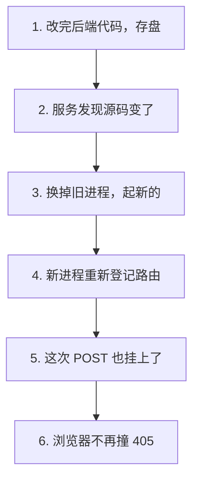
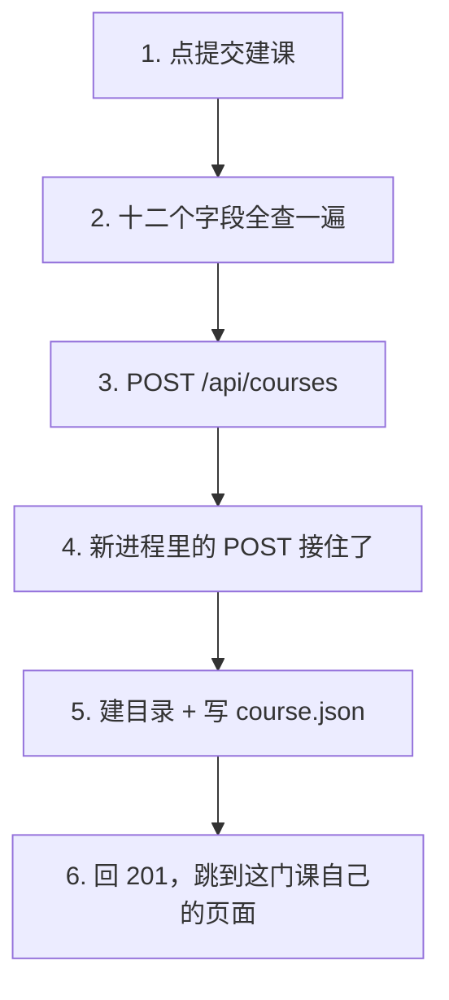

# 修 405 · 建课接口 405 Method Not Allowed

> 改动报告 · 2026-10-27 · 分支 `dev-don`
>
> 浏览器点「提交建课」收到 405，不是表单写错了。
> 是**跑着的后端进程太老**：它是加建课接口之前启动的，代码再也没换过。
> 这次让后端自己换新。

## 第一部分：Q&A 概览

| Question | Answer |
| --- | --- |
| Why did the browser get 405?【浏览器为什么收到 405】 | The process that was running was started before the creation route existed, so it only knew how to answer GET.【跑着的那个进程是加建课接口之前启动的 它只认 GET】Its code never changed while it ran.【它跑起来之后代码就没再动过】 |
| What changed now?【这次改了什么】 | The start script now runs the backend with the reload switch on, so a code change takes effect by itself.【启动脚本给后端打开了自动重载 改完代码自己生效】 |
| Does the reload watch everything?【自动重载会不会乱看】 | No, it only watches the source folder.【不会 它只盯着后端源码目录】The virtualenv is deliberately left out.【虚拟环境被故意排除在外】 |
| Is the 405 really gone?【405 真的没有了吗】 | The live route table now shows GET and POST on the same address.【跑着的路由表现在同一个地址上 GET 和 POST 都在】 |
| Do I still need to restart by hand?【还要手动重启吗】 | Only when the start script itself changes.【只有启动脚本自己改了才要】After that the API and the frontend both refresh on their own.【之后前后端都自己刷新】 |

## 第二部分：数据流

### 1. 改完后端代码，进程自己换新



| 步骤 | 关键变量 | 具体示例值 | 说明 |
| --- | --- | --- | --- |
| 1. 改完存盘 | `course_routes.py`（路由源码） | 加一行 `@router.post(...)` | 文件落到磁盘上，这一行的内容此刻是新的 |
| 2. 被监听到 | `app`（被盯的源码目录） | `apps/api/app` | 只盯这个目录，`.venv` 故意不盯 |
| 3. 换新进程 | `reload`（自动重载开关） | `--reload` | 旧的收掉，新的用磁盘上的代码起来 |
| 4. 重新登记路由 | `router`（装路由的架子） | `APIRouter(prefix="/api/courses")` | 新进程从头读一遍路由表 |
| 5. 挂上 POST | `post`（方法装饰器） | `@router.post("", status_code=201)` | 旧进程里缺的正是这一行 |
| 6. 不再 405 | 路由表 | `/api/courses -> GET, POST` | 同一个地址，GET 和 POST 都在 |

```dataflow
1-01 (改完存盘) 开发者改完 [[create_course_from_intake()]]建课路由的处理函数}}，把文件存到磁盘上 <{course_routes.py}>
1-02      → [被监听到] [[uvicorn]]跑起后端的那个服务程序}} 在 [[app]]后端源码目录}} 里看到 .py 变了 <{start-agent.sh}>
1-03           ↳ [换新进程] [[reload]]让后端代码改完自己生效的开关}} 收掉旧进程，起一个新的 <{start-agent.sh}>
1-04                ↳ [重新登记路由] [[APIRouter]]装路由的那个架子}} 重新登记一遍，这次 [[post]]POST 方法的装饰器}} 也挂上去了 <{course_routes.py}>
1-05                     ↳ [405 从哪来] 旧进程里只有 [[get]]GET 方法的装饰器}}，浏览器 POST 打过去它接不住 → 405 <{course_routes.py}>
---
{
  "1-01": "The developer changes the handler of the creation route and saves the file, so the disk now holds a newer version than the one the server is running.【create_course_from_intake[the handler of the creation route]: the old version → the version on the disk】",
  "1-02": "The program that runs the backend keeps an eye on the source folder and notices that a python file changed.【app[the source folder that is watched]: quiet → one file changed】",
  "1-03": "Because the reload switch is on, the old process is put down and a new one starts with the code that is on the disk right now.【reload[the switch that lets the process change itself]: off → on】",
  "1-04": "The new process reads the routes from the beginning, and this time the POST decorator is registered next to the GET one.【APIRouter[the router that holds the routes]: GET only → GET and POST】",
  "1-05": "That is exactly where the 405 came from: the old process only had the GET decorator, so a POST request arrived at a door that nobody was standing at.【get[the only decorator the old process had]: GET → the browser sent POST and got 405】",
  "Summary": "The backend was serving a frozen copy of the code. The fix is one switch on the start script: when the reload switch is on, saving a backend file puts the old process down and starts a new one with the code on the disk. The new process registers the POST route, so the same address now answers both GET and POST, and the 405 that the browser kept hitting is gone."
}
---
// STEP FLOW: 1-01[改完存盘] → 1-02[被监听到] → 1-03[换新进程] → 1-04[重新登记路由] → 1-05[405 从哪来]

// 这像一家早班开到一半就关门打烊的店:招牌上写着「建课受理」,可店里的人还是昨天那一批。
// 换了新的人(1-03)才看得懂新规矩(1-04),新来的客人就不用在门口吃闭门羹(1-05)。

// ===== 📂 scripts/start-agent.sh(一键把前后端拉起来的脚本) =====
// 1-02[被监听到] 只盯 app 这个源码目录,.venv 不在盯的范围里
// 1-03[换新进程] 这两个开关就是这次的全部改动
exec "$VENV_PY" -m <*uvicorn*> app.main:app --host 127.0.0.1 --port "$API_PORT" \
  --<*reload*> --reload-dir <*app*>

// ===== 📂 apps/api/app/api/course_routes.py(建课接口的路由) =====
// 1-04[重新登记路由] 路由架子,前缀是 /api/courses
router = <*APIRouter*>(prefix="/api/courses", tags=["courses"])

// 1-01[改完存盘] 建课的处理函数,POST 靠这一行挂上去
@router.<*post*>("", response_model=CourseCreated, status_code=201)
def <*create_course_from_intake*>(payload: CourseCreate) -> CourseCreated:
    ...

// 1-05[405 从哪来] 旧进程里只有这一个方法装饰器,POST 打过来它接不住
@router.<*get*>("/{slug}", response_model=CourseSummary)
def read_course(slug: str) -> CourseSummary:
    ...
```

### 2. 浏览器提交建课表单，这次真的建出来了



| 步骤 | 关键变量 | 具体示例值 | 说明 |
| --- | --- | --- | --- |
| 1. 点提交建课 | `submit()`（提交函数） | 按钮变成"建课中…" | 十二个字段全查一遍，有一个不行就跳回它所在的那一段 |
| 2. 发出去 | `api.createCourse(input)`（建课调用） | `POST /api/courses` | 请求体就是 P1.7 那个 `CourseCreate` |
| 3. 有人接了 | `post`（方法装饰器） | `@router.post(...)` | 旧进程没有这一行，这才是 405 的根 |
| 4. 建目录 | `create_course_scaffold()`（骨架落盘） | `courses/py/` | 建课程目录、workspace 和 `course.json` |
| 5. 回读 | `get_course()`（把课读回来） | `courses/py/course.json` | 从磁盘读回，回答里的课程就是列表里那一门 |
| 6. 跳走 | `navigate()`（换页面） | `/courses/py` | 浏览器自己换到这门课自己的页面 |

```dataflow
2-01 (点提交建课) [[submit()]]把整张表单交给后端的方法}} 把十二个字段全查一遍 <{course-pages.tsx}>
2-02      → [发出去] [[createCourse()]]前端建课的那一次请求}} → [[POST]]浏览器发来的请求方法}} [[/api/courses]]建课接口的地址}} <{api.ts}>
2-03           ↳ [这次有人接] 新进程里有 [[post]]POST 方法的装饰器}}，接住这次请求，回 201 <{course_routes.py}>
2-04                ↳ [建目录] [[create_course_scaffold()]]把课程骨架写到磁盘上的方法}} 建出这门课自己的目录 <{scaffold.py}>
2-05                     ↳ [回读] [[get_course()]]把一门课读回来的方法}} 从磁盘读回这门课，回答里的课程就是列表里那一门 <{course_service.py}>
2-06                          ↳ [跳走] [[navigate()]]前端换页面的方法}} 换到这门课自己的页面 <{course-pages.tsx}>
---
{
  "2-01": "The form is checked once more as a whole before anything leaves the browser, so a wrong field never becomes a request.【submit[the function that sends the form]: runs the whole check first】",
  "2-02": "The twelve values are packed into the exact body the API expects and sent to the creation endpoint.【createCourse[the create call]: POST /api/courses\nmethod[how the browser sends it]: POST】",
  "2-03": "This time the running process has the POST route, so the request lands on a door that somebody is standing at and comes back with 201.【post[the decorator that makes the route exist]: missing → present\nanswer[what the server says back]: 405 → 201】",
  "2-04": "The course skeleton is written to the disk: the course folder, its workspace and the course description file.【create_course_scaffold[the writer of the skeleton]: writes courses/py/ and its course.json】",
  "2-05": "The new course is read back from the disk, so the course in the answer is the very same item the course list shows.【get_course[the reader of one course]: from courses/py/course.json】",
  "2-06": "With the new short name in hand, the browser goes to the page of that course.【navigate[the change of page]: to the page of the new course】",
  "Summary": "The same request that used to bounce off with 405 now goes through. The new process has the POST route, the skeleton lands on the disk, the course is read back from there, and the browser ends up on the page of the course it just created."
}
---
// STEP FLOW: 2-01[点提交建课] → 2-02[发出去] → 2-03[这次有人接] → 2-04[建目录] → 2-05[回读] → 2-06[跳走]

// 这像寄一封挂号信:以前地址那栋楼只有「收件」没有「登记」,信送到了没人接(2-03)。
// 现在换了一班人上班,信被登记入册(2-04)、回执上写清门牌(2-05),你手上就多了一个地址(2-06)。

// ===== 📂 apps/web/src/pages/course-pages.tsx(建课向导：点提交) =====
// 2-01[点提交建课] 先把整张表单查一遍
async function <*submit*>() {
  const found = validateAll(values);
  ...
  try {
    const created = await api.<*createCourse*>(toPayload(values));
    // 2-06[跳走] 建成了,换到这门课自己的页面
    <*navigate*>(`/courses/${created.course.slug}`);
  } catch (reason) {
    ...
  }
}

// ===== 📂 apps/web/src/api.ts(前端发请求的四个调用) =====
// 2-02[发出去] 建课那一次请求
createCourse: (input: CourseCreate) =>
  request<CourseCreated>("/api/courses", {
    method: "POST",
    headers: { "Content-Type": "application/json" },
    body: JSON.stringify(input),
  }),

// ===== 📂 apps/api/app/api/course_routes.py(建课接口的路由) =====
// 2-03[这次有人接] 旧进程里缺的就是这一行
@router.<*post*>("", response_model=CourseCreated, status_code=201)
def create_course_from_intake(payload: CourseCreate) -> CourseCreated:
    ...

// ===== 📂 apps/api/app/courses/scaffold.py(课程骨架落盘) =====
// 2-04[建目录] 目录不存在才建,已存在就抛 FileExistsError
def <*create_course_scaffold*>(request: CourseCreate, courses_root: Path) -> dict[str, Any]:
    ...
    course_root.mkdir(parents=True)
    for name in COURSE_DIRECTORIES:
        (course_root / name).mkdir()
    for name in WORKSPACE_DIRECTORIES:
        (course_root / "workspace" / name).mkdir()
    _write_json_atomic(course_root / "course.json", metadata)

// ===== 📂 apps/api/app/course_service.py(建课服务的门面) =====
// 2-05[回读] 从磁盘把刚建好的课读回来
def <*get_course*>(slug: str) -> dict[str, Any] | None:
    """Read one course out of the courses root."""
    return catalog.get_course(slug, get_settings().courses_root)
```

## 第三部分：其它

### 这次改动的边界

只有 [scripts/start-agent.sh](scripts/start-agent.sh) 一个文件、一处改动：给 uvicorn 加上
`--reload --reload-dir app`。后端源码一行没动，前端源码一行没动，`apps/api/tests` 一行没动。

### 405 的根因是怎么坐实的

不是猜的，是三条证据对上了：

1. **跑着的进程认的路由表里没有 POST**。读运行中服务的 OpenAPI 文档，当时 `/api/courses`
   下面只有 GET。
2. **磁盘上的源码里有 POST**。[apps/api/app/api/course_routes.py:50](apps/api/app/api/course_routes.py#L50)
   就是 `@router.post("", response_model=CourseCreated, status_code=201)`。
3. **同一个地址，GET 通、POST 不通**。直接打 `127.0.0.1:8000`：GET 回 200，POST 回 405。

所以问题不在表单，也不在 Vite 代理（代理转发 GET 一直正常），而在**跑着的进程是一份旧代码**。
`scripts/start-agent.sh` 原来启动 uvicorn 不带 `--reload`，进程起来之后代码再怎么改，
它手里的那份都不换 —— 新加的路由就安静地变成了 405。

### 为什么是 `--reload-dir app`，不是光 `--reload`

- uvicorn 的 `reload_dirs` 不指定时是**当前工作目录**（脚本里 cd 到了 `apps/api`）。
- watchfiles 的默认忽略名单里**没有 `.venv`**。
- uvicorn 自带的过滤器只匹配 `*.py`，而 `.venv` 里全是 `.py` —— 不收窄目录的话，
  装个包就能把服务重启一遍。

收窄到 `app` 之后，只有后端源码改动才会触发重启。

### 这次验证了什么、没验证什么

**验证了（只读方式）**：

- 运行中服务的路由表现在是 `/api/courses -> GET, POST`，
  `/api/courses/{slug} -> GET`，`/api/health -> GET`。
- OpenAPI 里建课请求体的 12 个字段，跟开发者贴的那份 payload **完全对得上**：
  不多不少，5 个必填（`title` `slug` `audience` `goals` `scope`）都在，
  `token_budget_mtokens` 允许 `null`。
- `courses/py` 目前是空闲的，重试不会撞 409。
- 建课只会建 `courses/py/` 这一个目录，**不会碰 `courses/catalog.json`**。

**没验证（以及为什么）**：

- **没有真的发一次 POST 走完全程**。发验证请求的命令被权限分类器拦了两次
  （理由是任何 POST 到本地 API 都算写操作），所以改用只读的路由表 + 请求体模型来确认。
  端到端的证据由开发者自己点一次「提交建课」补上。
- **没跑 pytest**：后端源码一行没动，P1.7 的 131 passed / 1 skipped 仍是基线。
- **没跑 npm**：前端源码一行没动。
- **没做 E2E**：CLAUDE.md 第 6 条。

### 交给开发者的一件事

现在跑着的 API 是**会话内临时起的**那个后台进程（后台任务 `btl4rss94`），
它会活到本会话结束。要一个长期稳定的，请自己重跑一次 `scripts/start-agent.sh` ——
它现在带 `--reload --reload-dir app`，之后改后端代码自己生效。

### 报告自检（没跑 `check-report.py`）

按 CLAUDE.md 第 10 条，报告格式**没有跑** `check-report.py`。这次改用一份**放在仓库外**的
临时脚本（`%TEMP%/p18-report-check/check_rules.py`）复刻它的规则逐条核对：
`###` 子段 2 个（≤3）、每个 `dataflow` 块里 `---` 各两处、步骤号在图 / JSON 键 /
代码区 `//` 注释三处一致、`[[]]` 与 `}}` 配对、注音标识都在代码区原样出现、
JSON 讲解纯英文、Q&A 5 行且中文只在 `【】` 内、STEP FLOW 一条且每项都是 `[...]`。

**它是复刻，不是检查器本身** —— 权威的 `check-report.py` 仍然没跑过，两者可能有出入。

**这一轮抓出并已修的问题**：代码区里只贴了 `scaffold.py` 的函数体，没有
`create_course_scaffold` 这个标识本身 → 补上函数签名那一行。

**顺手拿它回测了已有报告**：本项目的 P1.8 全过；P1.7 报出一条 —— 第二个 dataflow 块的
`2-04` 步注音标识 `create_course_scaffold()` 在**那一块的代码区里没出现**
（那块只贴了 `schemas.py` 和 `common.py`）。这一条跟「STEP FLOW 用圆括号」是两回事，
之前的记录搞混了。**要不要回头改 P1.7 那篇，等开发者说。**
