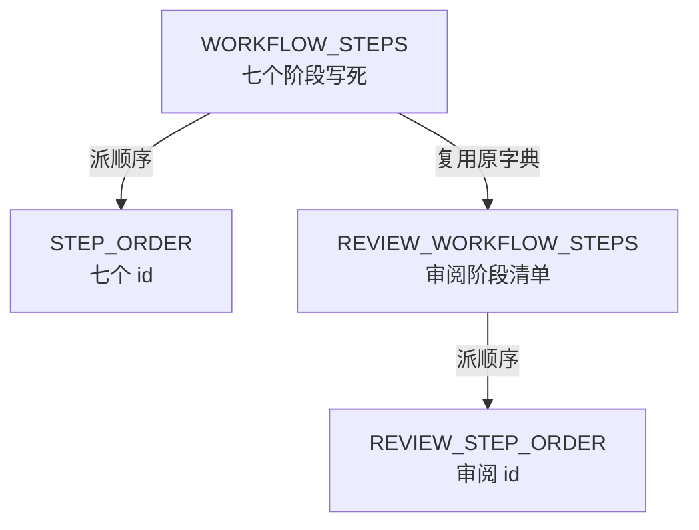
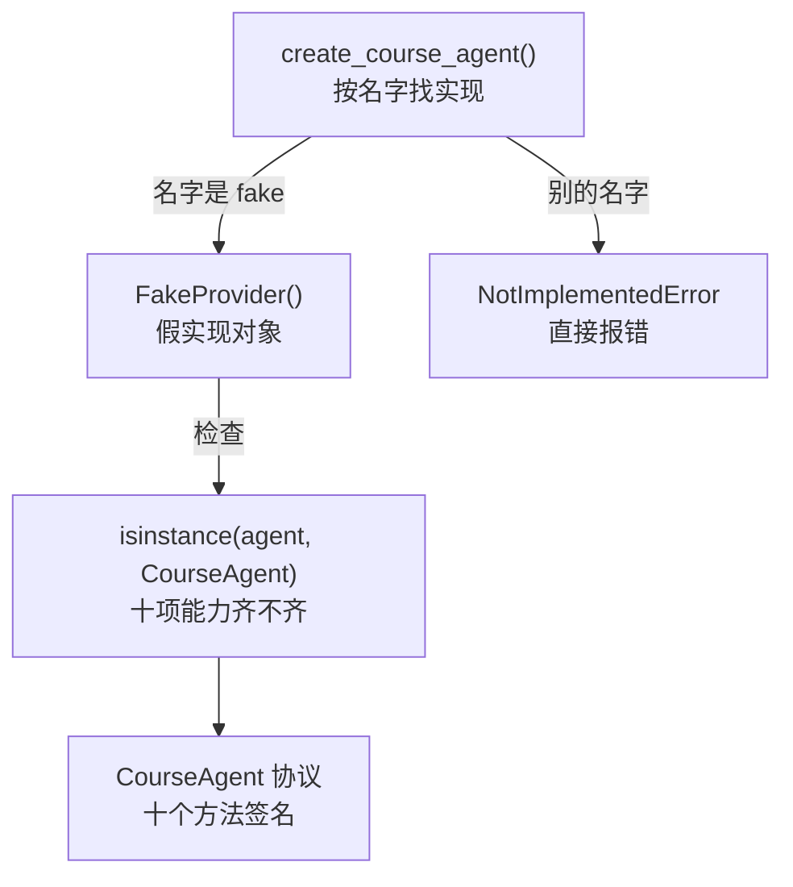
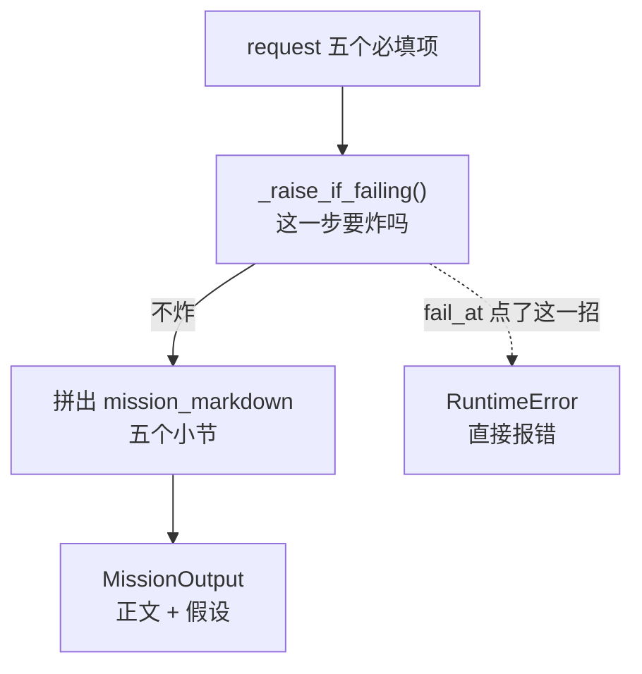

# P1.1–P1.3 · 课程流程与 Agent 能力的地基

> 覆盖范围：`P1.1` 七阶段契约常量 · `P1.2` Agent 能力协议 · `P1.3` 假 Provider 与第一批输出 Schema
> 分支：`dev-don` · 提交：`9b17a4e` · `7684ce9` · `78bc95b`

## 第一部分：Q&A 概览

| Question             | Answer                          |
| -------------------- | ------------------------------- |
| What changed?【这次改了什么】 | The course journey and what an agent can do are now written down in code.【七阶段流程和 Agent 能力边界都写进了代码】The frontend can read the stages, and tests keep them from drifting. |
| Where do the seven stages live?【七个阶段放在哪】 | One single file.【只在一个文件里】Every other place derives from it instead of repeating it.【其它地方都从它派生,不再各写一份】 |
| What is the agent contract?【Agent 的能力边界是什么】 | A protocol with ten capabilities.【十个能力的协议】It only says what an agent must be able to do, never how.【只说能做什么,不说怎么做】 |
| Why a fake provider so early?【为什么这么早就做假的】 | So the whole flow runs with no key and no network.【不用密钥不联网就能跑通全流程】Real providers plug in later.【真 Provider 后面才接进来】 |
| Can it break on purpose?【能不能故意失败】 | Yes.【可以】You pick the step that breaks.【指定在哪一步失败】Most steps raise an error; the humanizer just scores low.【大多数步骤直接报错,润色那步只给低分】 |

## 第二部分：数据流

### 1. 七个步骤从哪来



```dataflow
1-01 (模块加载) WORKFLOW_STEPS七阶段字典清单 直接写死在代码里 从 intake 一路到 release <{definitions.py}>
1-02      → [派顺序] STEP_ORDER七个阶段 id 列表 逐个 stage["id"] 收集出来 <{definitions.py}>
1-03           ↳ [拼审阅流] REVIEW_WORKFLOW_STEPS审阅阶段清单 从 WORKFLOW_STEPS拿前五步原字典 + 换一个审阅版 quality 字典 + 再拿最后一步原字典 <{definitions.py}>
1-04                ↳ [派顺序] REVIEW_STEP_ORDER审阅阶段 id 列表 逐个 stage["id"] 收集出来 <{definitions.py}>
---
{
  "1-01": "This one file holds the whole course journey, all seven stops in order.【WORKFLOW_STEPS[the seven stage descriptions]: intake, mission, blueprint, batch_plan, generation, quality, release】",
  "1-02": "The order is not typed out by hand, it is read off the list, so the two can never disagree.【STEP_ORDER[the seven stage ids in order]: intake → mission → blueprint → batch_plan → generation → quality → release】",
  "1-03": "The review journey reuses the very same dictionaries for six of the seven stops. Only the quality stop is different, because checking an old course is not the same job as building a new one.【REVIEW_WORKFLOW_STEPS[the review stage list]: six stages shared as-is + one brand new quality stage】",
  "1-04": "And its order is derived the same way, so the review flow always lines up with the build flow.【REVIEW_STEP_ORDER[the review stage ids in order]: the same seven ids, the same order】",
  "Summary": "The whole course journey now lives in one file, and everything else is derived from it. The review journey shares the same stage objects with the build journey, so the two can never drift apart by accident."
}
---
// STEP FLOW: 1-01[模块加载] → 1-02[派顺序] → 1-03[拼审阅流] → 1-04[派顺序]

// 整条流程像一份固定的课程路线图:七个站点按顺序排好,谁想看顺序都从图上读。
// 审阅路线复用同一份地图,只在"质量"那一站换了个牌子——因为查旧课和建新课不是一回事。

// ===== 📂 app/workflow/definitions.py(七阶段契约常量,整个项目的事实源) =====
// 1-01[模块加载] 七个阶段直接写死
<*WORKFLOW_STEPS*>: list[dict[str, str]] = [
    {
        "id": "intake",
        "title": "课程需求",
        "description": "确认课程目标、受众、范围、来源与交付形式",
        "user_input": "课程名称、受众、学习目标、内容范围、来源政策",
        "model_output": "结构化任务输入与缺失项",
    },
    # ... 中间五步 blueprint / batch_plan / generation / quality / release 同理 ...
    {
        "id": "release",
        "title": "整课确认",
        "description": "整课回归后交由用户决定是否完成",
        "user_input": "最终审核与发布决定",
        "model_output": "Markdown、HTML、质量记录和交付状态",
    },
]

// 1-02[派顺序] 顺序不手写,从清单里逐个收
<*STEP_ORDER*>: list[str] = [<*step*>["id"] for <*step*> in <*WORKFLOW_STEPS*>]

// 1-03[拼审阅流] 前五步和最后一步都复用原字典对象,只有 quality 换成审阅版
<*REVIEW_WORKFLOW_STEPS*>: list[dict[str, str]] = [
    *<*WORKFLOW_STEPS*>[:-2],
    {
        "id": "quality",
        "title": "课程 Review",
        "description": "审阅或重生成既有课程内容",
        "user_input": "选择章节、补充审阅要求并确认处理结果",
        "model_output": "章节审校、质量报告与修改结果",
    },
    <*WORKFLOW_STEPS*>[-1],
]

// 1-04[派顺序] 审阅顺序同样派生
<*REVIEW_STEP_ORDER*>: list[str] = [<*step*>["id"] for <*step*> in <*REVIEW_WORKFLOW_STEPS*>]
```

### 2. 造一个能用的 Agent



```dataflow
2-01 (调用工厂) create_course_agent()按名字找实现的函数 先看 provider_name 是不是 fake <{runtime.py}>
2-02      → [造实例] FakeProvider()假 Provider 对象 建好 同时记住 fail_at 要在哪儿失败 <{fake_runtime.py}>
2-03           ↳ [填失败表] FAILURE_TARGETS失败档位对照表 把 generation 这个阶段别名指向 generate_chapter()方法 <{fake_runtime.py}>
2-04                ↳ [对协议] isinstance()拿 agent和 CourseAgent比一比 看这个对象十项能力是不是都齐了 <{protocols.py}>
---
{
  "2-01": "You ask the factory for an agent by name.【create_course_agent(provider_name)[the name of the agent you want]: fake】",
  "2-02": "The factory hands you the offline one, and remembers where you wanted it to break.【FakeProvider instance[the offline agent object]: created\nfail_at[the step that should break]: none → whatever you asked for】",
  "2-03": "The failure table is a plain lookup, so the stage name and the method name both work.【FAILURE_TARGETS[the table of which step breaks what]: generation → generate_chapter, plus the other nine steps】",
  "2-04": "Then the object is checked against the protocol, which is how we know the agent really covers the whole boundary.【isinstance result[whether all ten capabilities are there]: yes】",
  "Summary": "There is exactly one agent implementation so far, and the factory refuses to pretend otherwise. Asking for any other provider raises an error instead of quietly handing back something that does not exist."
}
---
// STEP FLOW: 2-01[调用工厂] → 2-02[造实例] → 2-03[填失败表] → 2-04[对协议]

// 整条流程像去租车:报车名,人家给你一台能开的;报个不存在的车名,人家直接说没有,
// 不拿一台空壳糊弄你——因为这个阶段本来就只有这一台车。

// ===== 📂 app/agents/runtime.py(按名字造 Agent 的工厂) =====
// 2-01[调用工厂] 名字转小写再比对
if <*provider_name*> is not None and <*provider_name*>.lower() == "fake":
    # 2-02[造实例] 只有 fake 这一条路
    return <*FakeProvider*>()
raise NotImplementedError(
    f"Provider {<*provider_name*>!r} is not available in Phase 1; "
    "only 'fake' is implemented."
)

// ===== 📂 app/agents/fake_runtime.py(假 Provider 实现) =====
// 2-02[造实例] 建对象时就把非法档位挡掉
def __init__(self, fail_at: str | None = None) -> None:
    if <*fail_at*> is not None and <*fail_at*> not in <*FAILURE_TARGETS*>:
        raise ValueError(
            f"Unknown fail_at {<*fail_at*>!r}; "
            f"expected one of {sorted(<*FAILURE_TARGETS*>)}."
        )
    self.<*fail_at*> = <*fail_at*>

// 2-03[填失败表] 阶段别名和方法名都指向同一个方法
<*FAILURE_TARGETS*>: dict[str, str] = {
    "create_mission": "create_mission",
    "create_blueprint": "create_blueprint",
    "plan_research": "plan_research",
    "curate_research": "curate_research",
    "generation": "generate_chapter",
    "generate_chapter": "generate_chapter",
    "humanize": "humanize",
    "semantic_review": "semantic_review",
    "extract_continuity": "extract_continuity",
    "plan_repair": "plan_repair",
    "present_output": "present_output",
}

// ===== 📂 app/agents/protocols.py(Agent 能力协议) =====
// 2-04[对协议] 加上 runtime_checkable 之后 isinstance 才可以用
@runtime_checkable
class <*CourseAgent*>(Protocol):
    """The capability boundary every course agent has to satisfy."""

    name: str

    def create_mission(self, request: dict) -> MissionOutput:
        """Turn the intake request into a structured mission."""
        ...
    # ... 另外九项能力,create_blueprint / plan_research / curate_research /
    #     generate_chapter / humanize / semantic_review / extract_continuity /
    #     plan_repair / present_output ...

// ===== 📂 apps/api/tests/test_fake_runtime.py(假 Provider 行为测试) =====
// 2-04[对协议] 十项能力齐了才算数
<*agent*> = <*create_course_agent*>("fake")
assert <*isinstance*>(<*agent*>, <*CourseAgent*>)
```

### 3. 跑一次任务定义,以及怎么故意失败



```dataflow
3-01 (带请求来) request装着五个必填项的字典 title课程名 / audience目标受众 / goals学习目标 / scope内容范围 / source_policy来源政策 <{fake_runtime.py}>
3-02      → [先查失败] _raise_if_failing()先问要不要报错的方法 看看 fail_at 是不是点了这一步 <{fake_runtime.py}>
3-03           ↳ [拼正文] mission_markdown任务书正文 拼出五段小节 目标受众 / 学习成果 / 内容范围 / 来源政策 / 交付与审核 <{fake_runtime.py}>
3-04                ↳ [附假设] assumptions顺手记下的假设 记一条 "Fake Provider 演示输出" <{fake_runtime.py}>
4-01 (故意降分) FakeProvider(fail_at="humanize")假 Provider 对象 记住润色这一步要降分 <{fake_runtime.py}>
4-02      → [给低分] humanize()润色正文的方法 返回 revised_markdown正文原样不动 + score打分 30 分 + issues毛病一条 <{fake_runtime.py}>
4-03           ↳ [不报错] 这里不抛异常 因为质量闭环要能接住一个低分结果 <{fake_runtime.py}>
---
{
  "3-01": "You hand over the intake answers and the agent starts working.【request[the intake answers]: title, audience, goals, scope, source_policy】",
  "3-02": "Before doing any work it checks whether you asked it to break here.【fail_at[the step that should break]: none → none】",
  "3-03": "It writes the mission as a markdown page with one small section per answer.【mission_markdown[the mission document]: written with five sections】",
  "3-04": "And it says out loud what it assumed, so a reader can spot the guess.【assumptions[the things it took on faith]: one entry added】",
  "4-01": "You can also tell it to fail on purpose, and pick the step.【fail_at[the step that should break]: none → humanize】",
  "4-02": "On the humanizer step it does not crash, it just hands back a poor grade.【score[the grade for the writing]: 47 → 30\nissues[what was wrong with it]: empty → one entry】",
  "4-03": "That is on purpose, because a quality loop has to be able to catch a low grade and react to it.【the call[what the humanizer call returns]: a valid result, no error】",
  "Summary": "The fake agent is a pure function of its input, so the same request always produces the same mission. It can also break on demand, which is how the error paths get exercised before a real provider exists."
}
---
// STEP FLOW: 3-01[带请求来] → 3-02[先查失败] → 3-03[拼正文] → 3-04[附假设] → 4-01[故意降分] → 4-02[给低分] → 4-03[不报错]

// 整条流程像一份填好的问卷交给实习生:他先看有没有"故意出错"的指令,没有就照着写成一份任务书;
// 你要试错就指定一页,让他交一份明显不合格的稿子——而润色那一页是故意不报错的,
// 因为后面要接一个专门挑毛病的流程,它得能接住这份低分稿子。

// ===== 📂 app/agents/fake_runtime.py(假 Provider 实现) =====
// 3-01[带请求来] 五个必填项直接取,少一个就报错
def create_mission(self, request: dict) -> MissionOutput:
    """Turn the intake request into a structured mission."""
    // 3-02[先查失败] 这一步被点了就直接抛
    self.<*_raise_if_failing*>("create_mission")
    <*title*> = request["title"]
    // 3-03[拼正文] 五段小节拼成一份任务书
    <*markdown*> = "\n".join(
        [
            f"# {<*title*>}：课程任务定义",
            "",
            "## 目标受众",
            "",
            _render_value(request["audience"]),
            "",
            "## 学习成果",
            "",
            _render_value(request["goals"]),
            # ... 内容范围 / 来源政策 / 交付与审核 三段同理 ...
        ]
    )
    // 3-04[附假设] 把假设写出来
    return <*MissionOutput*>(
        <*mission_markdown*>=<*markdown*>,
        <*assumptions*>=["Fake Provider 演示输出"],
    )

// 4-01[故意降分] 唯一的降级档位:不抛异常,只给低分
def humanize(self, markdown: str) -> HumanizerOutput:
    """Rewrite the chapter into student-facing prose."""
    if self.<*_fails_at*>("humanize"):
        // 4-02[给低分] 正文原样不动,分数压到 30,毛病记一条
        // 4-03[不报错] 这里不抛异常,低分也是合法结果,质量闭环接得住
        return <*HumanizerOutput*>(
            <*revised_markdown*>=markdown,
            <*score*>=30,
            <*issues*>=["Fake Provider 故意返回低分，用于触发质量闭环。"],
        )
    # 正常档位:47 分,没有毛病
    return <*HumanizerOutput*>(revised_markdown=markdown, score=47, issues=[])

// 3-02[先查失败] 查失败表,命中就抛
def <*_raise_if_failing*>(self, method_name: str) -> None:
    """Raise the injected failure for `method_name`."""
    if self.<*_fails_at*>(method_name):
        raise RuntimeError(f"FakeProvider failed at {method_name}.")
```

## 第三部分：其它

#### 这次改动的边界

三个计划只做了三件事，**没有**碰任何真实模型、数据库、队列、LangGraph、Worker、质量闭环或自动发布：

| 计划 | 新增 | 一句话说明 |
| --- | --- | --- |
| P1.1 | `app/workflow/definitions.py` | 七阶段流程写死成一个文件，审阅流程复用它 |
| P1.2 | `app/agents/protocols.py` | Agent 的十项能力写成协议，只有签名没有实现 |
| P1.3 | `app/schemas.py`、`app/agents/fake_runtime.py`、`app/agents/runtime.py` | 十三个输出模型 + 一个能跑的假 Provider + 一个只认 `fake` 的工厂 |

#### 三个需要留意的取舍

1. **假 Provider 真的"假"。** 它不联网、不读密钥、不写磁盘，同样的输入永远给出同样的输出。这让它可以撑起整条流程的联调，但也意味着**它的内容没有任何课程价值**——它存在的意义是让后面的流程有地方接。
2. **`fail_at` 大多会直接报错，只有一档例外。** 十个档位里九个抛 `RuntimeError`，只有润色那档返回 30 分的合法结果。原因是质量闭环需要接住一个"能用但很差"的结果，而不是被异常打断。
3. **协议暂时只有十项能力。** 参考实现里还有七项（改写工作区、审校一致性、改写章节等），它们要等到 P3.8 和对应的一起补齐。现在协议里的十项是**冻结**的——后面谁想加能力，都要先改协议。

#### 还缺什么

- 七阶段清单还没有 API 出口，前端暂时拿不到它（P1.6 / P1.8 才接上）。
- `create_course_agent()` 目前只认 `fake`，真实 Provider 排在 P3.4。
- 建课 API（`POST /api/courses`）排在 P1.7，`CourseCreate` 这个入参模型要到 P1.5 才出现在 `app/schemas.py`。
