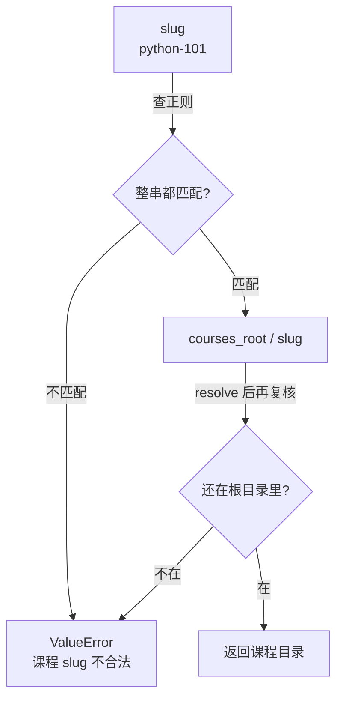
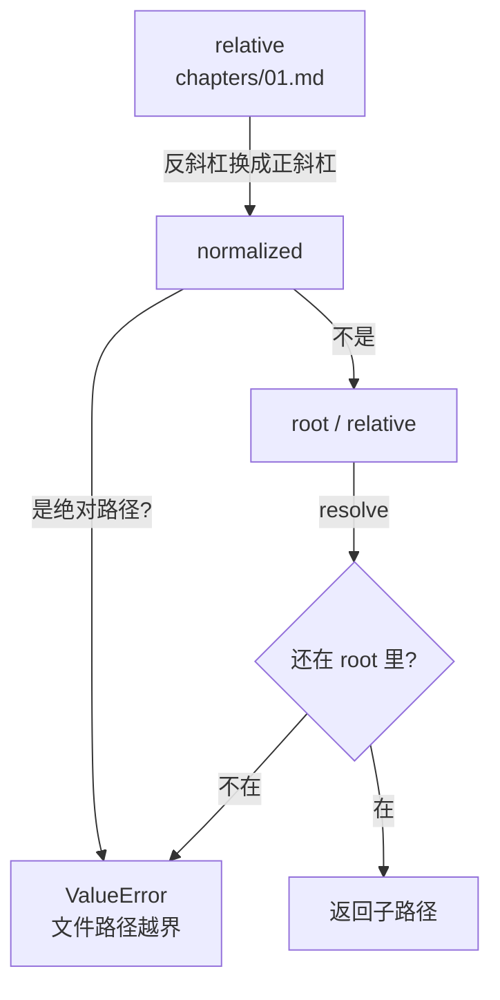
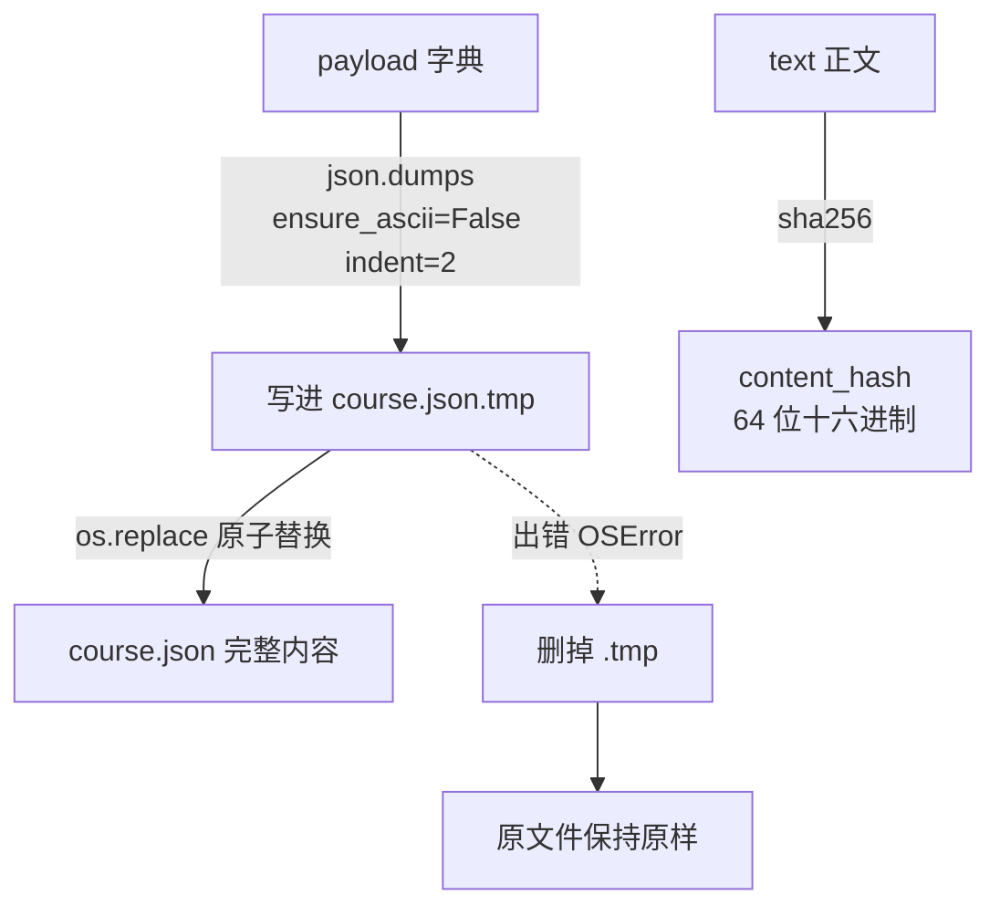

# P1.4 · 路径护栏与原子写

> 覆盖范围：`P1.4` 建立路径护栏与原子写
> 分支：`dev-don` · 提交：无（按约定，提交由开发者自己做）

## 第一部分：Q&A 概览

| Question             | Answer                          |
| -------------------- | ------------------------------- |
| What is this step for?【这一步是干什么的】 | Before any course file is read or written, the path has to be checked.【在读任何一个课程文件之前 都要先把路径验一遍】This step puts that check in one place, so no other code has to remember to do it.【护栏只写一次 别的代码不用再自己记着查】 |
| How does a course name become a folder?【课程名怎么变成文件夹】 | The name has to look like python-101: small letters, digits and single dashes.【名字必须长得像 python-101 小写字母 数字 单个连字符】Anything else is turned away at the door.【不像的一律当场请出去】 |
| What stops a file path from escaping the course folder?【怎么防止文件路径跑出课程目录】 | Every path is turned into its real absolute form first, then compared with the folder it has to stay inside.【每条路径都先变成真实绝对路径 再跟它该待的目录比一遍】Paths that point outside are refused, and Windows backslash tricks are refused too.【跑出去的路径一律拒绝 Windows 反斜杠那套也一样】 |
| How is a course file saved without ending up half written?【课程文件怎么存才不会被写坏】 | The new content goes to a temporary file first, then one single swap puts it in place.【新内容先写进临时文件 再一步原子替换换上去】If the swap fails, the old file stays exactly as it was and the temporary file is cleaned up.【替换失败就原样保留旧文件 临时文件也清掉】 |
| What is the content hash for?【内容指纹是干什么的】 | The same text always gets the same 64 character fingerprint.【同一段文字每次都得到同一个 64 位指纹】Later steps can then tell that a chapter really changed, without storing the whole text again.【后面只看指纹就知道这章改没改 不用再存一遍正文】 |

## 第二部分：数据流

### 1. 一个课程名变成一个目录



```dataflow
1-01 (带 slug 来) [[slug]]课程的小写短名}} 和 [[courses_root]]课程根目录}} 一起交给 [[_safe_course_root()]]算出课程目录的方法}} <{common.py}>
1-02      → [查正则] [[SLUG_PATTERN]]只准小写字母数字和连字符的正则}} 用 [[fullmatch()]]整串必须完全匹配的方法}} 把 [[slug]]课程的小写短名}} 验一遍 <{common.py}>
1-03           ↳ [不合法] 匹配不上就抛 [[ValueError]]表示参数不对的错}} 信息是 "课程 slug 不合法" <{common.py}>
1-04                ↳ [拼目录] 合法就拼出 [[candidate]]算出来的课程目录}} = [[courses_root]]课程根目录}} 拼上 [[slug]]课程的小写短名}} <{common.py}>
1-05                     ↳ [再复核] [[candidate]]算出来的课程目录}} 和 [[courses_root]]课程根目录}} 都 [[resolve()]]变成绝对真实路径的方法}} 走一遍 再用 [[is_relative_to()]]判断在不在里面的方法}} 比一次 <{common.py}>
1-06                          ↳ [交出去] 还在就把 [[candidate]]算出来的课程目录}} 交出去 不在也抛 [[ValueError]]表示参数不对的错}} 同一个错 <{common.py}>
---
{
  "1-01": "You bring a course short name and the folder that holds every course, and ask where the folder of this one course is.【_safe_course_root[the helper that finds a course folder]: called with the name and the courses folder】",
  "1-02": "First the name goes through the one rule book: small letters, digits and single dashes, and the whole name has to match.【SLUG_PATTERN[the one rule book for course names]: the pattern is looked up and applied】",
  "1-03": "If the name does not fit the rule book, it stops right there and says the name is not allowed.【the outcome[what happens to this name]: refused, with the message about an illegal slug】",
  "1-04": "If the name fits, it glues the name onto the courses folder to get the folder this course would live in.【candidate[the folder this course would live in]: the courses folder plus the name】",
  "1-05": "Then it turns both paths into the real absolute ones, so a shortcut or a symbolic link cannot fool it, and compares them.【candidate[the folder this course would live in]: unresolved → resolved\ncourses_root[the folder that holds every course]: unresolved → resolved】",
  "1-06": "If the folder is still inside the courses folder, you get it. If not, the very same refusal comes back, so there is no second chance to slip out.【the outcome[what happens to this name]: refused → accepted, or refused again】",
  "Summary": "One short name in, one course folder out. The name has to fit a fixed shape, and even after it fits, the folder is checked a second time so it can never leave the courses folder. Two doors, same lock."
}
---
// STEP FLOW: 1-01[带 slug 来] → 1-02[查正则] → 1-03[不合法] → 1-04[拼目录] → 1-05[再复核] → 1-06[交出去]

// 整条流程像门卫查证件:先看名字长得对不对,对不上直接请出去;对得上才拼出房间号,
// 然后再回头看一眼这房间号是不是还在这栋楼里——双保险,以后规矩放宽了也不会把人放错楼。

// ===== 📂 app/courses/common.py(课程目录护栏:课程名 → 课程目录) =====
// 1-01[带 slug 来] 入口:课程的小写短名 + 课程根目录
def <*_safe_course_root*>(<*slug*>: str, <*courses_root*>: Path) -> Path:
    """Return the folder that holds one course, refusing anything that escapes.

    Args:
        slug: The short name of the course, for example "python-101".
            It has to match SLUG_PATTERN: lower case letters, digits and
            single dashes only.
        courses_root: The directory that holds every course folder,
            for example courses/.

    Returns:
        The folder this course would live in, inside courses_root.
        Raises ValueError("课程 slug 不合法") if the slug does not match
        the pattern, or if the resulting folder would leave courses_root.
    """
    // 1-02[查正则] 整串必须完全匹配,末尾多一个换行也不放过
    if not <*SLUG_PATTERN*>.<*fullmatch*>(<*slug*>):
        // 1-03[不合法] 直接拒绝
        raise <*ValueError*>("课程 slug 不合法")

    // 1-04[拼目录] 课程根目录 拼上 slug
    <*candidate*> = <*courses_root*> / <*slug*>
    // 1-05[再复核] 两条路径都变成真实路径后再比一次
    if not <*candidate*>.<*resolve*>().<*is_relative_to*>(<*courses_root*>.<*resolve*>()):
        // 1-06[交出去] 不在就当它不合法
        raise <*ValueError*>("课程 slug 不合法")
    // 1-06[交出去] 在就交出去
    return <*candidate*>
```

### 2. 一段相对路径变成一个安全的子路径



```dataflow
2-01 (带相对路径来) [[root]]课程根目录}} 和 [[relative]]相对根目录的一段路径}} 交给 [[_safe_child()]]算出根目录内子路径的方法}} <{common.py}>
2-02      → [换斜杠] 先把 [[relative]]相对根目录的一段路径}} 里的反斜杠统一换成正斜杠 记进 [[normalized]]换好分隔符的路径}} <{common.py}>
2-03           ↳ [查绝对] 把 [[normalized]]换好分隔符的路径}} 交给 [[PurePosixPath]]按 unix 规则看路径的类}} 用 [[is_absolute()]]判断是不是绝对路径的方法}} 问一遍 <{common.py}>
2-04                ↳ [看盘符] 再把 [[normalized]]换好分隔符的路径}} 交给 [[PureWindowsPath]]按 windows 规则看路径的类}} 看出 [[windows_path]]windows 规则下的路径}} <{common.py}>
2-05                     ↳ [是绝对] 命中就抛 [[ValueError]]表示参数不对的错}} 信息是 "文件路径越界" <{common.py}>
2-06                          ↳ [拼候选] 拼出 [[candidate]]算出来的子路径}} = [[root]]课程根目录}} 拼上 [[normalized]]换好分隔符的路径}} 再 [[resolve()]]变成绝对真实路径的方法}} 一次 <{common.py}>
2-07                               ↳ [比一比] 用 [[is_relative_to()]]判断在不在里面的方法}} 看 [[candidate]]算出来的子路径}} 还在不在 [[root]]课程根目录}} 的里面 不在就抛 [[ValueError]]表示参数不对的错}} 同一个错 <{common.py}>
---
{
  "2-01": "You hand over the course folder and a path that is meant to be relative to it, and ask where that file really is.【_safe_child[the helper that turns a relative path into a real one]: called with the folder and the relative path】",
  "2-02": "First it makes every separator look the same, so a Windows style path cannot slip past the checks.【normalized[the path after the separators are unified]: backslashes → forward slashes】",
  "2-03": "Then it asks one rule book whether the path is absolute, the way a Linux machine would see it.【posix_absolute[the answer from the unix rules]: not absolute → absolute】",
  "2-04": "And it asks the Windows rule book the same question, because on Windows a path can look rooted without ever naming a drive.【windows_path[the path as Windows sees it]: built from the normalized text】",
  "2-05": "If either rule book says this is an absolute path, it stops: a relative path that turns out absolute is exactly the thing that must not be allowed.【the outcome[whether the path is accepted]: refused, with the message that the path is out of bounds】",
  "2-06": "Otherwise it glues the path onto the course folder and turns the result into the real absolute path.【candidate[the real file path]: the folder plus the relative path, resolved】",
  "2-07": "Finally it checks that the real path is still inside the course folder. If not, the same refusal comes back.【the outcome[whether the path is accepted]: refused → accepted, or refused again】",
  "Summary": "A relative path is only allowed to stay relative. It is normalized, checked against both the Linux rules and the Windows rules for absolute paths, and then compared with the folder it has to live in. Paths that try to climb out with dots, with a backslash, or by naming a drive all get refused with the same message."
}
---
// STEP FLOW: 2-01[带相对路径来] → 2-02[换斜杠] → 2-03[查绝对] → 2-04[看盘符] → 2-05[是绝对] → 2-06[拼候选] → 2-07[比一比]

// 整条流程像门卫查门牌:先把牌号里的分隔符统一,再问两遍"这是不是个绝对地址",
// 确认只是屋内的相对位置,最后才拿它跟这栋楼比一次——差一层都不放行。

// ===== 📂 app/courses/common.py(文件路径护栏:相对路径 → 根目录内的子路径) =====
// 2-01[带相对路径来] 入口:课程根目录 + 一段相对路径
def <*_safe_child*>(<*root*>: Path, <*relative*>: str) -> Path:
    """Return the real path of a file that lives inside a course folder.

    Args:
        root: The folder the path has to stay inside,
            for example courses/python-101/.
        relative: The path relative to that folder,
            for example "chapters/01.md".

    Returns:
        The resolved path of the file inside root.
        Raises ValueError("文件路径越界") if the path is absolute, or if it
        resolves to a place outside root.
    """
    // 2-02[换斜杠] 反斜杠也当分隔符
    <*normalized*> = <*relative*>.replace("\\", "/")
    // 2-03[查绝对] unix 规则问一遍
    posix_absolute = <*PurePosixPath*>(<*normalized*>).<*is_absolute*>()
    // 2-04[看盘符] windows 规则再问一遍
    <*windows_path*> = <*PureWindowsPath*>(<*normalized*>)
    // 2-05[是绝对] 命中就拒绝
    if posix_absolute or windows_path.drive or windows_path.root:
        raise <*ValueError*>("文件路径越界")

    // 2-06[拼候选] 根目录 拼上相对路径,再变成真实路径
    <*candidate*> = (<*root*> / <*normalized*>).<*resolve*>()
    // 2-07[比一比] 还在不在根目录里面
    if not <*candidate*>.<*is_relative_to*>(<*root*>.resolve()):
        raise <*ValueError*>("文件路径越界")
    return <*candidate*>
```

### 3. 写一份 JSON 不会写坏



```dataflow
3-01 (要存一份 JSON) [[payload]]要存下去的字典}} 和 [[path]]要写到哪个文件}} 交给 [[_write_json_atomic()]]一步换掉旧文件的方法}} <{common.py}>
3-02      → [序列化] 用 [[dumps()]]把字典转成 JSON 字符串的方法}} 把 [[payload]]要存下去的字典}} 转成 [[text]]要写进文件的字符串}} 靠 [[ensure_ascii]]中文要不要转义的开关}} 关掉转义 靠 [[indent]]缩进几格的开关}} 设成两格 末尾补一个换行 <{common.py}>
3-03           ↳ [写暂存] 先写到一个叫 [[tmp]]临时文件}} 上 文件名是 [[path]]要写到哪个文件}} 的名字加 ".tmp" <{common.py}>
3-04                ↳ [原子替换] 用 [[replace()]]一步换掉旧文件的方法}} 把 [[tmp]]临时文件}} 换成 [[path]]要写到哪个文件}} <{common.py}>
3-05                     ↳ [出事清理] 出错就用 [[unlink()]]删掉文件的方法}} 把 [[tmp]]临时文件}} 删掉 [[path]]要写到哪个文件}} 一个字节都不动 <{common.py}>
4-01 (算内容指纹) [[text]]要算指纹的正文}} 交给 [[content_hash()]]算内容指纹的函数}} <{common.py}>
4-02      → [算哈希] 把 [[text]]要算指纹的正文}} 编码成 utf-8 交给 [[hashlib]]标准库里的哈希模块}} 的 [[sha256()]]一种哈希算法}} 再用 [[hexdigest()]]转成十六进制字符串的方法}} <{common.py}>
---
{
  "3-01": "You hand over the dictionary you want to keep and the file it belongs in, and ask for it to be written safely.【_write_json_atomic[the helper that writes JSON without ever breaking a file]: called with the file and the dictionary】",
  "3-02": "First the dictionary is turned into text: Chinese stays Chinese instead of being escaped into unreadable codes, the lines are indented, and the file ends with a newline.【text[the text that will be written]: the dictionary as indented JSON, with a newline at the end】",
  "3-03": "That text goes into a temporary file sitting next to the real one, with .tmp added to the name.【tmp[the staged file]: course.json becomes course.json.tmp】",
  "3-04": "Then one single swap puts the temporary file in place of the real one. Because it is one swap, a reader either sees the old file or the new one, never a half written one.【the file on disk[what a reader can see]: the old content → the new content, all at once】",
  "3-05": "If the swap fails, the temporary file is removed and the old file is left exactly as it was. Nothing half done is left behind.【tmp[the staged file]: written → removed\nthe file on disk[what a reader can see]: the old content → the old content, untouched】",
  "4-01": "You can also ask for the fingerprint of a piece of text.【content_hash[the fingerprint helper]: called with the text】",
  "4-02": "The text is encoded and put through a well known hash algorithm, and the result is written out as 64 lowercase hex characters.【the result[the 64 character fingerprint]: a hex string, always the same length】",
  "Summary": "Writing a course file goes through a staging file and one atomic swap, so a reader never catches a half written file, and a failed write changes nothing at all. The content hash gives the same text the same fingerprint every time, which is how later steps can tell that a chapter really changed."
}
---
// STEP FLOW: 3-01[要存一份 JSON] → 3-02[序列化] → 3-03[写暂存] → 3-04[原子替换] → 3-05[出事清理] → 4-01[算内容指纹] → 4-02[算哈希]

// 整条流程像寄信:先把信写好放进草稿袋(临时文件),再一把塞进邮筒(原子替换),
// 塞的时候手滑就把草稿袋收走,原来那封信原封不动——读者永远只会看到完整的信。

// ===== 📂 app/courses/common.py(原子写与内容指纹) =====
// 3-01[要存一份 JSON] 入口:要存下去的字典 + 要写到哪个文件
def <*_write_json_atomic*>(<*path*>: Path, <*payload*>: dict[str, Any]) -> None:
    """Write a dictionary as JSON, so a reader never sees a half written file.

    Args:
        path: The file to write, for example
            courses/python-101/course.json. Its parent directory has to
            exist already; a wrong path has to surface immediately instead
            of being hidden by a silent mkdir.
        payload: The dictionary to store, for example
            {"title": "Python 入门"}.

    Returns:
        Nothing. The new content replaces the old one in a single step, and
        if that step fails the old file stays untouched and no temporary
        file is left behind.
    """
    // 3-02[序列化] 中文不转义,缩进两格,末尾补一个换行
    <*text*> = json.<*dumps*>(<*payload*>, <*ensure_ascii*>=False, <*indent*>=2) + "\n"
    // 3-03[写暂存] 先落到临时文件
    <*tmp*> = <*path*>.with_suffix(<*path*>.suffix + ".tmp")
    try:
        <*tmp*>.write_text(<*text*>, encoding="utf-8")
        // 3-04[原子替换] 一步换上去
        os.<*replace*>(<*tmp*>, <*path*>)
    except BaseException:
        // 3-05[出事清理] 暂存文件删掉,原文件不动
        <*tmp*>.<*unlink*>(missing_ok=True)
        raise

// ===== 📂 app/courses/common.py(内容指纹) =====
// 4-01[算内容指纹] 入口:一段正文
def <*content_hash*>(<*text*>: str) -> str:
    """Return the fingerprint of a piece of text.

    Args:
        text: The text to fingerprint, for example one chapter body.

    Returns:
        The sha256 digest of the text as 64 lower case hex characters. The
        same text always gives the same fingerprint, so a later step can
        tell that a chapter really changed without storing the text again.
    """
    // 4-02[算哈希] 编码后走一遍 sha256
    return <*hashlib*>.<*sha256*>(<*text*>.encode("utf-8")).<*hexdigest*>()
```

## 第三部分：其它

#### 这次改动的边界

P1.4 只加了一层文件系统护栏，**没有**碰模型、数据库、队列、LangGraph、Worker、质量闭环或自动发布：

| 文件 | 状态 | 一句话说明 |
| --- | --- | --- |
| `app/courses/__init__.py` | 新增 | 包标记，一行 docstring，同 `app/agents/__init__.py` 的写法 |
| `app/courses/common.py` | 新增 | 两条路径护栏 + 一条原子写 + 一个内容指纹 |
| `apps/api/tests/test_course_paths.py` | 新增 | 21 个行为测试 |

`common.py` 是纯文件系统工具：没有网络、没有全局状态，也**不读 `Settings` 单例**——课程根目录由调用方显式传进来，所以护栏不用 monkeypatch 就能测。

#### 代码片段里的函数都带完整文档注释

按你新立的规矩，报告里贴出来的每个函数都要有自己的文档注释。Python 用 docstring 写，写法对齐你给的 TS JSDoc 例子：一句话说清这个函数干什么，`Args:` 逐个参数说清楚（带例子），`Returns:` 说清返回什么、什么情况下会报错。

`common.py` 里四个函数（`_safe_course_root` / `_safe_child` / `_write_json_atomic` / `content_hash`）现在都带完整 docstring，**报告里的代码片段直接照抄源码，不是另写的**——所以源文件和报告永远对得上。

**还欠着的：** P1.1–P1.3 那批代码（`app/schemas.py` 的十三个输出模型、`app/agents/protocols.py` 的协议、`app/agents/fake_runtime.py` 的假 Provider）还是一行 docstring 的简写，没按这条规矩补。这属于回头改已经交付过的代码，等你说了再动。

#### 三条护栏各自的取舍

1. **课程根目录显式传入，不读配置。** 参考实现是 `_safe_course_root(slug, settings=None)`，内部自己去拿 `get_settings()`。这里改成调用方必须把根目录传进来，理由是护栏要能被单独测试，而且「课程根目录在哪儿」这件事应该在调用点一眼看得见，不该藏在函数内部。
2. **越界一律不回落到别的错误。** 两条护栏的失败都只有一种说法：`"课程 slug 不合法"` 和 `"文件路径越界"`。参考实现在「名字合法但拼出来的目录越界」时会抛第三种文案 `"课程目录越界"`，这里合并掉了——同一个原因不让调用方区分两种措辞。
3. **写文件不替你建目录。** 父目录不存在时直接抛 `FileNotFoundError`，而不是悄悄 `mkdir`。路径写错要立刻暴露，不能被一个自动建目录掩盖过去；参考实现会默默把目录建出来。

#### 一处偏离计划原文的地方（已同步回 RoadMap）

计划附录 P1.4.1 第 1 条原文写的是 `SLUG_PATTERN.match(slug)`。实现时改成了 `SLUG_PATTERN.fullmatch(slug)`，**模式串本身一个字没动**（还是 `^[a-z0-9]+(?:-[a-z0-9]+)*$`，P1.5 要断言的「逐字相同」不受影响）。

原因是 Python 的 `$` 也会匹配「字符串末尾那个换行符之前」：`match` 会放行 `"python-101\n"`，而 P1.5 的 Pydantic `pattern` 走的是 Rust 正则，更严格、会先拒掉。同一个模式串在两边含义不一样，正是 `SLUG_PATTERN` 要消除的那种漂移。改动方向是收紧（拒得更多），不会放宽任何东西。

`RoadMap.md` 的 P1.4.1 附录和 `.superpowers/sdd/RoadMap/task-P1.4-brief.md` 已经同步成 `fullmatch`，并补了一句说明。

#### 交给下一步的两条提醒

1. **两个函数返回的路径形态不一样**：`_safe_course_root` 返回**未 resolve** 的 `courses_root / slug`（这是计划里写死的验收断言），`_safe_child` 返回**已 resolve** 的路径。P1.5 / P1.6 混用时别拿未 resolve 的根目录去和 resolve 过的子路径直接比。
2. **P1.5 必须用同一个模式串**：`CourseCreate.slug` 要用 `^[a-z0-9]+(?:-[a-z0-9]+)*$`，并断言它与 `app.courses.common.SLUG_PATTERN.pattern` 逐字相同。

#### 还缺什么

- 护栏只是「门」，还没有真正走进来的人——建课流程排在 P1.5，课程目录扫描排在 P1.6。
- `_write_json_atomic` 没做 `fsync`：原子替换（不会读到半个文件）已经保证，断电时的持久化没有保证，计划没要求，没加。
