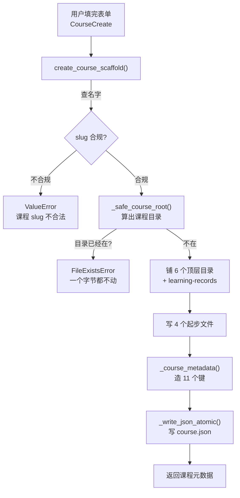
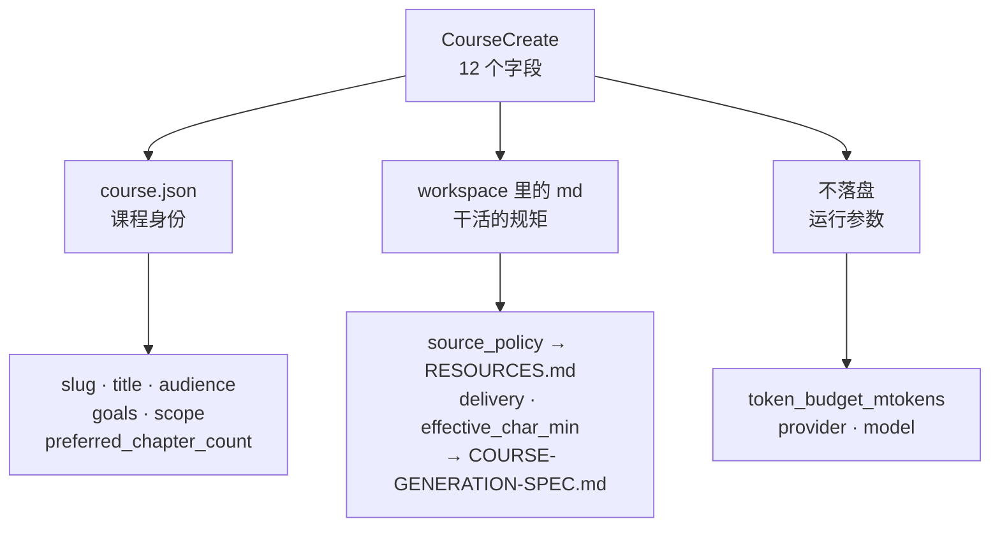
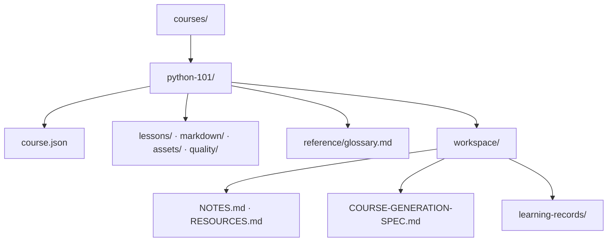

# P1.5 · 实现课程脚手架创建

> 覆盖范围：`P1.5` 建课时一次性铺好目录骨架与 `course.json`
> 分支：`dev-don` · 提交：无（按约定，提交由开发者自己做）

## 第一部分：Q&A 概览

| Question             | Answer                          |
| -------------------- | ------------------------------- |
| What does this step do?【这一步是干什么的】 | One course form, one folder on disk.【一份课程表单 磁盘上一个文件夹】This step lays out the whole skeleton of a course in one go: the folders, the notes, and the course.json that every later step reads.【一次把课程的骨架铺好 目录 笔记 还有那个后面到处都要读的 course.json】 |
| What is inside a new course folder?【新课程文件夹里有什么】 | Seven folders and five files.【七个目录 五个文件】lessons, reference, markdown, assets, quality and workspace hold the course pieces; inside sit NOTES.md, RESOURCES.md, COURSE-GENERATION-SPEC.md and glossary.md, with course.json at the top.【lessons reference markdown assets quality workspace 装课程零件 里面是 NOTES.md RESOURCES.md COURSE-GENERATION-SPEC.md 术语表 最上面放着 course.json】 |
| Where do the form fields end up?【表单里填的字段都落到哪儿了】 | The course identity goes into course.json.【课程的身份信息进 course.json】The working rules go into the workspace notes, and three run settings stay only inside the request.【干活的规矩进工作区笔记 三个运行参数只留在这一次请求里】 |
| What happens when the course name is already taken?【课程名撞上了会怎样】 | It stops, and nothing gets overwritten.【当场停下 一个字都不覆盖】The scaffold refuses to touch a folder that already exists, so an old course can never be silently replaced.【老课程绝不会被悄悄换掉】 |
| Why is course.json written the careful way?【course.json 为什么写得这么小心】 | It goes to a temporary file first and one single swap puts it in place.【先写临时文件 再一步换上去】A reader either sees the old file or the new one, never half of one.【读者要么看到旧的 要么看到新的 绝不会看到半截】 |

## 第二部分：数据流

### 1. 一个课程名变成一个课程文件夹



```dataflow
1-01 (带表单来) [[CourseCreate]]装表单内容的模型}} 带着 [[request]]这次要建的课}} 和 [[courses_root]]课程根目录}} 交给 [[create_course_scaffold()]]一次铺好课程骨架的函数}} <{scaffold.py}>
1-02      → [查名字] 用 [[SLUG_PATTERN]]只准小写字母数字和连字符的正则}} 加 [[fullmatch()]]整串必须完全匹配的方法}} 验一遍 [[request]]这次要建的课}} 里的 [[slug]]课程的小写短名}} 不合规就抛 [[ValueError]]表示参数不对的错}} <{scaffold.py}>
1-03           ↳ [算目录] 用 [[_safe_course_root()]]算出课程目录的方法}} 算出 [[course_root]]这门课要住的目录}} <{scaffold.py}>
1-04                ↳ [撞名] [[course_root]]这门课要住的目录}} 已经在磁盘上 就抛 [[FileExistsError]]目录已存在的错}} 这时候一个写操作都还没发生 <{scaffold.py}>
1-05                     ↳ [铺目录] 按 [[COURSE_DIRECTORIES]]六个顶层目录的清单}} 建目录 再按 [[WORKSPACE_DIRECTORIES]]工作区子目录的清单}} 建 [[learning-records]]迭代记录目录}} <{scaffold.py}>
1-06                          ↳ [写文件] 交给 [[_write_starting_files()]]写起步文件的函数}} 落 [[NOTES.md]]迭代笔记文件}} [[RESOURCES.md]]资源和来源政策文件}} [[COURSE-GENERATION-SPEC.md]]生成规格文件}} [[glossary.md]]术语表文件}} 四个文件 <{scaffold.py}>
1-07                               ↳ [写总账] 交给 [[_course_metadata()]]造课程元数据的函数}} 造出 11 个键 再用 [[_write_json_atomic()]]一步换掉旧文件的方法}} 写进 [[course.json]]课程总账文件}} <{scaffold.py}>
1-08                                    ↳ [交回] 把刚落盘的 [[metadata]]课程元数据字典}} 原样交回去 <{scaffold.py}>
---
{
  "1-01": "The user finishes the course form. The form, plus the folder that holds every course, is handed to the one function that builds a new course.【create_course_scaffold[the one function that builds a course folder]: called with the form and the courses folder】",
  "1-02": "First the short name goes through the same rule book the path guard uses, and the whole name has to match. If it does not fit, the request is turned away right there.【SLUG_PATTERN[the one rule book for course names]: applied to the whole short name\nthe outcome[what happens to this request]: accepted → refused】",
  "1-03": "Then the guard works out which folder this course would live in.【course_root[the folder this course would live in]: computed from the short name】",
  "1-04": "If that folder is already on disk, somebody already made a course with this name, so the function refuses. Nothing has been written yet, so the old course keeps every byte it had.【the outcome[what happens to this request]: refused, and nothing on disk is changed】",
  "1-05": "Otherwise the empty folders are made in one go, so every later step finds the same shape on disk.【COURSE_DIRECTORIES[the six top folders]: missing → created\nWORKSPACE_DIRECTORIES[the one sub folder of the workspace]: missing → created】",
  "1-06": "Then the four starting files are written: the notes of the course, the resource and source policy notes, the generation spec, and the glossary of terms.【NOTES.md, RESOURCES.md, COURSE-GENERATION-SPEC.md, glossary.md[the four starting files]: missing → written】",
  "1-07": "The course.json is the ledger of the course. The eleven keys are built first, then the file is written the safe way, through a temporary file and one single swap.【metadata[the eleven keys of the course]: built from the form\ncourse.json[the course ledger on disk]: missing → written in one swap】",
  "1-08": "Finally the very dictionary that went into the file is handed back, so the caller can answer without reading the file again.【metadata[the course metadata]: written to disk → returned to the caller】",
  "Summary": "One form in, one course folder out. The short name is checked first, an existing course is never overwritten, and the whole skeleton is laid down in one pass so every later step finds the same shape. The ledger file is written atomically, so a reader never sees half of it."
}
---
// STEP FLOW: 1-01[带表单来] → 1-02[查名字] → 1-03[算目录] → 1-04[撞名] → 1-05[铺目录] → 1-06[写文件] → 1-07[写总账] → 1-08[交回]

// 整条流程像按图纸盖一间房:先核对房号合不合法,再看这间房是不是已经有人住了,
// 没住人才动土——搭好格子,再摆上说明书,最后落一份总账,一次齐活。

// ===== 📂 app/courses/scaffold.py(课程骨架:表单 → 一个课程文件夹) =====
// 目录清单:六个顶层目录 + 工作区里的一个子目录
<*COURSE_DIRECTORIES*> = (
    "lessons",
    "reference",
    "markdown",
    "assets",
    "quality",
    "workspace",
)
<*WORKSPACE_DIRECTORIES*> = ("learning-records",)

// 1-01[带表单来] 入口:课程表单 + 课程根目录
def <*create_course_scaffold*>(<*request*>: CourseCreate, <*courses_root*>: Path) -> dict[str, Any]:
    """Create the folder skeleton and course.json of a brand new course.

    Args:
        request: The intake form the user submitted, for example a
            CourseCreate with the slug "python-101".
        courses_root: The directory that holds every course folder,
            for example courses/.

    Returns:
        The metadata that was written to course.json, so the caller can
        answer with the same values without reading the file again.
        Raises ValueError("课程 slug 不合法") when the slug does not match
        the shared pattern, and FileExistsError when the course folder is
        already there: an existing course is never overwritten.
    """
    // 1-02[查名字] 跟护栏用同一本正则
    if not <*SLUG_PATTERN*>.<*fullmatch*>(<*request*>.slug):
        raise <*ValueError*>("课程 slug 不合法")

    // 1-03[算目录] 护栏算出这门课要住的目录
    <*course_root*> = <*_safe_course_root*>(<*request*>.slug, <*courses_root*>)
    // 1-04[撞名] 目录已经在了就当场拒绝,一个写操作都不做
    if <*course_root*>.exists():
        raise <*FileExistsError*>(f"课程已存在：{<*request*>.slug}")

    // 1-05[铺目录] 六个顶层目录 + 工作区里的迭代记录目录
    <*course_root*>.mkdir(parents=True)
    for <*name*> in <*COURSE_DIRECTORIES*>:
        (<*course_root*> / <*name*>).mkdir()
    for <*name*> in <*WORKSPACE_DIRECTORIES*>:
        (<*course_root*> / "workspace" / <*name*>).mkdir()

    // 1-06[写文件] 四个起步文件
    <*_write_starting_files*>(<*course_root*>, <*request*>)

    // 1-07[写总账] 造出 11 个键,再用 P1.4 的原子写落盘
    <*metadata*> = <*_course_metadata*>(<*request*>)
    <*_write_json_atomic*>(<*course_root*> / "course.json", <*metadata*>)
    // 1-08[交回] 刚写进去的那份字典原样交回去
    return <*metadata*>


// ===== 📂 app/courses/scaffold.py(四个起步文件) =====
// 1-06[写文件] 入口:新课程的目录 + 表单
def <*_write_starting_files*>(<*course_root*>: Path, <*request*>: CourseCreate) -> None:
    """Write the four files a fresh course starts with.

    Args:
        course_root: The folder of the new course, for example
            courses/python-101/.
        request: The intake form the user submitted, for example a
            CourseCreate with the source policy "只使用公开官方资料".

    Returns:
        Nothing. The four files exist once the call returns.
    """
    <*workspace*> = <*course_root*> / "workspace"
    (<*workspace*> / "NOTES.md").write_text(<*NOTES_MD*>, encoding="utf-8")
    (<*workspace*> / "RESOURCES.md").write_text(
        <*RESOURCES_MD_TEMPLATE*>.format(source_policy=<*request*>.source_policy),
        encoding="utf-8",
    )
    (<*workspace*> / "COURSE-GENERATION-SPEC.md").write_text(
        <*COURSE_GENERATION_SPEC_MD_TEMPLATE*>.format(
            delivery=<*request*>.delivery,
            preferred_chapter_count=<*request*>.preferred_chapter_count,
            effective_char_min=<*request*>.effective_char_min,
        ),
        encoding="utf-8",
    )
    <*glossary*> = <*course_root*> / "reference" / "glossary.md"
    <*glossary*>.write_text(<*GLOSSARY_MD*>, encoding="utf-8")
```

### 2. 表单的十二个字段各归哪家



```dataflow
2-01 (表单十二个字段) [[CourseCreate]]装表单内容的模型}} 里有 12 个字段 先分三堆 <{schemas.py}>
2-02      → [进总账] 课程身份相关的字段进 [[course.json]]课程总账文件}}：[[slug]]课程短名}} · [[title]]课程标题}} · [[audience]]给谁学}} · [[goals]]要教会什么}} · [[scope]]学到哪}} · [[preferred_chapter_count]]期望章节数}} · [[description]]和 goals 同一句话}} <{scaffold.py}>
2-03           ↳ [进工作区] 干活的规矩进工作区的 markdown：[[source_policy]]来源政策}} 进 [[RESOURCES.md]]资源和来源政策文件}} [[delivery]]交付格式}} [[effective_char_min]]单章字数下限}} 进 [[COURSE-GENERATION-SPEC.md]]生成规格文件}} <{scaffold.py}>
2-04                ↳ [不落盘] 三个运行参数只活在这一次请求里：[[token_budget_mtokens]]令牌预算}} [[provider]]模型服务商}} [[model]]模型名字}} <{schemas.py}>
---
{
  "2-01": "The form model carries twelve fields, and they do not all belong in the same place. So they are split into three piles.【CourseCreate[the form model]: twelve fields, sorted into three piles】",
  "2-02": "The first pile is the identity of the course: who it is for, what it wants to teach, how wide it goes and how many chapters it should have. That goes into the course ledger, which is the file every later step reads.【course.json[the course ledger on disk]: the identity fields are written in\ndescription[the one line summary of the course]: the same text as the goals】",
  "2-03": "The second pile is the working rules: which sources may be used, what the delivery looks like and how long one chapter has to be. Those are written as readable notes in the workspace, because a person is meant to read and edit them.【RESOURCES.md[the source policy note]: written with the source policy\nCOURSE-GENERATION-SPEC.md[the generation spec note]: written with the delivery and the length floor】",
  "2-04": "The last pile is only about this one run: how many tokens it may spend, which gateway to talk to and which model to ask. Those stay in the request and are not written into the course folder.【token_budget_mtokens[how many tokens this run may spend]: kept in the request, not written to disk\nprovider[which gateway serves the model]: kept in the request, not written to disk\nmodel[which model to ask]: kept in the request, not written to disk】",
  "Summary": "The course folder keeps two kinds of memory. The identity of the course lives in course.json, where machines read it. The working rules live in the workspace notes, where a person reads them. The three run settings are deliberately not stored, because they belong to one run and not to the course."
}
---
// STEP FLOW: 2-01[表单十二个字段] → 2-02[进总账] → 2-03[进工作区] → 2-04[不落盘]

// 整条流程像整理一次搬家:重要的证件(课程身份)收进总账档案盒,日常要照着做的规矩
// 贴在工作区的记事板上,而这次搬家用的车和油钱(运行参数)用完就丢,不进箱子。

// ===== 📂 app/schemas.py(表单模型:12 个字段的出处) =====
// 2-01[表单十二个字段] 唯一的请求模型
class <*CourseCreate*>(BaseModel):
    """The intake form a user submits to create a course.

    This is the only request model of the module: the creation API of P1.7
    takes it as the body of `POST /api/courses`.  The slug uses the pattern
    of `app.courses.common.SLUG_PATTERN`, so the API and the path guard can
    never disagree about what a legal course folder looks like.
    """

    <*title*>: str = Field(min_length=2, max_length=120)
    <*slug*>: str = Field(pattern=SLUG_PATTERN.pattern)
    <*audience*>: str = Field(min_length=2, max_length=500)
    <*goals*>: str = Field(min_length=5, max_length=3000)
    <*scope*>: str = Field(min_length=2, max_length=3000)
    <*source_policy*>: str = "允许使用用户资料与公开官方资料"
    <*delivery*>: str = "Markdown + HTML"
    <*preferred_chapter_count*>: int = Field(default=12, ge=1, le=60)
    <*effective_char_min*>: int = Field(default=12000, ge=1000, le=50000)
    // 2-04[不落盘] 这三个只活在这一次请求里,不进课程目录
    <*token_budget_mtokens*>: float | None = Field(default=None, ge=0.01, le=10000)
    <*provider*>: str = "codex_gateway"
    <*model*>: str = "llm-gateway--kimi-k3"


// ===== 📂 app/courses/scaffold.py(字段分别落到哪个文件) =====
// 2-02[进总账] 造出总账的 11 个键
def <*_course_metadata*>(<*request*>: CourseCreate) -> dict[str, Any]:
    """Return the eleven keys that course.json has to contain.

    Args:
        request: The intake form the user submitted, for example a
            CourseCreate with the title "Python 入门".

    Returns:
        The metadata of a course that has not been generated yet: the
        intake values, an empty lesson list, the duration "待蓝图确认"
        and the status "preparing".
    """
    return {
        "schemaVersion": 1,
        "slug": <*request*>.slug,
        "title": <*request*>.title,
        "description": <*request*>.goals,
        "audience": <*request*>.audience,
        "goals": <*request*>.goals,
        "scope": <*request*>.scope,
        "duration": "待蓝图确认",
        "status": "preparing",
        "preferred_chapter_count": <*request*>.preferred_chapter_count,
        "lessons": [],
    }

// 2-02[进总账] 11 个键落进总账文件
<*_write_json_atomic*>(<*course_root*> / "course.json", <*metadata*>)
// 2-03[进工作区] 来源政策填空
(<*workspace*> / "RESOURCES.md").write_text(
    <*RESOURCES_MD_TEMPLATE*>.format(source_policy=<*request*>.source_policy),
    encoding="utf-8",
)
// 2-03[进工作区] 交付格式和字数下限填空
(<*workspace*> / "COURSE-GENERATION-SPEC.md").write_text(
    <*COURSE_GENERATION_SPEC_MD_TEMPLATE*>.format(
        delivery=<*request*>.delivery,
        preferred_chapter_count=<*request*>.preferred_chapter_count,
        effective_char_min=<*request*>.effective_char_min,
    ),
    encoding="utf-8",
)
```

### 3. 建完之后，磁盘上是什么样子



```dataflow
3-01 (课程根目录) [[courses_root]]课程根目录}} 下面多了一个以课程名命名的文件夹 <{scaffold.py}>
3-02      → [六个顶层目录] [[lessons]]正文目录}} [[reference]]参考资料目录}} [[markdown]]导出目录}} [[assets]]素材目录}} [[quality]]质检目录}} [[workspace]]工作区目录}} <{scaffold.py}>
3-03           ↳ [工作区] [[workspace]]工作区目录}} 里有 [[NOTES.md]]迭代笔记文件}} [[RESOURCES.md]]资源和来源政策文件}} [[COURSE-GENERATION-SPEC.md]]生成规格文件}} 还有一个 [[learning-records]]迭代记录目录}} <{scaffold.py}>
3-04                ↳ [参考资料] [[reference]]参考资料目录}} 里有 [[glossary.md]]术语表文件}} <{scaffold.py}>
3-05                     ↳ [课程总账] 最上面摆着 [[course.json]]课程总账文件}} <{scaffold.py}>
---
{
  "3-01": "After the call, the folder that holds every course has one more child in it, named after the short name of this course.【courses_root[the folder that holds every course]: one more course folder inside it】",
  "3-02": "Inside it there are six top folders: one for the chapters, one for reference material, one for the exported site, one for images and files, one for quality reports, and the workspace where the agent keeps its notes.【lessons, reference, markdown, assets, quality, workspace[the six top folders of a course]: created empty】",
  "3-03": "The workspace holds the three notes a person reads, and one folder for the running notes of later rounds.【NOTES.md, RESOURCES.md, COURSE-GENERATION-SPEC.md[the three notes in the workspace]: written\nlearning-records[the folder for later notes]: created empty】",
  "3-04": "The reference folder starts with a glossary, so there is already a place for the terms of this course.【glossary.md[the term list]: written with a table header only】",
  "3-05": "And the ledger sits at the very top of the course folder, next to all the folders.【course.json[the course ledger]: sits at the top of the course folder】",
  "Summary": "Every new course looks exactly the same on disk. Six top folders, three readable notes plus a folder for later notes in the workspace, a glossary in the reference folder, and the course ledger at the top. The later phases can therefore rely on the layout instead of checking whether it exists."
}
---
// STEP FLOW: 3-01[课程根目录] → 3-02[六个顶层目录] → 3-03[工作区] → 3-04[参考资料] → 3-05[课程总账]

// 整条流程像搬进一间样板房:进门是一个以课程名命名的房间,左边是正文和参考资料,
// 中间是工作区和质检,门口摆一张总账——以后每个阶段都往这套格子里放东西,不用再问"放哪儿"。

// ===== 📂 app/courses/scaffold.py(目录骨架清单) =====
// 3-02[六个顶层目录] 六个顶层目录
<*COURSE_DIRECTORIES*> = (
    "lessons",
    "reference",
    "markdown",
    "assets",
    "quality",
    "workspace",
)
// 3-03[工作区] 工作区里的子目录
<*WORKSPACE_DIRECTORIES*> = ("learning-records",)

// 3-01[课程根目录] 磁盘上多出来的就是这一棵树
// 3-02[六个顶层目录] 六个顶层目录,装课程零件
// 3-03[工作区] 工作区里三个笔记 + 一个迭代记录目录
// 3-04[参考资料] 参考资料目录里一个术语表
// 3-05[课程总账] 最上面那张课程总账
courses_root/
└── python-101/                          以课程名命名的文件夹
    ├── course.json                       课程总账
    ├── lessons/                          正文
    ├── reference/                        参考资料
    │   └── glossary.md                   术语表
    ├── markdown/                         导出
    ├── assets/                           素材
    ├── quality/                          质检
    └── workspace/                        工作区
        ├── learning-records/             迭代记录
        ├── NOTES.md                      迭代笔记
        ├── RESOURCES.md                  资源和来源政策
        └── COURSE-GENERATION-SPEC.md     生成规格
```

## 第三部分：其它

#### 这次改动的边界

P1.5 只在磁盘上铺了一个课程文件夹，**没有**碰网络、数据库、队列、LangGraph、Worker、质量闭环或自动发布：

| 文件 | 状态 | 一句话说明 |
| --- | --- | --- |
| `app/courses/scaffold.py` | 新增 | 铺目录骨架 + 写 4 个起步文件 + 原子写 `course.json` |
| `app/schemas.py` | 修改 | 加 `CourseCreate`（12 个字段），改模块 docstring |
| `apps/api/tests/test_course_scaffold.py` | 新增 | 18 个行为测试，全部落在真实文件系统上 |
| `apps/api/tests/test_schemas.py` | 修改 | 模型清单加上 `CourseCreate`（计划外的必要改动，见下） |

`scaffold.py` 只碰文件系统：没有网络、没有全局状态，也不读 `Settings` 单例——课程根目录由调用方显式传进来，所以脚手架不用 monkeypatch 就能测。

代码片段里的函数都带完整文档注释（`create_course_scaffold` / `_write_starting_files` / `_course_metadata`），格式沿用 P1.4 `common.py` 那套：一句摘要 + `Args:` 逐个参数（带例子）+ `Returns:`。**报告里的代码片段是源码的真实摘录**，源文件和报告永远对得上。

#### 跟参考实现不一样的四处（都是「不要照抄」的已知缺陷）

1. **`course.json` 用原子写。** 参考实现是 `write_text` + `json.dumps`，写一半被读到就是半截 JSON。这里走 P1.4 的 `_write_json_atomic`。
2. **不 import 后面阶段才有的模块。** 参考实现的 `scaffold.py` 同时 import 了 `app.courses.catalog`（P1.6 才建）和 `app.courses.workspace`（P2.x 才建）。本仓库的阶段顺序**故意**和目标版真实历史不同，所以 P1.5 必须自足——`scaffold.py` 现在的 import 只有 `pathlib` / `typing.Any` / `app.courses.common` / `app.schemas`。
3. **补上了 `from typing import Any`。** 参考实现漏了它（返回类型写的是 `dict[str, Any]`）。
4. **`course.json` 多写了三个键。** 参考实现只写 8 个键；这里写 11 个——多出的 `goals` / `scope` 是 **P8.4 明确要继承**的（它的产出键里有这两个，参考实现到 P8.4 就补不出来了），`preferred_chapter_count` 是 P4.4「把章节数同步进 `course.json`」的落点。

`CourseCreate.slug` 的 `pattern` 也不是抄一份字面量，而是**直接引用 `SLUG_PATTERN.pattern`**——P1.4 定下的唯一来源，两份正则从此不可能漂移。

#### 计划外的一处改动：`test_schemas.py`

P1.3 留了一个「模型清单」测试，锁死 `app/schemas.py` 只能有 13 个模型，它自己的注释还写着「`CourseCreate` belongs to P1.5」。P1.5 把 `CourseCreate` 加进去，这个测试**按设计**失效了，同批修好：清单加上 `CourseCreate`、测试改名为 `..._exactly_the_agreed_models`、docstring 同步。

**这颗雷还在**：P3.8 加 workspace schemas 时它会再炸一次。建议改成「必须包含这几个 + 允许的额外集合」的形式，否则每个阶段都要再改一次。

#### 三个字段没有落盘

`token_budget_mtokens` / `provider` / `model` 只活在这一次请求里，不进课程目录——它们是「这一次跑要花多少、找谁、问哪个模型」，属于某一次运行，不属于这门课。P1.7 的 `POST /api/courses` 若要在响应里回显它们，**从 `request` 取，不能从 `course.json` 读**。

另外三个键是写死的常量，不来自表单：`schemaVersion` 是 `1`，`duration` 是 `"待蓝图确认"`，`status` 是 `"preparing"`。

#### 交给下一步的三条提醒

1. **P1.6（目录扫描）**：`course.json` 的 11 个键已经定死，目录项的 `chapters` 用 `len(lessons)` 算。`description` 就是 `goals`（同一个值），别当成另一个字段。目录里没有 `course.json` 的子目录要跳过。
2. **P1.7（`POST /api/courses`）**：slug 重复 → `FileExistsError` → **409**；slug 非法 → Pydantic 挡在 **422**。映射请按**异常类型**判断，别依赖文案「课程已存在：{slug}」——那只是给人看的。
3. **P4.4 / P8.4**：章节数同步进 `course.json` 用 `preferred_chapter_count`；`goals` / `scope` 已经写进去了，直接读。

#### 还缺什么

- **建到一半失败会留下半个目录。** 目录铺完、写文件途中出错时没有回滚，磁盘上会剩一个残缺的课程文件夹。目前没有事务机制，P1.7 遇到这种情况会返回一个 500 和一个半成品目录。
- **`duration` / `status` 是写死的。** 蓝图确认、发布这些阶段改状态时，要记得回来改这两处，或者改成从别处派生。
- **原子写没有 `fsync`。** 断电时的持久化没有保证（跟 P1.4 一样），计划没要求，没加。
- **P1.5 还没有任何调用方。** 真正的入口是 P1.7 的 `POST /api/courses`，在那之前这个函数只能被测试调用。
