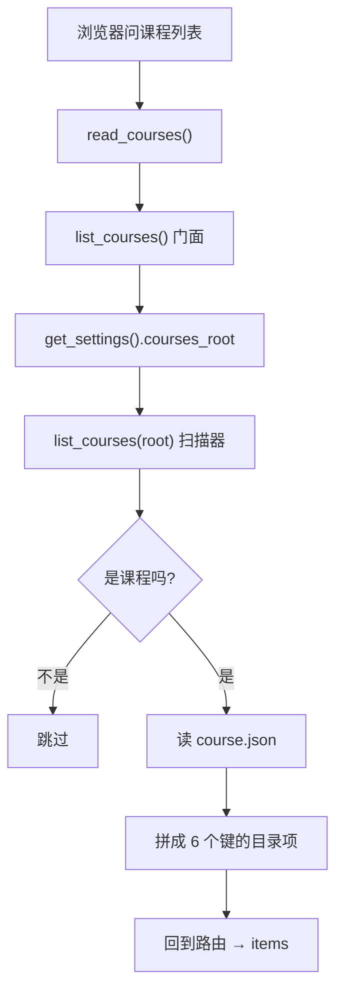
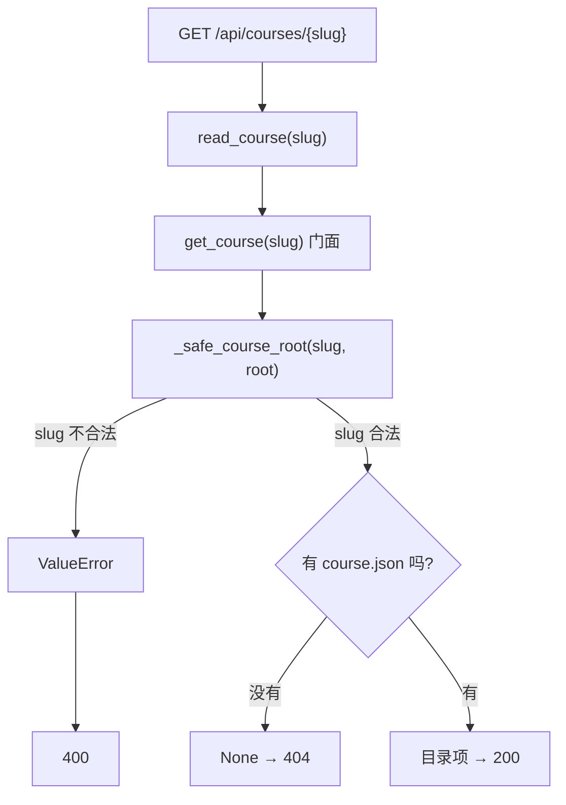
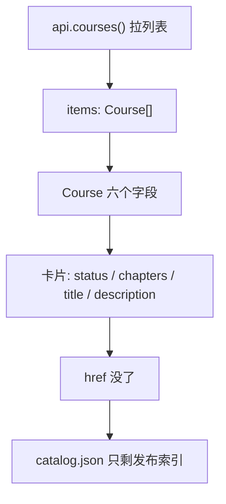

# P1.6 · 实现课程目录扫描与课程门面

> 改动报告 · 2026-10-27 · 分支 `dev-don`
>
> 这一步把「课程列表」从**手写的一份 `catalog.json`** 换成**扫描 `courses/` 目录**。
> 手写的那份文件从此只当发布索引，API 不再读它。

## 第一部分：Q&A 概览

| Question | Answer |
| --- | --- |
| What changed for the user?【用户看到的变化】 | The course list is now read from the disk.【课程列表改成从磁盘扫出来了】Before, a hand written file said which courses exist.【以前是手写一份清单 说有几门课】Now every folder that holds a course file becomes one course in the list.【现在每个放了课程文件的文件夹 就是列表里的一门课】 |
| What does one course look like in the list?【列表里的一门课长什么样】 | Six fields.【六个字段】The short name, the title, the description, how many chapters it has, its status and its duration.【短名 标题 简介 章节数 状态 时长】A course that was just created shows zero chapters and the status "preparing".【刚建好的课 章节数是 0 状态是「准备中」】 |
| What happens to a folder that is not a course yet?【还不是课的文件夹会怎样】 | It is skipped.【直接跳过】No course file, a broken course file, a hidden folder, a folder whose name could never be used as an address — all of them are left out quietly, and the other courses still show up.【没有课程文件 文件坏了 隐藏目录 名字不合法 全都悄悄跳过 别的课照常列出来】 |
| What if someone asks for a course that is not there?【问一门不存在的课会怎样】 | Two different answers.【两种答案】A legal name with no course behind it is a 404, nothing is broken.【名字合法但没这门课 是 404 没坏】A name that tries to point outside the courses folder is refused with a 400.【名字想指到课程目录外面 是 400 直接拒绝】 |
| Why did the "browse the published course" link disappear?【卡片上那条浏览链接为什么没了】 | It pointed at one hand mounted example page.【它指着唯一那一个手挂的示例页】There is no route that serves a published page per course yet, so a link would only ever lead to a 404.【现在还没有按课程提供静态页的路由 硬造一条链只会 404】The next step adds a real course page.【下一步会加真正的课程页】 |

## 第二部分：数据流

### 1. 课程列表从磁盘扫出来



| 步骤 | 关键变量 | 具体示例值 | 说明 |
| --- | --- | --- | --- |
| 1. 浏览器请求课程列表 | `GET /api/courses`（前端请求课程列表接口） | `GET /api/courses` | 前端请求课程列表接口 |
| 2. `read_courses()` | `request`（请求对象） | `{"method": "GET"}` | 路由函数收到请求后开始处理 |
| 3. `list_courses()` 门面 | `courses_root`（课程根目录） | `Path("C:/repo/project/courses")` | 门面先从配置读取课程根目录 |
| 4. `get_settings().courses_root` | `courses_root`（磁盘上的课程文件夹位置） | `courses/` | 实际上是磁盘上课程文件夹的位置 |
| 5. `list_courses(root)` 扫描器 | `root`（扫描入口目录）、`entries`（根目录下所有子项） | `root = courses/`，`entries = [".draft", "python-101", "ui-ux", "notes"]` | 扫描器先拿到根目录下所有子项 |
| 6. 过滤无效目录 | `course_root`（单个课程目录）、`slug`（课程短名） | `".draft" → 跳过；"notes" → 跳过；"ui-ux" → 继续` | 过滤掉隐藏目录、非法 slug、非课程目录 |
| 7. 读取 `course.json` | `course_root`（单个课程目录）、`metadata`（课程元数据对象） | `course_root = courses/python-101`，`metadata = {"title": "Python 入门", "description": "...", "lessons": [...], "status": "preparing", "duration": "4h"}` | 只有“像课程”的目录才会继续读 `course.json` |
| 8. 生成目录项 | `slug`（课程短名）、`title`（标题）、`description`（简介）、`chapters`（章节数）、`status`（状态）、`duration`（时长） | `{"slug": "python-101", "title": "Python 入门", "description": "从零到一", "chapters": 6, "status": "preparing", "duration": "4h"}` | 这条记录就是 API 返回给前端的一项 |
| 9. 回到路由 → `items` | `items`（最终返回列表） | `[{"slug":"python-101",...}, {"slug":"ui-ux",...}]` | 最终所有课程项聚合成 `items` 返回 JSON |


```dataflow
1-01 (问课程列表) [[read_courses()]]列表接口的处理函数}} 收到 [[GET]]浏览器发来的请求方法}} 就去叫 [[list_courses()]]课程门面}} <{course_routes.py}>
1-02      → [问门面的 root] [[list_courses()]]课程门面}} 自己去 [[get_settings()]]读全局配置的那个函数}} 里拿 [[courses_root]]课程根目录}} <{course_service.py}>
1-03           ↳ [开扫] [[list_courses()]]课程根目录扫描器}} 用 [[sorted()]]把文件夹按名字排好}} 一个一个看 <{catalog.py}>
1-04                ↳ [先挑一遍] 隐藏目录（名字以点开头）、名字不合 [[SLUG_PATTERN]]课程短名规则的目录 统统不看 <{catalog.py}>
1-05                     ↳ [读课程文件] [[_read_metadata()]]读课程总账文件的方法}} 打开 [[course.json]]课程总账文件}} 读出 [[metadata]]课程元数据字典}} <{catalog.py}>
1-06                          ↳ [读坏就跳过] [[course.json]]课程总账文件}} 不是合法 JSON、不是一个对象、根本读不出来 → 当作还不是课 跳过去 <{catalog.py}>
1-07                               ↳ [拼成目录项] [[_course_item()]]把课程文件拼成目录项的方法}} 拼出 [[chapters]]章节数}}（数 [[lessons]]课程章节清单}}）和另外五个键 <{catalog.py}>
1-08                                    ↳ [回到路由] [[CourseList]]课程列表的响应模型}} 把这些目录项装进 [[items]]课程列表}} 变成 JSON 回去 <{course_routes.py}>
---
{
  "1-01": "The browser asks for the course list, and the route hands the work to the one door that knows where the courses live.【read_courses[the route that answers the list]: called\nlist_courses[the door for the courses]: called next】",
  "1-02": "The door does not guess where the courses are, it asks the settings where they live, so moving the courses folder later is a one line change.【courses_root[where the course folders live]: read from the settings】",
  "1-03": "Then it looks at every folder in that place, one by one, in a fixed order, so the list always comes back the same way.【the folders[what it looked at]: all of them, sorted by name】",
  "1-04": "Two kinds of folders are ignored right away: hidden ones, and folders whose name could never be used as a course address.【the folders left out[why they were skipped]: hidden, or the name is not a legal course name】",
  "1-05": "For a folder that could be a course, the course file is opened and read.【metadata[what the course file holds]: read from course.json】",
  "1-06": "If that file is broken in any way, the folder is treated as not a course yet and quietly left out. One damaged course never takes the whole list down.【the broken folder[what happens to it]: skipped, and the other courses still show】",
  "1-07": "The course file is then turned into the six fields the list shows. The number of chapters is simply how many lessons the course has.【chapters[how many chapters the course has]: 0 for a new course, the lesson count for a finished one】",
  "1-08": "All of these items go into the response and travel back to the browser as one list.【items[the courses in the answer]: every course that was found】",
  "Summary": "One folder, one course. The list is no longer written by hand, it is read from the disk every time. Folders that are not courses yet are skipped instead of breaking the list, and every course comes back as the same six fields, so the frontend never has to guess."
}
---
// STEP FLOW: 1-01[问课程列表] → 1-02[问门面的 root] → 1-03[开扫] → 1-04[先挑一遍] → 1-05[读课程文件] → 1-06[读坏就跳过] → 1-07[拼成目录项] → 1-08[回到路由]

// 整条流程像去书架上找书:先看哪一排(课程根目录),再一排一排扫过去(每个文件夹),
// 抽头上没有「课程卡」的先跳过(1-04),有卡的就翻出来看卡上写了什么(1-05),
// 卡糊了看不清的就当这一格还没放书(1-06),看清楚了就照卡上写的说出书名和页数(1-07)。

// ===== 📂 app/course_service.py(课程门面：唯一知道课程根目录在哪的地方) =====
// 1-02[问门面的 root] 课程根目录从设置里拿,不写死
def list_courses() -> list[dict[str, Any]]:
    """List every course of the courses root.

    Returns:
        One item per course, ordered by slug.  The shape of an item is the
        one `app.courses.catalog` builds.
    """
    return <*catalog.list_courses*>(<*get_settings*>().<*courses_root*>)

// ===== 📂 app/courses/catalog.py(课程目录扫描：唯一读 course.json 的地方) =====
COURSE_FILE = "course.json"

// 1-03[开扫] 一个一个文件夹看过去
def list_courses(courses_root: Path) -> list[dict[str, Any]]:
    """List every course that lives in the courses root.

    Args:
        courses_root: The directory that holds every course folder,
            for example courses/.

    Returns:
        One item per course, ordered by slug.  Folders that are not a
        course are left out: no course file, an unreadable course file, a
        hidden folder, and a folder whose name is not a legal slug.
    """
    if not <*courses_root*>.is_dir():
        return []
    items: list[dict[str, Any]] = []
    for <*course_root*> in sorted(<*courses_root*>.iterdir()):
        // 1-04[先挑一遍] 隐藏目录 + 名字不合法 → 不看
        if not <*course_root*>.is_dir() or <*course_root*>.name.startswith("."):
            continue
        if not <*SLUG_PATTERN*>.fullmatch(<*course_root*>.name):
            continue
        // 1-05[读课程文件] 读不出来就不是课
        <*metadata*> = <*_read_metadata*>(<*course_root*>)
        // 1-06[读坏就跳过] 坏文件当没这门课,继续看下一个
        if <*metadata*> is None:
            continue
        // 1-07[拼成目录项] 变成 6 个键
        items.append(<*_course_item*>(<*course_root*>, <*metadata*>))
    return items

// 1-05[读课程文件] 打开 course.json 读出课程元数据
def _read_metadata(course_root: Path) -> dict[str, Any] | None:
    """Read the course file of one course folder.

    Args:
        course_root: The folder of one course, for example
            courses/python-101/.

    Returns:
        The content of the course file as a dictionary, or None when the
        folder is not a course: the file is missing, unreadable, not valid
        JSON, or not a JSON object.  A course that cannot be read is
        skipped instead of breaking the whole list.
    """
    <*path*> = <*course_root*> / <*COURSE_FILE*>
    if not <*path*>.is_file():
        return None
    try:
        <*metadata*> = json.loads(<*path*>.read_text(encoding="utf-8"))
    except (OSError, UnicodeDecodeError, json.JSONDecodeError):
        return None
    if not isinstance(<*metadata*>, dict):
        return None
    return <*metadata*>

// 1-07[拼成目录项] 章节数就是 lessons 的条数
def _course_item(course_root: Path, metadata: dict[str, Any]) -> dict[str, Any]:
    """Project the course file of one course into the item the API shows.

    Args:
        course_root: The folder of one course, for example
            courses/python-101/.
        metadata: The content of its course file, for example
            {"title": "Python 入门", "lessons": []}.

    Returns:
        The item of the course list: the slug, the title, the description,
        the number of chapters, the status and the duration.  The slug is
        the name of the folder, because that name is the address of the
        course and the route uses it to read the course again.
    """
    <*lessons*> = <*metadata*>.get("lessons")
    <*chapters*> = len(<*lessons*>) if isinstance(<*lessons*>, list) else 0
    return {
        "slug": <*course_root*>.name,
        "title": <*metadata*>.get("title") or <*course_root*>.name,
        "description": <*metadata*>.get("description") or "",
        "chapters": <*chapters*>,
        "status": <*metadata*>.get("status") or "preparing",
        "duration": <*metadata*>.get("duration") or "",
    }

// ===== 📂 app/api/course_routes.py(课程列表路由) =====
// 1-01[问课程列表] 收到 GET 就去叫 list_courses
// 1-08[回到路由] 装进 items 变成 JSON
@router.get("", response_model=CourseList)
def read_courses() -> CourseList:
    """Answer with every course of the courses root.

    Returns:
        The list of the courses, one item per course.
    """
    return <*CourseList*>(items=<*list_courses*>())
```

### 2. 一个 slug 变回一门课



| 步骤 | 关键变量 | 具体示例值 | 说明 |
| --- | --- | --- | --- |
| 1. 浏览器请求单门课 | `GET /api/courses/{slug}`（课程详情接口） | `GET /api/courses/python-101` | 前端请求某个课程详情 |
| 2. `read_course(slug)` | `slug`（课程短名） | `python-101` | 路由收到 slug 后开始查找这门课 |
| 3. `get_course(slug)` 门面 | `courses_root`（课程根目录） | `Path("C:/repo/project/courses")` | 门面把根目录和 slug 一起交给扫描器 |
| 4. `_safe_course_root(slug, root)` | `slug`（课程短名）、`candidate`（候选课程目录） | `slug = "python-101"`，`candidate = courses/python-101` | 先做路径合法性检查，拒绝越界访问 |
| 5. 路径合法性检查 | `SLUG_PATTERN`（合法短名规则） | `"python-101"` 通过；`"../etc"` 失败 | 非法 slug 直接抛 `ValueError` |
| 6. 路由处理错误 | `ValueError`（非法路径错误） | `ValueError("课程 slug 不合法")` | 路由捕获后返回 `400` |
| 7. 读取真实课程 | `course_root`（单个课程目录）、`metadata`（课程元数据对象） | `course_root = courses/python-101`，`metadata = {"title": "Python 入门", "description": "...", "lessons": [...], "status": "preparing", "duration": "4h"}` | 只有合法且存在的课程目录才继续查 `course.json` |
| 8. 课程不存在 | `None`（查无结果） | `None` | 合法 slug 但没有对应课程时返回 `404` |
| 9. 返回详情项 | `course`（课程详情对象） | `{"slug": "python-101", "title": "Python 入门", "description": "从零到一", "chapters": 6, "status": "preparing", "duration": "4h"}` | 最终返回 `200` 和课程详情 |

```dataflow
2-01 (问一门课) [[read_course()]]详情接口的处理函数}} 拿到 [[slug]]课程短名}} 去问 [[get_course()]]课程门面}} <{course_routes.py}>
2-02      → [问门面] [[get_course()]]课程门面}} 把 [[slug]]课程短名}} 和 [[courses_root]]课程根目录}} 一起交给 [[catalog.get_course()]]扫描器里的取单门课的方法}} <{course_service.py}>
2-03           ↳ [先过护栏] [[_safe_course_root()]]算出课程目录并且挡住越界路径的方法}} 拿 [[SLUG_PATTERN]]课程短名规则}} 检查 [[slug]]课程短名}} <{common.py}>
2-04                ↳ [不合法] 名字不合法 → 抛 [[ValueError]]路径不对就报错的那类错}} <{common.py}>
2-05                     ↳ [路由接住] [[read_course()]]详情接口的处理函数}} 接住 [[ValueError]]路径不对就报错的那类错}} → 回 [[400]]请求本身不对的状态码}} <{course_routes.py}>
2-06                          ↳ [合法但没有] 目录里没这门课 → [[catalog.get_course()]]扫描器里的取单门课的方法}} 回 [[None]]什么都没有}} → 路由回 [[404]]找不到东西的状态码}} <{course_routes.py}>
2-07                               ↳ [找到了] 读出 [[course.json]]课程总账文件}} 拼成 6 个键的目录项 → 回 [[200]]一切正常的状态码}} <{catalog.py}>
---
{
  "2-01": "The browser asks for one course by its short name, and the route passes that name straight to the service.【slug[the short name of the course]: taken from the address bar】",
  "2-02": "The service adds the one thing the scanner cannot know by itself, which is where the courses live, and asks for that one course.【catalog.get_course[the scanner call for a single course]: called with the slug and the courses root】",
  "2-03": "Before anything is read, the name goes past the same guard that every other course path goes past. A name is either a legal course name or it is not.【SLUG_PATTERN[the rule for a legal course name]: checked before any file is touched】",
  "2-04": "If the name is illegal, the guard raises an error instead of looking anything up. Nothing outside the courses folder can ever be reached this way.【ValueError[the error the guard raises]: raised, nothing read】",
  "2-05": "The route catches that error and answers with a bad request, because the caller sent something that could never be a course.【400[the status code for a bad request]: sent back to the browser】",
  "2-06": "A legal name that simply has no course behind it is not an error at all, it is nothing. The route turns that into a not found.【None[what the scanner answers]: nothing → 404 not found】",
  "2-07": "A legal name with a course behind it gives the same six fields as the list, and the route answers with a normal ok.【the course[what comes back]: the same six fields as the list → 200 ok】",
  "Summary": "Two failures, two different answers. A name that could point outside the courses folder is refused with a bad request, because the path guard must never be bypassed. A legal name with no course behind it is simply not found, which is not an error at all."
}
---
// STEP FLOW: 2-01[问一门课] → 2-02[问门面] → 2-03[先过护栏] → 2-04[不合法] → 2-05[路由接住] → 2-06[合法但没有] → 2-07[找到了]

// 这像去前台报一个房间号:房间号本身写错了(2-04),前台说「这个号写法不对」(400);
// 号没问题但那间房空着(2-06),前台说「没这间房」(404);有房才给你钥匙(2-07)。
// 越界的号(比如 ../../etc)连查都不查,直接拒。

// ===== 📂 app/course_service.py(课程门面：唯一知道课程根目录在哪的地方) =====
// 2-02[问门面] 把 slug 和 courses_root 一起交给扫描器
def get_course(slug: str) -> dict[str, Any] | None:
    """Read one course out of the courses root.

    Args:
        slug: The short name of the course, for example "python-101".

    Returns:
        The item of that course, or None when no course has this slug.
        Raises ValueError("课程 slug 不合法") when the slug does not match
        the shared pattern.
    """
    return <*catalog.get_course*>(<*slug*>, <*get_settings*>().<*courses_root*>)

// ===== 📂 app/courses/common.py(路径护栏：P1.4 建的那道闸) =====
// 2-03[先过护栏] 不合规则当场拒绝
def _safe_course_root(slug: str, courses_root: Path) -> Path:
    """Return the folder that holds one course, refusing anything that escapes.

    Args:
        slug: The short name of the course, for example "python-101".
            It has to match SLUG_PATTERN: lower case letters, digits and
            single dashes only.
        courses_root: The directory that holds every course folder,
            for example courses/.

    Returns:
        The folder this course would live in, inside courses_root.
        Raises ValueError("课程 slug 不合法") if the slug does not match
        the pattern, or if the resulting folder would leave courses_root.
    """
    if not <*SLUG_PATTERN*>.fullmatch(<*slug*>):
        // 2-04[不合法] 名字不合法 → 当场抛错,一个文件都不读
        raise <*ValueError*>("课程 slug 不合法")

    <*candidate*> = <*courses_root*> / <*slug*>
    if not <*candidate*>.resolve().is_relative_to(<*courses_root*>.resolve()):
        raise <*ValueError*>("课程 slug 不合法")
    return <*candidate*>

// ===== 📂 app/courses/catalog.py(课程目录扫描：唯一读 course.json 的地方) =====
// 2-06[合法但没有] 没有 course.json → 回答 None,不抛错
// 2-07[找到了] 读出 course.json → 拼成 6 个键的目录项 → 200
def get_course(slug: str, courses_root: Path) -> dict[str, Any] | None:
    """Read one course out of the courses root.

    Args:
        slug: The short name of the course, for example "python-101".
        courses_root: The directory that holds every course folder,
            for example courses/.

    Returns:
        The item of that course, or None when no course has this slug.
        Raises ValueError("课程 slug 不合法") when the slug does not match
        the shared pattern: a slug that could point outside the courses
        root is refused, not looked up.
    """
    <*course_root*> = <*_safe_course_root*>(<*slug*>, <*courses_root*>)
    <*metadata*> = <*_read_metadata*>(<*course_root*>)
    if <*metadata*> is None:
        return None
    return <*_course_item*>(<*course_root*>, <*metadata*>)

// ===== 📂 app/api/course_routes.py(课程列表路由) =====
// 2-01[问一门课] 拿到 slug 去问 get_course
// 2-05[路由接住] 名字不合法 → 400
// 2-06[合法但没有] 找不到 → 404
@router.get("/{slug}", response_model=CourseSummary)
def read_course(slug: str) -> CourseSummary:
    """Answer with one course.

    Args:
        slug: The short name of the course, for example "python-101".

    Returns:
        The item of that course.
        Raises HTTPException(404) when no course has this slug, and
        HTTPException(400) when the slug is not a legal course name.
    """
    try:
        <*course*> = <*get_course*>(<*slug*>)
    except <*ValueError*> as <*error*>:
        raise <*HTTPException*>(status_code=400, detail=str(<*error*>)) from <*error*>
    if <*course*> is None:
        raise <*HTTPException*>(status_code=404, detail="课程不存在")
    return <*CourseSummary*>(**<*course*>)
```

### 3. 前端卡片看到的是什么



| 步骤 | 关键变量 | 具体示例值 | 说明 |
| --- | --- | --- | --- |
| 1. 前端拉列表 | `api.courses()`（前端请求函数） | `api.courses()` | 页面请求课程列表接口 |
| 2. 列表响应 | `items`（课程列表） | `[{"slug":"python-101","title":"Python 入门","chapters":6,"status":"preparing"}, {"slug":"ui-ux","title":"UI 设计","chapters":4,"status":"preparing"}]` | 后端返回一组课程对象 |
| 3. 前端类型定义 | `Course`（课程对象类型） | `slug`, `title`, `description`, `chapters`, `duration`, `status` | 前端知道每门课有 6 个字段 |
| 4. 卡片展示 | `status`（状态）、`chapters`（章节数）、`title`（标题）、`description`（简介） | `status = "preparing"`，`chapters = 6`，`title = "Python 入门"`，`description = "从零到一"` | 卡片页面主要显示这四个字段 |
| 5. 链接移除 | `href`（课程详情链接） | `undefined` / 不再提供 | 旧链接会指向一个手写示例页，现已去掉 |
| 6. 清单降级 | `catalog.json`（发布索引文件） | `courses/catalog.json` | 这份文件只保留为发布索引，不再是 API 事实源 |

```dataflow
3-01 (前端拉列表) [[api.courses()]]前端拉课程列表的函数}} 去要 [[items]]课程列表}} <{api.ts}>
3-02      → [定形状] [[Course]]前端看到的课程类型}} 六个字段：[[slug]]课程短名}} · [[title]]课程标题}} · [[description]]课程简介}} · [[chapters]]章节数}} · [[duration]]课程时长}} · [[status]]课程状态}} <{api.ts}>
3-03           ↳ [画卡片] 卡片上显示 [[status]]课程状态}} 和 [[chapters]]章节数}}，再显示 [[title]]课程标题}} 和 [[description]]课程简介}} <{pages.tsx}>
3-04                ↳ [链没了] 以前卡片上有个 [[href]]课程网页地址}} 指向手写的 [[/course-example/]]示例课程静态页}}；现在按课程提供静态页的路由还没有，硬造一个地址只会 404 <{pages.tsx}>
3-05                     ↳ [清单降级] [[courses/catalog.json]]手写的课程清单文件}} 不再被 API 读，它以后只是发布索引 <{catalog.json}>
---
{
  "3-01": "The frontend asks for the same list as before and gets the same shape of answer, so nothing about the page has to change.【items[the courses the browser holds]: the list from the API】",
  "3-02": "The browser type says exactly what a course is: six fields, and that is all there is to read.【Course[the shape of one course in the browser]: six fields, no more】",
  "3-03": "The card shows the status and the chapter count in the small line, then the title and the description underneath.【what the card shows[the four fields on screen]: status, chapters, title, description】",
  "3-04": "The link that used to sit at the bottom of the card is gone. It pointed at one hand mounted example page, and there is no route that serves a published page for each course yet, so keeping it would only produce a broken page.【href[the address of a published course page]: removed from the card and from the type】",
  "3-05": "The hand written list file is still on disk, but nothing in the API reads it any more. From now on it is only the index that publishing writes into.【catalog.json[the hand written course list]: no longer read by the API, kept as a publish index】",
  "Summary": "The page keeps working, it just shows six honest fields per course instead of seven. The old link was pointing at a single hand mounted example, so it was removed rather than faked. The hand written list file stays on disk as a publish index, but the API and the disk are no longer two separate truths about which courses exist."
}
---
// STEP FLOW: 3-01[前端拉列表] → 3-02[定形状] → 3-03[画卡片] → 3-04[链没了] → 3-05[清单降级]

// 这一段像把一张手抄的货架清单换成现场扫码:清单上原来多写的「货架号」(href) 扫不出来,
// 因为每个货架还没装自己的二维码,与其写个假的让人点开扑空,不如先划掉(3-04)。
// 手抄的那张清单(catalog.json) 也不扔,留着当仓库的入库登记簿,只是不再拿来回答顾客(3-05)。

// ===== 📂 apps/web/src/api.ts(前端看到的课程类型) =====
// 3-02[定形状] 六个字段,一个不多一个不少
export type Course = {
  <*slug*>: string;
  <*title*>: string;
  <*description*>: string;
  <*chapters*>: number;
  <*duration*>: string;
  <*status*>: string;
};

// 3-01[前端拉列表] 页面调 api.courses(),还是那个接口,形状没变
export const api = {
  health: () => request<Health>("/api/health"),
  courses: () => request<{ items: Course[] }>("/api/courses"),
};

// ===== 📂 apps/web/src/pages.tsx(课程卡片) =====
// 3-03[画卡片] 状态、章节数、标题、简介
function CourseCard({ course }: { course: Course }) {
  return (
    <article className="course-card">
      <div className="card-meta">
        <span><*course.status*></span>
        <span><*course.chapters*> 章</span>
      </div>
      <h2><*course.title*></h2>
      <p><*course.description*></p>
    </article>
  );
}

// 3-04[链没了] 这一段被拿掉了:它只指向 /course-example/ 这一个手挂的示例页,点开只会 404
// <a className="course-link" href={<*course.href*>}>
//   浏览已发布课程
// </a>

// 3-05[清单降级] 手写清单不再被 API 读
┌──────────────────────────┐        ┌──────────────────────────────┐
│ 手写的 courses/catalog.json │   ✗    │ 扫出来的 courses/*/course.json │
│   courses: [ ... ]        │  ───→  │   一门课一个文件夹一个总账文件    │
└──────────────────────────┘        └──────────────────────────────┘
      以后只当发布索引(P8.x 往里写)
```

## 第三部分：其它

#### 这次改动的边界

| 文件 | 动作 | 干了什么 |
| --- | --- | --- |
| `apps/api/app/courses/catalog.py` | 新增 | 目录扫描器：`list_courses(root)` / `get_course(slug, root)`，唯一读 `course.json` 的地方 |
| `apps/api/app/course_service.py` | 新增 | 门面：`list_courses()` / `get_course(slug)`，唯一知道 `courses_root` 在哪的地方 |
| `apps/api/app/catalog.py` | **删除** | 旧的手写清单读取器，被上面两个模块取代 |
| `apps/api/app/api/course_routes.py` | 改 | 列表改走门面；新增 `GET /api/courses/{slug}`（404 / 400）；两条路由都带 `response_model` |
| `apps/api/app/main.py` | 改 | `EXAMPLE_COURSE_ROOT` 改从 `get_settings().courses_root` 算（`app/catalog.py` 删了之后没有出处了） |
| `apps/api/app/schemas.py` | 改 | 新增 `CourseSummary` / `CourseList` 两个响应模型 |
| `apps/api/tests/test_course_catalog.py` | 新增 | 扫描器 16 条测试，全用真实临时目录 |
| `apps/api/tests/test_course_service.py` | 新增 | 门面 3 条测试，用 `monkeypatch` 换掉设置 |
| `apps/api/tests/test_scaffold_api.py` | 改 | 旧的 `catalog.json` 断言改成扫描后的形状；补 4 条走真实 HTTP 的路由测试 |
| `apps/api/tests/test_schemas.py` | 改 | 模型清单加 `CourseSummary` / `CourseList` |
| `apps/web/src/api.ts` | 改 | `Course` 类型去掉 `href` |
| `apps/web/src/pages.tsx` | 改 | 课程卡片去掉指向 `course.href` 的那条链 |
| `AGENTS.md` | 改 | 「`courses/catalog.json` 是事实源」改成「扫 `courses/*/course.json`，`catalog.json` 只是发布索引」 |

#### 跟参考实现不一样的四处（都是「不要照抄」）

1. **参考的 `list_courses()` 读 `Settings` 单例，还 import 了 `app.courses.quality` 和 `app.db`**——
   那是 P5.x 和 P2.1 的东西，本阶段拿不到。本实现把 root 拆成「扫描器显式收参数 / 门面从设置拿」两层。
2. **参考的目录项叫 `chapter_count`，还带 `quality_report_count` / `has_workspace` /
   `has_course_json` / `lessons`**。本阶段目录项就是报告里那 6 个键，多一个少一个都算错。
3. **参考的 `get_course()` 找不到就抛 `FileNotFoundError`**。本阶段是**返回 `None`**，
   路由再决定给 404。
4. **参考的 `list_courses()` 把没有 `course.json` 的目录也列出来**（靠 `has_course_json` 标记）。
   本阶段是**直接跳过**，不列。

#### 两种「找不到」为什么要分清

| 情况 | 扫描器 | 路由 | 为什么 |
| --- | --- | --- | --- |
| slug 合法，但没这门课 | 返回 `None` | 404 | 不是错误，就是没有 |
| slug 不合法（`../etc`、`Python-101`） | 抛 `ValueError` | 400 | P1.4 的路径护栏不能被绕过 |

`get_course()` 内部走的是 `_safe_course_root(slug, courses_root)`，跟 P1.4 建的护栏是同一道闸。

#### 计划外的一处改动：`test_schemas.py`

`app/schemas.py` 的模型清单测试是「**恰好等于**」那 14 个模型，加两个响应模型就会红。
跟 P1.5 一样，这轮把它一起改掉了，没留一个已知失败的测试给开发者。
**这颗雷还在**：P3.8 加 workspace 模型时它会再红一次，建议那时改成
「必须包含 + 允许的额外集合」。

#### 三个字段悄悄改了默认值

`course.json` 里没有的字段，目录项会退到这些值，不是报错：
`title` → 文件夹名 · `description` → 空串 · `status` → `"preparing"` · `duration` → 空串 ·
`chapters` → 0（`lessons` 不是列表时也算 0）。仓库里那门示例课程只有 7 个键，照样读得出来。

#### 交给下一步的三条提醒

- **P1.7**：`POST /api/courses` 要用 `create_course_scaffold(request, courses_root)`，
  门面里已经有 root 了，直接传进去；`FileExistsError` → 409，非法 slug → 422，**按异常类型判断，别看文案**。
- **P1.8**：前端要加 `/courses/:slug` 路由和课程详情页，详情接口就是这一步加的
  `GET /api/courses/{slug}`；课程卡片那条链在这一步加回来。
- **P8.x**：`courses/catalog.json` 从现在起只是发布索引，发布流程往里写。
  目标版已知缺陷 #9（catalog.json 与 API 列表两个独立来源）到此解掉。

#### 还缺什么

- `resumable_run_id`（阶段验收表里挂在 P1.6 名下）需要 Run 表，那是 P2.x 的事，现在没有。
- 按课程提供静态页的路由没有，所以目录项里没有 `href`——P8.1 的构建做完才有。
- 目录项里没有 `audience` / `goals` / `scope` / `preferred_chapter_count`，
  它们在 `course.json` 里，要用的时候直接读那份文件。
