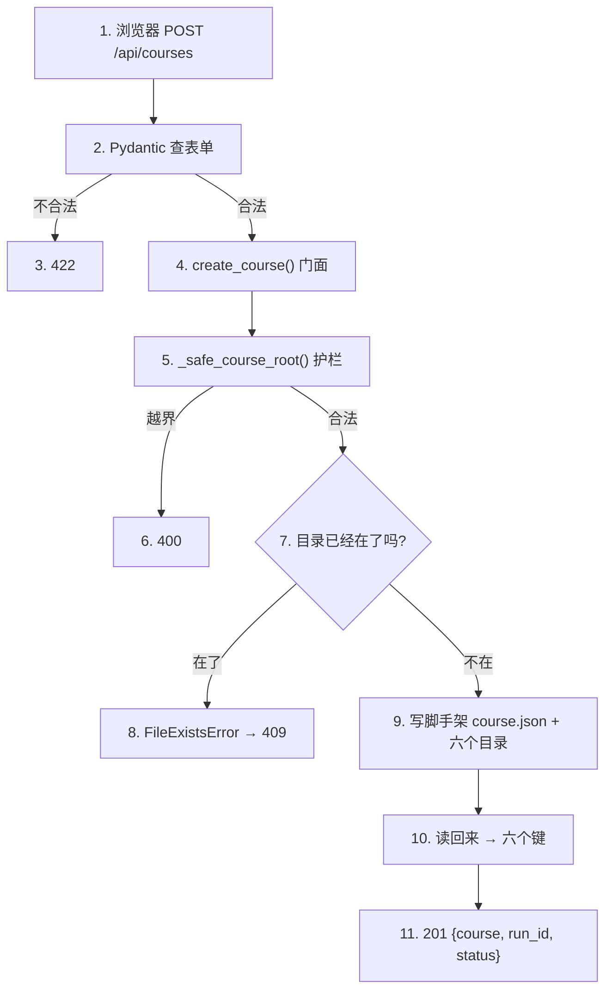
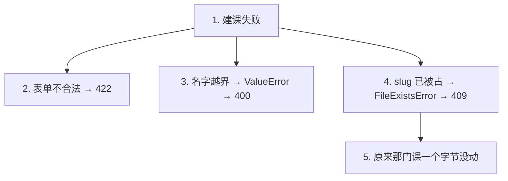
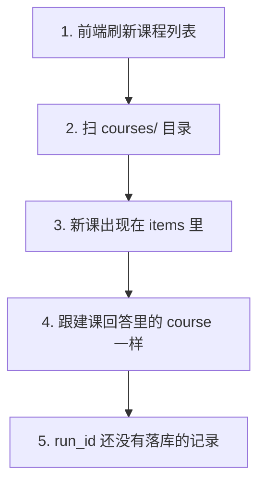

# P1.7 · 暴露 POST /api/courses

> 改动报告 · 2026-10-27 · 分支 `dev-don`
>
> 这一步把「建课」从**只能写脚本**变成**浏览器点一下就能做**。
> 表单发到 `POST /api/courses`，课程当场落到磁盘上，回答里带着这门课和一个流水号。

## 第一部分：Q&A 概览

| Question | Answer |
| --- | --- |
| What can the user do now?【用户现在能做什么】 | They can create a course over the API.【可以在浏览器里建一门课了】The form goes to a new endpoint, and the course lands on the disk right away.【表单发给新的接口 课程当场就落到磁盘上】 |
| What comes back when it works?【成功时返回什么】 | Three things.【三样东西】The new course, an id for this creation, and the status of the course.【新课程 这次建课的编号 课程的状态】The course carries the same six fields the list shows, so the frontend has one shape for a course.【课程跟列表里那六个字段一样 前端只有一种课程形状】 |
| What if the name is already taken?【名字被占了会怎样】 | A conflict, 409.【409 冲突】The course that is already there is left exactly as it was.【原来那门课一个字节都没动】 |
| What if the form is wrong?【表单填错了会怎样】 | The server says so before it writes anything.【服务器在写之前就说了】An illegal name or a field that is out of range comes back as a 422, and the disk stays empty.【名字不合法或者字段越界 都是 422 磁盘上什么都没留下】 |
| Is the new course ready to teach yet?【这门课现在能开讲吗】 | Not yet.【还不能】It has zero chapters and the status preparing.【章节数是 0 状态是「准备中」】The later phases fill it in.【后面的阶段会把它填满】 |

## 第二部分：数据流

### 1. 建一门课，一路走通



| 步骤 | 关键变量 | 具体示例值 | 说明 |
| --- | --- | --- | --- |
| 1. 浏览器提交建课表单 | `POST /api/courses`（建课接口） | `POST /api/courses` | 前端把表单发给 `create_course_from_intake()` |
| 2. `CourseCreate` 先校验 | `payload`（表单对象） | `{"title": "测试课程", "slug": "test-course", "audience": "初学者", "goals": "学会建课程", "scope": "基础入门"}` | Pydantic 在路由前检查字段，`slug` 必须匹配 `SLUG_PATTERN` |
| 3. `CourseCreate` 查字段 | `slug`、`title`、`goals` | `"test-course"` 合法；`"Test-Course"` / `"../secrets"` 不合法 | 字段过短、越界或 `slug` 违规时直接返回 `422`，磁盘不写入 |
| 4. `create_course()` 门面 | `courses_root`（课程根目录） | `Path("C:/repo/project/courses")` | 门面拿到根目录后，把请求交给脚手架写目录 |
| 5. `_safe_course_root()` 护栏 | `slug`、`candidate`（候选目录） | `slug = "test-course"`，`candidate = courses/test-course` | 非法名字或越界路径会抛 `ValueError`，路由回 `400` |
| 6. 目录占位检查 | `course_root`（课程目录） | `courses/test-course` | 如果目录已存在，`create_course_scaffold()` 抛 `FileExistsError`，路由回 `409` |
| 7. 写脚手架 | `COURSE_DIRECTORIES`（六个顶层目录）、`WORKSPACE_DIRECTORIES`（工作区子目录） | `['lessons', 'reference', 'markdown', 'assets', 'quality', 'workspace']` | 创建 `course.json`、四个起始文件，以及 `workspace/learning-records` |
| 8. 读回来 | `course`（磁盘上的真实课程项） | `{"slug": "test-course", "title": "测试课程", "description": "学会建课程", "chapters": 0, "status": "preparing", "duration": "待蓝图确认"}` | 返回值来自磁盘，不来自提交表单，所以列表和建课回答共用同一份结构 |
| 9. 回答 | `course`、`run_id`、`status` | `{"course": {...}, "run_id": "6f1c9c2e-4a7b-4c31-9f0e-1d2a3b4c5d6e", "status": "preparing"}` | 返回 `201`，前端得到新课和本次创建编号 |

```dataflow
1-01 (提交建课表单) [[POST]]浏览器发来的请求方法}} 把 [[CourseCreate]]建课表单模型}} 交给 [[create_course_from_intake()]]建课接口的处理函数}} <{course_routes.py}>
1-02      → [先查表单] [[CourseCreate]]建课表单模型}} 逐个字段对照 [[SLUG_PATTERN]]课程短名规则}} 和长度范围 → 不合法直接 [[422]]请求内容不对的状态码}} <{schemas.py}>
1-03           ↳ [问门面] [[create_course()]]课程门面}} 拿 [[courses_root]]课程根目录}} 去叫 [[create_course_scaffold()]]写课程脚手架的方法}} <{course_service.py}>
1-04                ↳ [先挡一下] [[_safe_course_root()]]算出课程目录并且挡住越界路径的方法}} 名字不合法 → [[ValueError]]路径不对就报错的那类错}} <{common.py}>
1-05                     ↳ [占位检查] 课程目录已经在了 → [[FileExistsError]]已经有这门课的那类错}} <{scaffold.py}>
1-06                          ↳ [写脚手架] 写下 [[course.json]]课程总账文件}} 和六个顶层目录、四个起始文件 <{scaffold.py}>
1-07                               ↳ [读回来] [[catalog.get_course()]]扫描器里的取单门课的方法}} 读回刚写的那门课 → 六个键的目录项 <{course_service.py}>
1-08                                    ↳ [回 201] [[CourseCreated]]建课接口的响应模型}} 装上 [[course]]这门新课}} · [[run_id]]这次建课的流水号}} · [[status]]课程状态}} <{course_routes.py}>
---
{
  "1-01": "The browser posts the intake form, and the route takes it from there.【CourseCreate[the form the user filled in]: received from the browser\ncreate_course_from_intake[the route that creates a course]: called with the form】",
  "1-02": "Before anything is written, every field of the form is checked. The short name has to look like a course name, and the text fields have to be long enough.【SLUG_PATTERN[the rule for a legal course name]: checked first\n422[the status code for a form the server cannot use]: sent back, nothing written】",
  "1-03": "The service adds the one thing the writer cannot know by itself, which is where the courses live, and asks for the skeleton to be written.【courses_root[where the course folders live]: read from the settings\ncreate_course_scaffold[the writer of the course skeleton]: called with the form and the courses root】",
  "1-04": "The same guard every other course path goes past checks the name first, so nothing outside the courses folder can ever be reached this way.【_safe_course_root[the guard that keeps paths inside the courses folder]: checked before a single file is touched】",
  "1-05": "If a course with that name is already there, the writer stops and says so instead of touching the old course.【FileExistsError[the error for a name that is already taken]: raised, the old course is left alone】",
  "1-06": "Otherwise the skeleton is written: one course file, six top level folders for the material the later phases produce, and four starting files.【course.json[the file that tells the later phases what this course is]: written with the intake values】",
  "1-07": "The new course is read back from the disk, so the answer comes from what was really written and not from the form that was sent.【the course[the six fields the list shows]: read back from the disk】",
  "1-08": "The answer carries the new course, an id for this creation, and the status of the course, which is preparing because it has no chapters yet.【run_id[the id of this creation]: a fresh id for every request\nstatus[the status of the new course]: preparing】",
  "Summary": "One request, one course on the disk. The form is checked before anything is written, the name goes past the path guard again, and the course that comes back is read from the disk, so the browser and the folder always tell the same story."
}
---
// STEP FLOW: 1-01[提交建课表单] → 1-02[先查表单] → 1-03[问门面] → 1-04[先挡一下] → 1-05[占位检查] → 1-06[写脚手架] → 1-07[读回来] → 1-08[回 201]

// 整条流程像去文具店买一本笔记本:先把要什么说清楚(1-02 查表单),店员照你说的名字
// 先翻一遍货架(1-04 挡住越界的名字),空着就现做一本(1-05 看看有没有同名、1-06 写出来),
// 做好的本子再拿回柜台照着封面念一遍(1-07 读回来),念出来那一栏跟货架上贴的一模一样(1-08)。

// ===== 📂 app/api/course_routes.py(建课路由：把建课请求变成一次建课) =====
// 1-01[提交建课表单] POST /api/courses 收到表单就交给处理函数
@router.post("", response_model=CourseCreated, status_code=201)
def <*create_course_from_intake*>(<*payload*>: <*CourseCreate*>) -> <*CourseCreated*>:
    """Create one course out of the intake form the browser posted.

    The form is checked by Pydantic before this function runs, so an
    illegal slug or an out of range field never reaches the disk.  What is
    left is answered with a status code per failure: 409 when the slug is
    taken, 400 when the path guard refuses the slug.

    Args:
        payload: The intake form the user submitted, for example a
            CourseCreate with the slug "python-101".

    Returns:
        The new course, the id of its intake run and the status of the new
        course, which is "preparing" because it has no chapters yet.
    Raises HTTPException(409) when a course with this slug is already
        there, and HTTPException(400) when the path guard refuses the
        slug.
    """
    // 1-03[问门面] 表单没问题,交给门面去建
    <*course*> = <*create_course*>(<*payload*>)
    // 1-08[回 201] 装成三样东西回去
    <*summary*> = <*CourseSummary*>(**<*course*>)
    return <*CourseCreated*>(
        course=<*summary*>,
        run_id=str(uuid.uuid4()),
        status=<*summary*>.status,
    )

// ===== 📂 app/schemas.py(表单模型与建课回答的模型) =====
// 1-02[先查表单] 名字走共享规则,长度走范围;不合法 → 422(门都没进)
class <*CourseCreate*>(BaseModel):
    """The intake form a user submits to create a course.

    This is the only request model of the module: the creation API of P1.7
    takes it as the body of `POST /api/courses`.  The slug uses the pattern
    of `app.courses.common.SLUG_PATTERN`, so the API and the path guard can
    never disagree about what a legal course folder looks like.
    """

    title: str = Field(min_length=2, max_length=120)
    slug: str = Field(pattern=<*SLUG_PATTERN*>.pattern)
    audience: str = Field(min_length=2, max_length=500)
    goals: str = Field(min_length=5, max_length=3000)
    scope: str = Field(min_length=2, max_length=3000)
    source_policy: str = "允许使用用户资料与公开官方资料"
    delivery: str = "Markdown + HTML"
    preferred_chapter_count: int = Field(default=12, ge=1, le=60)
    effective_char_min: int = Field(default=12000, ge=1000, le=50000)
    token_budget_mtokens: float | None = Field(default=None, ge=0.01, le=10000)
    provider: str = "codex_gateway"
    model: str = "llm-gateway--kimi-k3"

// 1-08[回 201] 回答带三样东西
class <*CourseCreated*>(BaseModel):
    """The answer of `POST /api/courses`.

    The course is the item the course list shows, so the frontend has one
    shape for a course wherever it comes from.  The run id names the intake
    run of this creation; until the run tables arrive with P2.1 it is an id
    without a record behind it.  The status is the status of the new
    course, which is "preparing" because it has no chapters yet.
    """

    course: <*CourseSummary*>
    run_id: str
    status: str

// ===== 📂 app/course_service.py(课程门面：唯一知道课程根目录在哪的地方) =====
// 1-03[问门面] 课程根目录从设置里拿,不写死
def <*create_course*>(<*request*>: <*CourseCreate*>) -> dict[str, Any]:
    """Create one course and answer with the item the course list shows.

    The course is written first and read back afterwards, so the answer
    comes from the disk and not from the form that was submitted: the
    course of the creation answer and the course of the course list are
    the same item.

    Args:
        request: The intake form the user submitted, for example a
            CourseCreate with the slug "python-101".

    Returns:
        The item of the new course: the slug, the title, the description,
        the number of chapters, the status and the duration.
    Raises FileExistsError when a course with this slug is already there:
        an existing course is never overwritten.
    Raises ValueError("课程 slug 不合法") when the slug does not match
        the shared pattern.
    """
    <*courses_root*> = <*get_settings*>().<*courses_root*>
    <*scaffold.create_course_scaffold*>(<*request*>, <*courses_root*>)
    // 1-07[读回来] 从磁盘读回来,回答跟课程列表一模一样
    <*course*> = <*catalog.get_course*>(<*request*>.slug, <*courses_root*>)
    if <*course*> is None:
        raise RuntimeError(f"课程刚落盘就读不到：{<*request*>.slug}")
    return <*course*>

// ===== 📂 app/courses/common.py(路径护栏：P1.4 建的那道闸) =====
// 1-04[先挡一下] 不合规则当场拒绝
def <*_safe_course_root*>(<*slug*>: str, <*courses_root*>: Path) -> Path:
    """Return the folder that holds one course, refusing anything that escapes.

    Args:
        slug: The short name of the course, for example "python-101".
            It has to match SLUG_PATTERN: lower case letters, digits and
            single dashes only.
        courses_root: The directory that holds every course folder,
            for example courses/.

    Returns:
        The folder this course would live in, inside courses_root.
    Raises ValueError("课程 slug 不合法") if the slug does not match
        the pattern, or if the resulting folder would leave courses_root.
    """
    if not <*SLUG_PATTERN*>.fullmatch(<*slug*>):
        raise <*ValueError*>("课程 slug 不合法")

    <*candidate*> = <*courses_root*> / <*slug*>
    if not <*candidate*>.resolve().is_relative_to(<*courses_root*>.resolve()):
        raise <*ValueError*>("课程 slug 不合法")
    return <*candidate*>

// ===== 📂 app/courses/scaffold.py(课程脚手架：写出一门新课的骨架) =====
// 1-05[占位检查] 目录在了就直接报错,老课一个字节不动
// 1-06[写脚手架] 一个课程文件夹 + 六个顶层目录 + 四个起始文件
def <*create_course_scaffold*>(<*request*>: CourseCreate, <*courses_root*>: Path) -> dict[str, Any]:
    """Create the folder skeleton and course.json of a brand new course.

    Args:
        request: The intake form the user submitted, for example a
            CourseCreate with the slug "python-101".
        courses_root: The directory that holds every course folder,
            for example courses/.

    Returns:
        The metadata that was written to course.json, so the caller can
        answer with the same values without reading the file again.
    Raises ValueError("课程 slug 不合法") when the slug does not match
        the shared pattern, and FileExistsError when the course folder is
        already there: an existing course is never overwritten.
    """
    if not <*SLUG_PATTERN*>.fullmatch(<*request*>.slug):
        raise <*ValueError*>("课程 slug 不合法")

    <*course_root*> = <*_safe_course_root*>(<*request*>.slug, <*courses_root*>)
    // 1-05[占位检查] 已经有一门课叫这个名字了 → 报错,不覆盖
    if <*course_root*>.exists():
        raise <*FileExistsError*>(f"课程已存在：{<*request*>.slug}")

    <*course_root*>.mkdir(parents=True)
    for <*name*> in <*COURSE_DIRECTORIES*>:
        (<*course_root*> / <*name*>).mkdir()
    for <*name*> in <*WORKSPACE_DIRECTORIES*>:
        (<*course_root*> / "workspace" / <*name*>).mkdir()

    <*_write_starting_files*>(<*course_root*>, <*request*>)

    <*metadata*> = <*_course_metadata*>(<*request*>)
    // 1-06[写脚手架] course.json 一次写完,读者看不到半截文件
    <*_write_json_atomic*>(<*course_root*> / "course.json", <*metadata*>)
    return <*metadata*>
```

### 2. 三种失败，三种答案



| 步骤 | 关键变量 | 具体示例值 | 说明 |
| --- | --- | --- | --- |
| 1. 表单不合法 | `CourseCreate`（表单模型）、`422` | `slug = "Test-Course"`，`title = "课"` | Pydantic 先拦下，路由根本不进，磁盘上什么都没写 |
| 2. 名字越界 | `slug`、`ValueError` | `"../secrets"` | `SLUG_PATTERN` 和路径防护都不通过，`_safe_course_root()` 会直接抛错 |
| 3. 路由接住 | `ValueError`、`400` | `ValueError("课程 slug 不合法")` | 在 `create_course_from_intake()` 里按异常类型收住，返回 `400` |
| 4. slug 已被占 | `course_root`、`FileExistsError` | `course_root = courses/test-course` | 脚手架看到目录已存在，立刻停止写入，不覆盖旧课程 |
| 5. 路由接住 | `FileExistsError`、`409` | `FileExistsError("课程已存在：test-course")` | `except FileExistsError` 执行后，返回 `409`，告诉客户端名字已被占用 |
| 6. 老课没动 | `course.json`（原课程总账） | 旧文件字节内容不变 | 失败的建课请求不会改任何已有课程，原来那门课保持原样 |

```dataflow
2-01 (表单不合法) [[CourseCreate]]建课表单模型}} 逐个字段自己先查一遍 → 不合法直接 [[422]]请求内容不对的状态码}}，门都没进 <{schemas.py}>
2-02      → [名字越界] [[_safe_course_root()]]算出课程目录并且挡住越界路径的方法}} 当场抛 [[ValueError]]路径不对就报错的那类错}} <{common.py}>
2-03           ↳ [接住 ValueError] [[create_course_from_intake()]]建课接口的处理函数}} 按异常类型判断 → 回 [[400]]请求本身不对的状态码}} <{course_routes.py}>
2-04                ↳ [slug 被占] [[create_course_scaffold()]]写课程脚手架的方法}} 看见目录已经在了 → 抛 [[FileExistsError]]已经有这门课的那类错}} <{scaffold.py}>
2-05                     ↳ [接住 FileExistsError] [[create_course_from_intake()]]建课接口的处理函数}} 按异常类型判断 → 回 [[409]]东西已经在那里的状态码}} <{course_routes.py}>
2-06                          ↳ [老课没动] [[course.json]]课程总账文件}} 一个字节都没改 <{scaffold.py}>
---
{
  "2-01": "The form is checked before the request even reaches the route, so a form that could never be a course is turned away right away.【CourseCreate[the form the user filled in]: every field checked\n422[the status code for a form the server cannot use]: sent back, nothing written】",
  "2-02": "The name goes past the same guard every other course path goes past. A name that is not a legal course name is refused before a single file is touched.【ValueError[the error the guard raises]: raised, nothing read and nothing written】",
  "2-03": "The route catches that error and answers with a bad request, because the caller sent something that could never be a course.【400[the status code for a bad request]: sent back to the browser】",
  "2-04": "A name that is already taken is a different failure. The writer sees the folder is there and stops, instead of touching the course that is already there.【FileExistsError[the error for a name that is already taken]: raised, the old course is left alone】",
  "2-05": "The route catches that one too and answers with a conflict, because the name is fine, it is just taken.【409[the status code for something that is already there]: sent back to the browser】",
  "2-06": "Either way the course that was already on the disk is exactly as it was. A refused creation never changes a course.【course.json[the file of the old course]: unchanged, byte for byte】",
  "Summary": "Three failures, three different answers. A form the server cannot use is a 422, a name that tries to point outside the courses folder is a 400, and a name that is already taken is a 409. None of them writes a single file, and the course that was already there is never changed."
}
---
// STEP FLOW: 2-01[表单不合法] → 2-02[名字越界] → 2-03[接住 ValueError] → 2-04[slug 被占] → 2-05[接住 FileExistsError] → 2-06[老课没动]

// 这像去柜台办一张卡:材料不齐(表单不合法)人家当场退回来(422);名字写得不对、
// 像是想指到别人家(名字越界)也是当场退回来(400);名字没问题,只是这张卡
// 别人已经办过了(slug 被占),那就告诉你一声「已经有了」(409)。
// 不管是哪种,柜台上原来那张卡一个字都不会被改(2-06)。

// ===== 📂 app/schemas.py(表单模型：字段不合法在进路由之前就被拦下) =====
// 2-01[表单不合法] CourseCreate 自己先查一遍 → 422(门都没进)
class <*CourseCreate*>(BaseModel):
    """The intake form a user submits to create a course.

    This is the only request model of the module: the creation API of P1.7
    takes it as the body of `POST /api/courses`.  The slug uses the pattern
    of `app.courses.common.SLUG_PATTERN`, so the API and the path guard can
    never disagree about what a legal course folder looks like.
    """

    title: str = Field(min_length=2, max_length=120)
    slug: str = Field(pattern=<*SLUG_PATTERN*>.pattern)
    audience: str = Field(min_length=2, max_length=500)
    goals: str = Field(min_length=5, max_length=3000)
    scope: str = Field(min_length=2, max_length=3000)
    source_policy: str = "允许使用用户资料与公开官方资料"
    delivery: str = "Markdown + HTML"
    preferred_chapter_count: int = Field(default=12, ge=1, le=60)
    effective_char_min: int = Field(default=12000, ge=1000, le=50000)
    token_budget_mtokens: float | None = Field(default=None, ge=0.01, le=10000)
    provider: str = "codex_gateway"
    model: str = "llm-gateway--kimi-k3"

// ===== 📂 app/courses/common.py(路径护栏：名字不合法当场拒绝) =====
// 2-02[名字越界] _safe_course_root() 当场抛 ValueError,一个文件都不读
def <*_safe_course_root*>(<*slug*>: str, <*courses_root*>: Path) -> Path:
    """Return the folder that holds one course, refusing anything that escapes.

    Args:
        slug: The short name of the course, for example "python-101".
            It has to match SLUG_PATTERN: lower case letters, digits and
            single dashes only.
        courses_root: The directory that holds every course folder,
            for example courses/.

    Returns:
        The folder this course would live in, inside courses_root.
    Raises ValueError("课程 slug 不合法") if the slug does not match
        the pattern, or if the resulting folder would leave courses_root.
    """
    if not <*SLUG_PATTERN*>.fullmatch(<*slug*>):
        raise <*ValueError*>("课程 slug 不合法")

    <*candidate*> = <*courses_root*> / <*slug*>
    if not <*candidate*>.resolve().is_relative_to(<*courses_root*>.resolve()):
        raise <*ValueError*>("课程 slug 不合法")
    return <*candidate*>

// ===== 📂 app/api/course_routes.py(建课路由：按异常类型给状态码) =====
// 2-03[接住 ValueError] create_course_from_intake() → 400
// 2-05[接住 FileExistsError] 名字被占 → 409
    try:
        <*course*> = <*create_course*>(<*payload*>)
    except <*FileExistsError*> as <*error*>:
        raise <*HTTPException*>(status_code=409, detail="课程 slug 已存在") from <*error*>
    except <*ValueError*> as <*error*>:
        raise <*HTTPException*>(status_code=400, detail=str(<*error*>)) from <*error*>

// ===== 📂 app/courses/scaffold.py(课程脚手架：写出一门新课的骨架) =====
// 2-04[slug 被占] 目录已经在了 → 报错
// 2-06[老课没动] 原来那门课的 course.json 一个字节没动
    <*course_root*> = <*_safe_course_root*>(<*request*>.slug, <*courses_root*>)
    if <*course_root*>.exists():
        raise <*FileExistsError*>(f"课程已存在：{<*request*>.slug}")
```

### 3. 新课出现在列表里，流水号暂时只是编号



| 步骤 | 关键变量 | 具体示例值 | 说明 |
| --- | --- | --- | --- |
| 1. 前端刷新列表 | `api.courses()`（前端拉列表的函数） | `api.courses()` | 页面再次请求 `GET /api/courses`，拿最新课程列表 |
| 2. 扫目录 | `course_root`、`course.json` | `courses/test-course/course.json` | 新课已经有自己的目录和总账文件，扫描器就可以认出它 |
| 3. 进列表 | `items`（课程列表） | `[{"slug": "test-course", "title": "测试课程", "description": "学会建课程", "chapters": 0, "status": "preparing", "duration": "待蓝图确认"}]` | 新课立刻出现在列表中 |
| 4. 同一个形状 | `course`、`CourseSummary` | 建课响应和列表项的字段完全一致 | 建课回答里的 `course` 和课程列表项是同一份课程对象，前端只需要认一种课程形状 |
| 5. 流水号没落库 | `run_id`、`uuid4()` | `"6f1c9c2e-4a7b-4c31-9f0e-1d2a3b4c5d6e"` | 这里只是随机编号，还没有对应 run 记录，后续 P2.1 才会落库 |

```dataflow
3-01 (前端刷新列表) [[api.courses()]]前端拉课程列表的函数}} 再问一次后端 <{api.ts}>
3-02      → [扫目录] 新课有了自己的文件夹和 [[course.json]]课程总账文件}} → 出现在 [[items]]课程列表}} 里 <{catalog.py}>
3-03           ↳ [同一个形状] 建课回答里的 [[course]]这门新课}} 和列表里那一项一模一样，六个字段 <{course_routes.py}>
3-04                ↳ [流水号没落库] [[run_id]]这次建课的流水号}} 现在只是 [[uuid4()]]随机生成的编号}}，磁盘上没有对应的记录 <{course_routes.py}>
---
{
  "3-01": "The page asks for the course list again, the same way it always does.【items[the courses the browser holds]: refreshed from the API】",
  "3-02": "The new course has a folder of its own now, with a course file inside, so the scanner finds it and the list shows it.【course.json[the file that makes a folder count as a course]: written, so the folder is a course now】",
  "3-03": "The course in the creation answer and the course in the list are the same thing, because both were read from the disk with the same six fields.【course[the course in the creation answer]: the same six fields as the list item】",
  "3-04": "The run id is a number for now, with no record behind it. The run tables arrive later, and then the id will point at a real run.【run_id[the id of this creation]: a fresh random number, nothing stored yet】",
  "Summary": "A new course shows up in the list right away, and it looks exactly like the course the creation answer carried, because both came from the same file on the disk. The run id is only a name for now: it marks this creation, but there is no run record behind it until the run tables arrive."
}
---
// STEP FLOW: 3-01[前端刷新列表] → 3-02[扫目录] → 3-03[同一个形状] → 3-04[流水号没落库]

// 这一段像新员工入职:人已经在了工位上,工牌也挂上了(3-02 扫目录就认出这门新课),
// 花名册上那一栏跟建课回执上写的完全一样(3-03)。至于工单号(3-04),
// 现在只是先记一个号,等人事系统上线(阶段 P2.1)才有真正的工单可查。

// ===== 📂 apps/web/src/api.ts(前端看到的课程类型) =====
// 3-01[前端刷新列表] 页面调 api.courses(),还是那个接口,形状没变
export const api = {
  health: () => request<Health>("/api/health"),
  courses: () => request<{ items: Course[] }>("/api/courses"),
};

// ===== 📂 app/courses/catalog.py(课程目录扫描：唯一读 course.json 的地方) =====
// 3-02[扫目录] 有 course.json 的文件夹就是一门课
COURSE_FILE = "course.json"

    for <*course_root*> in sorted(<*courses_root*>.iterdir()):
        if not <*course_root*>.is_dir() or <*course_root*>.name.startswith("."):
            continue
        if not <*SLUG_PATTERN*>.fullmatch(<*course_root*>.name):
            continue
        <*metadata*> = <*_read_metadata*>(<*course_root*>)
        if <*metadata*> is None:
            continue
        items.append(<*_course_item*>(<*course_root*>, <*metadata*>))

// ===== 📂 app/api/course_routes.py(建课路由：回答带一门课和一个流水号) =====
// 3-03[同一个形状] 回答里的 course 就是列表里那一项
// 3-04[流水号没落库] uuid4() 现在只是编号,没有记录
    <*summary*> = <*CourseSummary*>(**<*course*>)
    return <*CourseCreated*>(
        course=<*summary*>,
        run_id=str(uuid.uuid4()),
        status=<*summary*>.status,
    )
```

## 第三部分：其它

#### 这次改动的边界

| 文件 | 动作 | 干了什么 |
| --- | --- | --- |
| `apps/api/app/api/course_routes.py` | 改 | 新增 `POST /api/courses`（201 / 409 / 400），带 `response_model=CourseCreated` |
| `apps/api/app/course_service.py` | 改 | 门面加 `create_course(request)`：叫脚手架写课，再从磁盘读回来 |
| `apps/api/app/schemas.py` | 改 | 新增 `CourseCreated` 响应模型（`course` / `run_id` / `status`） |
| `apps/api/tests/test_course_create_api.py` | 新增 | 20 条建课接口测试，课程根目录全指向临时目录 |
| `apps/api/tests/test_schemas.py` | 改 | 模型清单加 `CourseCreated` |
| `AGENTS.md` | 改 | 「仅暴露健康检查、课程列表与单门课详情」后面加上「与建课接口」 |
| `RoadMap.md` | 改 | P1.7 那一节扩成可执行的步骤：接口约定、失败表、测试清单 |

#### 回答长什么样

```json
{
  "course": {
    "slug": "test-course",
    "title": "测试课程",
    "description": "学会用 Agent 把一门课从零做出来",
    "chapters": 0,
    "status": "preparing",
    "duration": "待蓝图确认"
  },
  "run_id": "6f1c9c2e-4a7b-4c31-9f0e-1d2a3b4c5d6e",
  "status": "preparing"
}
```

`course` 是**从磁盘读回来的那 6 个键**，跟 `GET /api/courses` 里那一项逐字相同——
不是 `course.json` 的 11 个键，也不是把表单原样回显。
这样 API 里只有**一种课程形状**，前端不用认两种。

#### 三种失败各归各的

| 情况 | 谁先发现 | 状态码 | 磁盘上留下什么 |
| --- | --- | --- | --- |
| 名字不合法 / 字段越界 | Pydantic（门都没进） | 422 | 什么都没有 |
| 名字想指到课程目录外面 | 路径护栏 `_safe_course_root` | 400 | 什么都没有 |
| 名字已经被占了 | 脚手架的占位检查 | 409 | 什么都没有，原来那门课一个字节没动 |

**409 和 400 都按异常类型判断**（`except FileExistsError` / `except ValueError`），
**不许拿异常文案去比对**——文案是给人看的，改一次就断一次。

#### 跟参考实现不一样的四处（都是「不要照抄」）

1. **参考的 POST 还会建 run 记录、写 artifact、把命令排进队列**——那是 P2.1 / P2.2 / P6.x
   的东西，本阶段拿不到，也不该提前加。
2. **参考回的是 `{course, run_id, command_id, duplicate}`**，本阶段是 `{course, run_id, status}`：
   没有队列就没有 `command_id`，没有查重逻辑就没有 `duplicate`。
3. **参考的 `create_course_scaffold(payload)` 自己读 `Settings` 单例**，本实现是显式传
   `courses_root`（跟 P1.5/P1.6 一致），扫描器和脚手架都不认识配置。
4. **参考的 run 词表是 `QUEUED`**，本阶段没有队列，`status` 是**课程自己的**状态，
   值是 `"preparing"`。

#### `run_id` 现在只是编号

`run_id` 是 `str(uuid.uuid4())`，**没有落库**，磁盘上没有对应的记录。
Run 表是 P2.1 的活儿；在那之前它只起两个作用：标记「这是哪一次建课」，
以及给前端一个可以拿去问进度的把手。**别拿它当查询键去查任何东西。**

#### P1.6 报告里的 import 那行已经变了

P1.6 报告的代码片段里，`app/api/course_routes.py` 的 import 是

```python
from app.course_service import get_course, list_courses
from app.schemas import CourseList, CourseSummary
```

本步之后多了一个 `create_course` 和 `CourseCreate` / `CourseCreated`。
**报告里的片段是当时的样子，代码以现在的为准。**

#### 交给下一步的三条提醒

- **P1.8**：前端建课向导直接调 `POST /api/courses`，回答是 `{course, run_id, status}`；
  `course` 跟课程列表用同一个 `Course` 类型，别再造一个。
- **P2.1**：Run 表落地后，`run_id` 要改成真的记录 id，
  创建接口要同时写一条 run 记录。
- **P3.8**：`test_schemas.py` 那个「**恰好等于**」的模型清单会再红一次，
  建议那时改成「必须包含 + 允许的额外集合」。

#### 还缺什么

- 这个接口**不启动任何生成**：没有 run 记录、没有 artifact、没有队列，
  建完的课就是磁盘上的一个文件夹（阶段 P2.x 的事）。
- 后端没有做「同一个 slug 反复提交」的去重，第二次一定是 409，不是幂等返回。
- 前端还没有建课页面（表单在哪填），那是 P1.8 的活儿。
