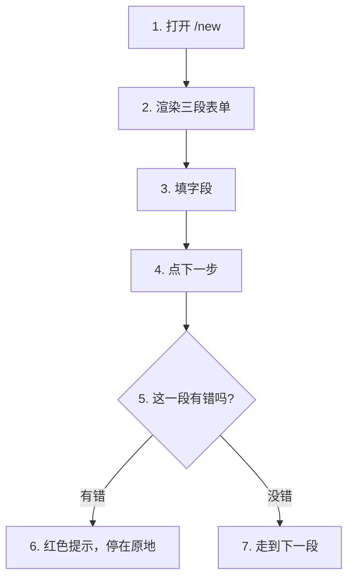
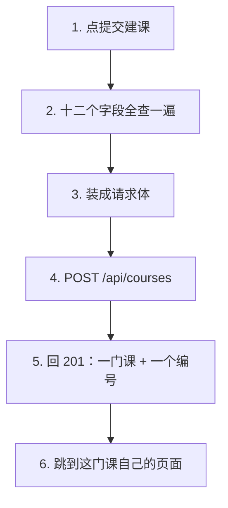
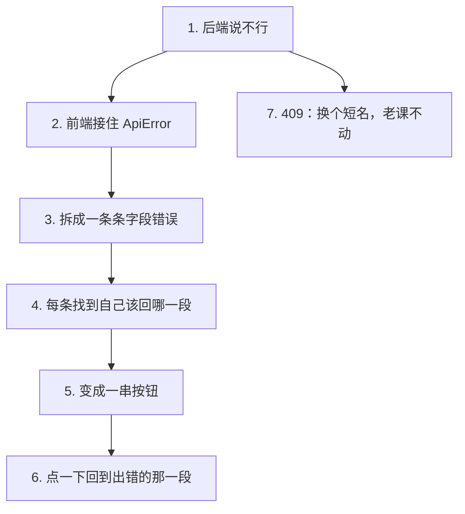

# P1.8 · 前端建课向导 + 课程详情路由

> 改动报告 · 2026-10-27 · 分支 `dev-don`
>
> 这一步把后端那个建课接口**接到浏览器上**。
> 三段表单填完，课真的建出来，浏览器自己跳到这门课自己的页面。

## 第一部分：Q&A 概览

| Question | Answer |
| --- | --- |
| What can the user do now?【用户现在能做什么】 | They can fill a three step form in the browser and create a course.【在浏览器里填一张三段表单就能建课】The course lands on the disk right away.【课程当场就落到磁盘上】 |
| What does the form ask for?【表单问哪三组东西】 | Three groups: who the course is for, what the learner should be able to do, and the limits of the generation.【三组 给谁学 学完能做什么 生成有什么限制】 |
| What happens when a field is wrong?【字段填错了会怎样】 | The form stops at that step and says what is wrong.【表单停在那一段 直接告诉你哪里不对】If the server still says no, every bad field gets a button that jumps back to the step it belongs to.【服务器要是还不答应 每个错字段都给一个按钮 一点就回到它所在的那一段】 |
| What if the short name is already taken?【短名被占了会怎样】 | A conflict, 409.【409 冲突】The course that is already there is not touched at all.【原来那门课一个字节都没动】 |
| Where does the browser go after that?【建完课浏览器去哪】 | To the page of the new course.【跳到这门新课自己的页面】It shows what the skeleton already has; the generation itself comes later.【上面是课程骨架已经有的东西 生成本身是后面的阶段】 |

## 第二部分：数据流

### 1. 三段表单，一段一段填



| 步骤 | 关键变量 | 具体示例值 | 说明 |
| --- | --- | --- | --- |
| 1. 打开新建课页 | `NewCourse`（建课向导组件） | `/new` | 路由 `/new` 渲染向导组件，页面上方是三张步骤卡 |
| 2. 渲染三段表单 | `COURSE_STEPS`（三段清单） | `课程身份` / `学习任务` / `生成约束` | 三段的名字和说明写在表单模块里，页面只照着渲染 |
| 3. 填字段 | `values`（每个字段现在的值） | `{ title: "Python 入门", slug: "" }` | 每个字段的值存在一处；后端有的字段前端一个不多、一个不少 |
| 4. 点下一步 | `validateStep(step, values)`（查这一段） | `step = 1` | 用的是后端同一套规则（长度、范围、短名格式） |
| 5. 这一段有错吗 | `problems`（每个错字段的文案） | `{ title: "至少 2 个字符" }` | 有错就停在原地，错误文案显示在字段下面 |
| 6. 往前挪一段 | `step`（当前走到第几段） | `1 → 2` | 走过的那一段记进 `visited`，才允许点回去 |

```dataflow
1-01 (打开新建课页) [[NewCourse]]建课向导组件}} 从 [[COURSE_STEPS]]三段表单的清单}} 里渲染出三张卡片 <{course-pages.tsx}>
1-02      → [填字段] [[values]]表单里每个字段现在的值}} 从 [[initialValues()]]默认值表}} 起头 <{course-form.ts}>
1-03           ↳ [点下一步] [[validateStep()]]查这一段的字段合不合规}} <{course-form.ts}>
1-04                ↳ [有错] [[problems]]这一段每个字段的错误文案}} 记下来，红色显示 <{course-pages.tsx}>
1-05                     ↳ [没错] [[step]]现在走到第几段}} 往前挪一段 <{course-pages.tsx}>
---
{
  "1-01": "The new course page opens with the three steps of the form, taken from one list, so the page and the form can never drift apart.【COURSE_STEPS[the three steps of the form]: course identity, learning task, generation limits】",
  "1-02": "Every field starts from the default the API itself uses, so only the parts a person has to write are left empty.【values[the value of every field]: empty for the first two steps, already filled for the third】",
  "1-03": "Before the form lets you move on, it checks the fields of this step with the same rules the server uses.【validateStep[the check of one step]: runs on the step that is open】",
  "1-04": "If a field is wrong, the wizard stays where it is and shows the message under that field.【problems[the message of every wrong field]: empty → one message per wrong field】",
  "1-05": "If everything is fine, the wizard moves one step further and opens that step.【step[which step is open]: 1 → 2 → 3】",
  "Summary": "The form is three steps, and it never lets you walk past a step that is not filled in yet. Each step is checked with the same rules the server will use, so a mistake is caught while the user is still looking at the field. The wizard only ever moves forward when the current step is clean."
}
---
// STEP FLOW: 1-01[打开新建课页] → 1-02[填字段] → 1-03[点下一步] → 1-04[有错] → 1-05[没错]

// 这像填一张三联表:第一联写课程身份,第二联写学习任务,第三联写生成约束。
// 每一联填完按"下一步",柜台先看一眼这一联有没有漏写(1-03),
// 漏了就退回来告诉你哪一格(1-04),没漏才把这一联收走、换下一联(1-05)。

// ===== 📂 src/features/course/course-form.ts(建课表单的字段清单与校验规则) =====
// 1-02[填字段] 默认值表:哪些字段有默认,哪些要人自己填
export function <*initialValues*>(): Record<string, string> {
  const <*values*>: Record<string, string> = {};
  for (const field of COURSE_FIELDS) {
    values[field.name] = field.defaultValue;
  }
  return values;
}

// 1-03[点下一步] 查这一段的字段:有错就返回错误文案,没错就返回空
export function <*validateStep*>(step: StepNumber, values: Record<string, string>): FieldProblems {
  const problems: FieldProblems = {};
  for (const field of fieldsOfStep(step)) {
    const message = validateField(field, values[field.name] ?? "");
    if (message) {
      problems[field.name] = message;
    }
  }
  return problems;
}

// ===== 📂 src/pages/course-pages.tsx(建课向导：三段表单) =====
// 1-01[打开新建课页] 三段清单从表单模块拿,页面只照着渲染
export function <*NewCourse*>() {
  const [values, setValues] = useState<Record<string, string>>(initialValues);
  const [step, setStep] = useState<StepNumber>(1);
  const [problems, setProblems] = useState<FieldProblems>({});

  // 1-03[点下一步] 先查这一段
  function goNext() {
    const found = <*validateStep*>(step, values);
    // 1-04[有错] 有错就留在这一段,把错记下来
    setProblems(found);
    if (Object.keys(found).length > 0) {
      return;
    }
    // 1-05[没错] 往前走一段
    const next = (step + 1) as StepNumber;
    setStep(next);
    setVisited((current) => (current.includes(next) ? current : [...current, next]));
  }

  <ol className="wizard-steps">
    {COURSE_STEPS.map((courseStep) => (
```

### 2. 提交建课：一次 POST 把课建出来



| 步骤 | 关键变量 | 具体示例值 | 说明 |
| --- | --- | --- | --- |
| 1. 点提交建课 | `submit()`（提交函数） | 按钮变成"建课中…" | 先把十二个字段全查一遍，有一个不行就跳到它所在的那一段 |
| 2. 装成请求体 | `toPayload(values)`（请求体装配） | `token_budget_mtokens: null` | 文本去空格，三个数字变数字，空预算变 `null` 而不是 0 |
| 3. 发出去 | `api.createCourse(input)`（建课调用） | `POST /api/courses` | 请求体就是 P1.7 的 `CourseCreate`，字段一个不多一个不少 |
| 4. 回 201 | `CourseCreated`（响应模型） | `{"course": {...}, "run_id": "...", "status": "preparing"}` | `course` 跟课程列表用同一个 `Course` 类型，前端只认一种课程形状 |
| 5. 跳走 | `navigate(\`/courses/${slug}\`)` | `/courses/python-101` | 提交成功后浏览器自己换到这门课自己的页面 |

```dataflow
2-01 (点提交建课) [[submit()]]把整张表单交给后端的方法}} 先把十二个字段全查一遍 <{course-pages.tsx}>
2-02      → [装请求体] [[toPayload()]]把表单值变成请求体的方法}} → [[CourseCreate]]建课表单模型}} 的十二个字段 <{course-form.ts}>
2-03           ↳ [发出去] [[createCourse()]]前端建课的那一次请求}} → [[POST]]浏览器发来的请求方法}} [[/api/courses]]建课接口的地址}} <{api.ts}>
2-04                ↳ [回 201] [[request()]]前端发请求的那个函数}} 把回答读成 [[CourseCreated]]建课接口的响应模型}}：[[course]]这门新课}} 和 [[run_id]]这次建课的编号}} <{api.ts}>
2-05                     ↳ [跳走] [[navigate()]]前端换页面的方法}} 换到这门课自己的页面 <{course-pages.tsx}>
---
{
  "2-01": "The form checks all twelve fields before anything is sent, so a field that is wrong never becomes a request.【validateAll[the check of the whole form]: every field checked】",
  "2-02": "The values become a tidy body: the text is trimmed, the three numbers become real numbers, and an empty budget stays empty instead of turning into zero.【toPayload[the body builder]: form values → request body\ntoken_budget_mtokens[the token budget]: empty → null】",
  "2-03": "The body goes to the creation endpoint, and the browser waits for the answer.【createCourse[the create call]: POST /api/courses\nmethod[how the browser sends it]: POST】",
  "2-04": "The answer is read as the shape the API promised, and it carries the new course, an id for this creation and the status of the course. The course is the same six fields the list shows.【course[the new course]: the six fields the list shows\nrun_id[the id of this creation]: a fresh number】",
  "2-05": "With the new short name in hand, the browser goes to the page of that course, and that page reads the course back from the API.【navigate[the change of page]: to the page of the new course】",
  "Summary": "One request, one course on the disk. The form is checked once more as a whole, the twelve values are packed into the exact body the API expects, and the answer comes back in the shape the list already uses. Then the browser takes the new short name and goes to the page of that course."
}
---
// STEP FLOW: 2-01[点提交建课] → 2-02[装请求体] → 2-03[发出去] → 2-04[回 201] → 2-05[跳走]

// 这像在柜台交报名表:先把表格自己从头到尾查一遍(2-01),把十二栏抄成一张
// 规规矩矩的报名表(2-02),递进去(2-03),柜台盖了章把回执递回来(2-04),
// 你拿着回执上的短名去自己那间教室(2-05)。

// ===== 📂 src/features/course/course-form.ts(建课表单的字段清单与校验规则) =====
// 2-02[装请求体] 表单值 → 请求体:文本去空格,数字变数字,空预算变 null
export function <*toPayload*>(values: Record<string, string>): <*CourseCreate*> {
  const budget = values.token_budget_mtokens?.trim() ?? "";
  return {
    title: values.title?.trim() ?? "",
    slug: values.slug?.trim() ?? "",
    audience: values.audience?.trim() ?? "",
    goals: values.goals?.trim() ?? "",
    scope: values.scope?.trim() ?? "",
    source_policy: values.source_policy?.trim() ?? "",
    delivery: values.delivery?.trim() ?? "",
    preferred_chapter_count: Number(values.preferred_chapter_count),
    effective_char_min: Number(values.effective_char_min),
    token_budget_mtokens: budget.length > 0 ? Number(budget) : null,
    provider: values.provider?.trim() ?? "",
    model: values.model?.trim() ?? "",
  };
}

// ===== 📂 src/api.ts(前端调后端的四个接口) =====
// 2-04[回 201] 回答是 JSON;不是 2xx 就抛 ApiError,把状态码和说明都留下
async function <*request*><T>(path: string, init?: RequestInit): Promise<T> {
  const response = await fetch(path, init);
  const text = await response.text();
  let data: unknown = null;
  if (text.length > 0) {
    try {
      data = JSON.parse(text);
    } catch {
      data = text;
    }
  }
  if (!response.ok) {
    const detail =
      data && typeof data === "object" && "detail" in data
        ? (data as { detail: unknown }).detail
        : data;
    throw new ApiError(response.status, detail);
  }
  return data as T;
}

// 2-04[回 201] 回答装一门课、一个编号和一个状态
export type <*CourseCreated*> = {
  course: <*Course*>;
  <*run_id*>: string;
  status: string;
};

// 2-03[发出去] 建课:POST /api/courses,请求体是建课表单
  createCourse: (input: <*CourseCreate*>) =>
    request<<*CourseCreated*>>("/api/courses", {
      method: "<*POST*>",
      headers: { "Content-Type": "application/json" },
      body: JSON.stringify(input),
    }),

// ===== 📂 src/pages/course-pages.tsx(建课向导：提交与跳转) =====
// 2-01[点提交建课] 十二个字段全查一遍,有一个不行就跳到它所在的那一段
async function <*submit*>() {
  const found = validateAll(values);
  setProblems(found);
  if (Object.keys(found).length > 0) {
    const broken = COURSE_STEPS.find((courseStep) =>
      fieldsOfStep(courseStep.number).some((field) => found[field.name]),
    );
    if (broken) {
      setStep(broken.number);
      setVisited((current) =>
        current.includes(broken.number) ? current : [...current, broken.number],
      );
    }
    return;
  }
  setSubmitting(true);
  setSubmitError(null);
  setSubmitProblems([]);
  try {
    // 2-03[发出去] 表格递出去
    const created = await api.<*createCourse*>(<*toPayload*>(values));
    // 2-05[跳走] 拿着新短名去这门课自己的页面
    <*navigate*>(`/courses/${created.<*course*>.slug}`);
  } catch (reason) {
    if (reason instanceof ApiError) {
      setSubmitError(reason.message);
      setSubmitProblems(collectFieldProblems(reason.detail));
    } else {
      setSubmitError("建课失败：请求没有送达后端，请确认 API 在运行");
    }
  } finally {
    setSubmitting(false);
  }
}
```

### 3. 后端说不行：错误摊给人看



| 步骤 | 关键变量 | 具体示例值 | 说明 |
| --- | --- | --- | --- |
| 1. 后端说不行 | `ApiError`（前端接住的错） | `status = 422` | 状态码和后端的详细说明都留着，409 和 422 走得开 |
| 2. 拆错误 | `collectFieldProblems(detail)` | `[{ "loc": ["body", "slug"], "msg": "..." }]` | 后端给的是 loc+msg 的列表，这里拆成"字段 + 文案" |
| 3. 定位段 | `stepOfField(name)` | `slug → 1` | 每个字段再问一次表单：它属于第几段 |
| 4. 显示 | `submitProblems` | `[{ field: "slug", message: "...", step: 1 }]` | 每条错误变成一个按钮，按钮上写着回第几段 |
| 5. 跳回 | `goToStep(problem.step)` | `step = 1` | 点一下就换到出错的那一段，用户不用自己找 |
| 6. 短名被占 | `submitError` | `"请求失败：409 · 课程 slug 已存在"` | 409 单独给一句人话：换个短名，原来那门课一个字节不动 |

```dataflow
3-01 (后端说不行) [[ApiError]]前端接住后端报错的那类错}} 带着 [[status]]HTTP 状态码}} 和 [[detail]]后端给的详细说明}} 回来 <{api.ts}>
3-02      → [拆错误] [[collectFieldProblems()]]把后端的字段错误拆成一条条的方法}} <{course-form.ts}>
3-03           ↳ [定位段] [[stepOfField()]]查一个字段属于第几段的方法}} → 每条错误都知道自己该回到哪一段 <{course-form.ts}>
3-04                ↳ [显示] [[submitProblems]]后端报出来的每一条字段错误}} 变成一串按钮 <{course-pages.tsx}>
3-05                     ↳ [跳回] [[goToStep()]]换到某一段的方法}} 点一下就回到出错的那一段 <{course-pages.tsx}>
3-06                          ↳ [短名被占] [[submitError]]提交失败时的那句提示}} 遇到 [[409]]东西已经在那里的状态码}} → 提示换个短名 <{course-pages.tsx}>
---
{
  "3-01": "When the API says no, the frontend catches it as one kind of error that keeps the status code and what the server said about it.【status[the status code of the failed answer]: 409 or 422\ndetail[what the server said about it]: kept as it is】",
  "3-02": "The field errors in that answer are taken apart, so every wrong field gets its own line.【collectFieldProblems[the reader of the field errors]: a list of field errors → one line per field】",
  "3-03": "Each field is looked up in the form, so the error knows which of the three steps it belongs to.【stepOfField[which step a field belongs to]: a field name → 1, 2 or 3】",
  "3-04": "Every one of those errors becomes a button under the form, so the user sees all of them at once.【submitProblems[the field errors the server sent back]: empty → one entry per wrong field】",
  "3-05": "Clicking a button takes the form back to the step that holds that field, so the user does not have to hunt for it.【goToStep[the jump to one step]: the step of the wrong field → the step on screen】",
  "3-06": "When the short name is taken, the message says so in plain words and tells the user to pick another one. The course that is already there is not touched.【submitError[the message of the failed creation]: shows the conflict\n409[the status code for something that is already there]: 409 → a hint to change the short name】",
  "Summary": "The server never answers with a shrug. It says which field is wrong, and the frontend turns that answer into one button per field, each button knowing which of the three steps its field lives in. The user clicks the button and lands exactly where the mistake is. A short name that is already taken gets its own plain sentence, and the course that is already there stays exactly as it was."
}
---
// STEP FLOW: 3-01[后端说不行] → 3-02[拆错误] → 3-03[定位段] → 3-04[显示] → 3-05[跳回] → 3-06[短名被占]

// 这像退回来一张填错的表:柜台上没有只说一句"你错了",而是在每一栏旁边
// 写上为什么这一栏不行(3-02),再告诉你这张表该退到哪一联(3-03),
// 你点一下按钮(3-05)就回到那一联改。名字跟人重了(3-06)就换个名字,
// 柜台上原来那一份一个字都不会被改。

// ===== 📂 src/api.ts(前端接住后端报错的那类错) =====
// 3-01[后端说不行] 状态码和后端的说明都留着,409 和 422 走得开
export class <*ApiError*> extends Error {
  readonly <*status*>: number;
  readonly <*detail*>: unknown;

  constructor(status: number, detail: unknown) {
    super(describeFailure(status, detail));
    this.name = "ApiError";
    this.status = status;
    this.detail = detail;
  }
}

// ===== 📂 src/features/course/course-form.ts(把后端的字段错误拆成一条条) =====
// 3-02[拆错误] 后端给的是 loc + msg 的列表,这里拆成"字段 + 文案"
// 3-03[定位段] 每个字段再问一次:它属于第几段
export function <*collectFieldProblems*>(detail: unknown): FieldProblem[] {
  if (!Array.isArray(detail)) {
    return [];
  }
  const problems: FieldProblem[] = [];
  for (const item of detail) {
    if (!item || typeof item !== "object") {
      continue;
    }
    const record = item as { loc?: unknown; msg?: unknown };
    const location = Array.isArray(record.loc)
      ? record.loc.filter((part) => part !== "body").map((part) => String(part)).join(".")
      : "";
    if (location.length === 0) {
      continue;
    }
    const message = typeof record.msg === "string" ? record.msg : "这一项不合法";
    problems.push({ field: location, message, step: <*stepOfField*>(location) });
  }
  return problems;
}

// ===== 📂 src/pages/course-pages.tsx(提交失败：把错误摊给人看) =====
// 3-01[后端说不行] catch 里接住后端的错,把状态码和说明都留下
    if (reason instanceof <*ApiError*>) {
      setSubmitError(reason.message);
      setSubmitProblems(<*collectFieldProblems*>(reason.detail));
    }

// 3-04[显示] 每条错误一个按钮,按钮上写着回哪一段
// 3-05[跳回] 点一下就换到那一段
              {<*submitProblems*>.map((problem) => (
                <li key={`${problem.field}-${problem.message}`}>
                  <button type="button" onClick={() => <*goToStep*>(problem.step)}>
                    {problem.field}：{problem.message}（回到第 {problem.step} 段）
                  </button>
                </li>
              ))}

// 3-06[短名被占] 409 单独给一句人话:换个短名,原来那门课不动
  const conflict = <*submitError*> !== null && <*submitError*>.includes("409");
```

## 第三部分：其它

#### 这次改动的边界

| 文件 | 动作 | 干了什么 |
| --- | --- | --- |
| `apps/web/src/api.ts` | 改 | 加 `CourseCreate` / `CourseCreated` 类型、`ApiError`、`request<T>(path, init)` 包装器和 `api.createCourse()` |
| `apps/web/src/features/course/course-form.ts` | **新建（计划外）** | 12 个字段的清单、客户端校验、请求体装配、错误拆分 |
| `apps/web/src/pages/course-pages.tsx` | 新建 | `Dashboard` · `NewCourse`（三段向导）· `CourseWorkspace`（详情占位）· `WorkflowPage` |
| `apps/web/src/pages.tsx` | **删** | 内容全部迁到 `pages/course-pages.tsx`（原来只有 `App.tsx` 引它） |
| `apps/web/src/App.tsx` | 改 | 加路由 `/new` 和 `/courses/:slug` |
| `apps/web/src/styles.css` | 改 | 向导和详情页的样式，约 200 行 |
| `AGENTS.md` | 改 | 「前端只通过 REST API 读取后端数据」→「读取课程列表与单门课详情，提交建课表单」 |
| `RoadMap.md` | 改 | P1.8 的文件清单加上计划外的那一个文件 |

**`course-form.ts` 是计划外的。** RoadMap 原本只列了四个文件，但那三个文件塞不下
12 个字段的清单 + 校验 + 请求体装配：`course-pages.tsx` 会顶破 500 行的源码体积闸
（`npm run check:source-size`）。拆出来之后，页面的 452 行、表单模块 365 行，都在闸内。

#### 十二个字段从哪来

字段不是前端拍脑袋定的，是照着 P1.7 的 `CourseCreate` 一个一个抄过来的：

| 段 | 字段 | 前端校验 | 后端校验 |
| --- | --- | --- | --- |
| 1 课程身份 | `title` / `slug` / `audience` | 2–120 / 短名格式 / 2–500 | 一样 |
| 2 学习任务 | `goals` / `scope` | 5–3000 / 2–3000 | 一样 |
| 3 生成约束 | `source_policy` / `delivery` / `preferred_chapter_count` / `effective_char_min` / `token_budget_mtokens` / `provider` / `model` | 可空；数字 1–60 / 1000–50000 / 0.01–10000 | 一样 |

**前端校验只是省一次往返，不是权威。** 后端仍然是唯一说了算的那个：前端全过、
后端 422 的情况照样会发生（见第 3 段数据流）。前端规则是从后端抄的，抄漏了以后
后端会拦住，只是用户要多走一趟。

#### 跟 P1.7 报告不一样的地方

- **P1.7 说「前端还没有建课页面」**——这一句到本步为止作废。
- **P1.7 的 `run_id` 提醒照旧有效**：前端拿到了 `run_id`，但**没有地方存它**，
  也没有拿它去查任何东西。它现在只是建课回答里的一个字段。
- **没有引入第二套课程形状**：`CourseCreated.course` 的类型就是 P1.6 那个 `Course`，
  前端只有一个 `Course` 类型。
- **`request<T>()` 是新写的包装器**，P1.6/P1.7 报告里 `api.ts` 的片段是当时的样子，
  代码以现在的为准。

#### 三处「不要照抄」

1. **短名冲突不做幂等**。后端第二次提交同一个 slug 一定是 409，前端只是把这句话
   翻译成人话，没有偷偷去查「这门课是不是已经存在、要不要直接跳过去」。
2. **前端不替后端放宽规则**。`effective_char_min` 上限 50000，表单里就写 50000，
   不因为「用户大概不会填这么大」而偷偷放宽。
3. **`409` 之后不自动改名重试**。后端不能静默替用户做决定，前端也不替。

#### 交给下一步的三条提醒

- **P1.9 起**：详情页 `CourseWorkspace` 现在只是个占位（标题 / 状态 / 章节数 / 时长），
  生成流程、进度、产物都还没有——那是 P2 之后的事。
- **P2.1**：`run_id` 落库之后，前端要有一个地方存它并且能拿它查进度。
  到时候 `api.createCourse()` 的回答形状可能要跟着变。
- **P8.1**：课程卡片上的「查看课程 →」现在指向 SPA 路由 `/courses/:slug`，
  不是静态课页。静态课页是 P8.1 的活儿，那时候这张卡片的链接要再改一次。

#### 还缺什么

- **没有 E2E 测试**。按规矩默认不做，端到端是开发者的手动验收。
- **没有前端单元测试**。`apps/web/tests/` 下目前只有 P0.x 留下的那一个
  `run-polling.test.ts`，而且它 import 的是不存在的文件，压根没进 typecheck
  （`tsconfig.app.json` 的 `include` 只有 `src`）。这是 P0 遗留的坑，跟本步无关。
- **详情页不显示生成进度**，因为还没有 run 记录可显示。
- **没有静态课程页**（`/courses/<slug>/index.html` 那种），那是 P8.1。

#### 报告自检（手检，没有跑脚本）

按 CLAUDE.md 第 10 条，**没有运行** `check-report.py`。下面是照着它的规则逐条
手检的结果：

| 规则 | 结果 |
| --- | --- |
| 第一部分 Q&A ≤ 5 行 | 5 行 ✓ |
| 第一部分中文只在【】内 | 逐行看过，【】外全是 ASCII ✓ |
| 第二部分 `###` 段 ≤ 3 | 3 段 ✓ |
| 每个 dataflow 块正好两个 `---` | 三个块各两个 ✓ |
| 图里每行以 `<{file}>` 结尾 | 逐行 ✓ |
| 步骤序号在图 / JSON 键 / 代码注释三处一致 | 1-01…1-05 / 2-01…2-05 / 3-01…3-06 ✓ |
| 新段从 1 开始，段内序号连续 | ✓ |
| `[[…]]` 与 `}}` 配对，解释非空 | ✓ |
| JSON 合法、有 `Summary`、键与步骤一一对应 | ✓ |
| JSON 讲解纯英文、【】配对、不用 ruby 标记 | ✓ |
| 每个步骤在代码区有自己的 `// N-MM[…]` 注释 | ✓ |
| 代码区只有一个 `// STEP FLOW:`，链序与图一致 | ✓ |
| 代码区有 `// =====` 文件头 | ✓ |
| 每个注音标识都在代码区里出现过 | ✓ |

**顺带发现一件事**：P1.7 那篇报告的 `// STEP FLOW:` 第一项写的是 `1-01(提交建课表单)`，
用的是圆括号，而检查脚本抓的是 `(\d+-\d+)\[`——圆括号那一项抓不到，链序就会对不上。
本篇从第一项起一律用方括号。**P1.7 那篇按这条算是过不了检查的**，
要不要回头改，等开发者定。
