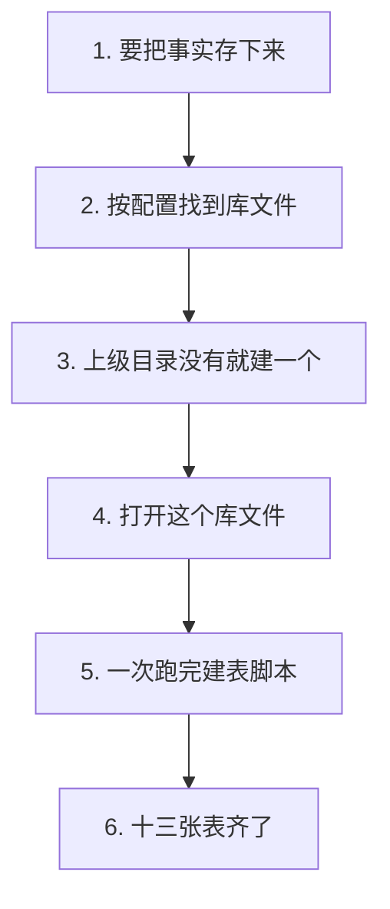
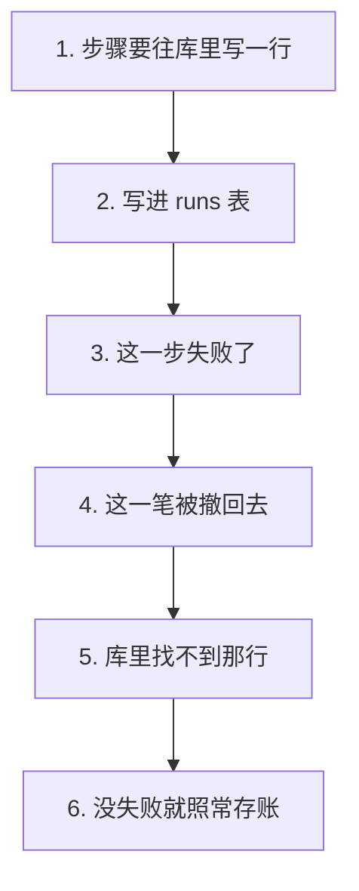
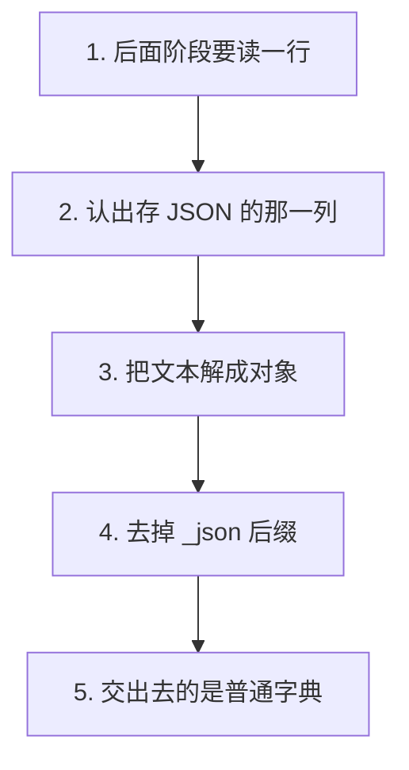

# P2.1 · 建立 SQLite schema 与连接管理

> 改动报告 · 2026-10-27 · 分支 `dev-don`
>
> 事实该有个落点了。
> 十三张表、一次建齐、重复建不报错、写坏了能撤回。

## 第一部分：Q&A 概览

| Question | Answer |
| --- | --- |
| What changed in this step?【这一步改了什么】 | The business database now has a real place to live, and all thirteen tables are built in one shot.【业务库有了真正的落点 十三张表一次建齐】 |
| Where does the database file sit?【库文件放在哪】 | Under the .course-agent folder of the repo, next to the course folders.【放在仓库的 .course-agent 目录里 和课程目录做邻居】 |
| Can it be built twice?【能建第二遍吗】 | Yes, and the second run rebuilds nothing and loses no rows.【可以 第二遍什么也不重建 也不丢行】 |
| What happens when a step fails?【某一步失败会怎样】 | The write is taken back, so a half finished step leaves no trace behind.【这一笔会被撤掉 半截的步骤不留痕迹】 |
| Does the course text go in there too?【课程正文也存进去吗】 | No, the text stays in the course folder, and the database only holds the facts about the runs.【不会 正文还在课程目录里 库里只放运行的事实】 |

## 第二部分：数据流

### 1. 第一次建库，十三张表一次到位



| 步骤 | 关键变量 | 具体示例值 | 说明 |
| --- | --- | --- | --- |
| 1. 要把事实存下来 | `SCHEMA`（建表脚本） | 13 条 `CREATE TABLE` | 脚本是纯文本，交给 SQLite 一次执行 |
| 2. 按配置找到库文件 | `get_settings().database_path` | `.course-agent/agent.db` | 位置只由配置说了算，不写在代码里 |
| 3. 上级目录没有就建 | `target.parent.mkdir()` | `.course-agent/` | 目录不存在时先建，文件才有地方落 |
| 4. 打开这个库文件 | `sqlite3.connect()` | `timeout=30` | 拿到的连接对象，后面所有写入都走它 |
| 5. 一次跑完脚本 | `executescript(SCHEMA)` | `PRAGMA` + 13 条建表 | 设置和建表放在同一段脚本里，不会跑一半 |
| 6. 十三张表齐了 | `IF NOT EXISTS` | 第二次执行 | 表已在就不重建，已有的一行都不动 |

```dataflow
1-01 (要存事实) 开发者要有一个地方放 Agent 的事实：[[SCHEMA]]十三张表的建表脚本}} 交给 [[executescript()]]一次跑完的函数}} <{db.py}>
1-02      → [找位置] [[get_settings()]]读全局配置的那个函数}} 给出 [[database_path]]业务库文件放在哪}}，落在 .course-agent/agent.db <{config.py}>
1-03           ↳ [建目录] [[target]]要写的那个库文件}} 的上级目录没有就 [[mkdir()]]先建出来}} <{db.py}>
1-04                ↳ [连上库] [[sqlite3.connect()]]打开这个库文件的函数}}，拿到一个连着这个库的连接 <{db.py}>
1-05                     ↳ [跑脚本] [[executescript()]]一次执行完}} 把 [[PRAGMA]]改数据库设置的那句话}} 和十三条建表语句一起跑掉 <{db.py}>
1-06                          ↳ [表齐了] [[IF NOT EXISTS]]表已在就不重建的那句话}} 让 [[initialize_database()]]建库的那个函数}} 跑第二遍也不丢行 <{db.py}>
---
{
  "1-01": "The agent needs one place to keep its facts, so the script that builds the thirteen tables is handed to a function that runs the whole script in one go.【SCHEMA[the script that builds the tables]: thirteen tables → ready to run】",
  "1-02": "The settings say where the business database file belongs, and that is the file under the .course-agent folder.【database_path[where the business database lives]: .course-agent/agent.db】",
  "1-03": "If the folder above the file is not there yet, it is created first, so the file always has somewhere to land.【target[the database file being written]: .course-agent/agent.db → folder made first】",
  "1-04": "The file is opened and a connection that talks to this database comes back.【connection[the live connection to the database]: not open → open】",
  "1-05": "The script runs in one shot: the setting that switches the database into its fast write ahead log mode, plus the thirteen create statements.【PRAGMA[the database setting command]: journal mode → write ahead log\ntable count[how many tables get created]: 0 → 13】",
  "1-06": "Every create statement says the table is only made when it is not there yet, so running the build again rebuilds nothing and loses no rows.【IF NOT EXISTS[the words that mean do not rebuild]: set → honoured on the second run】",
  "Summary": "The business database is built from one script and one file path. The settings pick the file, the folder is made when it is missing, the script runs in one go, and because every table is created only when it is absent, running the build a second time is harmless."
}
---
// STEP FLOW: 1-01[要存事实] → 1-02[找位置] → 1-03[建目录] → 1-04[连上库] → 1-05[跑脚本] → 1-06[表齐了]

// 这像第一次搬进新办公室:先按地址找到楼层(1-02),再看房间在不在(1-03),
// 开门进去(1-04),最后照着清单把要用的家具一次摆齐(1-05)。
// 清单上每件家具都写着「没有才买」(1-06),所以下次再搬一次,旧家具一样不会被扔掉。

// ===== 📂 apps/api/app/db.py(业务库的建表脚本) =====
// 1-01[要存事实] 十三张表的建表脚本,交给 executescript 一次跑完
<*SCHEMA*> = """
<*PRAGMA*> journal_mode=WAL;
<*PRAGMA*> foreign_keys=ON;

CREATE TABLE <*IF NOT EXISTS*> runs (
    id TEXT PRIMARY KEY,
    course_slug TEXT NOT NULL,
    mode TEXT NOT NULL,
    status TEXT NOT NULL,
    current_step TEXT NOT NULL,
    provider TEXT NOT NULL,
    model TEXT NOT NULL,
    request_json TEXT NOT NULL,
    interrupt_type TEXT,
    interrupt_payload_json TEXT,
    error_message TEXT,
    trace_id TEXT,
    budget_policy_json TEXT NOT NULL DEFAULT '{}',
    created_at TEXT NOT NULL,
    updated_at TEXT NOT NULL
);
...
"""

// ===== 📂 apps/api/app/db.py(把库建出来的那个函数) =====
// 1-02[找位置] 不给路径就问配置要
def <*initialize_database*>(path: Path | None = None) -> None:
    <*target*> = path or <*get_settings*>().<*database_path*>
    // 1-03[建目录] 上级目录没有就先建
    <*target*>.parent.<*mkdir*>(parents=True, exist_ok=True)
    // 1-04[连上库] 打开这个文件,拿到一个连着这个库的连接
    connection = <*sqlite3.connect*>(<*target*>, timeout=30, isolation_level="")
    try:
        // 1-05[跑脚本] 建表脚本一次跑完
        connection.<*executescript*>(<*SCHEMA*>)
    finally:
        connection.close()
// 1-06[表齐了] 脚本里每条 CREATE 都带着 IF NOT EXISTS,再跑一遍也不重建已有的表
```

### 2. 某一步失败，那一笔账不留痕迹



| 步骤 | 关键变量 | 具体示例值 | 说明 |
| --- | --- | --- | --- |
| 1. 步骤要写一行 | `database()`（上下文管理器） | `with database() as connection:` | 进块前先把表准备好，块里只管写 |
| 2. 写进 runs 表 | `INSERT INTO runs` | `id = "run-1"` | 一行代表一次运行 |
| 3. 这一步失败了 | `raise RuntimeError` | `"这一步失败了"` | 异常从块里抛出来 |
| 4. 这一笔被撤回去 | `connection.rollback()` | 自动 | 退回到写之前的样子 |
| 5. 库里找不到那行 | `SELECT COUNT(*)` | `0` | 半截的步骤不留痕迹 |
| 6. 没失败就存账 | `connection.commit()` | 自动 | 块里没抛错才真正入账 |

```dataflow
2-01 (步骤落账) 某个 Run 步骤要往库里写一行：[[database()]]打开业务库的上下文管理器}} 把连接交出来用 <{db.py}>
2-02      → [写一行] 往 [[runs]]记录一次运行的那张表}} 写一行这次运行 <{test_database.py}>
2-03           ↳ [出了错] 这一步失败了，异常从块里抛出来 <{test_database.py}>
2-04                ↳ [撤回去] [[rollback()]]把这一笔退回去的方法}} 退回到写之前的样子 <{db.py}>
2-05                     ↳ [不留痕] 再去数一次 [[runs]]记录一次运行的那张表}}，刚才那行已经不在了 <{test_database.py}>
2-06                          ↳ [另一种结局] 块里没抛错就走 [[commit()]]把改动存下去的方法}}，这行就留下了 <{db.py}>
---
{
  "2-01": "A run step needs to put a row into the database, and this context manager hands out the connection to do it.【database[the helper that opens the business database]: closed → open for the caller】",
  "2-02": "One row is written into the table that keeps the runs.【runs[the table that holds the runs]: 0 rows → 1 row】",
  "2-03": "Then the step fails, and the error comes out of the block.【the error[what went wrong inside the block]: none → raised】",
  "2-04": "The write is taken back, so the table looks exactly as it did before the step started.【rollback[undoing the write]: the new row → gone again】",
  "2-05": "Counting the table again shows that the row is really not there.【row count[how many rows the runs table holds]: 1 → 0】",
  "2-06": "When nothing goes wrong, the change is kept and the row stays.【commit[keeping the change]: not reached → the row is stored】",
  "Summary": "A step either lands completely or leaves no trace at all. The write goes into the runs table, the step fails, the transaction is taken back, and the table is left exactly as it was. Only a step that finishes without an error is really written down."
}
---
// STEP FLOW: 2-01[步骤落账] → 2-02[写一行] → 2-03[出了错] → 2-04[撤回去] → 2-05[不留痕] → 2-06[另一种结局]

// 这像银行柜台:你递进去一张单子(2-02),中途发现填错了(2-03),
// 柜员就把这一笔整个撤掉(2-04),账上一点痕迹都不留(2-05)。
// 要是没出错(2-06),这一笔才真正入账。

// ===== 📂 apps/api/app/db.py(打开业务库的那个上下文管理器) =====
// 2-01[步骤落账] 先把表准备好,再把连接交出去
@contextmanager
def <*database*>() -> Iterator[sqlite3.Connection]:
    path = get_settings().database_path
    initialize_database(path)
    connection = sqlite3.connect(
        path,
        timeout=30,
        check_same_thread=False,
        isolation_level="",
    )
    connection.row_factory = sqlite3.Row
    connection.execute("PRAGMA foreign_keys=ON")
    try:
        yield connection
        // 2-06[另一种结局] 没抛错就存账
        connection.<*commit*>()
    except Exception:
        // 2-04[撤回去] 抛错了就把这一笔撤掉
        connection.<*rollback*>()
        raise
    finally:
        connection.close()

// ===== 📂 apps/api/tests/test_database.py(证明失败不留痕的那个测试) =====
// 2-02[写一行] 往 runs 里写一行
with pytest.raises(RuntimeError):
    with <*database*>() as connection:
        insert_run(connection)
        // 2-03[出了错] 这一步失败了
        raise RuntimeError("这一步失败了")

# 2-05[不留痕] 再去数一次,那行不在了
with <*database*>() as connection:
    stored = connection.execute("SELECT COUNT(*) FROM <*runs*>").fetchone()
```

### 3. 读回一行，JSON 变回对象



| 步骤 | 关键变量 | 具体示例值 | 说明 |
| --- | --- | --- | --- |
| 1. 读回一行 | `row_to_dict()` | `row: sqlite3.Row \| None` | 没有行就给 `None`，不假装有一行 |
| 2. 认出 JSON 列 | `JSON_COLUMNS` | `"payload_json"` | 清单里有的列才是 JSON 列 |
| 3. 解成对象 | `json.loads()` | `'{"answer": 42}'` | 文本变回真的对象 |
| 4. 去掉后缀 | `removesuffix("_json")` | `payload_json → payload` | 键名变短，读的人不用猜 |
| 5. 交出去 | 返回的字典 | `{"payload": {...}}` | 调用方拿到的就是普通字典 |

```dataflow
3-01 (读回一行) 后面阶段要读一行记录：[[row_to_dict()]]把一行变成字典的方法}} 接手 [[sqlite3.Row]]数据库交回来的那一行}} <{db.py}>
3-02      → [认 JSON 列] 这一行的 [[payload_json]]存一份 JSON 用的那一列}}，名字结尾是 _json <{db.py}>
3-03           ↳ [解成对象] [[JSON_COLUMNS]]哪些列存的是 JSON 那张清单}} 里的列取出文本后，交给 [[json.loads()]]把文本变回对象的方法}} <{db.py}>
3-04                ↳ [去掉后缀] [[removesuffix()]]去掉末尾几个字的方法}} 把 _json 去掉，键变成 [[payload]]存进去的那个对象}} <{db.py}>
3-05                     ↳ [交出去] 交出去的字典里 payload 是对象，别的列还是原来的字符串 <{db.py}>
---
{
  "3-01": "Later phases need to read a stored row back, and this helper turns that row into a plain dictionary.【row_to_dict[the helper that turns a row into a dictionary]: a database row → a plain dictionary】",
  "3-02": "One of its columns holds a JSON document as text, and the column name says so by ending in _json.【payload_json[the column that keeps a JSON document as text]: a JSON document, held as text】",
  "3-03": "Columns on the list are taken out as text and turned back into real objects.【JSON_COLUMNS[the list of columns that hold JSON]: payload_json → decoded into an object】",
  "3-04": "The _json ending is cut off, so the key in the dictionary is short.【payload[the key after the suffix is cut]: payload_json → payload】",
  "3-05": "What comes out is a dictionary where that key holds an object, while every other column is still the text it was.【the stored value[what that key holds now]: a JSON string → a real object】",
  "Summary": "Reading a row back is where stored text becomes usable data. The helper takes the columns that hold JSON, decodes them, and cuts the _json ending off the key, so the caller gets an object under a short name and never has to parse anything by hand."
}
---
// STEP FLOW: 3-01[读回一行] → 3-02[认 JSON 列] → 3-03[解成对象] → 3-04[去掉后缀] → 3-05[交出去]

// 这像拆快递:箱子上贴着「易碎,向上」这种标签(3-02),
// 说明箱子里装的是要小心拿的东西(3-03),拆完把标签撕掉,只留里面的东西(3-04),
// 递给你的时候就是一个普普通通的好东西,不用你再研究包装(3-05)。

// ===== 📂 apps/api/app/db.py(哪些列存的是 JSON) =====
// 3-02[认 JSON 列] 名字结尾是 _json 的列,存的是一份 JSON
<*JSON_COLUMNS*> = (
    "request_json",
    "budget_policy_json",
    "interrupt_payload_json",
    "payload_json",
    "presentation_json",
    "raw_output_json",
    "scope_json",
    "verification_json",
    "evidence_json",
    "success_criteria_json",
    "latest_verification_json",
    "plan_json",
    "patch_json",
    "output_json",
    "attributes_json",
    "previous_policy_json",
    "next_policy_json",
)

// ===== 📂 apps/api/app/db.py(把一行变成字典的那个方法) =====
// 3-01[读回一行] 没有行就给 None
def <*row_to_dict*>(row: <*sqlite3.Row*> | None) -> dict[str, Any] | None:
    if row is None:
        return None
    value = dict(row)
    // 3-03[解成对象] 清单里有的列,取出来的是 JSON 文本
    for key in <*JSON_COLUMNS*>:
        if key not in value:
            continue
        raw = value.pop(key)
        // 3-04[去掉后缀] 去掉 _json 后缀,键变成 payload 这样的短名字
        value[key.<*removesuffix*>("_json")] = <*json.loads*>(raw) if raw else None
    return value

// ===== 📂 apps/api/tests/test_database.py(证明 JSON 变回对象的那个测试) =====
// 3-05[交出去] 交出去的字典里,payload 是对象,原来的列名不见了
assert result["payload"] == {"answer": 42}
assert "payload_json" not in result
```

## 第三部分：其它

### 这次改动的边界

三个新文件，别的文件一行没动：

| 文件 | 行数 | 干什么的 |
| --- | --- | --- |
| `apps/api/app/db.py` | 358 | 建表脚本 + 连接管理 |
| `apps/api/tests/test_database.py` | 331 | 21 条测试 |
| `apps/api/tests/conftest.py` | 58 | 临时库 fixture |

`apps/api/tests/conftest.py` 是这个仓库里**第一个** conftest，它对整个 `tests/` 目录生效。既有那 12 个测试文件不用它，但 pytest 加载目录时会把它一起加载 —— 所以这次跑了全量（152 passed / 1 skipped），确认没有连带影响。

### 跟计划不一样的一处：`row_to_dict` 的返回类型

计划里写的是 `row_to_dict(row) -> dict`，实现是
`row_to_dict(row: sqlite3.Row | None) -> dict[str, Any] | None`。

理由：P2.2 的 `get_run_record(run_id)` 查不到这一行时必须能说"没有"。参考版也是返回 `None`。
如果 `row_to_dict` 把 `None` 变成 `{}`，"没有这条记录"和"这条记录是空的"就分不开了。
`None` 进去、`None` 出来，是更省心的契约 —— 少一个要记住的例外。

### 没有抄参考版的三段旧库迁移

参考版的 `db.py` 里有三个私有迁移函数（`_migrate_execution_tables` /
`_migrate_observability_tables` / `_migrate_repair_task_findings`），是给"已经发出去过、
后来改了表结构"的旧库补列用的。

我们是从零开始的仓库，从来没有过旧库。`CREATE TABLE IF NOT EXISTS` 本身就已经满足
计划要的"重复初始化不报错"。抄过来只会多三段永远走不到、也没人测的代码。

参考版里 `_migrate_observability_tables` 顺手做了一件事：
`UPDATE runs SET trace_id = id WHERE trace_id IS NULL`。这对应 RoadMap §2.1 的
`run_id == trace_id` 不变量。**这一条留给 P2.2** —— 建 Run 记录的时候就要把 `trace_id`
直接写成 `run_id`，不要靠事后补。

### 这次验证了什么、没验证什么

**验证了**：

- `apps/api/tests/test_database.py`：21 条全过（`-v`）。
- 全量 `apps/api/tests`：152 passed / 1 skipped（基线 131 passed / 1 skipped，加上新增的 21 条）。
- `ruff check apps/api`：All checks passed。
- `node scripts/check-source-size.mjs`：26 files, <= 500 lines each。
- WAL 模式会在库文件旁边留下 `-wal` 和 `-shm` 两个副文件，conftest 的 fixture 把它们一起删掉。

**没验证**：

- **没有在真的 `.course-agent/agent.db` 上跑过**。全部测试都在 pytest 的临时目录里。
  真实路径由 `Settings.database_path` 决定，要等 P2.2 接上仓储时才会第一次真正打开它。
- **没有并发测试**。`database()` 开了 `check_same_thread=False`，但多个线程同时写同一个库
  的行为没有测过。
- **没有 E2E**：CLAUDE.md 第 6 条。
- **没有跑 `check-report.py`**：CLAUDE.md 第 10 条。这次用仓库外那份复刻脚本逐条核对。

### 交给开发者的一件事

1. `apps/api/tests/conftest.py` 对整个 `tests/` 目录生效。以后别的测试也要用临时库，
   直接用 `use_temp_database` 这个 fixture 就行，不用自己再造一个。
2. **有两篇旧报告有同类缺陷，还没处理** —— 都在「注音标识没出现在那一块的代码区里」：
   - `p1.6-course-catalog.md`：dataflow@329，注音标识 `items`。
   - `p1.7-course-create-api.md`：dataflow@244，注音标识 `create_course_scaffold`
     （那一块只贴了 `schemas.py` 和 `common.py`）。

   **要不要回头改这两篇，等开发者说。**

### 报告自检（没跑 `check-report.py`）

按 CLAUDE.md 第 10 条，报告格式**没有跑** `check-report.py`。这次仍然用放在仓库外的
临时脚本（`%TEMP%/p18-report-check/check_rules.py`）复刻它的规则逐条核对：
`###` 子段 3 个（≤3）、每个 `dataflow` 块里 `---` 各两处、步骤号在图 / JSON 键 /
代码区 `//` 注释三处一致、`[[]]` 与 `}}` 配对、注音标识都在代码区原样出现、
JSON 讲解纯英文、Q&A 5 行且中文只在 `【】` 内、STEP FLOW 一条且每项都是 `[...]`。

这一轮把复刻脚本的注释规则对齐了权威检查器：步骤注释 `//` 或 `#` 都收，但必须
**独占一行**、不能跟代码并排；注音标识的核对在去掉 `<* *>` 和 `<{ }>` 之后做。
箭头几何另用一段脚本核对过：第 N 步的箭头落在第 5×N 列，全部对齐。

**它是复刻，不是检查器本身** —— 权威的 `check-report.py` 仍然没跑过，两者可能有出入。

**顺手拿它回测了 `docs/changes/2026-10-27/` 下全部 7 篇旧报告**：5 篇全过，
2 篇有上面说的注音缺陷（P1.6、P1.7）。
