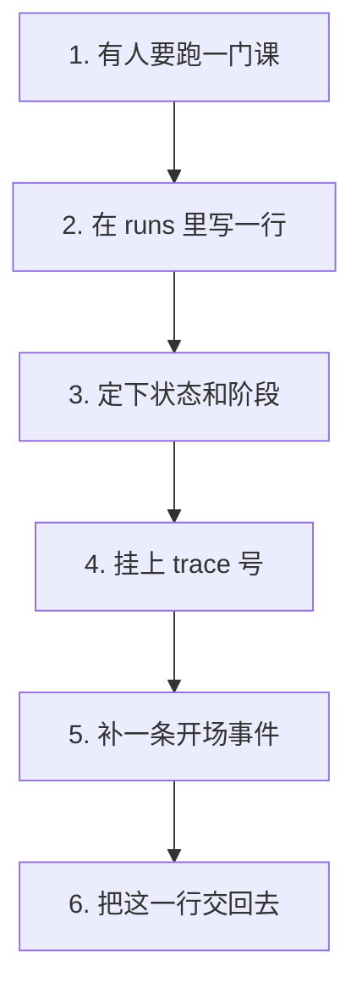
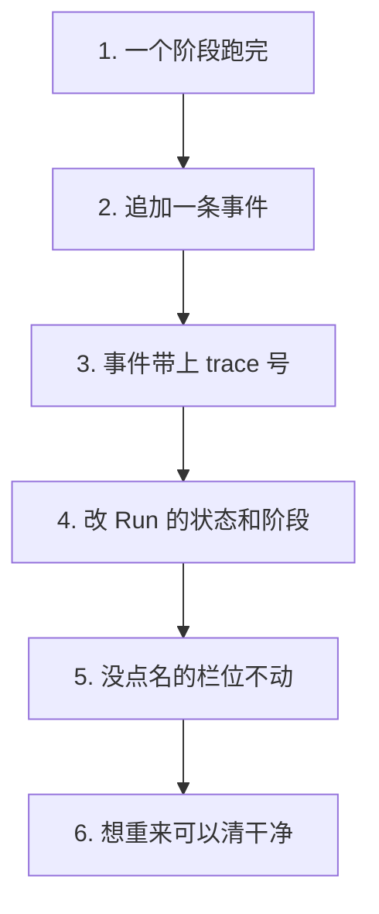
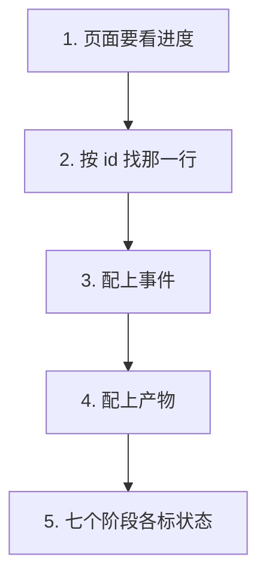

# P2.2 · 建立 Run 仓储（落账）

> 改动报告 · 2026-10-27 · 分支 `dev-don`
>
> 事实该有个落点了。
> 跑过什么、做到哪一步、出了什么错，都记在账上。

## 第一部分：Q&A 概览

| Question | Answer |
| --- | --- |
| What does the run ledger do?【这次加了什么】 | Every state change of a run now leaves a row behind, so the page can show what happened.【Run 的每次状态变化都留下一行 页面随时查得到】 |
| What happens when a run starts?【Run 开张时写了什么】 | One row in the runs table plus a first event that says the run was created.【runs 表里写一行 外加一条「刚建立」的事件】 |
| Can a run be traced?【能追踪吗】 | Yes, the run id is the trace id, so one run means one trace.【能 run_id 就是 trace_id 一个 Run 一条 trace】 |
| What if a run has to start over?【重来时旧账怎么办】 | The old error and the old waiting for approval can be wiped, so the record shows the run as it is now.【旧的失败原因和旧的中断可以抹掉 账上只剩现在的样子】 |
| What does the page get back?【页面拿到什么】 | Four things in one call: the run, its events, its artifacts, and the seven stages with their state.【一次拿到四样 Run 本身、事件、产物、还有七个阶段各自的状态】 |

## 第二部分：数据流

### 1. 一个 Run 开张，先落一行账



| 步骤 | 关键变量 | 具体示例值 | 说明 |
| --- | --- | --- | --- |
| 1. 开张 | `create_run_record()` | `run_id="run-1"` | 有人要跑课，就先在 `runs` 里开一行 |
| 2. 定状态 | `status` / `current_step` | `"QUEUED"` / `"intake"` | 新 Run 从排队起步，停在第一个阶段 |
| 3. 留痕 | `trace_id` | `== run_id` | 一个 Run 一条 trace，不靠事后补 |
| 4. 存请求 | `request_json` / `budget_policy_json` | `{"title": "Python 入门"}` | 请求和预算规则都存成 JSON 文本 |
| 5. 写首条 | `append_event()` | `"run.created"` | 第一条事件：这个 Run 刚建立 |
| 6. 交账 | 返回值 | `runs` 那一行 | 写进去什么就交回什么 |

```dataflow
1-01 (开张) 有人要跑一门课,[[create_run_record()]]开一个 Run 记录的函数}} 先往 [[runs]]记录一次运行的那张表}} 写一行 <{repository.py}>
1-02      → [定状态] 这一行从 [[QUEUED]]排队等着的那个状态}} 起步,停在 [[intake]]第一步的名字}} 上 <{repository.py}>
1-03           ↳ [留痕] [[trace_id]]追踪这次运行用的那串号}} 直接写成 [[run_id]]这次运行自己的号}},一个 Run 一条 trace <{repository.py}>
1-04                ↳ [存请求] [[request_json]]存这次请求的那一列}} 和 [[budget_policy_json]]存预算规则的那一列}} 都存成 JSON 文本 <{repository.py}>
1-05                     ↳ [写首条] 接着调 [[append_event()]]往账本里追加一条事件的函数}},写下第一条 [[run.created]]表示 Run 刚建立的事件类型}} <{repository.py}>
1-06                          ↳ [交账] 交回去的是 [[runs]]记录一次运行的那张表}} 里刚写进去的那一行 <{repository.py}>
---
{
  "1-01": "Someone wants to run a course, so the helper writes one row into the table that keeps the runs.【create_run_record[the helper that opens a run]: called → one new row in the runs table】",
  "1-02": "That row starts out waiting in line, sitting at the very first stage of the flow.【status[the state the run is in]: QUEUED (waiting in line)\ncurrent_step[the stage the run sits at]: intake (the first stage)】",
  "1-03": "The row also carries a trace number, and it is simply the run number, so one run means one trace.【trace_id[the number that follows this run through the system]: same as the run id\nrun_id[the number that names this run]: the id it was given】",
  "1-04": "The request that started the run and the budget rules for it are both stored as text that reads back as real objects.【request_json[the column that keeps the request]: the request → stored as JSON text\nbudget_policy_json[the column that keeps the budget rules]: the rules → stored as JSON text】",
  "1-05": "Right after that, the ledger gets its first entry, saying this run has just been created.【run.created[the kind of event that says the run just started]: none → the first event of the run】",
  "1-06": "What comes back is the row that was just written, so the caller can keep working with it.【the row[the new run row]: written → handed back to the caller】",
  "Summary": "A new run leaves two traces behind: one row in the runs table and one first event. The row starts out waiting in line at the first stage, carries the run id as its own trace number, and keeps the request and the budget rules as text that reads back as objects."
}
---
// STEP FLOW: 1-01[开张] → 1-02[定状态] → 1-03[留痕] → 1-04[存请求] → 1-05[写首条] → 1-06[交账]

// 这像开一张流水账:先在账本上写一行「这个人今天来办业务」(1-01),
// 定下状态是「排队中」(1-02),给这一行挂上唯一编号(1-03),
// 把来办事的缘由和规矩一并记下(1-04),再补一条「开张了」的小条(1-05),
// 最后把这一行原件交回给办事的人(1-06)。

// ===== 📂 apps/api/app/workflow/repository.py(Run 的账本:唯一的写账口) =====
// 1-01[开张] 有人要跑一门课,先在 runs 里写一行
def <*create_run_record*>(
    <*run_id*>: str,
    course_slug: str,
    mode: str,
    provider: str,
    model: str,
    <*request*>: dict[str, Any],
    budget_policy: dict[str, Any] | None = None,
) -> dict[str, Any]:
    """Open a new run: one row in `runs` plus the first event.

    The run starts in `QUEUED` at the first stage, and its trace id is the
    run id itself, so one trace covers the whole run.

    Args:
        run_id: The id of the new run, for example a uuid4 string.
        course_slug: The course this run belongs to, for example "python-101".
        mode: The run mode, for example "guided".
        provider: The model provider, for example "codex_gateway".
        model: The model name, for example "llm-gateway--kimi-k3".
        request: The request that started the run, for example the intake
            payload.  It is stored as JSON so the run can be replayed.
        budget_policy: The budget rules of this run, for example
            {"token_budget_mtokens": 20}.  An empty policy when omitted.

    Returns:
        The new row of `runs`, decoded into a dictionary.
    """
    now = utcnow()
    with database() as connection:
        // 1-02[定状态] 这一行从「排队中」起步,停在第一步
        connection.execute(
            """
            INSERT INTO runs (
                id, course_slug, mode, status, current_step, provider, model,
                <*request_json*>, <*trace_id*>, <*budget_policy_json*>, created_at, updated_at
            ) VALUES (?, ?, ?, 'QUEUED', 'intake', ?, ?, ?, ?, ?, ?, ?)
            """,
            (
                <*run_id*>,
                course_slug,
                mode,
                provider,
                model,
                // 1-04[存请求] 请求和预算规则都存成 JSON 文本
                json.dumps(<*request*>, ensure_ascii=False),
                // 1-03[留痕] trace_id 直接写成 run_id,一个 Run 一条 trace
                <*run_id*>,
                json.dumps(budget_policy or {}, ensure_ascii=False),
                now,
                now,
            ),
        )
    // 1-05[写首条] 第一条事件:这个 Run 刚建立
    <*append_event*>(<*run_id*>, "run.created", "intake", "课程 Agent Run 已创建")
    with database() as connection:
        row = _run_row(connection, run_id)
    // 1-06[交账] 交回去的是刚写进去的那一行
    return row or {}
```

### 2. 跑到一半，留下痕迹



| 步骤 | 关键变量 | 具体示例值 | 说明 |
| --- | --- | --- | --- |
| 1. 阶段完成 | `append_event()` | `"stage.completed"` | 阶段跑完，往账本里追加一条 |
| 2. 写事件 | `run_events` | `message="任务定义完成"` | 事件类型、阶段名、人能读的一句话 |
| 3. 带上 trace | `trace_id` | `"trace-1"` 或回落成 `run_id` | 有 trace 用 trace 的，没有就用 run 的顶上 |
| 4. 改状态 | `update_run()` | `status="RUNNING"` | 只动点名的栏位 |
| 5. 只改给的 | `error_message` / `interrupt_type` | 原样留着 | 没给的栏位一个字都不碰 |
| 6. 能清干净 | `clear_interrupt` / `clear_error` | `True` | 想重来就把旧批注擦掉 |

```dataflow
2-01 (阶段完成) 一个阶段跑完了,[[append_event()]]往账本里追加一条事件的函数}} 追加一条事件 <{repository.py}>
2-02      → [写事件] 往 [[run_events]]记录事件的那张表}} 写一行,带上事件类型、阶段名和人能读的一句话 <{repository.py}>
2-03           ↳ [带上 trace] 有 trace 就用它的 [[trace_id]]追踪这次运行用的那串号}},没有就用 [[run_id]]这次运行自己的号}} 顶上 <{repository.py}>
2-04                ↳ [改状态] [[update_run()]]改一个 Run 状态的函数}} 把 [[status]]这个 Run 现在的状态}} 和 [[step]]这个 Run 停在哪一步}} 改掉 <{repository.py}>
2-05                     ↳ [只改给的] 没点名的栏位一个都不碰,[[error_message]]失败原因那一列}} 和 [[interrupt_type]]等人审批的那种中断}} 原样留着 <{repository.py}>
2-06                          ↳ [能清干净] 想重新开始时,[[clear_interrupt]]把中断拿掉的那个开关}} 和 [[clear_error]]把失败原因拿掉的那个开关}} 把旧账一笔勾销 <{repository.py}>
---
{
  "2-01": "A stage is done, so the ledger gets one more entry.【append_event[the helper that adds a line to the ledger]: called → one more event for the run】",
  "2-02": "The new entry goes into the table that keeps the events, carrying what happened, which stage it happened in, and a line a person can read.【run_events[the table that keeps the events]: one event → two events\nmessage[the short line a person reads]: none → the message for this event】",
  "2-03": "If the event happened inside a trace, that trace number is used; if there is no trace yet, the run number stands in.【trace_id[the number that follows the run through the system]: the trace's number → the run's own number when there is no trace】",
  "2-04": "The run itself is then told about the change, so the state and the stage it sits at move on.【update_run[the helper that changes a run]: called → the run row changes\nstatus[the state of the run]: old state → new state\nstep[the stage the run sits at]: old stage → new stage】",
  "2-05": "Only the fields that are named are touched. The old failure reason and the old waiting for approval are left exactly as they were.【error_message[the column that keeps why a run failed]: old text → untouched\ninterrupt_type[the kind of approval a run is waiting for]: old kind → untouched】",
  "2-06": "When a run starts over, the two switches clear the old marks, so the run no longer looks broken or stuck.【clear_interrupt[the switch that removes the waiting for approval]: off → on, the old mark is gone\nclear_error[the switch that removes the failure reason]: off → on, the old mark is gone】",
  "Summary": "Every state change leaves a line in the ledger. A finished stage adds an event and moves the run on, a trace number rides along with the event, and only the fields that are named get touched. When a run starts over, the old failure and the old waiting for approval can be wiped away, so the record shows the run as it is now."
}
---
// STEP FLOW: 2-01[阶段完成] → 2-02[写事件] → 2-03[带上 trace] → 2-04[改状态] → 2-05[只改给的] → 2-06[能清干净]

// 这像记账员:一笔一笔往下记(2-01),把事情记进流水账(2-02),
// 顺手标上这一笔属于哪条单子(2-03);回头要改状态时只改该改的那几栏(2-04),
// 没提到的栏位一个字都不动(2-05),想重来就拿橡皮擦把旧批注擦掉(2-06)。

// ===== 📂 apps/api/app/workflow/repository.py(往账本里追加一条事件) =====
// 2-01[阶段完成] 一个阶段跑完了,追加一条事件
def <*append_event*>(
    <*run_id*>: str,
    event_type: str,
    step: str,
    message: str,
    payload: dict[str, Any] | None = None,
    trace: Any | None = None,
) -> dict[str, Any]:
    """Write one event into the ledger of a run.

    Args:
        run_id: The run this event belongs to, for example "run-1".
        event_type: What happened, for example "run.created" or "run.failed".
        step: The stage the event belongs to, for example "intake".
        message: A short line a human can read, for example "任务定义完成".
        payload: The details of the event, for example {"attempt": 1}.  An
            empty payload when omitted.
        trace: The trace context this event happened in.  It may be a
            mapping or an object carrying "trace_id" / "span_id" /
            "parent_span_id".  Without one the event falls back to the run
            id as its trace id.

    Returns:
        The new row of `run_events`, decoded into a dictionary.
    """
    event_id = str(uuid.uuid4())
    now = utcnow()
    with database() as connection:
        // 2-02[写事件] 往 run_events 里写一行
        connection.execute(
            """
            INSERT INTO run_events (
                id, run_id, event_type, step, message, payload_json,
                <*trace_id*>, span_id, parent_span_id, created_at
            ) VALUES (?, ?, ?, ?, ?, ?, ?, ?, ?, ?)
            """,
            (
                event_id,
                <*run_id*>,
                event_type,
                step,
                message,
                json.dumps(payload or {}, ensure_ascii=False),
                // 2-03[带上 trace] 有 trace 用 trace 的,没有就用 run_id 顶上
                <*_trace_value*>(trace, "trace_id", <*run_id*>),
                _trace_value(trace, "span_id"),
                _trace_value(trace, "parent_span_id"),
                now,
            ),
        )
        row = connection.execute(
            "SELECT * FROM run_events WHERE id = ?", (event_id,)
        ).fetchone()
    return row_to_dict(row) or {}

// ===== 📂 apps/api/app/workflow/repository.py(改一个 Run 的状态) =====
// 2-04[改状态] 只改名字里点到的那些栏位
def <*update_run*>(
    <*run_id*>: str,
    *,
    <*status*>: str | None = None,
    <*step*>: str | None = None,
    interrupt_type: str | None = None,
    interrupt_payload: dict[str, Any] | None = None,
    <*error_message*>: str | None = None,
    <*clear_interrupt*>: bool = False,
    <*clear_error*>: bool = False,
) -> dict[str, Any]:
    """Change the state of a run and write down what changed.

    Only the fields that are given are touched.  An interrupt or an error
    message is taken away when the matching clear flag is set, because
    "no error" and "the old error" are two different things.

    Args:
        run_id: The run to change, for example "run-1".
        status: The new run status, for example "RUNNING".  One of the
            statuses the contract freezes: `QUEUED` / `RUNNING` /
            `WAITING_APPROVAL` / `COMPLETED` / `FAILED` / `STOPPED`.
        step: The stage the run is at now, for example "mission".
        interrupt_type: The kind of approval the run is waiting for, for
            example "MISSION_APPROVAL".
        interrupt_payload: The details of that approval, for example
            {"type": "MISSION_APPROVAL"}.
        error_message: The reason the run failed, for example "这一批生成失败了".
        clear_interrupt: True takes the interrupt and its payload away.
        clear_error: True takes the error message away.

    Returns:
        The updated row of `runs`, decoded into a dictionary.
    Raises ValueError: when there is no run with this id.
    """
    fields = ["updated_at = ?"]
    values: list[Any] = [utcnow()]
    // 2-05[只改给的] 没点名的栏位一个都不碰
    if status is not None:
        fields.append("status = ?")
        values.append(status)
    if step is not None:
        fields.append("current_step = ?")
        values.append(step)
    // 2-06[能清干净] 想重来就把旧的批注擦掉
    if clear_interrupt:
        fields.extend(["interrupt_type = NULL", "interrupt_payload_json = NULL"])
    elif interrupt_type is not None:
        fields.extend(["interrupt_type = ?", "interrupt_payload_json = ?"])
        values.extend(
            [interrupt_type, json.dumps(interrupt_payload or {}, ensure_ascii=False)]
        )
    if error_message is not None:
        fields.append("error_message = ?")
        values.append(error_message)
    elif <*clear_error*>:
        fields.append("error_message = NULL")
    values.append(run_id)
    with database() as connection:
        cursor = connection.execute(
            f"UPDATE runs SET {', '.join(fields)} WHERE id = ?",
            values,
        )
        if cursor.rowcount == 0:
            raise ValueError("Run 不存在")
        row = _run_row(connection, run_id)
    return row or {}
```

### 3. 页面要看的四件东西



| 步骤 | 关键变量 | 具体示例值 | 说明 |
| --- | --- | --- | --- |
| 1. 要看进度 | `get_run_record()` | `run_id="run-1"` | 一次调用把整件事读出来 |
| 2. 先找 Run | `runs` / `None` | 找不到就是 `None` | 没有这一行就不假装有 |
| 3. 配事件 | `events` | 按 `seq` 排序 | 谁先谁后，顺序不乱 |
| 4. 配产物 | `artifacts` | 按写入顺序 | 同样是最新的在前 |
| 5. 配步骤 | `workflow_steps` | `completed` / `active` / `pending` | 七个阶段各标一个状态 |

```dataflow
3-01 (要看进度) 页面要显示这次跑到哪了,[[get_run_record()]]把一次运行读成一个整体的那个函数}} 把整件事读出来 <{repository.py}>
3-02      → [先找 Run] 去 [[runs]]记录一次运行的那张表}} 里按 id 找那一行,找不到就是 [[None]]什么都没有的那个值}} <{repository.py}>
3-03           ↳ [配事件] 把 [[events]]这次运行发生过的事件}} 按先后顺序摆好 <{repository.py}>
3-04                ↳ [配产物] 把 [[artifacts]]这次运行产出的东西}} 也按先后顺序摆好 <{repository.py}>
3-05                     ↳ [配步骤] 七个阶段各标一个状态:走完的 [[completed]]已经完成的那几个}}、正在走的 [[active]]眼下这一步}}、还没到的 [[pending]]排在后面的那些}} <{repository.py}>
---
{
  "3-01": "The page wants to show how far the run got, so the helper reads the whole story back in one go.【get_run_record[the helper that reads a run as a whole]: called → one record with four parts】",
  "3-02": "First the run row itself is looked up by its id, and when there is no such run the answer is nothing at all.【runs[the table that keeps the runs]: searched by id → found or not found\nNone[the value that means there is nothing]: the answer when no run is found】",
  "3-03": "The events of the run are then lined up in the order they happened.【events[the events of this run]: none → the full list, oldest first】",
  "3-04": "The artifacts of the run are lined up the same way, oldest first.【artifacts[the things this run produced]: none → the full list, oldest first】",
  "3-05": "Finally the seven stages each get a label: the ones already done, the one being worked on now, and the ones still to come.【completed[the label for a stage that is done]: attached to the finished stages\nactive[the label for the stage in progress]: attached to the current stage\npending[the label for a stage still to come]: attached to the waiting stages】",
  "Summary": "One call gives the browser everything it needs about a run: the run row itself, the events that happened, the artifacts that were produced, and the seven stages each marked as done, in progress, or still to come. Asking for a run that was never started gives nothing back at all."
}
---
// STEP FLOW: 3-01[要看进度] → 3-02[先找 Run] → 3-03[配事件] → 3-04[配产物] → 3-05[配步骤]

// 这像前台查一个快递:先按单号找到那张单(3-02),
// 再把签收记录(3-03)和包裹清单(3-04)一并摊在柜台上,
// 最后照着流程表标一句「到哪一步了」(3-05)。
// 单号查不到(3-02),前台不会瞎编一张单给你,只会说没有。

// ===== 📂 apps/api/app/workflow/repository.py(把一次运行读成一个整体) =====
// 3-01[要看进度] 页面要显示这次跑到哪了
def <*get_run_record*>(<*run_id*>: str) -> dict[str, Any] | <*None*>:
    """Read the whole story of a run.

    Args:
        run_id: The run to read, for example "run-1".

    Returns:
        A dictionary with four keys: "run" (the row of `runs`), "events"
        (the events of the run, oldest first), "artifacts" (the artifacts of
        the run, oldest first) and "workflow_steps" (the seven stages, each
        with a "status" of "completed", "active" or "pending").  It is None
        when there is no such run, so a missing run stays distinguishable
        from an empty one.
    """
    with database() as connection:
        // 3-02[先找 Run] 按 id 在 runs 里找那一行,找不到就是 None
        run = _run_row(connection, run_id)
        if run is None:
            return None
        event_rows = connection.execute(
            "SELECT * FROM run_events WHERE run_id = ? ORDER BY seq",
            (run_id,),
        ).fetchall()
    # 3-03[配事件] 事件按先后顺序排好
    events = [row_to_dict(row) or {} for row in event_rows]
    current_index = _step_index(run["current_step"])
    finished = run["status"] == "COMPLETED"
    return {
        // 3-04[配产物] 产物也按先后顺序排好
        "run": run,
        "events": events,
        "artifacts": list_run_artifacts(run_id),
        // 3-05[配步骤] 七个阶段各标一个状态
        "workflow_steps": [
            {
                **definition,
                "status": (
                    "completed"
                    if index < current_index or (finished and index == current_index)
                    else "active"
                    if index == current_index
                    else "pending"
                ),
            }
            for index, definition in enumerate(WORKFLOW_STEPS)
        ],
    }
```

## 第三部分：其它

### 这次改动的边界

两个新文件，别的文件一行没动：

| 文件 | 行数 | 干什么的 |
| --- | --- | --- |
| `apps/api/app/workflow/repository.py` | 389 | Run 的账本：7 个公开函数 + 3 个私有帮手 |
| `apps/api/tests/test_run_repository.py` | 348 | 14 条测试 |

计划里写的是 7 个产出函数，全部落地，签名照抄计划：
`create_run_record()` / `append_event()` / `update_run()` / `record_run_artifact()` /
`list_run_artifacts()` / `get_run_record()` / `list_run_records()`。

### 跟计划不一样的一处：`get_run_record` 的返回类型

计划里写的是 `get_run_record(run_id) -> dict`，实现是
`get_run_record(run_id: str) -> dict[str, Any] | None`。

理由跟 P2.1 的 `row_to_dict` 是同一条：查不到这一行时必须能说"没有"。
返回 `{}` 的话，"没有这条记录"和"这条记录是空的"就分不开了。
P2.5 的 `GET /api/runs/{id}` 正好要靠这个 `None` 决定回 404 还是回 200。

### 读模型为什么是四个具名的键

RoadMap 第 1799 行（P2.5）写死了：`GET /api/runs/{id}` 返回 `run` / `events` /
`artifacts` / `workflow_steps`。

参考版的 `get_run_record` 是一个**扁平**结构 —— Run 的字段直接摊在最外层，
`events` / `artifacts` / `workflow_steps` 跟 `status` / `course_slug` 平级。
那样子 Run 自己的字段会和读模型混在一起，页面每加一个读模型的键都要小心翼翼地
避开 Run 的字段名。

我们直接按 RoadMap 走，四个具名的键：

```python
return {
    "run": run,
    "events": events,
    "artifacts": list_run_artifacts(run_id),
    "workflow_steps": [...],
}
```

`workflow_steps` 的每一项 = `WORKFLOW_STEPS` 里那一条 + 一个 `status`
（`completed` / `active` / `pending`）。

### 阶段顺序用的是"列表"，不是"字典"

RoadMap 第 717 行（P0.x 契约）写的是 `STEP_ORDER`（`list[str]`）。
参考版自己把它改成了一个 `dict`，然后靠 `step_order.get(current_step, 0)` 查位置。

我们**不抄这个偏离**。`_step_index()` 改成对列表做宽松查找：

```python
def _step_index(current_step: str) -> int:
    if current_step in STEP_ORDER:
        return STEP_ORDER.index(current_step)
    return 0
```

查不到的阶段按第一个阶段算（不是抛错、也不是当成最后一步）——
测试 `test_an_unknown_stage_is_treated_as_the_first_one` 钉的就是这一条。

### 没抄参考版的四样东西

| 参考版有的 | 我们为什么不要 |
| --- | --- |
| `_is_creation_request()` | 它靠 `request["scope"]` 判断这是"建课"还是"Review"。我们的 `CourseCreate.scope` 是**课程内容范围**（正文讲什么），不是流程范围，抄过来会误判。RoadMap 也没定义 `workflow_scope` 这个约定。 |
| `_migrate_observability_tables()` | 旧库补列用的。我们是从零开始的仓库，从来没有过旧库。而且它做的事（`trace_id` 补成 `id`）在 P2.2 已经**直接写进 INSERT** 了 —— 一次 trace 对一个 Run，从建立起就是对的。 |
| `update_budget_policy()` | 不在计划这次的产出清单里，预算账本（`budget_ledger_entries`）是后面的阶段才动的。 |
| `recover_stale_runs()` | RoadMap 里没有这个需求。僵尸 Run 的回收属于队列/Worker 那一片。 |

参考版的 `repository.py` 还 import 了六个我们还没有的模块（observability ×3、
repair_tasks、command_repository、course_service 的快照），全部不碰。

### `record_run_artifact` 只写了 `run_artifacts`

这次它只往 `run_artifacts` 写一行 —— 计划的 P2.3 才让它在**同一个事务**里
再写 `artifacts` 和 `artifact_edges`，并且对 `(run_id, node, source)` 做幂等。

所以现在它是"只写一张表"的简单版本，P2.3 在同一个函数里加两张表。
**这个函数是 P2.3 的落点，不要在这里提前加。**

### 这次验证了什么、没验证什么

**验证了**：

- `apps/api/tests/test_run_repository.py`：14 条全过（`-v`）。
- `ruff check apps/api/app apps/api/tests`：All checks passed。
- `node scripts/check-source-size.mjs`：27 files, <= 500 lines each。

**没验证**：

- **没跑全量测试**。CLAUDE.md 第 7 条：默认只跑增量测试。
  这次新增的模块没有被别的文件 import，`conftest.py` 是 P2.1 就放好的，全量基线
  （152 passed / 1 skipped）没有理由被这次改动影响 —— 但这是推断，不是跑出来的结果。
- **没在真的 `.course-agent/agent.db` 上跑过**。全部测试都在 pytest 的临时目录里。
- **没测并发**。`database()` 开了 `check_same_thread=False`，多个线程同时写同一个库
  的行为没测过。
- **没测 E2E**：CLAUDE.md 第 6 条。
- **没跑 `check-report.py`**：CLAUDE.md 第 10 条。这次用仓库外那份复刻脚本逐条核对。

### 留给后面阶段的三件事

1. **P2.3**：`record_run_artifact()` 在同一事务里写 `run_artifacts` + `artifacts` +
   `artifact_edges`，重复提交同一 `(run_id, node, source)` 不产生重复行。
2. **P2.5**：`GET /api/runs/{id}` 直接透出 `get_run_record()` 的四个具名键，
   查到 `None` 就回 404。
3. **P2.4**：`chapter_versions` 这张表这次没动，它是章节乐观并发那一步的事。

### 报告自检（没跑 `check-report.py`）

按 CLAUDE.md 第 10 条，报告格式**没有跑** `check-report.py`。这次仍然用放在仓库外的
临时脚本（`%TEMP%/p18-report-check/check_rules.py`）复刻它的规则逐条核对：
`###` 子段 3 个（≤3）、每个 `dataflow` 块里 `---` 各两处、步骤号在图 / JSON 键 /
代码区 `//` 注释三处一致、`[[]]` 与 `}}` 配对、注音标识都在代码区原样出现、
JSON 讲解纯英文、Q&A 5 行且中文只在 `【】` 内、STEP FLOW 一条且每项都是 `[...]`。
箭头几何另用一段脚本核对过：第 N 步的箭头落在第 5×N 列，全部对齐。

代码区贴的是 `repository.py` 的真片段，**每个函数都带着它自己的文档注释**，
注释和源码逐字一致（`description` + `Args`（带例子）+ `Returns`）。

**它是复刻，不是检查器本身** —— 权威的 `check-report.py` 仍然没跑过，两者可能有出入。
