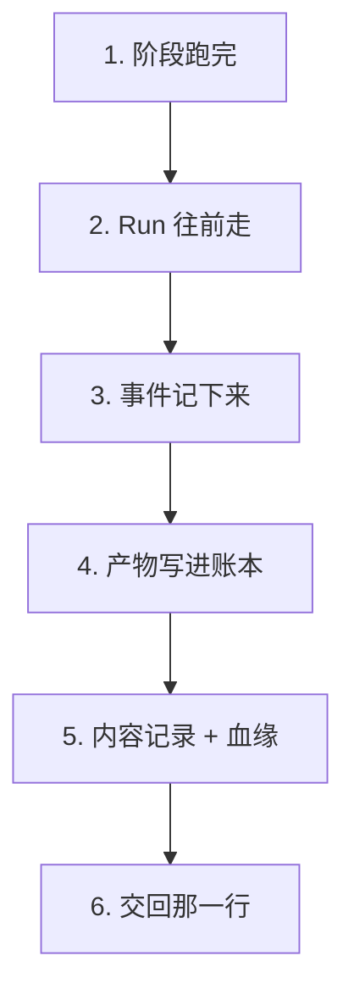
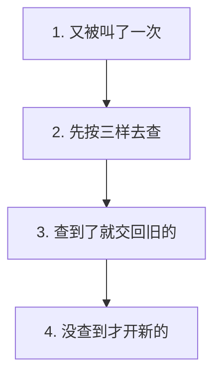
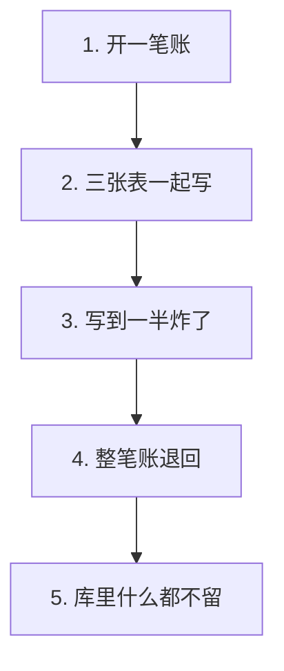

# P2.3 · 建立失败事务与写入幂等

> 改动报告 · 2026-10-27 · 分支 `dev-don`
>
> 写到一半，最怕留下半截账。
> 这一步把「一起写」和「写两次一样」这两件事钉住。

## 第一部分：Q&A 概览

| Question | Answer |
| --- | --- |
| What does a finished stage write?【一个阶段跑完写下什么】 | Three things in one go: the run moves on, the event is written down, and the artifact is stored.【一次写三样 Run 往前走、事件记下来、产物存起来】 |
| What if the write breaks half way?【写到一半炸了怎么办】 | Nothing survives. All three tables roll back together, so there is no half finished row anywhere.【三张表一起退回 哪儿都不留半截】 |
| What happens when the same stage writes twice?【同一个阶段写两次呢】 | The second write changes nothing. The row that is already there is handed back.【第二次什么都不改 把原来那行交回去】 |
| How does the system know two writes are the same?【怎么认出是同一个】 | By the run, the node that produced it and where it came from.【run_id、node、source 三样凑成一个身份】 |
| What is a content record for?【内容记录是干什么的】 | It says what an artifact is, how private it is and which artifact it grew out of.【记下它是什么、有多私密、是从哪件长出来的】 |

## 第二部分：数据流

### 1. 一个阶段跑完，三张表一起落账



| 步骤 | 关键变量 | 具体示例值 | 说明 |
| --- | --- | --- | --- |
| 1. 阶段跑完 | `record_stage_output()` | `step="mission"` | 一次调用把三件事一起做掉 |
| 2. Run 往前走 | `status` / `next_step` | `"RUNNING"` / `"blueprint"` | 状态和阶段一起换 |
| 3. 事件记下来 | `_insert_event()` | `"stage.completed"` | 账本上多一条 |
| 4. 产物写进账本 | `node` | `"mission.agent"` | 记下是哪台机器产出的 |
| 5. 内容记录 | `artifacts` | `status="RECORDED"` | 这件东西是什么、有多私密 |
| 6. 血缘 | `artifact_edges` | `relation="derives_from"` | 它是从哪一件长出来的 |
| 7. 交回那一行 | 返回值 | `run_artifacts` 那一行 | 写进去什么就交回什么 |

```dataflow
1-01 (阶段跑完) 一个阶段跑完了,[[record_stage_output()]]阶段收尾时调用一次的函数}} 把状态、事件、产物三件事一次做完
1-02      → [往前走] [[_update_run()]]改一个 Run 状态的函数}} 把 [[status]]这个 Run 现在的状态}} 换成新的,再把 [[next_step]]下一步要去的地方}} 写上去
1-03           ↳ [记下来] [[_insert_event()]]往账本里追加一条事件的函数}} 追加一条「阶段跑完」的事件
1-04                ↳ [写产物] [[insert_run_artifact()]]把一个产物写进账本的函数}} 记下 [[node]]产出它的那台机器}} 这一行
1-05                     ↳ [存内容] [[write_artifact_rows()]]写内容记录和血缘的函数}} 往 [[artifacts]]存产物内容的那张表}} 写一行
1-06                          ↳ [连血缘] 同一笔再往 [[artifact_edges]]记产物之间关系的那张表}} 写一条血缘关系
1-07                               ↳ [交账] 交回带 [[title]]一句话标题的那一行
---
{
  "1-01": "A stage is done, so one helper does all three jobs at once: move the run on, write the event down, and store the artifact.【record_stage_output[the helper that closes a stage]: called → three jobs in one go】",
  "1-02": "The run row is told about the change first, so the new state and the stage it moves to are written down.【status[the state the run is in]: old state → new state\nnext_step[the stage the run moves to]: old stage → new stage】",
  "1-03": "Right after that, the ledger gets one more entry, saying this stage has finished.【event_type[the kind of entry]: stage.completed\nmessage[the short line a person reads]: the title of the artifact】",
  "1-04": "Then the artifact itself goes into the table that keeps what this run produced, together with the machine that produced it.【node[the machine that produced the artifact]: mission.agent\nrun_artifacts[the table that keeps the output of the run]: one more row】",
  "1-05": "The same write also leaves a content record, which says what the artifact is, how private it is and which version of the schema it follows.【artifacts[the table that keeps the content record]: one more row\ncontent_hash[the fingerprint of the content]: computed → stored】",
  "1-06": "And it links the new artifact to the one that came before it, so the run has one clear chain of what was built on what.【artifact_edges[the table that keeps the links between artifacts]: one more link\nrelation[how the two are linked]: derives_from】",
  "1-07": "What comes back is the row that was just written, so the caller can hand it straight to the page.【title[the short title a person reads]: kept on the row\nthe row[the new artifact row]: written → handed back】",
  "Summary": "A finished stage writes three things in one go, and they share one transaction. The run moves on, the event is written down, and the artifact is stored together with a content record and a link to the artifact before it."
}
---
// STEP FLOW: 1-01[阶段跑完] → 1-02[往前走] → 1-03[记下来] → 1-04[写产物] → 1-05[存内容] → 1-06[连血缘] → 1-07[交账]

// 这像一次盖章:状态、事件、产物这三样必须一起盖上。
// 先把单子上的状态往前挪一格(1-02),再在流水账上补一笔(1-03),
// 最后把做出来的东西登记入库(1-04),并记下它是从哪一件长出来的(1-05、1-06)。
// 任何一样盖不下去,整张单子全部作废重来,不会留下半盖的章。

// ===== 📂 apps/api/app/workflow/repository.py(阶段收尾:状态、事件、产物一起做) =====
// 1-01[阶段跑完] 一个阶段跑完了,把三件事一次做完
def <*record_stage_output*>(
    run_id: str,
    step: str,
    node: str,
    title: str,
    presentation: dict[str, Any],
    raw_output: dict[str, Any],
    *,
    source: str = "model",
    status: str | None = None,
    next_step: str | None = None,
    event_type: str = "stage.completed",
    message: str | None = None,
) -> dict[str, Any]:
    """Record that a stage finished, and what it produced, in one go.

    Three things happen together: the run moves on, the event is written
    down, and the artifact is stored.  They share one transaction, so a stage
    that breaks half way leaves the run exactly as it was -- no event, no
    finished state, no half written artifact.

    The artifact is stored last on purpose.  It is the heaviest of the three
    writes and the one most likely to fail, so when it fails the two cheap
    writes before it are taken back with it.

    Args:
        run_id: The run this stage belongs to, for example "run-1".
        step: The stage that just finished, for example "mission".
        node: The node that produced the output, for example "mission.agent".
        title: A short title a human can read, for example "任务定义".
        presentation: The artifact as it is shown to a person, for example
            {"headline": "任务定义完成"}.
        raw_output: The untouched model output behind it, for example
            {"markdown": "..."}.
        source: Where the artifact came from, for example "model" or
            "system".
        status: The status the run should have afterwards, for example
            "RUNNING".  The run keeps its status when it is None.
        next_step: The stage the run moves to, for example "blueprint".  The
            run stays where it is when it is None.
        event_type: The kind of event this stage leaves, for example
            "stage.completed".
        message: The line a human reads, for example "任务定义完成".  The
            title is used when it is None.

    Returns:
        The row of `run_artifacts` that was written, decoded into a
        dictionary.
    """
    with database() as connection:
        // 1-02[往前走] 状态和阶段一起换
        if status is not None or next_step is not None:
            <*_update_run*>(connection, run_id, status=<*status*>, step=<*next_step*>)
        // 1-03[记下来] 流水账上多一条
        <*_insert_event*>(connection, run_id, event_type, step, message or title)
        // 1-04[写产物] 产物写进账本
        // 1-07[交账] 写完就把那一行交回去
        return <*insert_run_artifact*>(
            connection, run_id, step, <*node*>, title, presentation, raw_output, source
        )

// ===== 📂 apps/api/app/workflow/artifacts.py(产物的内容记录和血缘) =====
// 1-05[存内容] 往 artifacts 写一行内容记录
def <*write_artifact_rows*>(
    connection: sqlite3.Connection,
    *,
    run_id: str,
    artifact_id: str,
    step: str,
    node: str,
    digest: str,
    now: str,
) -> None:
    """Write the content record of one artifact and where it comes from.

    The content record (`artifacts`) says what the artifact is, and the
    lineage (`artifact_edges`) says which earlier artifact it was built on.
    The parent is the artifact that was written last in this run, so the
    artifacts of a run form one chain in the order they were produced.

    Args:
        connection: The open connection, inside the caller's transaction.
        run_id: The run the artifact belongs to, for example "run-1".
        artifact_id: The id of the artifact, the same one `run_artifacts`
            uses.
        step: The stage the artifact came from, for example "mission".
        node: The node that produced it, for example "mission.agent".
        digest: The fingerprint of the content, for example a sha256 digest.
        now: The moment to write into `created_at` and `updated_at`.

    Returns:
        Nothing. The rows are written inside the caller's transaction, so a
        failure here takes the whole stage down with it.
    """
    parent = connection.execute(
        "SELECT id FROM artifacts WHERE run_id = ? ORDER BY rowid DESC LIMIT 1",
        (run_id,),
    ).fetchone()
    scope = json.dumps(
        {"node": node, "run_id": run_id, "step": step},
        ensure_ascii=False,
        sort_keys=True,
    )
    connection.execute(
        """
        INSERT INTO artifacts (
            id, run_id, artifact_type, schema_version, content_hash, storage_uri,
            producer_execution_id, scope_json, sensitivity, base_content_hash,
            status, is_current, verification_json, created_at, updated_at
        ) VALUES (
            ?, ?, ?, '1.0', ?, ?, NULL, ?, 'internal', NULL, 'RECORDED', 1, NULL, ?, ?
        )
        """,
        (
            artifact_id,
            run_id,
            step,
            digest,
            f"run://{run_id}/artifacts/{artifact_id}",
            scope,
            now,
            now,
        ),
    )
    // 1-06[连血缘] 同一笔账里再写一条血缘关系
    if parent is not None:
        connection.execute(
            """
            INSERT OR IGNORE INTO artifact_edges (
                parent_artifact_id, child_artifact_id, relation, created_at
            ) VALUES (?, ?, 'derives_from', ?)
            """,
            (parent["id"], artifact_id, now),
        )
```

### 2. 同一个产物写两次，什么都不会多



| 步骤 | 关键变量 | 具体示例值 | 说明 |
| --- | --- | --- | --- |
| 1. 又被叫了一次 | `record_run_artifact()` | 同一个 `(run_id, node, source)` | 同一个阶段又报了一遍 |
| 2. 先去查 | `run_id` + `node` + `source` | `"run-1"` + `"mission.agent"` + `"model"` | 三样凑成一个身份 |
| 3. 查到了 | `existing` | 已经在库里那一行 | 直接交回去，一个字都不改 |
| 4. 没查到 | `artifact_id` | 新的 uuid | 这才往下写 |

```dataflow
2-01 (再写一次) 同一个阶段又跑了一遍,[[record_run_artifact()]]把一个产物写进账本的函数}} 又被叫了一次
2-02      → [先查] [[insert_run_artifact()]]真正落账的那个函数}} 先按 [[run_id]]这次运行自己的号}} + [[node]]产出它的那台机器}} + [[source]]它是从哪来的}} 去 [[run_artifacts]]这次运行产出过的东西那张表}} 里查
2-03           ↳ [查到了] 查到了,[[existing]]已经存在的那一行}} 就直接交回去,一笔都不新写
2-04                ↳ [没查到] 没查到,才生成一个新的 [[artifact_id]]这次产物的号}} 继续往下写
2-05                     ↳ [写下去] 写进账本,再交给 [[write_artifact_rows()]]写内容记录和血缘的函数}} 补上另外两张表
---
{
  "2-01": "The same stage runs again, so the same helper is asked to write the same artifact a second time.【record_run_artifact[the helper that writes an artifact]: called → called again】",
  "2-02": "Before writing anything, it looks the artifact up by three things: which run it belongs to, which machine produced it and where it came from.【run_id[the run it belongs to]: run-1\nnode[the machine that produced it]: mission.agent\nsource[where it came from]: model\nrun_artifacts[the table that keeps the output of the run]: searched】",
  "2-03": "When the row is already there, that row is simply handed back and nothing new is written.【existing[the row that was already there]: none → found, and returned as is\nthe row count[how many rows the table holds]: one → still one】",
  "2-04": "Only when there is no such row does it make a fresh id and carry on.【artifact_id[the id of the new artifact]: none → a new uuid】",
  "2-05": "Then the artifact goes into the table, and the content record and the link to the earlier one are written as well.【write_artifact_rows[the helper that writes the content record]: not called → called\nartifacts[the table that keeps the content record]: one more row】",
  "Summary": "Writing the same artifact twice is safe. The second call finds the row that is already there and hands it back, so a run keeps one row per artifact, one content record and one link, no matter how many times the same stage reports in."
}
---
// STEP FLOW: 2-01[再写一次] → 2-02[先查] → 2-03[查到了] → 2-04[没查到] → 2-05[写下去]

// 这像领用一张发票:同一张票只能报一次账(2-02)。
// 记账员先按「哪个单子、谁开的、从哪来」三样去翻(2-02),
// 翻到了就把原来那张给你(2-03),翻不到才开一张新的(2-04、2-05)。
// 绝不会因为报了两遍,账上就多出一张票。

// ===== 📂 apps/api/app/workflow/artifacts.py(把一个产物写进账本) =====
// 2-01[再写一次] 同一个阶段又跑了一遍,又被叫了一次
def <*record_run_artifact*>(
    run_id: str,
    step: str,
    node: str,
    title: str,
    presentation: dict[str, Any],
    raw_output: dict[str, Any],
    source: str = "model",
) -> dict[str, Any]:
    """Write one artifact of a run into the ledger.

    Three tables are written in one transaction: the run scoped view
    (`run_artifacts`), the content record (`artifacts`) and the lineage
    (`artifact_edges`).  When one of them fails, none of them is kept.

    A run artifact is identified by its run, its node and its source.  Writing
    the same one twice changes nothing: the row that is already there is
    handed back instead of a second one being added.

    Args:
        run_id: The run this artifact belongs to, for example "run-1".
        step: The stage the artifact came from, for example "mission".
        node: The node that produced it, for example "mission.agent".
        title: A short title a human can read, for example "任务定义".
        presentation: The artifact as it is shown to a person, for example
            {"headline": "任务定义完成"}.
        raw_output: The untouched model output behind it, for example
            {"markdown": "..."}.
        source: Where the artifact came from, for example "model" or
            "system".

    Returns:
        The new row of `run_artifacts`, decoded into a dictionary.  When the
        same artifact was already written, the row that was there before.
    """
    with database() as connection:
        return <*insert_run_artifact*>(
            connection, run_id, step, node, title, presentation, raw_output, source
        )

// 2-02[先查] 先按 run_id + node + source 查有没有写过
def <*insert_run_artifact*>(
    connection: sqlite3.Connection,
    run_id: str,
    step: str,
    node: str,
    title: str,
    presentation: dict[str, Any],
    raw_output: dict[str, Any],
    source: str,
) -> dict[str, Any]:
    """Write one artifact of a run into the ledger, inside a given transaction.

    Args:
        connection: The open connection, inside the caller's transaction.
        run_id: The run this artifact belongs to, for example "run-1".
        step: The stage the artifact came from, for example "mission".
        node: The node that produced it, for example "mission.agent".
        title: A short title a human can read, for example "任务定义".
        presentation: The artifact as it is shown to a person, for example
            {"headline": "任务定义完成"}.
        raw_output: The untouched model output behind it, for example
            {"markdown": "..."}.
        source: Where the artifact came from, for example "model".

    Returns:
        The new row of `run_artifacts`, decoded into a dictionary.  When the
        same artifact was already written, the row that was there before.
    """
    existing = connection.execute(
        "SELECT * FROM run_artifacts WHERE run_id = ? AND node = ? AND source = ?",
        (<*run_id*>, <*node*>, <*source*>),
    ).fetchone()
    // 2-03[查到了] 查到了就直接交回去,一笔都不新写
    if <*existing*> is not None:
        return row_to_dict(<*existing*>) or {}
    // 2-04[没查到] 没查到,才生成一个新的号
    <*artifact_id*> = str(uuid.uuid4())
    now = utcnow()
    connection.execute(
        """
        INSERT INTO run_artifacts (
            id, run_id, step, node, title, source,
            presentation_json, raw_output_json, created_at
        ) VALUES (?, ?, ?, ?, ?, ?, ?, ?, ?)
        """,
        (
            artifact_id,
            run_id,
            step,
            node,
            title,
            source,
            json.dumps(presentation, ensure_ascii=False, default=str),
            json.dumps(raw_output, ensure_ascii=False, default=str),
            now,
        ),
    )
    // 2-05[写下去] 再把内容记录和血缘补上
    <*write_artifact_rows*>(
        connection,
        run_id=run_id,
        artifact_id=artifact_id,
        step=step,
        node=node,
        digest=content_digest(presentation, raw_output),
        now=now,
    )
    row = connection.execute(
        "SELECT * FROM run_artifacts WHERE id = ?", (artifact_id,)
    ).fetchone()
    return row_to_dict(row) or {}
```

### 3. 写到一半炸了，三张表都不留



| 步骤 | 关键变量 | 具体示例值 | 说明 |
| --- | --- | --- | --- |
| 1. 开一笔账 | `database()` | `isolation_level=""` | 一个连接，走完就提交 |
| 2. 三张表一起写 | `run_artifacts` / `artifacts` / `artifact_edges` | 同一笔账 | 三张表不是三笔账 |
| 3. 写到一半炸了 | `RuntimeError` | `"产物写到一半炸了"` | 错误被抛出来 |
| 4. 整笔账退回 | `rollback()` | 自动 | 出错时把这一笔撤掉 |
| 5. 什么都不留 | 三张表 | 查出来都是 `[]` | 一个字都不留 |

```dataflow
3-01 (开一笔账) [[database()]]开一个连接并且统一提交的那个函数}} 开出一笔账,三张表都记在这笔账上
3-02      → [一起写] 三张表 [[run_artifacts]]这次运行产出过的东西那张表}} 、 [[artifacts]]存产物内容的那张表}} 、 [[artifact_edges]]记产物之间关系的那张表}} 写在同一笔账里
3-03           ↳ [炸了] 写到一半炸了,[[RuntimeError]]程序里主动抛出的错误}} 被抛了出来
3-04                ↳ [全退回] 这一笔账整体退回,[[rollback()]]把没做完的改动撤销的那个方法}} 把它撤掉
3-05                     ↳ [不留痕] 三张表查出来都是空的,[[run_artifacts]]/[[artifacts]]/[[artifact_edges]] 一个字都没留下
3-06                          ↳ [交回错误] 错误继续往上抛,让上层知道这次失败了
---
{
  "3-01": "Everything runs inside one connection that either commits at the end or gives up on the whole thing.【database[the helper that opens the connection]: opened → one shared transaction】",
  "3-02": "The three tables are not three separate bookings, they are three columns of the same one.【run_artifacts[the table that keeps the output of the run]: one column of the booking\nartifacts[the table that keeps the content record]: one column of the booking\nartifact_edges[the table that keeps the links]: one column of the booking】",
  "3-03": "Then the write breaks half way through and the error comes out.【RuntimeError[the error that was raised]: none → raised in the middle of the write】",
  "3-04": "The booking is taken back as a whole, so the half finished work disappears.【rollback[the method that undoes the work]: not called → called\nthe half written rows[the rows that were already there]: written → undone】",
  "3-05": "Afterwards all three tables are read back and they are empty.【run_artifacts[the table that keeps the output of the run]: one row → no rows\nartifacts[the table that keeps the content record]: one row → no rows\nartifact_edges[the table that keeps the links]: one row → no rows】",
  "3-06": "The error keeps going up, so the caller knows the stage failed.【the error[what the caller sees]: swallowed → passed on unchanged】",
  "Summary": "The three tables share one transaction, so a write that breaks half way leaves nothing behind at all. The connection rolls the whole thing back, the error travels up to the caller, and the ledger still shows the run exactly as it was before the stage started."
}
---
// STEP FLOW: 3-01[开一笔账] → 3-02[一起写] → 3-03[炸了] → 3-04[全退回] → 3-05[不留痕] → 3-06[交回错误]

// 这像一次刷卡:三张表是同一张单子上的三个栏位(3-02)。
// 刷卡到一半出了问题(3-03),整张单子作废,三个栏位一起清空(3-04、3-05),
// 不会只清掉一半,让账本上半张单子、半张空白。

// ===== 📂 apps/api/app/db.py(统一提交:出错了就整体退回) =====
// 3-01[开一笔账] 开一个连接,走完就提交,出错就整体退回
@contextmanager
def <*database*>() -> Iterator[sqlite3.Connection]:
    """Open a connection to the business database and hand it to the caller.

    The schema is checked on the way in, so a caller never has to ask
    whether the tables exist.  Leaving the block normally commits what was
    written; an exception inside the block rolls the transaction back, so a
    half finished step leaves no rows behind.

    Args:
        Nothing. The database file comes from the settings.

    Yields:
        An open connection whose rows come back as ``sqlite3.Row`` objects,
        so that ``row_to_dict`` can turn them into plain dictionaries.
    """
    path = get_settings().database_path
    initialize_database(path)
    connection = sqlite3.connect(
        path,
        timeout=30,
        check_same_thread=False,
        isolation_level="",
    )
    connection.row_factory = sqlite3.Row
    connection.execute("PRAGMA foreign_keys=ON")
    try:
        // 3-02[一起写] 这一段里写下的每一张表都记在同一笔账上
        yield connection
        // 3-04[全退回] 只有走到这里才提交
        connection.commit()
    except Exception:
        // 3-04[全退回] 中间任何一步炸了,整笔账撤掉
        connection.rollback()
        // 3-06[交回错误] 错误继续往上抛,上层才知道这次失败了
        raise
    finally:
        connection.close()

// ===== 📂 apps/api/tests/test_run_repository.py(故意让写到一半炸掉) =====
// 3-03[炸了] 把写内容记录那一步换成会炸的那个
def <*_break_half_way*>(*args: Any, **kwargs: Any) -> None:
    """Stand in for a write that breaks half way through.

    Args:
        args: The arguments the real function would have received.
        kwargs: The keyword arguments the real function would have received.

    Returns:
        Nothing. It always raises.
    Raises RuntimeError: always, because that is the point of it.
    """
    raise <*RuntimeError*>("产物写到一半炸了")

// 3-05[不留痕] 炸完之后,三张表查出来都是空的
def test_a_broken_artifact_write_leaves_nothing_behind(
    use_temp_database: Path, monkeypatch: pytest.MonkeyPatch
) -> None:
    """A write that breaks half way leaves no half written row in any table.

    Args:
        use_temp_database: The throwaway database this test writes into.
        monkeypatch: The tool that makes the second half of the write break.

    Returns:
        Nothing. The test fails when a row survived the broken write.
    """
    start_run()
    monkeypatch.setattr(artifacts, "write_artifact_rows", _break_half_way)

    with pytest.raises(RuntimeError):
        record_run_artifact(
            RUN_ID, "mission", "mission.node", "任务定义", {"headline": "b"}, {"raw": "b"}
        )

    assert table_rows(use_temp_database, "run_artifacts") == []
    assert table_rows(use_temp_database, "artifacts") == []
    assert table_rows(use_temp_database, "artifact_edges") == []
```

## 第三部分：其它

### 这次改动的边界

| 文件 | 行数 | 干什么的 |
| --- | --- | --- |
| `apps/api/app/workflow/artifacts.py` | 242 | 产物那三张表：内容记录、血缘、幂等写入（新建） |
| `apps/api/app/workflow/repository.py` | 469 | Run 的账本：状态、事件、读模型、阶段收尾 |
| `apps/api/app/db.py` | 361 | 多了一条唯一索引，给幂等兜底 |
| `apps/api/tests/test_run_repository.py` | 550 | 19 条测试（14 条 P2.2 的 + 5 条这次的） |

计划里写的是「`record_run_artifact` 在同一事务里写三张表、重复提交不产生重复行」。
这次落地了，还多了一个 `record_stage_output()`：把「状态、事件、产物」三件事
收成一个调用，让调用方不可能只写其中一样。

### 三条决定

**一、幂等的身份是 `(run_id, node, source)`，并且用一条唯一索引兜底。**

应用层先查后写已经能保证「第二次不新增」，但那只是我们**自己**守规矩。
`db.py` 里加了一条唯一索引，让数据库自己也不许出现第二行：

```sql
CREATE UNIQUE INDEX IF NOT EXISTS idx_run_artifacts_identity
ON run_artifacts(run_id, node, source);
```

计划这次列的文件只有 `repository.py` 和测试文件，我们多动了 `db.py`。
理由是：万一哪天有人绕过 `insert_run_artifact()` 直接插一行，
唯一索引会当场拦下来，而不是等到读模型才发现多了一行。

**二、产物放在最后写。**

`record_stage_output()` 里的顺序是「改状态 → 写事件 → 写产物」。
产物那一步最重（三张表、还要算指纹），也最容易失败；把它放最后，
失败时前面两笔便宜的写会跟着一起退回。
如果把它放最前面，前两笔写成功了、产物失败，运行状态就会停在
「已经成功」但其实没有产物 —— 那才是最难查的账。

**三、拆成了两个文件。**

`repository.py` 一度涨到 676 行，超过仓库自己定的 500 行上限。
按职责拆开：

- `artifacts.py` —— 产物那三张表（`run_artifacts` / `artifacts` / `artifact_edges`）
- `repository.py` —— Run 本身（`runs` / `run_events`）+ 读模型 + 阶段收尾

P2.2 定的七个公开函数**一个都没少、签名一个都没改**，
`record_run_artifact` 和 `list_run_artifacts` 仍然可以从
`app.workflow.repository` 导入（那里重新导出了它们），
所以后面阶段的 import 路径不用改。

### 没抄参考版的三样东西

| 参考版 | 我们 | 为什么 |
| --- | --- | --- |
| `relation` 写 `"supersedes"` | 写 `"derives_from"` | 我们的关系是「从哪一件长出来的」，不是「顶掉了哪一件」。同一个 Run 的产物是接力，不是替换。 |
| `storage_uri` 写相对文件路径 | 写 `run://{run_id}/artifacts/{id}` | 我们这一步不落文件，只落账。写一个不存在的路径比写一个逻辑 URI 更骗人。 |
| 产物有版本，`is_current` 会翻 | 第一次写死，重复写直接交回旧的 | 参考版支持「同一节点重跑出新版本」。我们这次不做：`artifacts` 表里 `is_current` 和 `base_content_hash` 两列已经留好了位置，等真的需要「重跑出新版本」时再补。 |

### 这次验证了什么、没验证什么

**验证了**：

- `apps/api/tests/test_run_repository.py`：19 条全过（`-v`）。
- `ruff check apps/api/app apps/api/tests`：All checks passed。
- `node scripts/check-source-size.mjs`：28 files, <= 500 lines each。

**没验证**：

- **没跑全量测试**。CLAUDE.md 第 7 条：默认只跑增量测试。
  这次改动的模块没有被别的文件 import（`grep` 过，只有测试文件引用 `app.workflow.repository`），
  全量基线没有理由被影响 —— 但这是推断，不是跑出来的结果。
- **没在真的 `.course-agent/agent.db` 上跑过**。全部测试都在 pytest 的临时目录里。
  唯一索引是对**已有**库加的，仓库里没有旧库，所以加索引不会撞上历史重复行 ——
  但这依赖「现在没有旧库」这个事实，将来在真库上跑要留意。
- **没测并发**。两个线程同时写同一个 `(run_id, node, source)`，
  应用层是「先查后写」，理论上会撞唯一索引报错而不是静默写两行 —— 这条没测过。
- **没测 E2E**：CLAUDE.md 第 6 条。
- **没跑 `check-report.py`**：CLAUDE.md 第 10 条。这次用仓库外那份复刻脚本逐条核对。

### 留给后面阶段的三件事

1. **P2.5**：`GET /api/runs/{id}` 透出 `get_run_record()` 的四个具名键，
   查到 `None` 就回 404。
2. **「同一节点重跑出新版本」**：这次是「第一次写赢」。真要重跑出新版本，
   用 `artifacts.is_current` / `base_content_hash` 那两列，别再加新表。
3. **P2.4**：`chapter_versions` 这张表这次没动，它是章节乐观并发那一步的事。

### 报告自检（没跑 `check-report.py`）

按 CLAUDE.md 第 10 条，报告格式**没有跑** `check-report.py`。这次仍然用放在仓库外的
临时脚本（`%TEMP%/p18-report-check/`）复刻它的规则逐条核对：
`###` 子段 3 个（≤3）、每个 `dataflow` 块里 `---` 各两处、步骤号在图 / JSON 键 /
代码区 `//` 注释三处一致、`[[]]` 与 `}}` 配对、注音标识都在代码区原样出现、
JSON 讲解纯英文、Q&A 5 行且中文只在 `【】` 内、STEP FLOW 一条且每项都是 `[...]`。
箭头几何另用一段脚本核对过：第 N 步的箭头落在第 5×N 列，全部对齐。

代码区贴的是 `repository.py` / `artifacts.py` / `db.py` / 测试文件的真片段，
**每个函数都带着它自己的文档注释**，注释和源码逐字一致
（`description` + `Args`（带例子）+ `Returns`）。
另有一段脚本核对过：代码区里每一行（去掉 `<* *>` 标记和报告自己的注释层之后）
都能在源码里逐字找到。

**它是复刻，不是检查器本身** —— 权威的 `check-report.py` 仍然没跑过，两者可能有出入。
