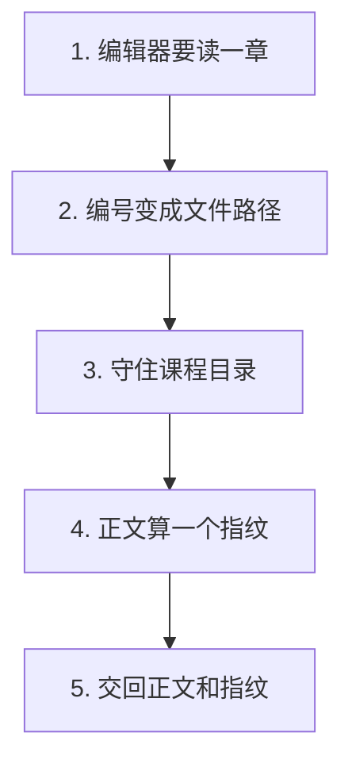
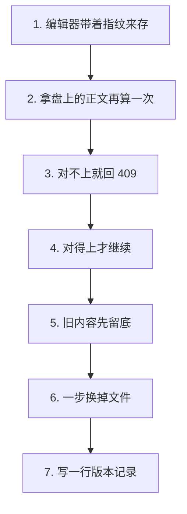
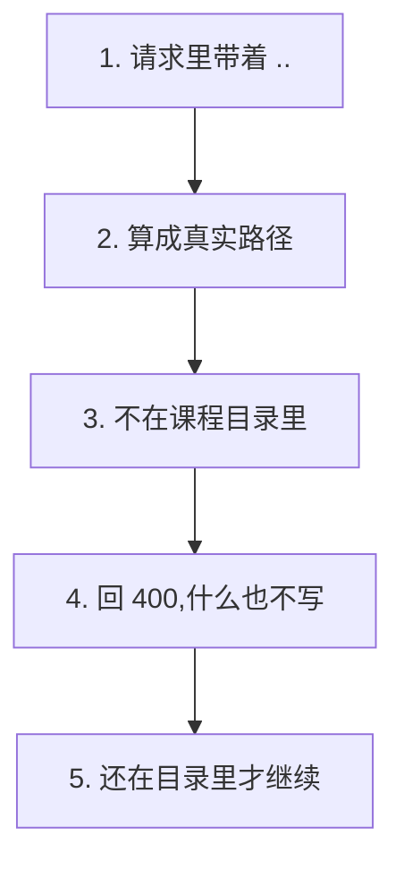

# P2.4 · 建立工作区与章节乐观并发读写

> 改动报告 · 2026-10-27 · 分支 `dev-don`
>
> 两个人同时改一章，后保存的那个不能把前一个的活儿悄悄抹掉。
> 这一步让「谁改过」有据可查：读的时候给一个指纹，存的时候把它带回来。

## 第一部分：Q&A 概览

| Question | Answer |
| --- | --- |
| What does reading a chapter give back?【读一章会拿到什么】 | The text and a fingerprint of it.【正文和一个指纹 指纹是为了下次存的时候能对上】 |
| What happens when the file changed after you read it?【你读完以后文件被人改了会怎样】 | The save is refused with a 409 and the file stays as it is.【存不进去 回 409 盘上的内容一个字不动】 |
| What is the fingerprint for?【这个指纹是干嘛的】 | It is the short proof of what you read, so the server can tell whether your copy is still the current one.【它是「你读到的就是这份」的凭证 用来判断你手上那份还是不是最新的】 |
| Where does the old content go?【旧的内容去哪了】 | It is copied into the history folder before the file is replaced.【替换之前先拷进历史目录 随时能翻回去】 |
| Can a request reach a file outside the course?【请求能写到课程目录外面吗】 | No. A path with `..` in it is refused with a 400.【带 .. 的路径一律回 400 课程目录外不会多出任何文件】 |

## 第二部分：数据流

### 1. 打开一章，先拿到它的指纹



| 步骤 | 关键变量 | 具体示例值 | 说明 |
| --- | --- | --- | --- |
| 1. 编辑器要读一章 | `read_chapter()` | `key="01"` | 读一章的入口 |
| 2. 编号变成文件路径 | `resolve_chapter_path()` | `"lessons/01.md"` | 编号换成真实文件 |
| 3. 守住课程目录 | `_safe_child()` | 越界就报错 | 跑出去就不给 |
| 4. 正文算一个指纹 | `content_hash()` | 64 位十六进制 | 指纹就是正文的摘要 |
| 5. 交回正文和指纹 | `content` / `content_hash` | 指纹 64 位 | 编辑器拿这两样 |

```dataflow
1-01 (打开一章) 编辑器要读一章,[[read_chapter()]]读一章正文的那个函数}} 出手 <{chapters.py}>
1-02      → [找文件] [[resolve_chapter_path()]]把章节编号变成真实文件路径的那个函数}} 把 [[key]]章节的编号}} 变成 [[path]]文件落在哪}} <{chapters.py}>
1-03           ↳ [认章节] [[_chapter_relative_path()]]把编号对成课程里那个文件的那个函数}} 编号对不上清单时,自己去 lessons 里找同名文件 <{chapters.py}>
1-04                ↳ [守住边界] [[_safe_child()]]守住目录边界不让路径跑出去的那个函数}} 跑出课程目录就报错 <{common.py}>
1-05                     ↳ [算指纹] [[content_hash()]]算内容指纹的那个函数}} 把正文变成 [[content_hash]]这段正文的指纹}} <{common.py}>
1-06                          ↳ [交回] 交回 [[content]]这一章的正文}} 和 [[content_hash]]它的指纹}} 给编辑器 <{chapters.py}>
---
{
  "1-01": "The editor asks for one chapter, and the helper that reads a chapter is the way in.【read_chapter[the helper that reads one chapter]: called → called】",
  "1-02": "First the key is turned into the place where the file really sits.【key[the number of the chapter]: 01\npath[where the file really is]: unknown → lessons/01.md】",
  "1-03": "The key is matched against the lesson list of the course, and when the list does not know it, the lessons folder is searched for a file of that name.【_chapter_relative_path[the helper that matches a key to a file]: called → called\nthe lesson list[the chapters the course knows about]: checked first】",
  "1-04": "While it does that, the path is kept inside the course folder, so a key that points somewhere else is refused right away.【_safe_child[the helper that keeps a path inside its folder]: used → used\nthe course folder[where the course lives]: never left】",
  "1-05": "Then the text is fingerprinted, so the same text always gets the same mark.【content_hash[the fingerprint of the text]: unknown → a 64 character mark】",
  "1-06": "What comes back is the text itself and its fingerprint, so the editor can hold on to the mark and send it back when it saves.【content[the text of the chapter]: unknown → the text on disk\ncontent_hash[the fingerprint of the text]: unknown → the mark of that text】",
  "Summary": "Reading a chapter gives back two things: the text and a short fingerprint of it. The key is turned into a real file first, and the path guard makes sure that file stays inside the course folder."
}
---
// STEP FLOW: 1-01[打开一章] → 1-02[找文件] → 1-03[认章节] → 1-04[守住边界] → 1-05[算指纹] → 1-06[交回]

// 这像借书:你拿到书的时候,工作人员顺手给你一个条形码(1-05)。
// 还书的时候扫一下条码,就知道还回来的是不是同一本书(1-06)。

// ===== 📂 apps/api/app/courses/chapters.py(读一章:找文件、算指纹、交回) =====
// 1-01[打开一章] 编辑器要读一章,从这个函数进去
def read_chapter(course_root: Path, key: str) -> dict[str, Any]:
    """Read one chapter of a course.

    Args:
        course_root: The folder of one course, for example
            courses/python-101/.
        key: The key of the chapter, for example "01".

    Returns:
        The key, the path, the content, the fingerprint of the content and
        the moment the file was changed the last time.
        Raises ValueError when the key is empty or points outside the
        course, and FileNotFoundError when there is no such chapter.
    """
    <*path*> = <*resolve_chapter_path*>(course_root, <*key*>)
    if not path.is_file():
        raise FileNotFoundError(f"章节不存在：{key}")
    <*content*> = path.read_text(encoding="utf-8")
    root = course_root.resolve()
    // 1-06[交回] 交回正文和指纹
    return {
        "key": key,
        "path": path.relative_to(root).as_posix(),
        "content": content,
        "content_hash": content_hash(content),
        "updated_at": _updated_at(path),
    }

// 1-02[找文件] 把章节编号变成真实文件路径
def resolve_chapter_path(course_root: Path, key: str) -> Path:
    """Return the file of one chapter, refusing anything outside the course.

    Args:
        course_root: The folder of one course, for example
            courses/python-101/.
        key: The key of the chapter, for example "01".

    Returns:
        The path of the chapter file.  The file itself does not have to
        exist yet.
        Raises ValueError("章节标识不合法") when the key is empty, and
        ValueError("文件路径越界") when the key points outside the course.
    """
    if not key or not key.strip():
        raise ValueError("章节标识不合法")
    relative = _chapter_relative_path(course_root, key)
    try:
        return <*_safe_child*>(course_root, relative)
    except ValueError as error:
        raise ValueError("文件路径越界") from error

// 1-03[认章节] 编号对不上清单时,自己去 lessons 里找同名文件
def _chapter_relative_path(course_root: Path, key: str) -> str:
    """Turn the key of a chapter into a path inside the course.

    A key that names one lesson of the course list keeps the path that
    lesson has.  Every other key without a slash names a file in the
    `lessons/` folder, and a key with a slash is a path inside the course.

    Args:
        course_root: The folder of one course, for example
            courses/python-101/.
        key: The key the caller asked for, for example "01".

    Returns:
        The path of the chapter inside the course, for example
        "lessons/01.md".
    """
    known = _lesson_path(course_root, key)
    if known is not None:
        return known
    if "/" in key:
        return key
    if Path(key).suffix:
        return f"{CHAPTER_DIRECTORY}/{key}"
    return f"{CHAPTER_DIRECTORY}/{key}{CHAPTER_SUFFIX}"

// ===== 📂 apps/api/app/courses/common.py(守边界、算指纹) =====
// 1-04[守住边界] 路径跑出课程目录就报错
def _safe_child(root: Path, relative: str) -> Path:
    """Return the real path of a file that lives inside a course folder.

    Args:
        root: The folder the path has to stay inside,
            for example courses/python-101/.
        relative: The path relative to that folder,
            for example "chapters/01.md".

    Returns:
        The resolved path of the file inside root.
        Raises ValueError("文件路径越界") if the path is absolute, or if it
        resolves to a place outside root.
    """
    normalized = relative.replace("\\", "/")
    windows_path = PureWindowsPath(normalized)
    posix_absolute = PurePosixPath(normalized).is_absolute()
    if posix_absolute or windows_path.drive or windows_path.root:
        raise ValueError("文件路径越界")

    candidate = (root / normalized).resolve()
    if not candidate.is_relative_to(root.resolve()):
        raise ValueError("文件路径越界")
    return candidate

// 1-05[算指纹] 同一段正文永远算出同一个指纹
def content_hash(text: str) -> str:
    """Return the fingerprint of a piece of text.

    Args:
        text: The text to fingerprint, for example one chapter body.

    Returns:
        The sha256 digest of the text as 64 lower case hex characters. The
        same text always gives the same fingerprint, so a later step can
        tell that a chapter really changed without storing the text again.
    """
    return hashlib.sha256(text.encode("utf-8")).hexdigest()
```

### 2. 存一章：对得上指纹才写，对不上就退回来



| 步骤 | 关键变量 | 具体示例值 | 说明 |
| --- | --- | --- | --- |
| 1. 编辑器带着指纹来存 | `expected_hash` | 读时拿到的那个指纹 | 客户端把凭证带回来 |
| 2. 拿盘上的正文再算一次 | `content_hash(current)` | 现在的指纹 | 现算现比 |
| 3. 对不上就回 409 | `ConcurrencyConflict` | `"内容已被其他编辑器修改…"` | 文件一个字不动 |
| 4. 对得上才继续 | — | 一样 | 才往下走 |
| 5. 旧内容先留底 | `snapshot_file()` | `.agent-history/<ts>/` | 替换前先拷一份 |
| 6. 一步换掉文件 | `write_text_atomic()` | 临时文件 + 改名 | 读到的人看不到半截 |
| 7. 写一行版本记录 | `chapter_versions` | 一行 | 这一版留个底 |

```dataflow
2-01 (编辑器要存) 编辑器带着 [[expected_hash]]它读到的那个指纹}} 来存这一章 <{chapters.py}>
2-02      → [对指纹] [[content_hash()]]算内容指纹的那个函数}} 拿盘上的正文算一遍,和 [[expected_hash]]带来的指纹}} 对一下 <{chapters.py}>
2-03           ↳ [对不上] 对不上就抛 [[ConcurrencyConflict]]内容被人改过了这个错}} ,回 409,盘上一个字不动 <{chapters.py}>
2-04                ↳ [对得上] 对得上才继续往下走 <{chapters.py}>
2-05                     ↳ [留底] [[snapshot_file()]]把旧内容拷进历史目录的那个函数}} 存一份到 [[HISTORY_DIRECTORY]]历史目录放在哪}} <{common.py}>
2-06                          ↳ [换文件] [[write_text_atomic()]]原子替换文件的那个函数}} 一步换掉,读到的人看不到半截 <{common.py}>
2-07                               ↳ [记账] 往 [[chapter_versions]]章节版本表}} 写一行,记下这一版 <{chapters.py}>
2-08                                    ↳ [交回] 交回新的 [[content_hash]]指纹}},下次存就拿它 <{chapters.py}>
---
{
  "2-01": "The editor sends the chapter back with the mark it read, so the server can check it.【expected_hash[the mark the editor read]: sent → sent with the save】",
  "2-02": "The server reads the file again and works out its mark, then puts the two side by side.【content_hash[the fingerprint of the text]: the old text → the mark of the text on disk】",
  "2-03": "When the two marks are not the same, the file was changed by somebody else, so the save is turned down with a conflict and the file on disk is left exactly as it was.【ConcurrencyConflict[the error that says the file moved on]: raised → raised\nthe file on disk[what the reader sees]: unchanged → unchanged】",
  "2-04": "When the marks are the same, nobody else has touched the file, so the save goes on.【expected_hash[the mark the editor read]: matches → matches】",
  "2-05": "Before anything is replaced, the old text is copied into the history folder of the course, so it can be looked at again later.【snapshot_file[the helper that copies the old text away]: called → called\nHISTORY_DIRECTORY[the name of the history folder]: .agent-history】",
  "2-06": "Then the file is replaced in one step, through a temporary file, so a reader never sees half of the new text.【write_text_atomic[the helper that replaces a file in one step]: called → called\nthe file[what the reader sees]: the old text → the new text】",
  "2-07": "The version that was just written is written down as well, so the history of the chapter is kept in the database too.【chapter_versions[the table that keeps the versions of a chapter]: one more row】",
  "2-08": "What comes back is the new mark of the new text, and that is what the editor holds on to for the next save.【content_hash[the fingerprint of the text]: the old mark → the mark of the new text】",
  "Summary": "Saving a chapter is a two step promise. The server checks the mark the editor read against the file on disk, and a file that moved on in the meantime is never overwritten. When the marks agree, the old text is kept in the history folder, the file is replaced in one step, and the new version is written down."
}
---
// STEP FLOW: 2-01[编辑器要存] → 2-02[对指纹] → 2-03[对不上] → 2-04[对得上] → 2-05[留底] → 2-06[换文件] → 2-07[记账] → 2-08[交回]

// 这像取款要凭密码:密码对上(2-02、2-04)才让进,密码不对(2-03)就直接退回,
// 柜子里的东西一件不动 —— 绝不因为急着办事就先把东西换掉。
// 进去了先复印一份旧的存进档案(2-05),再换新的(2-06),最后把这一笔记在账上(2-07)。

// ===== 📂 apps/api/app/courses/chapters.py(存一章:对指纹、留底、记账) =====
// 2-01[编辑器要存] 编辑器带着读到的指纹来存这一章
def save_chapter(
    course_root: Path,
    key: str,
    content: str,
    expected_hash: str,
    *,
    reason: str = DEFAULT_REASON,
) -> dict[str, Any]:
    """Write one chapter of a course, but only when nobody else changed it.

    The fingerprint the caller read has to match the fingerprint of the
    file on the disk.  When it does not, the write is refused and the file
    stays as it is: the person who is behind has to look at both versions
    before they decide which one wins.

    Args:
        course_root: The folder of one course, for example
            courses/python-101/.
        key: The key of the chapter, for example "01".
        content: The new content of the chapter.
        expected_hash: The fingerprint the caller read, for example the
            `content_hash` a read handed out.
        reason: Why the chapter was saved, for example "手工编辑".

    Returns:
        The chapter as it is after the save: the key, the path, the new
        content, its fingerprint, the moment it was changed and the path
        of the snapshot of the content that was replaced.
        Raises ValueError when the key is empty or points outside the
        course, FileNotFoundError when there is no such chapter, and
        ConcurrencyConflict when the fingerprint does not match.
    """
    path = resolve_chapter_path(course_root, key)
    root = course_root.resolve()
    relative = path.relative_to(root).as_posix()

    current = path.read_text(encoding="utf-8") if path.is_file() else ""
    // 2-02[对指纹] 拿盘上的正文现算一个指纹,和带来的那个对一下
    if <*content_hash*>(current) != <*expected_hash*>:
        // 2-03[对不上] 对不上就是有人改过了,回 409,盘上一个字不动
        raise <*ConcurrencyConflict*>("内容已被其他编辑器修改，请刷新并比较后再保存")

    // 2-04[对得上] 对得上才继续:先留底,再换文件,再记账
    // 2-05[留底] 旧内容先拷进历史目录
    snapshot = <*snapshot_file*>(root, path, relative)
    // 2-06[换文件] 一步换掉,读到的人看不到半截
    <*write_text_atomic*>(path, content)
    try:
        // 2-07[记账] 往章节版本表写一行
        _record_version(
            root,
            key,
            relative,
            content_hash(content),
            snapshot.relative_to(root).as_posix(),
            reason,
        )
    except Exception:
        write_text_atomic(path, current)
        raise

    saved = read_chapter(course_root, key)
    // 2-08[交回] 交回新的指纹
    saved["snapshot_path"] = snapshot.relative_to(root).as_posix()
    return saved

def _record_version(
    course_root: Path,
    key: str,
    source_path: str,
    digest: str,
    snapshot_path: str,
    reason: str,
) -> None:
    """Write the version that was just saved into the version table.

    Args:
        course_root: The folder of one course, for example
            courses/python-101/.
        key: The key of the chapter, for example "01".
        source_path: The path of the chapter inside the course, for
            example "lessons/01.md".
        digest: The fingerprint of the content that was written.
        snapshot_path: The path of the snapshot of the content that was
            replaced, for example
            ".agent-history/20261027T083105123456Z/lessons/01.md".
        reason: Why the chapter was saved, for example "手工编辑".

    Returns:
        Nothing. The row is written inside one transaction, so a failure
        leaves no half written version behind.
    """
    with database() as connection:
        connection.execute(
            """
            INSERT INTO <*chapter_versions*> (
                id, course_slug, chapter_key, source_path, content_hash,
                snapshot_path, reason, created_at
            ) VALUES (?, ?, ?, ?, ?, ?, ?, ?)
            """,
            (
                str(uuid.uuid4()),
                course_root.name,
                key,
                source_path,
                digest,
                snapshot_path,
                reason,
                utcnow(),
            ),
        )

// ===== 📂 apps/api/app/courses/common.py(留底、换文件) =====
// 2-05[留底] 替换之前把旧内容拷进历史目录
def snapshot_file(root: Path, source: Path, relative: str) -> Path:
    """Copy the content that is about to be replaced into the history folder.

    The copy keeps the name of the file it protects, so the history of a
    course can be read without knowing what was written when.  A file that
    does not exist yet is snapshotted as an empty file, so the history
    always points at a real file.

    Args:
        root: The course folder the history lives in, for example
            courses/python-101/.  It has to be the resolved path, so the
            snapshot can be addressed relative to it.
        source: The file that is about to be overwritten.
        relative: The path of that file inside the course, for example
            "lessons/01.md".

    Returns:
        The path of the snapshot, for example
        courses/python-101/.agent-history/20261027T083105123456Z/lessons/01.md.
    """
    target = root / <*HISTORY_DIRECTORY*> / timestamp_slug() / relative
    target.parent.mkdir(parents=True, exist_ok=True)
    if source.is_file():
        shutil.copy2(source, target)
    else:
        target.write_text("", encoding="utf-8")
    return target

// 2-06[换文件] 先写临时文件再改名,读到的人看不到半截
def write_text_atomic(path: Path, text: str) -> None:
    """Write text into a file in one replacement.

    The new content is staged in a temporary file next to the target and
    then moved over it, so a reader either sees the old content or the new
    one, never half of each.

    Args:
        path: The file to write, for example
            courses/python-101/lessons/01.md.  Its parent directory has to
            exist already.
        text: The content to write, for example "# 第一章\n".

    Returns:
        Nothing. The new content replaces the old one in a single step, and
        if that step fails the old file stays untouched and no temporary
        file is left behind.
    """
    with tempfile.NamedTemporaryFile(
        "w", encoding="utf-8", dir=path.parent, delete=False
    ) as handle:
        handle.write(text)
        temporary = Path(handle.name)
    try:
        os.replace(temporary, path)
    except BaseException:
        temporary.unlink(missing_ok=True)
        raise
```

### 3. 跑出课程目录的路径，一律拒绝



| 步骤 | 关键变量 | 具体示例值 | 说明 |
| --- | --- | --- | --- |
| 1. 请求里带着 `..` | `name` | `"../../course.json"` | 有人想把路径写到外面 |
| 2. 算成真实路径 | `_safe_child()` | `courses/course.json` | 算完就知道跑没跑出去 |
| 3. 不在课程目录里 | `ValueError` | `"文件路径越界"` | 直接拒绝 |
| 4. 回 400，什么也不写 | 状态码 | `400` | 课程目录外不留文件 |
| 5. 还在目录里才继续 | `_http_error()` | 409 / 404 / 400 | 错有错的样子 |

```dataflow
3-01 (有人传了 ..) 请求里带着 [[name]]文件叫什么}} ,里面藏着 .. <{workspace.py}>
3-02      → [算真实路径] [[_safe_child()]]守住目录边界不让路径跑出去的那个函数}} 把路径算成真的,再看看它落在哪 <{common.py}>
3-03           ↳ [跑出去了] 算出来不在课程目录里 → 400,课程目录外一个文件也不写 <{workspace.py}>
3-04                ↳ [还在里面] 还在课程目录里 → 正常读写 <{workspace.py}>
3-05                     ↳ [分状态码] [[_http_error()]]把错误变成状态码的那个函数}} : 冲突 409、找不到 404、其它 400 <{course_routes.py}>
---
{
  "3-01": "A request comes in with a name that hides a way out, like two dots and a slash.【name[what the file is called]: ../../course.json】",
  "3-02": "The name is turned into a real path, and then the helper checks whether that path is still inside the folder it belongs to.【_safe_child[the helper that keeps a path inside its folder]: used → used\nthe real path[where the file would really be]: courses/course.json】",
  "3-03": "When the real path is outside the course, the request is turned down with a 400 and not a single byte is written outside the course folder.【the file outside[what is written outside the course]: nothing → nothing\nthe answer[what the caller gets]: a request → 400】",
  "3-04": "When the path stays inside the workspace, the file is read or written as usual.【the file[what happens to it]: untouched → read or written as usual】",
  "3-05": "Whatever went wrong, the error is given a shape the browser understands: a conflict is a 409, a missing file is a 404 and everything else is a 400.【_http_error[the helper that turns a failure into a status code]: called → called\nthe status code[what the browser sees]: one → 409, 404 or 400】",
  "Summary": "No request can reach a file outside the course. The name is turned into a real path and checked against the folder it belongs to, so a name that tries to walk out is refused with a 400 and leaves nothing behind."
}
---
// STEP FLOW: 3-01[有人传了 ..] → 3-02[算真实路径] → 3-03[跑出去了] → 3-04[还在里面] → 3-05[分状态码]

// 这像小区门禁:你报门牌号,门卫先查这个号是不是这一栋的(3-02)。
// 不是这一栋的,门都不开(3-03);是这一栋的,才让你进去(3-04)。

// ===== 📂 apps/api/app/courses/workspace.py(工作区文件:先守住路径) =====
// 3-01[有人传了 ..] 请求里的文件名可能藏着 ..
def resolve_workspace_path(course_root: Path, name: str) -> Path:
    """Return the file of one workspace entry, refusing anything else.

    The name is a path inside the workspace folder.  A name that leaves the
    workspace is refused, and so is a name that points into the history of
    the course: the history is written by the editor, never by a person.

    Args:
        course_root: The folder of one course, for example
            courses/python-101/.
        name: The name of the workspace file, for example "NOTES.md".

    Returns:
        The path of the file.  The file itself does not have to exist yet.
        Raises ValueError("Workspace 文件路径不合法") when the name is empty
        or points into the history, ValueError("文件路径越界") when the name
        points outside the workspace, and ValueError("该文件不支持在线编辑")
        when the file is not one the editor can write.
    """
    if not name or not name.strip():
        raise ValueError("Workspace 文件路径不合法")
    if HISTORY_DIRECTORY in Path(name).parts:
        raise ValueError("Workspace 文件路径不合法")

    workspace_root = (course_root.resolve() / WORKSPACE_DIRECTORY).resolve()
    try:
        // 3-02[算真实路径] 算成真实路径,顺便看看它落在哪
        path = <*_safe_child*>(workspace_root, name)
    except ValueError as error:
        // 3-03[跑出去了] 跑出工作区就拒绝,课程目录外一个文件也不写
        raise ValueError("文件路径越界") from error

    // 3-04[还在里面] 还在工作区里,才轮到「这个文件能不能在线改」
    if path.suffix.lower() not in EDITABLE_SUFFIXES:
        raise ValueError("该文件不支持在线编辑")
    return path

// ===== 📂 apps/api/app/courses/common.py(算真实路径、比对边界) =====
// 3-02[算真实路径] 路径跑出目录就报错
def _safe_child(root: Path, relative: str) -> Path:
    """Return the real path of a file that lives inside a course folder.

    Args:
        root: The folder the path has to stay inside,
            for example courses/python-101/.
        relative: The path relative to that folder,
            for example "chapters/01.md".

    Returns:
        The resolved path of the file inside root.
        Raises ValueError("文件路径越界") if the path is absolute, or if it
        resolves to a place outside root.
    """
    normalized = relative.replace("\\", "/")
    windows_path = PureWindowsPath(normalized)
    posix_absolute = PurePosixPath(normalized).is_absolute()
    if posix_absolute or windows_path.drive or windows_path.root:
        raise ValueError("文件路径越界")

    candidate = (root / normalized).resolve()
    if not candidate.is_relative_to(root.resolve()):
        raise ValueError("文件路径越界")
    return candidate

// ===== 📂 apps/api/app/api/course_routes.py(把错误变成状态码) =====
// 3-05[分状态码] 冲突 409、找不到 404、其它 400
def _http_error(error: Exception) -> HTTPException:
    """Turn a failure of the course service into the answer of the route.

    Args:
        error: The exception the service raised.

    Returns:
        The error to answer with: a 409 when the file on disk changed after
        the caller read it, a 404 when the course or the file is not there,
        and a 400 for everything else, for example a path that points
        outside the course.
    """
    if isinstance(error, ConcurrencyConflict):
        return HTTPException(status_code=409, detail=str(error))
    if isinstance(error, FileNotFoundError):
        return HTTPException(status_code=404, detail=str(error))
    return HTTPException(status_code=400, detail=str(error))
```

## 第三部分：其它

### 这次改动的边界

| 文件 | 行数 | 干什么的 |
| --- | --- | --- |
| `apps/api/app/courses/chapters.py` | 291 | 章节这一侧：编号找文件、读、存、记账（新建） |
| `apps/api/app/courses/workspace.py` | 160 | 工作区这一侧：守住路径、读、存（新建） |
| `apps/api/app/courses/common.py` | 203 | 加了冲突异常、原子写、留底三样共用工具 |
| `apps/api/app/course_service.py` | 196 | 门面：新增四个函数，路由只认它 |
| `apps/api/app/api/course_routes.py` | 222 | 新增四条路由：章节和工作区各一读一存 |
| `apps/api/app/schemas.py` | 256 | 新增四个模型：读章节、存章节、读工作区、存工作区 |
| `apps/api/tests/test_workspace_concurrency.py` | 371 | 10 条测试 |
| `apps/api/tests/test_schemas.py` | 94 | 模型清单加了四个名字 |

计划里写的是「Modify `workspace.py` / `chapters.py`」——这两个文件在我们仓库里
**还不存在**，所以这次是新建。计划没列的还有 `course_service.py`、`schemas.py`
和 `test_schemas.py`，原因见下面的两条决定。

### 四条决定

**一、指纹由「读」发出去，由「存」带回来，存的时候比的是盘上的正文。**

读的时候除了正文，还给一个 `content_hash`（sha256，64 位十六进制）。
存的时候客户端必须把它带回来；服务端**重新读一遍盘上的文件**算一次指纹，
两个对不上就是 409。
比的是盘上的正文，不是客户端手里那份 —— 客户端手里的那份可能早就过期了，
拿它比等于没比。

**二、历史只有一个根，就放在课程目录下。**

参考版把章节的历史放在课程根下、把工作区的历史放在工作区里，两套。
我们改成一套：`<课程目录>/.agent-history/<时间戳>/<原路径>`，
章节存成 `.../lessons/01.md`，工作区文件存成 `.../workspace/NOTES.md`。

理由是**一处好找**：要回看这门课改过什么，翻一个目录就够；
两套目录还得先想清楚「这一份在哪」。

**三、版本表记的是「这一版」，不是「被换掉的那一版」。**

`chapter_versions` 的 `content_hash` 存的是**刚写进去的新内容**的指纹，
`snapshot_path` 指向被换掉的那份的存档。
参考版存的是旧内容的指纹 —— 那样这一行和它指向的存档说的不是同一件事，
读的人得先想一遍「这行记的是新的还是旧的」。
我们这版：这一行 = 刚写进去的那一版；`snapshot_path` = 上一版在哪，可以退回去。

**四、`app/schemas.py` 加了四个模型，`test_schemas.py` 的清单也跟着加。**

`test_schemas.py` 有一个「模块里恰好只有这些模型」的测试，钉住了 17 个名字。
这次加了 `ChapterRead` / `ChapterSave` / `WorkspaceFileRead` / `WorkspaceFileSave`
四个，测试里的清单也加了这四个。

钉清单这件事本身留着 —— 它防的是「schema 提前溜进来」。
这次是**有计划地**加四个（编辑器的请求和响应），所以清单跟着改，
而不是把测试删掉或者放松成「至少这些」。

模块 docstring 里那句「workspace 的 schema 属于 P3.8」也顺手改了：
P3.8 的 30 个模型是**各阶段 Agent 的输出 schema**，跟编辑器这四个 API 模型
不是一回事，现在各归各位。

### 没抄参考版的三样东西

| 参考版 | 我们 | 为什么 |
| --- | --- | --- |
| 保存章节时调 `commit_chapter_candidate()`，把改动做成 artifact | 只写文件 + 写一行版本记录 | 那是 P3.7 的活。这一步先把「并发不失内容」钉住，产物那条线等 P3.7 到了再接。 |
| 工作区用 `?path=` 查询参数，路径是 `workspace/file?path=xxx` | 路径参数 `/workspace/files/{name}` | 计划里定的是这个形状。好处是前端拼 URL 时不用转义问号和等号。 |
| 章节存的是旧内容的指纹 | 存新内容的指纹 | 上一条说过：这一行和它指向的存档得说同一件事。 |

另外两处小的：参考版的工作区历史放在工作区里面（得在列文件时专门过滤掉），
我们放在课程目录下，一处就好；参考版一次能改一堆文件（增量补丁），
我们这一步一次只改一个文件 —— 补丁计划是 P3 阶段的事。

**这次没做**（P2.4 的计划里没有，也没顺手加）：列出工作区里有哪些文件、
上传二进制资源、章节的批量改、Agent 写回时的并发协调。
参考版有 `GET /{slug}/workspace`（列文件）、`POST /{slug}/workspace/resources`（上传）
和一次改多个文件的补丁接口 —— 那些是 P3 阶段的事，这一步不碰。

### 这次验证了什么、没验证什么

**验证了**：

- `apps/api/tests/test_workspace_concurrency.py`：10 条全过（`-v`）。
- 一起跑的相关测试（`test_schemas` / `test_course_create_api` / `test_course_service` /
  `test_course_catalog` / `test_course_paths` / `test_course_scaffold` / `test_scaffold_api`）：
  102 条全过。
- `ruff check app tests`：All checks passed。
- `node scripts/check-source-size.mjs`：30 files, <= 500 lines each。

**没验证**：

- **没跑全量测试**。CLAUDE.md 第 7 条：默认只跑增量测试。
  这次动到的 `app/schemas.py` 和 `app/course_service.py` 被别的测试 import，
  上面那 7 个文件都跑过了；`test_run_repository.py` 等没重跑 —— 这是推断，不是跑出来的结果。
- **没测两个进程同时写同一个文件**。这一版是「读 → 比 → 写」，
  两个请求同时进来时，比对和写入之间还有缝。真正堵住要靠文件锁，
  那是 P3.7 之后的事。同一进程内两个线程的缝更小，但也没测。
- **没测 E2E**：CLAUDE.md 第 6 条。没在浏览器里点过这两个页面。
- **没测真库**：全部测试都在 pytest 的临时目录里，
  仓库里那份 `.course-agent/agent.db` 这次没被写。
- **没跑 `check-report.py`**：CLAUDE.md 第 10 条。这次用仓库外那份复刻脚本逐条核对。

### 留给后面阶段的三件事

1. **P2.5**：`GET /api/runs/{id}` 透出 `get_run_record()` 的四个具名键，
   查到 `None` 就回 404。
2. **P3.7**：章节写回要接上产物那条线（`commit_chapter_candidate`），
   并且把 `expected_hash` 的机制从「编辑器之间」扩到「Agent 和编辑器之间」——
   现在 Agent 直接改文件的话，编辑器的指纹就过期了。
3. **前端**：这两条路由还没有页面。编辑器要把读到的 `content_hash` 存着，
   保存时带回来；收到 409 要提示「刷新并比较」，不能自己重试覆盖。

### 报告自检（没跑 `check-report.py`）

按 CLAUDE.md 第 10 条，报告格式**没有跑** `check-report.py`。这次仍然用放在仓库外的
临时脚本（`%TEMP%/p18-report-check/`）复刻它的规则逐条核对：
`###` 子段 3 个（≤3）、每个 `dataflow` 块里 `---` 各两处、步骤号在图 / JSON 键 /
代码区 `//` 注释三处一致、`[[]]` 与 `}}` 配对、注音标识都在代码区原样出现、
JSON 讲解纯英文、Q&A 5 行且中文只在 `【】` 内、STEP FLOW 一条且每项都是 `[...]`。
箭头几何另用一段脚本核对过：第 N 步的箭头落在第 5×N 列，全部对齐。

代码区贴的是 `chapters.py` / `workspace.py` / `common.py` / `course_routes.py` 的真片段，
**每个函数都带着它自己的文档注释**，注释和源码逐字一致
（`description` + `Args`（带例子）+ `Returns`）。
另有一段脚本核对过：代码区里每一行（去掉 `<* *>` 标记和报告自己的注释层之后）
都能在源码里逐字找到。

**它是复刻，不是检查器本身** —— 权威的 `check-report.py` 仍然没跑过，两者可能有出入。
