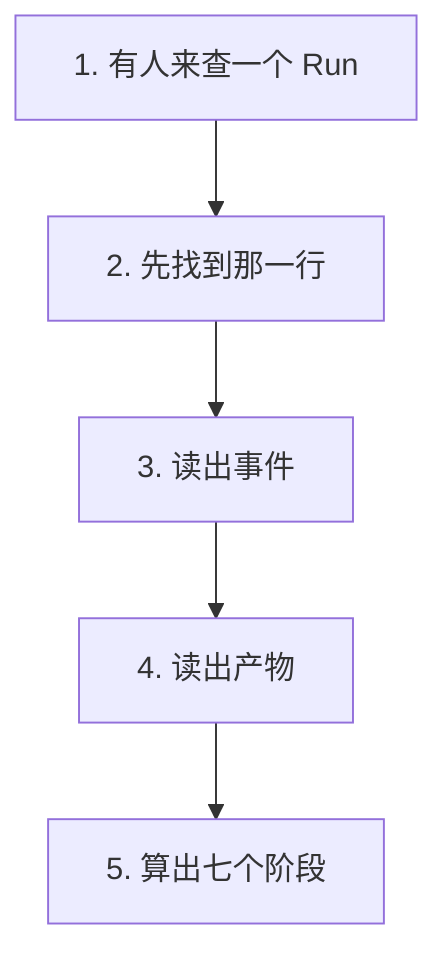
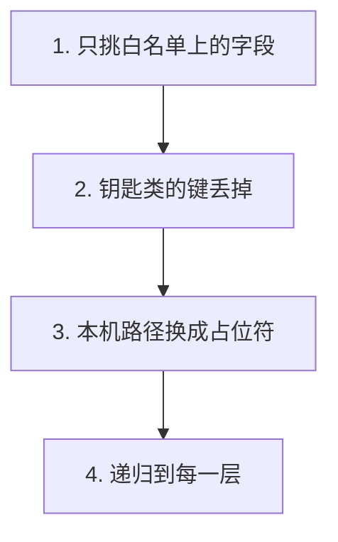
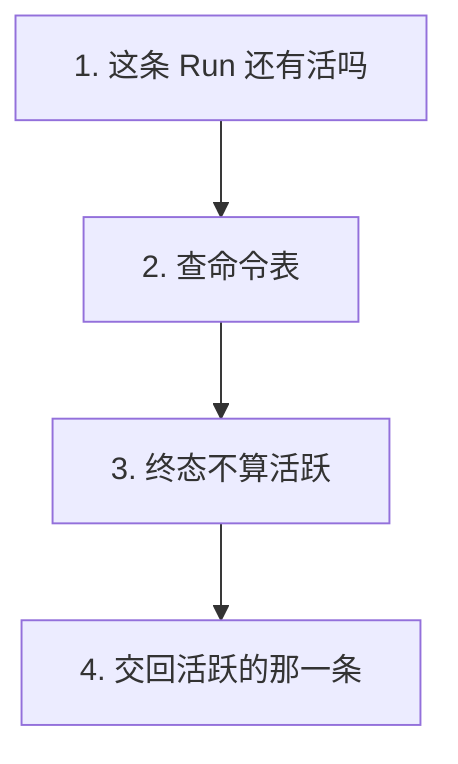

# P2.5 · 暴露 GET /api/runs 与完整读模型

> 改动报告 · 2026-10-27 · 分支 `dev-don`
>
> Agent 在后台干活的时候，浏览器得知道它干到哪了。
> 这一步把 Run 变成查得到的东西：一条 Run 的四块家底一次给全，
> 而且机器自己的东西（本机路径、给模型的提示词）一个都不出门。

## 第一部分：Q&A 概览

| Question | Answer |
| --- | --- |
| What does reading a run give back?【读一个 Run 会拿到什么】 | Four things in one answer: the run itself, its events, its artifacts and the seven stages.【四样东西放在一个回答里 这个 Run 本身、它做过的事、它做出来的东西、还有七个阶段走到哪】 |
| What is not in the answer?【回答里没有什么】 | No path of this machine and no prompt of the model.【没有本机的绝对路径 也没有给模型的那段提示词】 |
| What happens when the run is not there?【查不到这个 Run 会怎样】 | A 404, so an empty answer is never mistaken for a missing run.【回 404 不会拿一个空回答糊弄过去】 |
| Does the answer change when the API restarts?【API 重启以后答案会变吗】 | No. It is read from the database every time, and the file on disk is the only truth.【不会 每次都从数据库里读 盘上那个文件才是真的】 |
| Why does a run sometimes carry a command?【为什么 Run 上还挂着一道命令】 | That command is the way back: it says the run can still be moved even though it failed.【那条命令是往回走的路 它说明这个 Run 就算失败了也还能再往前走】 |

## 第二部分：数据流

### 1. 读一个 Run：四块家底拼在一起



| 步骤 | 关键变量 | 具体示例值 | 说明 |
| --- | --- | --- | --- |
| 1. 有人来查一个 Run | `run_id` | `"run-1"` | 查哪一条 |
| 2. 先找到那一行 | `get_run_record()` | `runs` 表 | 没有这一行就回 404 |
| 3. 读出事件 | `run_events` | 按 `seq` 排序 | 从旧到新，画时间线用 |
| 4. 读出产物 | `list_run_artifacts()` | 按写入顺序 | 模型做出来的东西 |
| 5. 算出七个阶段 | `WORKFLOW_STEPS` | `completed`/`active`/`pending` | 流程走到哪一段 |

```dataflow
1-01 (有人来查) 有人来查 [[run_id]]这一个 Run}} <{repository.py}>
1-02      → [找那一行] [[get_run_record()]]把一个 Run 的全部故事读出来的那个函数}} 先读 [[runs]]runs 表}} 的那一行 <{repository.py}>
1-03           ↳ [读事件] 读 [[run_events]]事件表}} ,按 [[seq]]顺序号}} 从旧到新 <{repository.py}>
1-04                ↳ [读产物] [[list_run_artifacts()]]读产物的那一个函数}} ,按写入的先后顺序 <{artifacts.py}>
1-05                     ↳ [算阶段] [[_step_index()]]算当前阶段排在第几的那个函数}} 配 [[WORKFLOW_STEPS]]七个阶段的定义}} ,给每段标上状态 <{repository.py}>
---
{
  "1-01": "Someone asks for one run by its id, and the helper that reads the whole story of a run is the way in.【run_id[the id of the run that is wanted]: asked for → asked for】",
  "1-02": "First the row of the run is found in the runs table, so the rest of the story hangs on that one row.【get_run_record[the helper that reads the whole story of a run]: called → called\nruns[the table that holds the runs]: one row → one row found】",
  "1-03": "Then the events of the run are read, oldest first, so a timeline can be drawn from them.【run_events[the table that holds the events of a run]: read → read in order\nseq[the number that keeps the events in order]: ordered by → ordered by】",
  "1-04": "The artifacts are read next, in the order they were written, so the output of the run shows up as it came.【list_run_artifacts[the helper that reads the artifacts of a run]: called → called】",
  "1-05": "Finally the seven stages are marked, so the answer says how far the run has come.【_step_index[the helper that finds where a stage sits]: used → used\nWORKFLOW_STEPS[the seven stages of the workflow]: marked → marked with a status】",
  "Summary": "Reading a run is one function that gathers four things: the row of the run, its events, its artifacts and the seven stages of the workflow with the state each one is in."
}
---
// STEP FLOW: 1-01[有人来查] → 1-02[找那一行] → 1-03[读事件] → 1-04[读产物] → 1-05[算阶段]

// 这像调一份档案:先找到那一本(1-02),再翻出他做过的事(1-03)、
// 他交出来的东西(1-04),最后看他在流程里走到第几步(1-05)。

// ===== 📂 apps/api/app/workflow/repository.py(读一个 Run:找行、读事件、算阶段) =====
// 1-02[找那一行] 从 runs 表里读出那一行
def _run_row(connection: sqlite3.Connection, run_id: str) -> dict[str, Any] | None:
    """Read one row of `runs` and decode it.

    Args:
        connection: The open connection to read through.
        run_id: The run to read, for example "run-1".

    Returns:
        The row as a dictionary, or None when there is no such run.
    """
    row = connection.execute("SELECT * FROM runs WHERE id = ?", (run_id,)).fetchone()
    return row_to_dict(row)

// 1-01[有人来查] 有人来查一个 Run,从这个函数进去
def get_run_record(run_id: str) -> dict[str, Any] | None:
    """Read the whole story of a run.

    Args:
        run_id: The run to read, for example "run-1".

    Returns:
        A dictionary with four keys: "run" (the row of `runs`), "events"
        (the events of the run, oldest first), "artifacts" (the artifacts of
        the run, oldest first) and "workflow_steps" (the seven stages, each
        with a "status" of "completed", "active" or "pending").  It is None
        when there is no such run, so a missing run stays distinguishable
        from an empty one.
    """
    with database() as connection:
        run = <*_run_row*>(connection, run_id)
        if run is None:
            return None
        // 1-03[读事件] 事件按顺序号从旧到新
        event_rows = connection.execute(
            "SELECT * FROM run_events WHERE run_id = ? ORDER BY seq",
            (run_id,),
        ).fetchall()
    events = [row_to_dict(row) or {} for row in event_rows]
    // 1-05[算阶段] 当前阶段排在第几
    current_index = <*_step_index*>(run["current_step"])
    finished = run["status"] == "COMPLETED"
    return {
        "run": run,
        "events": events,
        // 1-04[读产物] 产物按写入的先后顺序
        "artifacts": <*list_run_artifacts*>(run_id),
        "workflow_steps": [
            {
                **definition,
                "status": (
                    "completed"
                    if index < current_index or (finished and index == current_index)
                    else "active"
                    if index == current_index
                    else "pending"
                ),
            }
            for index, definition in enumerate(<*WORKFLOW_STEPS*>)
        ],
    }

// ===== 📂 apps/api/app/workflow/artifacts.py(读产物) =====
// 1-04[读产物] 产物按写入的先后顺序排好
def list_run_artifacts(run_id: str) -> list[dict[str, Any]]:
    """List the artifacts of a run, oldest first.

    Args:
        run_id: The run whose artifacts are wanted, for example "run-1".

    Returns:
        One dictionary per artifact, in the order they were written.
    """
    with database() as connection:
        rows = connection.execute(
            "SELECT * FROM run_artifacts WHERE run_id = ? ORDER BY created_at, rowid",
            (run_id,),
        ).fetchall()
    return [row_to_dict(row) or {} for row in rows]
```

### 2. 答出去之前过一道投影：白名单、藏钥匙、擦路径



| 步骤 | 关键变量 | 具体示例值 | 说明 |
| --- | --- | --- | --- |
| 1. 只挑白名单上的字段 | `RUN_FIELDS` | 12 个字段 | 名单外的一个都不给 |
| 2. 钥匙类的键丢掉 | `HIDDEN_KEYS` | `prompt` / `api_key` | 哪一层都丢 |
| 3. 本机路径换成占位符 | `_scrub_text()` | `"<path>"` | Windows、UNC、家目录三种 |
| 4. 递归到每一层 | `_scrub()` | 字典、列表、字符串 | 藏得再深也擦得到 |

```dataflow
2-01 (先挑字段) [[_pick()]]按白名单挑字段的那个函数}} 只把 [[RUN_FIELDS]]白名单}} 上的字段带出去,不在名单上就不给 <{run_routes.py}>
2-02      → [藏起钥匙] [[HIDDEN_KEYS]]不能外传的键}} 里的键,哪一层都丢掉 <{run_routes.py}>
2-03           ↳ [擦掉路径] [[_scrub_text()]]把本机绝对路径换成占位符的那个函数}} ,换成 [[PATH_PLACEHOLDER]]路径的占位符}} <{run_routes.py}>
2-04                ↳ [递归下去] [[_scrub()]]清理任意形状的值}} 递归到每一层 <{run_routes.py}>
---
{
  "2-01": "Only the fields that are named are copied out of the row, so a field nobody thought about cannot slip into the answer.【_pick[the helper that copies the named fields out]: used → used\nRUN_FIELDS[the fields that are allowed out]: the whole row → the named ones】",
  "2-02": "The keys that carry credentials or the prompt of the model are dropped, and they are dropped wherever they show up.【HIDDEN_KEYS[the keys that never reach the browser]: dropped → dropped at every level\nthe request[the notes that started the run]: in the database → in the database】",
  "2-03": "A path that points into this computer is replaced by a placeholder, so the answer says where a thing is without saying where this computer is.【_scrub_text[the helper that cleans the paths out of a text]: called → called\nPATH_PLACEHOLDER[what a path of this machine becomes]: the real path → a placeholder】",
  "2-04": "The cleaning walks into the dictionaries and the lists, so a path or a key is found however deep it is hidden.【_scrub[the helper that cleans a value of any shape]: called → called at every level】",
  "Summary": "What leaves the server is a projection, not the row itself. The fields on the whitelist are copied out, the keys that carry credentials or a prompt are dropped, and the paths of this machine are replaced by a placeholder."
}
---
// STEP FLOW: 2-01[先挑字段] → 2-02[藏起钥匙] → 2-03[擦掉路径] → 2-04[递归下去]

// 这像出机场的登机牌:登机牌上只有该印的东西(2-01),
// 钱包和手机号那一栏根本不印(2-02),登机牌上也不会写清
// 你家小区的门牌号 —— 只写「<path>」(2-03、2-04)。

// ===== 📂 apps/api/app/api/run_routes.py(投影:先挑字段,再擦干净) =====
// 2-01[先挑字段] 只有白名单上的字段才出门
RUN_FIELDS = (
    "id",
    "course_slug",
    "mode",
    "status",
    "current_step",
    "provider",
    "model",
    "interrupt_type",
    "error_message",
    "trace_id",
    "created_at",
    "updated_at",
)

// 2-02[藏起钥匙] 这些键在哪一层都不许出门
HIDDEN_KEYS = frozenset(
    {
        "access_token",
        "api_key",
        "authorization",
        "cookie",
        "messages",
        "password",
        "prompt",
        "raw_output",
        "raw_response",
        "refresh_token",
        "secret",
        "system_prompt",
        "token",
        "user_prompt",
    }
)

// 2-03[擦掉路径] 本机的绝对路径换成这个占位符
PATH_PLACEHOLDER = "<path>"

_PATH_END = r"\s\"'<>|,;)\]}:：，。、；？！）【】《》「」"
WINDOWS_PATH_RE = re.compile(rf"[A-Za-z]:[\\/](?![\\/])[^{_PATH_END}]*")
UNC_PATH_RE = re.compile(rf"\\\\[^{_PATH_END}]*")
HOME_PATH_RE = re.compile(rf"/(?:Users|home)/[A-Za-z0-9._-]+[^{_PATH_END}]*")

// 2-03[擦掉路径] Windows、UNC、家目录三种各扫一遍
def _scrub_text(text: str) -> str:
    """Replace the paths of this machine by a placeholder.

    Args:
        text: The text to clean, for example an error message.

    Returns:
        The text with every absolute path of this computer replaced by
        "<path>".  A relative path such as "lessons/01.md" is left alone:
        it says nothing about the machine it was written on.
    """
    cleaned = WINDOWS_PATH_RE.sub(<*PATH_PLACEHOLDER*>, text)
    cleaned = UNC_PATH_RE.sub(<*PATH_PLACEHOLDER*>, cleaned)
    return HOME_PATH_RE.sub(<*PATH_PLACEHOLDER*>, cleaned)

// 2-04[递归下去] 字典、列表、字符串一层层擦
def _scrub(value: Any) -> Any:
    """Drop the internal material out of a value of any shape.

    Args:
        value: The value to clean, for example the presentation of an
            artifact.

    Returns:
        The value without the hidden keys and without the paths of this
        machine.  A list keeps its order, a dictionary keeps the keys that
        are not hidden, and everything else is returned as it is.
    """
    if isinstance(value, dict):
        return {
            key: _scrub(item)
            for key, item in value.items()
            if key.lower() not in HIDDEN_KEYS
        }
    if isinstance(value, list):
        return [_scrub(item) for item in value]
    if isinstance(value, str):
        return _scrub_text(value)
    return value

// 2-01[先挑字段] 名单上的才抄出来,抄完再擦一遍
def _pick(row: dict[str, Any], fields: tuple[str, ...]) -> dict[str, Any]:
    """Copy the named fields out of a row and clean them.

    Args:
        row: The row to read, for example the row of `runs`.
        fields: The names of the fields that are allowed out.

    Returns:
        A dictionary with the fields that the row has, cleaned.
    """
    return _scrub({field: row[field] for field in fields if field in row})
```

### 3. 活跃命令：失败的 Run 也可能还会往前走



| 步骤 | 关键变量 | 具体示例值 | 说明 |
| --- | --- | --- | --- |
| 1. 这条 Run 还有活吗 | `run_id` | `"run-1"` | 前端要判断还要不要轮询 |
| 2. 查命令表 | `commands` | 最新一条 | 一个 Run 可能有好几条命令 |
| 3. 终态不算活跃 | `TERMINAL_COMMAND_STATUSES` | `succeeded` / `failed` / `done` | 大写小写都认 |
| 4. 交回活跃的那一条 | `active_command` | 没有就是 `null` | 挂在 `run` 里面 |

```dataflow
3-01 (这条 Run 还有活吗) 前端要知道这条 Run 还有没有命令没做完 <{commands.py}>
3-02      → [查命令表] [[get_active_command()]]读活跃命令的那个函数}} 查 [[commands]]命令表}} <{commands.py}>
3-03           ↳ [终态不算活跃] [[TERMINAL_COMMAND_STATUSES]]终态的集合}} 里的状态不算活跃 <{commands.py}>
3-04                ↳ [交回] 交回 [[active_command]]活跃的那一条}} ,没有就是空 <{run_routes.py}>
---
{
  "3-01": "The browser has to know whether this run still has something left to do, so it can decide whether to keep asking.【run_id[the run that is being watched]: watched → watched】",
  "3-02": "The commands of the run are looked up, newest first, because one run may have several commands over its life.【get_active_command[the helper that reads the command a run waits on]: called → called\ncommands[the table that holds the commands]: read → read newest first】",
  "3-03": "A command whose status says it is finished is not counted as active, so a run that failed but can be resumed still shows the way back.【TERMINAL_COMMAND_STATUSES[the statuses that mean a command is done]: skipped → skipped\nthe command[the one that is still going]: the newest → the newest that is not done】",
  "3-04": "What is given back is that one command, hung on the run itself, or nothing at all when the run has nothing left to do.【active_command[the command the run still waits on]: put on the run → put on the run\nnothing left[when the run is done]: null → null】",
  "Summary": "A run says whether it can still move. The commands of the run are read, the ones that are finished are skipped, and the one that is still going is hung on the run itself so the browser can keep asking or stop asking."
}
---
// STEP FLOW: 3-01[这条 Run 还有活吗] → 3-02[查命令表] → 3-03[终态不算活跃] → 3-04[交回]

// 这像取号:号码还没叫到,你就还在等(3-02);
// 叫过了就算完,不再占着你的号(3-03);屏幕上只显示你现在这一个号(3-04)。

// ===== 📂 apps/api/app/workflow/commands.py(读活跃命令) =====
// 3-03[终态不算活跃] 这些状态都算做完了
TERMINAL_COMMAND_STATUSES = frozenset(
    {"succeeded", "failed", "cancelled", "waiting_approval", "retryable", "done"}
)

// 3-01[这条 Run 还有活吗] 前端要知道有没有命令没做完
// 3-02[查命令表] 从 commands 表里找最新的一条还没做完的
def get_active_command(run_id: str) -> dict[str, Any] | None:
    """Read the command a run is still waiting on.

    Args:
        run_id: The run whose command is wanted, for example "run-1".

    Returns:
        The newest command of the run that is not in a terminal state, or
        None when the run has no command left to do.  Only the fields the
        browser needs are given back: the payload of a command stays in the
        database, because it is the machine's own instruction.
    """
    placeholders = ", ".join("?" for _ in TERMINAL_COMMAND_STATUSES)
    query = f"""
        SELECT id, kind, status, attempt_count, created_at, updated_at
        FROM commands
        WHERE run_id = ? AND LOWER(status) NOT IN ({placeholders})
        ORDER BY created_at DESC, rowid DESC LIMIT 1
    """
    with database() as connection:
        row = connection.execute(
            query, (run_id, *sorted(TERMINAL_COMMAND_STATUSES))
        ).fetchone()
    return row_to_dict(row)

// ===== 📂 apps/api/app/api/run_routes.py(把它挂到 Run 上) =====
// 3-04[交回] 交回活跃的那一条,没有就是空
def _run_read(row: dict[str, Any], active_command: dict[str, Any] | None) -> RunRead:
    """Build the run of the answer out of its row.

    Args:
        row: The row of `runs`, decoded.
        active_command: The command the run is still waiting on, or None.

    Returns:
        The run as the browser sees it.
    """
    read = _pick(row, RUN_FIELDS)
    if active_command is not None:
        read["<*active_command*>"] = _pick(active_command, COMMAND_FIELDS)
    return RunRead(**read)
```

## 第三部分：其它

### 这次改动的边界

| 文件 | 行数 | 干什么的 |
| --- | --- | --- |
| `apps/api/app/api/run_routes.py` | 251 | 两条路由 + 投影：白名单、藏钥匙、擦路径（新建） |
| `apps/api/app/workflow/commands.py` | 49 | 读活跃命令（新建） |
| `apps/api/app/schemas.py` | 382 | 加了八个模型：Run 的读模型 |
| `apps/api/app/main.py` | 34 | 把 `run_router` 挂上去 |
| `apps/api/tests/test_run_api.py` | 301 | 7 条测试 |
| `apps/api/tests/test_schemas.py` | 103 | 模型清单加了八个名字 |

计划里写的是「Create `run_routes.py` / `test_run_api.py`」——这两个确实是新建。
计划没列的还有 `commands.py`、`schemas.py`、`main.py` 和 `test_schemas.py`，
原因见下面的几条决定。

### 五条决定

**一、答出去的不是那一行，是一版「投影」。**

参考版把 `runs` 那一行原样发给浏览器；我们发的是照着白名单挑出来的一版。
两层保险：先是**白名单**（名单上没有的字段根本没被抄出来），再是**清洗**
（在名单上的字段，里面的钥匙和本机路径也要擦掉）。

理由是失败方向不一样：白名单漏一个字段，是「多给了」；
清洗漏一个键，是「本机路径和提示词漏出去了」。所以两层都得有。

**二、`request` / `interrupt_payload` / `budget_policy` / `raw_output` / `event.payload` 一个都不给。**

这五个是「机器自己的笔记」：发起这次 Run 的原始请求、审批要问的问题、
预算策略、模型没加工过的原文、事件里那坨原始数据。

RoadMap §2.1 说 `run_id == trace_id`，RoadMap §P5.7 说「快照里不含 Prompt 原文与绝对路径」，
§P7.2 说「白名单不存在时默认丢弃一切（fail-closed）」——这三条指向同一件事：
**不给就是不给**，不是「先给了再擦」。

**三、`active_command` 放在 `run` 里面，不放在回答的最外层。**

P2.6 要写的 `shouldPollRun(run)` 读的是同一个对象的 `status` 和 `active_command`。
放一起，前端读一次对象就够了；分开的话前端得同时拿两个对象还得自己对齐。

**四、命令的终态用小写集合收，大写小写都认。**

RoadMap §2.1 冻的是大写：`SUCCEEDED` / `FAILED` / `CANCELLED` / `WAITING_APPROVAL` / `RETRYABLE`。
P6.1 声明的 `CommandStatus` 是小写：`pending` / `leased` / `done` / `failed` / `cancelled`。

这两套说法都在合同里，而且不一致。`get_active_command()` 用
`LOWER(status) NOT IN (...)` 判断，集合里两种拼法都收着，还额外收了 `done`
（worker 队列把 `SUCCEEDED` 叫 `done`）。这样 **P6.1 落地的时候答案不会变**。

**五、`app/workflow/commands.py` 是新建的，不是塞进 `repository.py`。**

`repository.py` 已经 469 行，离 500 行的闸门只剩 31 行。
读活跃命令这件事归它自己的模块管，注释里也写清楚了：
`app/worker/commands.py`（P6.1）管队列那边，这个模块管读这一边。

### 没抄参考版的三样东西

| 参考版 | 我们 | 为什么 |
| --- | --- | --- |
| `get_run_record()` 返回一个扁平的大字典，键混在一起 | 分成 `run` / `events` / `artifacts` / `workflow_steps` 四块 | 计划里定的就是四个具名键。前端画时间线、画产物、画阶段条，各取各的，不用在一堆键里猜。 |
| 把 `raw_output` 和 `request` 原样发出去 | 这两个键不在白名单里，一个都不给 | 参考版的 `raw_output` 是模型原文，里面有提示词和本机路径。RoadMap 的「本机路径」和「快照里不含 Prompt 原文」两条都指向「不给」。 |
| 活跃命令是回答最外层的一个键 | 挂在 `run.active_command` 里面 | P2.6 的 `shouldPollRun(run)` 读的是同一个对象的两个字段，放一起前端读一次就够。 |

另外一处小的：参考版用 `attach_artifact_presentations()` 把产物的展示层拼上去，
我们把展示层直接存在 `run_artifacts.presentation_json` 这一列，读的时候直接拿出来，
不用再拼一次。

**这次没做**（P2.5 的计划里没有，也没顺手加）：Run 的暂停 / 继续 / 停止接口、
预算和 trace 的查询、事件的流式推送（SSE）、按课程查产物。
参考版的 `run_routes.py` 里那些是 P6 阶段和 P2.6 的活，这一步不碰。

### 这次验证了什么、没验证什么

**验证了**：

- `apps/api/tests/test_run_api.py`：7 条全过。
- 一起跑的相关测试（11 个文件）：149 条全过。
- `ruff check apps/api/app apps/api/tests`：All checks passed!
- `node scripts/check-source-size.mjs`：32 files, <= 500 lines each。
- OpenAPI 里能看到 `GET /api/runs` 和 `GET /api/runs/{run_id}` 两条路由。

**没验证**：

- **没跑全量测试**。CLAUDE.md 第 7 条：默认只跑增量测试。
  这次动到的 `app/schemas.py` 和 `app/main.py` 被别的测试 import，上面那 11 个文件都跑过了；
  其余测试文件没重跑 —— 这是推断，不是跑出来的结果。
- **没测 E2E**：CLAUDE.md 第 6 条。没在浏览器里点过这两个接口。
- **没测真的数据库文件**：全部测试都在 pytest 的临时目录里，
  仓库里那份 `.course-agent/agent.db` 这次没被写。
- **没测重启场景以外的重启**：测试里模拟的是「重新打开一次连接」，
  真正的进程重启（uvicorn 起来再停再起）没测。
- **没测前端怎么用 `active_command`**：P2.6 的轮询逻辑还没写，
  这里只保证答案里有这个字段。
- **没跑 `check-report.py`**：CLAUDE.md 第 10 条。这次用仓库外那份复刻脚本逐条核对。

### 留给后面阶段的三件事

1. **P2.6**：前端轮询 `GET /api/runs/{id}`，用 `run.status` 和 `run.active_command`
   判断还要不要继续轮 —— 这两个字段现在都在了。
2. **P6.1**：worker 队列落地后，命令状态会换成 `pending` / `leased` / `done` 这套小写说法。
   现在的终态集合已经把这套认下来了，答案不会变，但队列那边落地时记得回来对一遍。
3. **P7.2**：脱敏现在是这个模块自己做的。等统一那条线落地时，把它换成同一个工具，
   别留两套 —— 现在两套的「什么算本机路径」不一定一样。

### 报告自检（没跑 `check-report.py`）

按 CLAUDE.md 第 10 条，报告格式**没有跑** `check-report.py`。这次仍然用放在仓库外的
临时脚本（`%TEMP%/p18-report-check/`）复刻它的规则逐条核对：
`###` 子段 3 个（≤3）、每个 `dataflow` 块里 `---` 各两处、步骤号在图 / JSON 键 /
代码区 `//` 注释三处一致、`[[]]` 与 `}}` 配对、注音标识都在代码区原样出现、
JSON 讲解纯英文、Q&A 5 行且中文只在 `【】` 内、STEP FLOW 一条且每项都是 `[...]`。
箭头几何另用一段脚本核对过：第 N 步的箭头落在第 5×N 列，全部对齐。

代码区贴的是 `repository.py` / `artifacts.py` / `run_routes.py` / `commands.py` 的真片段，
**每个函数都带着它自己的文档注释**，注释和源码逐字一致
（`description` + `Args`（带例子）+ `Returns`）。
另有一段脚本核对过：代码区里每一行（去掉 `<* *>` 标记和报告自己的注释层之后）
都能在源码里逐字找到。

**它是复刻，不是检查器本身** —— 权威的 `check-report.py` 仍然没跑过，两者可能有出入。
