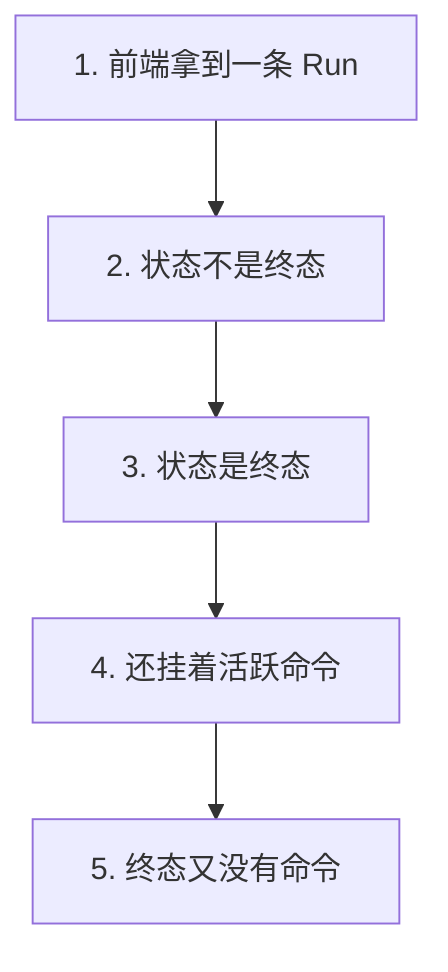
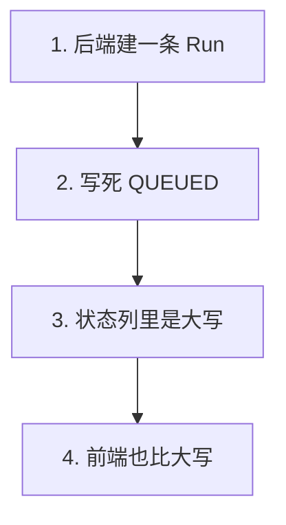
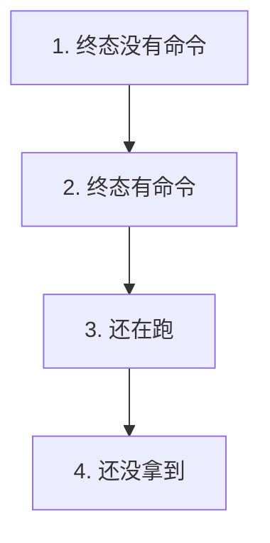

# P2.6 · 前端：轮询判定 shouldPollRun

> 改动报告 · 2026-10-27 · 分支 `dev-don`
>
> Agent 在后台跑的时候，浏览器一遍遍问「跑到哪了」。
> 什么时候该停下来问，这件事得说死 —— 说错了要么一直在问，
> 要么问一次就再也不问了。

## 第一部分：Q&A 概览

| Question | Answer |
| --- | --- |
| What decides whether the browser keeps asking?【是什么决定要不要继续问】 | Two things: the status of the run and the command it still waits on.【两样东西 这条 Run 的状态,和它还在等的那条命令】 |
| When does the polling stop?【什么时候停轮询】 | When the run is over and has nothing left to wait for.【Run 结束了、而且没有等着要做的事的时候】 |
| What does "over" mean here?【这里说的「结束」指哪三个词】 | `COMPLETED`, `FAILED` and `STOPPED`.【COMPLETED、FAILED、STOPPED 这三个】 |
| A failed run is over, so does the polling stop?【失败的 Run 结束了,那轮询就停了吗】 | Not when it still carries a command. That is the "continue from the checkpoint" case.【不一定 它要是还挂着一条命令就不能停 那是从检查点继续的情形】 |
| What if the run has not been loaded yet?【Run 还没拿到的时候怎么办】 | Keep asking. Asking once more is how it gets loaded.【继续问 再问一次才能拿到它】 |

## 第二部分：数据流

### 1. 判定停不停：状态先，命令后



| 步骤 | 关键变量 | 具体示例值 | 说明 |
| --- | --- | --- | --- |
| 1. 前端拿到一条 Run | `run` | `undefined` 也可以 | 问还要不要继续问 |
| 2. 状态不是终态 | `TERMINAL_RUN_STATUSES` | `QUEUED` / `RUNNING` | 没结束就继续问 |
| 3. 状态是终态 | `status` | `COMPLETED` / `FAILED` / `STOPPED` | 结束了，再看命令 |
| 4. 还挂着活跃命令 | `active_command` | `{ status: "PENDING" }` | 答案还没定，继续问 |
| 5. 终态又没有命令 | — | `null` | 停下来 |

```dataflow
1-01 (有人问) 前端拿到一条 Run,问还要不要继续轮询 <{run-polling.ts}>
1-02      → [看状态] 状态不在 [[TERMINAL_RUN_STATUSES]]终态的三个词}} 里 → 继续轮询 <{run-polling.ts}>
1-03           ↳ [是终态] 状态是终态 → 再看它还挂没挂着命令 <{run-polling.ts}>
1-04                ↳ [有命令] 有 [[active_command]]活跃命令}} → 继续轮询 <{run-polling.ts}>
1-05                     ↳ [都没了] 终态又没有活跃命令 → 停轮询 <{run-polling.ts}>
---
{
  "1-01": "The browser has a run in hand and asks whether it is worth asking again.【run[the run that is on screen]: in hand → in hand】",
  "1-02": "The status is looked up in the set of terminal statuses, and a status that is not one of them means the run is still going, so the polling goes on.【TERMINAL_RUN_STATUSES[the statuses that mean the run is over]: checked → checked\nthe polling[whether to ask again]: goes on → goes on】",
  "1-03": "A status that is one of them means the run is over, and then the question is whether it still has something to wait for.【the status[where the run stands]: COMPLETED, FAILED or STOPPED → over】",
  "1-04": "When the run still carries an active command, the answer can still change, because that command is going to move the run again.【active_command[the command the run still waits on]: present → present\nthe polling[whether to ask again]: goes on → goes on】",
  "1-05": "When the run is over and carries nothing, nothing about it will change on its own, so the polling stops.【the polling[whether to ask again]: goes on → stops】",
  "Summary": "The decision is two questions in a row. Is the run over? And if it is, does it still carry a command that is going to move it? Only when both answers are no does the browser stop asking."
}
---
// STEP FLOW: 1-01[有人问] → 1-02[看状态] → 1-03[是终态] → 1-04[有命令] → 1-05[都没了]

// 这像等一个快递:查件还在路上(1-02),就继续等;
// 显示已签收(1-03),还得看看是不是还放着一个待取件(1-04);
// 两样都没了,才不用再看(1-05)。

// ===== 📂 apps/web/src/features/run/run-polling.ts(判定停不停) =====
// 1-01[有人问] 前端拿到一条 Run,问还要不要继续轮询
export type RunPollingState = {
  status?: string | null;
  active_command?: { status?: string | null } | null;
};

/**
 * The statuses of a run that mean it is over.
 *
 * A run in one of these is done unless it still carries a command.
 */
export const TERMINAL_RUN_STATUSES = new Set(["COMPLETED", "FAILED", "STOPPED"]);

/**
 * Decide whether the browser should ask about this run again.
 *
 * @param run The run as the read model of P2.5 gives it, or `undefined`
 *   when the run has not been loaded yet.
 * @returns `true` when the answer can still change, `false` when the run is
 *   over and has nothing left to wait for.
 */
export function shouldPollRun(run: RunPollingState | undefined): boolean {
  const status = run?.status || "";
  // 1-02[看状态] 状态不在终态的三个词里 → 继续轮询
  if (!TERMINAL_RUN_STATUSES.has(status)) {
    return true;
  }
  // 1-03[是终态] 状态是终态 → 再看它还挂没挂着命令
  // 1-04[有命令] 终态却还挂着命令 → 继续轮询
  // 1-05[都没了] 终态又没有活跃命令 → 停
  return Boolean(run?.active_command);
}
```

### 2. 词要对上：后端写的是大写



| 步骤 | 关键变量 | 具体示例值 | 说明 |
| --- | --- | --- | --- |
| 1. 后端建一条 Run | `create_run_record()` | `"QUEUED"` | 新 Run 的第一个状态 |
| 2. 写死 QUEUED | `status` 列 | `'QUEUED'` | 大写，不小写 |
| 3. 状态列里是大写 | `status` | `"RUNNING"` | 全流程都是大写 |
| 4. 前端也比大写 | `TERMINAL_RUN_STATUSES` | `"COMPLETED"` | 两边对得上 |

```dataflow
2-01 (后端建 Run) 后端建一条 Run,状态得写进数据库 <{repository.py}>
2-02      → [写死大写] [[create_run_record()]]建一条 Run 记录的那个函数}} 把 [[QUEUED]]刚排队的意思}} 写死进去 <{repository.py}>
2-03           ↳ [存进状态列] 状态列里存的是大写,一个字都不小写 <{repository.py}>
2-04                ↳ [前端比大写] 前端的 [[TERMINAL_RUN_STATUSES]]终态的三个词}} 也写大写 → 两边对得上 <{run-polling.ts}>
---
{
  "2-01": "The backend opens a run and has to say in which state it is, so the state goes into the row of the run.【the row of the run[where the state of the run is kept]: written → written】",
  "2-02": "The helper that opens a run writes the queued state into that row with the capital letters the contract uses.【create_run_record[the helper that opens a run]: called → called\nQUEUED[the state of a run that is waiting its turn]: written → written in capital letters】",
  "2-03": "So the column holds the capital spelling, and a lookup that compared with small letters would never match anything.【the status column[what it holds]: capital letters → capital letters\na lookup[the comparison that is made against it]: never matches → never matches】",
  "2-04": "The terminal statuses of the frontend are written the same way, so the two sides speak the same words.【TERMINAL_RUN_STATUSES[the statuses that mean the run is over]: capital letters → capital letters】",
  "Summary": "The vocabulary is one vocabulary. The backend writes the state of a run in capital letters and the frontend compares against the same capital letters, so the terminal check can never quietly stop matching."
}
---
// STEP FLOW: 2-01[后端建 Run] → 2-02[写死大写] → 2-03[存进状态列] → 2-04[前端比大写]

// 这像两科室对暗号:后端写「已签收」(2-02、2-03),前端也认「已签收」(2-04)。
// 一边改成小写「已签收」,另一边还认大写 —— 对不上,而且不会报错,
// 只会让「已签收」看起来像「还在路上」。

// ===== 📂 apps/api/app/workflow/repository.py(后端怎么写状态) =====
// 2-01[后端建 Run] 后端建一条 Run,状态得写进数据库
def create_run_record(
    run_id: str,
    course_slug: str,
    mode: str,
    provider: str,
    model: str,
    request: dict[str, Any],
    budget_policy: dict[str, Any] | None = None,
) -> dict[str, Any]:
    """Open a new run: one row in `runs` plus the first event.

    The run starts in `QUEUED` at the first stage, and its trace id is the
    run id itself, so one trace covers the whole run.  The row and the first
    event are written in one transaction, so a run never exists without the
    event that says it was created.

    Args:
        run_id: The id of the new run, for example a uuid4 string.
        course_slug: The course this run belongs to, for example "python-101".
        mode: The run mode, for example "guided".
        provider: The model provider, for example "codex_gateway".
        model: The model name, for example "llm-gateway--kimi-k3".
        request: The request that started the run, for example the intake
            payload.  It is stored as JSON so the run can be replayed.
        budget_policy: The budget rules of this run, for example
            {"token_budget_mtokens": 20}.  An empty policy when omitted.

    Returns:
        The new row of `runs`, decoded into a dictionary.
    """
    now = utcnow()
    with database() as connection:
        // 2-02[写死大写] 把「刚排队」这个意思写死进去
        // 2-03[存进状态列] 状态列里存的是大写,一个字都不小写
        connection.execute(
            """
            INSERT INTO runs (
                id, course_slug, mode, status, current_step, provider, model,
                request_json, trace_id, budget_policy_json, created_at, updated_at
            ) VALUES (?, ?, ?, 'QUEUED', 'intake', ?, ?, ?, ?, ?, ?, ?)
            """,
            (
                run_id,
                course_slug,
                mode,
                provider,
                model,
                json.dumps(request, ensure_ascii=False),
                run_id,
                json.dumps(budget_policy or {}, ensure_ascii=False),
                now,
                now,
            ),
        )
        _insert_event(connection, run_id, "run.created", "intake", "课程 Agent Run 已创建")
        row = _run_row(connection, run_id)
    return row or {}

// ===== 📂 apps/web/src/features/run/run-polling.ts(前端怎么比) =====
// 2-04[前端比大写] 前端的终态集合也写大写 → 两边对得上
export const TERMINAL_RUN_STATUSES = new Set(["COMPLETED", "FAILED", "STOPPED"]);
```

### 3. 合同写在能跑的地方：四条断言



| 步骤 | 关键变量 | 具体示例值 | 说明 |
| --- | --- | --- | --- |
| 1. 终态没有命令 | `COMPLETED` | `active_command: null` | 停 |
| 2. 终态有命令 | `FAILED` | `active_command: { status: "PENDING" }` | **继续**（最容易写错） |
| 3. 还在跑 | `RUNNING` | — | 继续 |
| 4. 还没拿到 | `undefined` | — | 继续 |

```dataflow
3-01 (四条断言) 用 [[assertEqual()]]比一比的那个函数}} 把判定停不停这件事钉成四条断言 <{run-polling.test.ts}>
3-02      → [终态没命令] [[shouldPollRun()]]判定还要不要继续轮询的那个函数}} 说不 → 停 <{run-polling.test.ts}>
3-03           ↳ [终态有命令] 同一条判定说有 → 继续 <{run-polling.test.ts}>
3-04                ↳ [还在跑] 同一条判定说有 → 继续 <{run-polling.test.ts}>
3-05                     ↳ [还没拿到] 同一条判定说有 → 继续 <{run-polling.test.ts}>
---
{
  "3-01": "The decision is pinned down by four assertions, written so that a change in the rule breaks a test instead of quietly changing the polling.【assertEqual[the helper that compares two answers]: used → used】",
  "3-02": "The first case is a run that is over with nothing left to wait for: the decision says no, so the polling stops.【shouldPollRun[the helper that decides whether to ask again]: answered → answered\nthe polling[whether to ask again]: stops → stops】",
  "3-03": "The second case is the one that is easy to get wrong: a run that failed but still carries a command has to keep polling.【shouldPollRun[the helper that decides whether to ask again]: answered → answered\nthe polling[whether to ask again]: goes on → goes on】",
  "3-04": "The third case is a run that is still running, which of course keeps polling.【the polling[whether to ask again]: goes on → goes on】",
  "3-05": "The fourth case is a run that has not been loaded yet: asking once more is how it gets loaded, so the polling goes on.【the polling[whether to ask again]: goes on → goes on】",
  "Summary": "Four assertions hold the rule in place: a run that is over and empty stops the polling, a run that is over but still carries a command keeps it, a running run keeps it, and a run that is not loaded yet keeps it."
}
---
// STEP FLOW: 3-01[四条断言] → 3-02[终态没命令] → 3-03[终态有命令] → 3-04[还在跑] → 3-05[还没拿到]

// 这像体检报告上的四条线:每条线管一件事,写下来就改不掉了。
// 其中第二条最要紧 ——「没通过但可以复查」不能当成「没通过」(3-03)。

// ===== 📂 apps/web/tests/run-polling.test.ts(四条断言) =====
// 3-01[四条断言] 用 assertEqual 把判定停不停这件事钉成四条断言
function assertEqual(actual: boolean, expected: boolean, message: string): void {
  if (actual !== expected) {
    throw new Error(`${message}（期望 ${expected}，实际 ${actual}）`);
  }
}

// 3-02[终态没命令] 终态、没有活跃命令：这条 Run 不会再自己变了，停轮询。
assertEqual(
  shouldPollRun({ status: "COMPLETED", active_command: null }),
  false,
  "a completed run with nothing left to wait for must stop polling",
);

// 3-03[终态有命令] 终态、但有活跃命令：从检查点继续，答案还没定，轮询要继续。
assertEqual(
  shouldPollRun({ status: "FAILED", active_command: { status: "PENDING" } }),
  true,
  "a failed run with an open command must keep polling",
);

// 3-04[还在跑] 非终态：还在跑，轮询要继续。
assertEqual(
  shouldPollRun({ status: "RUNNING" }),
  true,
  "a running run must keep polling",
);

// 3-05[还没拿到] 还没拿到这条 Run：再问一次才能拿到，轮询要继续。
assertEqual(
  shouldPollRun(undefined),
  true,
  "a run that has not been loaded yet must keep polling",
);
```

## 第三部分：其它

### 这次改动的边界

| 文件 | 行数 | 干什么的 |
| --- | --- | --- |
| `apps/web/src/features/run/run-polling.ts` | 55 | 判定停不停：一个类型、一个终态集合、一个函数（新建） |
| `apps/web/tests/run-polling.test.ts` | 57 | 四条断言（改写：种子文件跑不起来） |

这一阶段**只动前端两个文件**，后端一个字节都没改，Python 测试没重跑。

### 三条决定

**一、测试里的 import 写 `.ts` 后缀，不是 `.js`。**

Node 的 `--experimental-strip-types` **不会**把 `.js` 解析成 `.ts`
（实测：`ERR_MODULE_NOT_FOUND: Cannot find module .../run-polling.js`）。
仓库里原来那份 `apps/web/tests/run-polling.test.ts` 是从参考版种子带过来的，
写的是 `../src/features/run/run-polling.js` —— 计划里那条验收命令在它上面跑不起来。

改成 `../src/features/run/run-polling.ts` 之后，node 的 ESM 解析器认这个后缀，
类型被剥掉，模块正常加载，验收命令 PASS。

（应用代码那边不受影响：`src/` 里的 import 照旧不带后缀，
和 `course-form.ts` 里 `import { CourseCreate } from "../../api";` 一个写法。
只有这个用 node 直接跑的测试文件带后缀。）

**二、种子测试里那条 P2.7 的断言先挪走。**

原来那份文件还断言了 `authoritativeEffectiveChars()` —— 那是 P2.7 的
`apps/web/src/features/run/quality-metrics.ts`，这一阶段那个文件还不存在。
留着这条断言，验收命令就会因为「模块找不到」而失败。

所以这条断言挪到 P2.7 去做（连同它自己的测试文件
`apps/web/tests/quality-metrics.test.ts`）。**这一条是欠着的**，不是删掉了。

**三、`WAITING_APPROVAL` 不算终态。**

RoadMap §2.1 冻的 Run 状态是六个：`QUEUED` · `RUNNING` · `WAITING_APPROVAL` ·
`COMPLETED` · `FAILED` · `STOPPED`。终态取其中三个（`COMPLETED` / `FAILED` / `STOPPED`），
`WAITING_APPROVAL` **不在里面**。

理由：等着人审批的 Run 不是结束了，是等着被放行 —— 放行了它还会往前走，
所以轮询要留着。计划里给的终态集合也是这三个，照办。

### 跟参考版的四处不同

| 参考版 | 我们 | 为什么 |
| --- | --- | --- |
| `type RunPollingState` 没导出 | `export type RunPollingState` | P2.7 要用它给「前端拿到的那条 Run」定型，不导出就得再抄一份。 |
| `const terminalRunStatuses` 没导出 | `export const TERMINAL_RUN_STATUSES` | P2.7 的界面要给终态上色，得知道哪几个是终态。名字也改成大写，和仓库里 `SLUG_PATTERN` / `COURSE_STEPS` / `COURSE_FIELDS` 的写法一致。 |
| 一行 `!terminalRunStatuses.has(...) \|\| Boolean(...)` | 拆成「先看状态，再看命令」两步 | 逻辑一样，但顺序看得见 —— 报告里第二节讲的就是这个顺序。 |
| 一个函数、零注释 | 每个导出物都带文档注释 | 跟 `apps/web/src/api.ts` 和 `course-form.ts` 的写法一致（那边每个函数都有 `@param` / `@returns`）。 |

参考版的接法（这一阶段**没抄**，那是 P2.7 的活）：
`refetchInterval: (query) => shouldPollRun(query.state.data) ? 1200 : false`。

### 这次验证了什么、没验证什么

**验证了**：

- `node --experimental-strip-types apps/web/tests/run-polling.test.ts` → `run-polling：4 条断言全过`。
- **变异测试**：把实现里的 `Boolean(run?.active_command)` 改成 `... && false`，
  第二条断言立刻报错（`期望 true，实际 false`）—— 说明那条「最容易写错」的断言
  真的在咬人，不是摆设。改回来以后又全过。
- `npm --prefix apps/web run typecheck` → 0 error。
- `node scripts/check-source-size.mjs` → 33 files, <= 500 lines each。

**没验证**：

- **没跑 `npm --prefix apps/web run build`**。新文件还没被任何页面 import，
  bundle 不受影响；typecheck 已经过了。
- **没在真浏览器里试过**。`shouldPollRun` 还没接进 react-query 的
  `refetchInterval`（P2.7 的活），这一阶段它只是一个纯函数。
- **测试文件不在 typecheck 的范围里**：`tsconfig.app.json` 的 `include` 只有 `src`，
  `tsconfig.node.json` 只有 `vite.config.ts`。所以 `tests/` 里的类型错误 typecheck 抓不到。
- **没跑一次真的接口对一遍**。后端写的是大写这件事，是从 `repository.py` 的
  `INSERT` 语句里读出来的（见第二节），不是跑接口看出来的。
- **没跑 Python 测试**：这一阶段后端一个字节都没动。
- **没跑 `check-report.py`**（CLAUDE.md 第 10 条）：用仓库外那份复刻脚本逐条核对。

### 留给后面阶段的三件事

1. **P2.7**：把 `shouldPollRun` 接进 react-query 的 `refetchInterval`，
   并把种子测试里挪走的那条 `authoritativeEffectiveChars()` 断言还回来
   （新文件 `apps/web/tests/quality-metrics.test.ts`）。
2. **`tests/` 还没进 typecheck**：`tsconfig.app.json` 的 `include` 只有 `src`。
   要么加一个 `tsconfig.test.json`（得开 `allowImportingTsExtensions`，
   因为测试里 import 的是 `.ts` 后缀），要么把测试目录并进现有的配置。
3. **后端和前端的词要一起改**：终态集合写的是大写，后端也写大写。
   谁改了另一边都得跟着改 —— 改错了**不会报错**，只会让轮询永远停不下来。

### 报告自检（没跑 `check-report.py`）

按 CLAUDE.md 第 10 条，报告格式**没有跑** `check-report.py`。这次仍然用放在仓库外的
临时脚本（`%TEMP%/p18-report-check/`）复刻它的规则逐条核对：
`###` 子段 3 个（≤3）、每个 `dataflow` 块里 `---` 各两处、步骤号在图 / JSON 键 /
代码区 `//` 注释三处一致、`[[]]` 与 `}}` 配对、注音标识都在代码区原样出现、
JSON 讲解纯英文、Q&A 5 行且中文只在 `【】` 内、STEP FLOW 一条且每项都是 `[...]`。
箭头几何另用一段脚本核对过：第 N 步的箭头落在第 5×N 列，全部对齐。

代码区贴的是 `run-polling.ts` / `repository.py` / `run-polling.test.ts` 的真片段，
**每个函数都带着它自己的文档注释**，注释和源码逐字一致
（`description` + `@param`（带例子）+ `@returns`）。
另有一段脚本核对过：代码区里每一行（去掉 `<* *>` 标记和报告自己的注释层之后）
都能在源码里逐字找到。

**它是复刻，不是检查器本身** —— 权威的 `check-report.py` 仍然没跑过，两者可能有出入。
