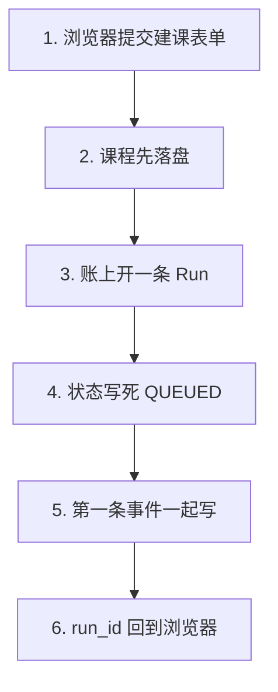
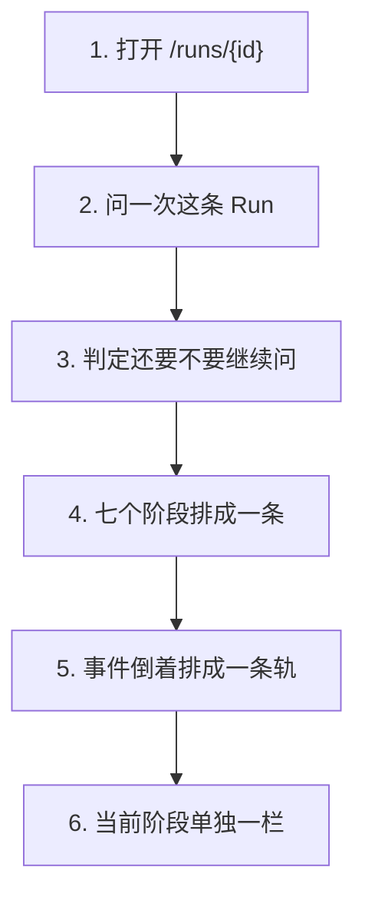
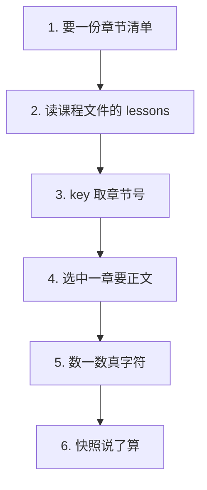

# P2.7 · 前端：Run 工作台最小版

> 改动报告 · 2026-10-27 · 分支 `dev-don`
>
> 这一步要把「有一条 Run」变成「看得见的一条 Run」。
> 但工作台打开是空的 —— 之前没有人记账，浏览器问谁要 Run 呢？
> 所以先把账记上，再把台子搭起来。

## 第一部分：Q&A 概览

| Question | Answer |
| --- | --- |
| What does the workbench show?【工作台上面是什么】 | Three things: the seven stages, the events, and the text of the chapters.【三样东西 七个阶段、发生过的事、还有章节正文】 |
| Why did creating a course change on the backend?【为什么建课要在后端也动】 | Because nobody was writing runs, so the workbench had nothing to show.【因为之前没人记账 工作台打开只能看到一片空白】 |
| What does a course creation leave behind?【建完课留下什么】 | A course on the disk and one run in the ledger, in one request.【磁盘上一门课 账上一条 Run 一次请求里一起办完】 |
| How does the page know the run is still running?【页面怎么知道还在跑】 | It asks again every 1.2 seconds until the answer can no longer change.【每 1.2 秒问一次 直到这个答案不会再变】 |
| Where do the chapters come from?【章节是从哪来的】 | From the lesson list of the course file, not from the folder.【从课程文件的章节清单里来 不是去文件夹里数】 |

## 第二部分：数据流

### 1. 建课顺手开一条 Run：占位 id 变成账上的记录



| 步骤 | 关键变量 | 具体示例值 | 说明 |
| --- | --- | --- | --- |
| 1. 浏览器提交建课表单 | `payload` | `slug: "python-101"` | 12 个字段的 intake 表单 |
| 2. 课程先落盘 | `course` | `status: "preparing"` | 落盘被拒 → 400 / 409，不留 Run |
| 3. 账上开一条 Run | `run_id` | `uuid4()` | 之前是个空名字，现在有行了 |
| 4. 状态写死 QUEUED | `status` | `"QUEUED"` | 大写，和前端那三个终态一个词表 |
| 5. 第一条事件一起写 | `event_type` | `"run.created"` | 和 Run 在同一个事务里 |
| 6. run_id 回到浏览器 | `CourseCreated.run_id` | `"3f2a…"` | 前端拿它开工作台 |

```dataflow
1-01 (建课) 浏览器 POST /api/courses,课程先落盘,拿到 [[CourseCreated]]建课回执}} <{course_routes.py}>
1-02      → [开账] [[create_run_record()]]在账上开一条 Run 的那个函数}} 记下这次运行 <{course_routes.py}>
1-03           ↳ [写死 QUEUED] [[QUEUED]]刚排队的意思}} 写进状态列 <{repository.py}>
1-04                ↳ [第一条事件] [[run.created]]Run 刚建好的事件名}} 和 Run 一起写 <{repository.py}>
1-05                     ↳ [回给浏览器] [[run_id]]这次运行的编号}} 跟着课程回到前端 <{course_routes.py}>
---
{
  "1-01": "The browser posts the intake form. The course is written to the disk first, so a refused form leaves nothing behind, and the receipt of the new course comes back with the request.【course[the new course on the disk]: written → written\nstatus[where the course stands]: preparing → preparing】",
  "1-02": "The route opens one run on the ledger. Before this step the id in the receipt was a name with nothing behind it; now it names a row that can be read back.【run_id[the id of this run]: a bare name → a real record\nthe ledger[the table of runs]: one more row → one more row】",
  "1-03": "The new run starts in the queued state, written with capital letters, so the frontend that looks for the terminal statuses finds the same words on both sides.【status[where the run stands]: QUEUED → QUEUED\nthe status column[what it holds]: capital letters → capital letters】",
  "1-04": "The row and the first event are written in one transaction, so a run never exists without the event that says it was created.【event_type[what happened]: none → run.created\nthe run and its first event[the two rows]: written together → written together】",
  "1-05": "The course and the id of the run go back together, so the browser has everything it needs to open the workbench of this run right away.【run_id[the id of this run]: a bare name → a real record\nthe answer[what the browser gets]: the course → the course and the run id】",
  "Summary": "Creating a course now leaves two things behind: the course on the disk and one run in the ledger. The run is opened after the course is written, so a form that is refused leaves no run that nobody could continue."
}
---
// STEP FLOW: 1-01[建课] → 1-02[开账] → 1-03[写死 QUEUED] → 1-04[第一条事件] → 1-05[回给浏览器]

// 这像前台开单:先把单子写好(1-01),再在流水账上记一笔(1-02),
// 顺手写清这单排在哪(1-03)、第一笔写了什么(1-04),
// 最后把流水号念给客人(1-05)——客人手上有个号,回头就能凭号查进度。

// ===== 📂 apps/api/app/api/course_routes.py(建课这条路由) =====
// 1-01[建课] 课程先落盘,读回来变成回执
    try:
        course = create_course(payload)
    except FileExistsError as error:
        raise HTTPException(status_code=409, detail="课程 slug 已存在") from error
    except ValueError as error:
        raise HTTPException(status_code=400, detail=str(error)) from error
    summary = CourseSummary(**course)
    <*run_id*> = str(uuid.uuid4())
    // 1-02[开账] 在账上开一条 Run,占位 id 变成真的记录
    <*create_run_record*>(
        run_id,
        payload.slug,
        INTAKE_RUN_MODE,
        payload.provider,
        payload.model,
        payload.model_dump(),
        budget_policy={"token_budget_mtokens": payload.token_budget_mtokens},
    )
    // 1-05[回给浏览器] 课程和这次运行的编号一起回去
    return CourseCreated(
        course=summary,
        run_id=run_id,
        status=summary.status,
    )

// ===== 📂 apps/api/app/workflow/repository.py(账上的 Run 怎么写) =====
// 1-03[写死 QUEUED] 状态列里写的是大写的「刚排队」
// 1-04[第一条事件] Run 和它的第一条事件在同一个事务里写进去
    with database() as connection:
        connection.execute(
            """
            INSERT INTO runs (
                id, course_slug, mode, status, current_step, provider, model,
                request_json, trace_id, budget_policy_json, created_at, updated_at
            ) VALUES (?, ?, ?, 'QUEUED', 'intake', ?, ?, ?, ?, ?, ?, ?)
            """,
        _insert_event(connection, run_id, "run.created", "intake", "课程 Agent Run 已创建")
        row = _run_row(connection, run_id)
    return row or {}
```

### 2. 工作台问一次：七个阶段、事件轨、活着的当前阶段



| 步骤 | 关键变量 | 具体示例值 | 说明 |
| --- | --- | --- | --- |
| 1. 打开 /runs/{id} | `runId` | `"3f2a…"` | 地址栏里那个 id |
| 2. 问一次这条 Run | `api.run(runId)` | `RunDetail` | 一次拿到 Run、事件、阶段 |
| 3. 判定还要不要继续问 | `shouldPollRun` | `true` | 还在跑 → 每 1.2 秒再问 |
| 4. 七个阶段排成一条 | `workflow_steps` | 7 个 | 一个阶段一个按钮 |
| 5. 事件倒着排成一条轨 | `seq` | 从大到小 | 最新的在最上面 |
| 6. 当前阶段单独一栏 | `run.current_step` | `"intake"` | 带一个走动的钟 |

```dataflow
2-01 (打开工作台) 浏览器打开 /runs/{id},先问一次这条 Run <{run-workspace.tsx}>
2-02      → [接上判定] [[shouldPollRun()]]判定还要不要继续问的那个函数}} 说了算 → 每 1.2 秒再问 <{run-workspace.tsx}>
2-03           ↳ [画七个阶段] [[workflow_steps]]这条 Run 的七个阶段}} 画成一条流程条 <{run-workspace.tsx}>
2-04                ↳ [亮当前阶段] [[current_step]]这条 Run 现在走到哪一步}} 决定哪个格子亮 <{run-workspace.tsx}>
2-05                     ↳ [事件轨] [[seq]]事件的先后号}} 倒着排,最新的在最上面 <{run-workspace.tsx}>
2-06                          ↳ [活的当前阶段] [[LiveAgentActivity()]]当前阶段活儿视图那个组件}} 把这一段的事件挑出来 <{activity.tsx}>
---
{
  "2-01": "The page opens with the id of the run in the address bar and asks the API about that run once.【runId[the id in the address bar]: from the address → from the address\nthe answer[what the API sends back]: nothing → the run, its events and its stages】",
  "2-02": "The polling decision of the earlier step is used as it is: while the answer can still change, the page asks again every 1.2 seconds.【shouldPollRun[the helper that decides whether to ask again]: answered → answered\nthe ask again[how often the page asks]: once → every 1.2 seconds while the run can still move】",
  "2-03": "The seven stages of the contract come back with the run, and the page draws them as a bar, one button per stage.【workflow_steps[the seven stages of the run]: seven → seven\nthe bar[what the page draws]: nothing → seven buttons】",
  "2-04": "The stage the run is at is the one that is highlighted, and every stage says in one word whether it is done, running or not started.【current_step[the stage the run is at]: intake → intake\nthe stage label[the word under a stage]: nothing → done, current or not started】",
  "2-05": "The events are turned around before they are drawn, because the last thing that happened is the thing a person wants to read first.【seq[the order number of an event]: counted up → counted down\nthe track[what the page draws]: oldest on top → newest on top】",
  "2-06": "The events of the stage that is running are picked out into their own panel, with a clock that ticks while the person watches.【LiveAgentActivity[the panel of the running stage]: hidden → shown\nthe clock[the running time on screen]: none → ticks every second】",
  "Summary": "The workbench asks once and then keeps asking while the run can still move. It draws the seven stages, turns the events around so the newest is on top, and gives the running stage a panel of its own with a ticking clock."
}
---
// STEP FLOW: 2-01[打开工作台] → 2-02[接上判定] → 2-03[画七个阶段] → 2-04[亮当前阶段] → 2-05[事件轨] → 2-06[活的当前阶段]

// 这像盯着一趟火车的到站牌:先看一趟(2-01),到站牌每 1.2 秒擦一次(2-02),
// 七个站台排成一条线(2-03),现在这个站台亮着(2-04),
// 车厢往哪边开一目了然 —— 最新的一节排在最上面(2-05),
// 当前这一节单独放大,还挂着一个走动的钟(2-06)。

// ===== 📂 apps/web/src/features/run/run-polling.ts(要不要继续问) =====
// 2-02[接上判定] P2.6 那个判定,一个字的改动都没有
/**
 * Decide whether the browser should ask about this run again.
 *
 * @param run The run as the read model of P2.5 gives it, or `undefined`
 *   when the run has not been loaded yet.
 * @returns `true` when the answer can still change, `false` when the run is
 *   over and has nothing left to wait for.
 */
export function shouldPollRun(run: RunPollingState | undefined): boolean {
  const status = run?.status || "";
  if (!TERMINAL_RUN_STATUSES.has(status)) {
    return true;
  }
  return Boolean(run?.active_command);
}

// ===== 📂 apps/web/src/features/run/run-workspace.tsx(工作台页面) =====
// 2-01[打开工作台] 页面打开先问一次这条 Run
export function RunWorkspace() {
  const { runId = "" } = useParams();
  const [pickedStep, setPickedStep] = useState<string | null>(null);
  const detail = useQuery({
    queryKey: ["run", runId],
    queryFn: () => api.run(runId),
    // 2-02[接上判定] 判定说还要问,就每 1.2 秒问一次
    refetchInterval: (query) =>
      shouldPollRun(query.state.data?.run) ? 1200 : false,
  });
  // ...
// 2-03[画七个阶段] 七个阶段画成一条流程条,点一个看一个
      <WorkflowMap
        steps={detail.data.workflow_steps}
        currentStep={run.current_step}
        selectedStep={selectedStep}
        onSelect={setPickedStep}
      />
  // ...
// 2-04[亮当前阶段] 一个阶段一个字:已完成、当前阶段、未开始
function stageStateLabel(step: WorkflowStepRead, currentStep: string): string {
  if (step.status === "completed") {
    return "已完成";
  }
  if (step.id === currentStep) {
    return "当前阶段";
  }
  return "未开始";
}

// 2-05[事件轨] 事件倒着排,最新的在最上面
export function EventTrack({ events }: { events: RunEventRead[] }) {
  const ordered = events.slice().sort((left, right) => right.seq - left.seq);
  // ...
}

// ===== 📂 apps/web/src/features/run/activity.tsx(当前阶段的活儿视图) =====
// 2-06[活的当前阶段] 只挑当前阶段的事件,最新的在最上面
export function LiveAgentActivity({
  step,
  events,
}: {
  step: string;
  events: RunEventRead[];
}) {
  const relevant = events
    .filter((event) => event.step === step)
    .slice()
    .sort((left, right) => right.seq - left.seq);
  // ...
// 2-06[活的当前阶段] 挂着一个走动的钟,秒针每秒动一下
export function ElapsedTimer({ startedAt }: { startedAt: string }) {
  const [now, setNow] = useState(() => Date.now());

  useEffect(() => {
    const timer = window.setInterval(() => setNow(Date.now()), 1000);
    return () => window.clearInterval(timer);
  }, []);
  // ...
}
```

### 3. 章节正文只读：先要清单，再要正文



| 步骤 | 关键变量 | 具体示例值 | 说明 |
| --- | --- | --- | --- |
| 1. 要一份章节清单 | `GET …/chapters` | `{"items":[…]}` | 课程摘要只给章节数，不给是哪几章 |
| 2. 读课程文件的 lessons | `course.json` | `lessons: [...]` | 清单只认这份文件 |
| 3. key 取章节号 | `key` | `"1"` | 单章路由照单全收，不用猜 |
| 4. 选中一章要正文 | `GET …/chapters/{key}` | `ChapterRead` | 磁盘上的原话 |
| 5. 数一数真字符 | `effectiveCharCount` | `12345` | Markdown 记号不算正文 |
| 6. 快照说了算 | `authoritativeEffectiveChars` | 快照 → 正文 | 快照没来时才用正文 |

```dataflow
3-01 (要章节清单) 浏览器 GET /api/courses/{slug}/chapters,要一份清单 <{course_routes.py}>
3-02      → [读课程文件] [[list_chapters()]]列出一门课章节的那个函数}} 看 course.json 里的 lessons <{chapters.py}>
3-03           ↳ [key 就是编号] [[key]]这一章的钥匙}} 取自章节号,单章路由照单全收 <{chapters.py}>
3-04                ↳ [拿正文] 选中一章,再 GET .../chapters/{key} 拿正文 <{api.ts}>
3-05                     ↳ [量正文] [[effectiveCharCount()]]数真字符的那个函数}} 量这一章有多少真字符 <{quality-metrics.ts}>
3-06                          ↳ [快照说了算] [[authoritativeEffectiveChars()]]快照和正文谁说了算}} → 快照说了算 <{quality-metrics.ts}>
3-07                               ↳ [快照还没来] [[SNAPSHOT_CHARS]]快照里的有效字符数}} 现在是空的 → 先用正文 <{run-workspace.tsx}>
---
{
  "3-01": "The browser asks for a list of the chapters of the course, because the summary of a course says how many chapters there are but not which ones they are.【the chapter list[what the browser asks for]: a number → a list of chapters】",
  "3-02": "The list is read from the lesson list of the course file, because that list is the only place that says which chapter exists and what it is called.【lessons[the lesson list of the course file]: read → read\nthe chapters[what the course has]: unknown → known】",
  "3-03": "The key of a chapter is its number, and that is exactly the key the single chapter route accepts, so an item of the list can be read back without a second guess.【key[the key of a chapter]: the number → the number\nthe round trip[read a list, then read a chapter]: works → works】",
  "3-04": "When a chapter is picked, the browser asks for that one chapter and gets the text that is really on the disk.【content[the text of the chapter]: unknown → the text on the disk\nthe path[where the text lives]: unknown → inside the course】",
  "3-05": "The number of characters that count as content is measured from that text, with the marks of the markdown left out.【effectiveCharCount[the helper that measures the text]: not called → called\nthe marks[the markdown syntax]: counted → not counted】",
  "3-06": "When the two numbers disagree, the number of the snapshot is the one that is shown, so the workbench never shows two numbers that contradict each other.【authoritativeEffectiveChars[the helper that picks the number]: called → called\nthe number on screen[what the person sees]: the fallback → the snapshot】",
  "3-07": "The snapshot of the quality stage does not exist yet, so the number falls back to the text of the chapter. The rule is already in place, so nothing has to change when the snapshot arrives.【SNAPSHOT_CHARS[the number of the snapshot]: empty → empty for now\nthe number on screen[what the person sees]: the text of the chapter → the text of the chapter】",
  "Summary": "The chapter list comes from the course file, its keys are the ones the single chapter route accepts, and the number of characters follows one rule: the snapshot wins, and until the snapshot exists the text of the chapter stands in."
}
---
// STEP FLOW: 3-01[要章节清单] → 3-02[读课程文件] → 3-03[key 就是编号] → 3-04[拿正文] → 3-05[量正文] → 3-06[快照说了算] → 3-07[快照还没来]

// 这像去图书馆借书:先看目录(3-01),目录写在馆里的册子上(3-02),
// 每本书的书号就印在目录那一行(3-03)——照着号去取,不用自己找。
// 取下来先掂一掂有多厚(3-05),但厚度以登记卡为准(3-06),
// 登记卡还没做好就先按手上这本的厚度说(3-07)。

// ===== 📂 apps/api/app/api/course_routes.py(章节清单这条路由) =====
// 3-01[要章节清单] 课程摘要给的是章节数,这一条给的是章节本身
@router.get("/{slug}/chapters", response_model=ChapterList)
def read_chapters(slug: str) -> ChapterList:
    """Answer with the chapters of a course.

    The list is what the browser needs to show a chapter picker: the
    course summary of the API carries the *number* of chapters, but not
    which ones they are.  The key of every item is the key the single
    chapter route accepts, so an item of this list can be read back
    without a second guess.

    Args:
        slug: The short name of the course, for example "python-101".

    Returns:
        The chapters of the course, in the order of the course file.
    Raises HTTPException(404) when there is no such course, and
        HTTPException(400) when the slug is illegal.
    """
    try:
        chapters = list_chapters(slug)
    except ValueError as error:
        raise HTTPException(status_code=400, detail=str(error)) from error
    except FileNotFoundError as error:
        raise HTTPException(status_code=404, detail=str(error)) from error
    return ChapterList(items=chapters)

// ===== 📂 apps/api/app/courses/chapters.py(清单从课程文件里读) =====
// 3-02[读课程文件] 章节清单只认 course.json 里的 lessons
def list_chapters(course_root: Path) -> list[dict[str, Any]]:
    """List the chapters of a course in the order the course file gives.

    The lesson list of the course file is the only place that says which
    chapter exists and what it is called, so the list is read from there
    and not from the folder: a chapter that was planned but not written
    yet is still a chapter of the course.

    The key of a chapter is the one the single chapter route accepts, so
    a key taken from this list can be read back with
    `GET /api/courses/{slug}/chapters/{key}` without a second guess.

    Args:
        course_root: The folder of one course, for example
            courses/python-101/.

    Returns:
        One item per chapter: the key, the number, the title and the path
        of the Markdown file inside the course.  A lesson without a
        Markdown file is left out, because there is nothing to read.
    """
    lessons = _read_metadata(course_root).get("lessons")
    if not isinstance(lessons, list):
        return []
    items: list[dict[str, Any]] = []
    for lesson in lessons:
        if not isinstance(lesson, dict):
            continue
        markdown = str(lesson.get("markdown") or "")
        if not markdown:
            continue
        raw_number = lesson.get("number")
        number = raw_number if isinstance(raw_number, int) else None
        items.append(
            {
                # 3-03[key 就是编号] key 取章节号,单章路由照单全收
                <*"key"*>: str(raw_number) if raw_number is not None else Path(markdown).stem,
                "number": number if number is not None else len(items) + 1,
                "title": str(lesson.get("title") or Path(markdown).stem),
                "path": markdown,
            }
        )
    return items

// ===== 📂 apps/web/src/api.ts(前端怎么拿) =====
// 3-04[拿正文] 清单一条、正文一条,两个接口
  chapters: (slug: string) =>
    request<ChapterList>(
      `/api/courses/${encodeURIComponent(slug)}/chapters`,
    ),
  chapter: (slug: string, key: string) =>
    request<Chapter>(
      `/api/courses/${encodeURIComponent(slug)}/chapters/${encodeURIComponent(key)}`,
    ),

// ===== 📂 apps/web/src/features/run/quality-metrics.ts(两个数字,谁说了算) =====
// 3-05[量正文] Markdown 的记号不算正文
export function effectiveCharCount(markdown: string): number {
  let value = markdown.replace(/```[\s\S]*?```/g, "");
  value = value.replace(/!\[[^\]]*]\([^)]+\)/g, "");
  value = value.replace(/\[([^\]]+)]\([^)]+\)/g, "$1");
  value = value.replace(/[#>*_`|~\-\s]/g, "");
  return value.length;
}

// 3-06[快照说了算] 快照说了算,正文只是没有快照时的替补
export function authoritativeEffectiveChars(
  snapshotChars: number | undefined,
  fallbackChars: number,
): number {
  return typeof snapshotChars === "number" ? snapshotChars : fallbackChars;
}

// ===== 📂 apps/web/src/features/run/run-workspace.tsx(快照还没来) =====
// 3-07[快照还没来] 质量快照的接口要到 P5.7,现在这一格是空的
const SNAPSHOT_CHARS: number | undefined = undefined;
  // ...
                {authoritativeEffectiveChars(
                  SNAPSHOT_CHARS,
                  effectiveCharCount(chapter.data.content),
                ).toLocaleString()}
```

## 第三部分：其它

#### 这次改动的边界

| 文件 | 行数 | 干什么的 |
| --- | --- | --- |
| `apps/api/app/api/course_routes.py` | 275 | 章节清单这条路由 + 建课时开一条 Run |
| `apps/api/app/course_service.py` | 213 | 门面多一个 `list_chapters` |
| `apps/api/app/courses/chapters.py` | 335 | `list_chapters`：从课程文件读章节清单 |
| `apps/api/app/schemas.py` | 402 | `ChapterSummary` / `ChapterList` |
| `apps/api/tests/test_course_create_api.py` | 324 | 建课开的那条 Run 读得回来（2 条新用例 + 临时库） |
| `apps/api/tests/test_chapter_list_api.py` | 175 | 章节清单的 5 条用例（新建） |
| `apps/web/src/api.ts` | 247 | Run / 章节的类型、三个清单类型和 4 个新接口 |
| `apps/web/src/features/run/run-workspace.tsx` | 359 | 工作台页面：阶段条、事件轨、章节预览、Run 列表 |
| `apps/web/src/features/run/activity.tsx` | 110 | 当前阶段的活儿视图 + 走动的钟 |
| `apps/web/src/features/run/quality-metrics.ts` | 60 | 两个数字，快照说了算（P2.6 欠的断言还回来了） |
| `apps/web/src/features/run/run.css` | 318 | 工作台的样式（新建） |
| `apps/web/src/App.tsx` | 22 | 加两条路由：`/runs` 和 `/runs/:runId` |
| `apps/web/src/main.tsx` | 30 | 装上 react-query 的 `QueryClientProvider` |
| `apps/web/src/components/layout.tsx` | 24 | 导航加一个「运行」 |
| `apps/web/tests/quality-metrics.test.ts` | 61 | 4 条断言（新建） |

#### 六条决定

**一、建课的时候顺手开一条 Run（计划外的后端改动）。**

P2.7 是前端的一步，但工作台打开是空的 —— 全仓库只有测试在写 Run，
产品代码里没有任何一条路会往 `runs` 表里写行。工作台问「这条 Run 走到哪了」
没人答得上来。

P1.7 的规格里写得明白：`run_id` 那时是**占位**，「本步只发一个 id，不落库」，
并且「P2.1 建了 `runs` 表之后由它接管」。P2.1 已经建好了，
所以建课这条路由现在调 `create_run_record()`，占位 id 变成账上的记录。

顺序是「先写课程，再开 Run」：表单被拒（400 / 409）时不留 Run ——
一个不存在的课程配一条谁也接不上的 Run 是脏账。反过来不成立：
Run 写不进去时课程已经落盘了，那是 500。

**二、加了一条章节清单接口（计划外的后端改动）。**

`CourseSummary` 只有章节**数**，没有章节**是哪几个**。工作台要画章节选择器，
必须有清单，所以加了 `GET /api/courses/{slug}/chapters`。
清单只从 `course.json` 的 `lessons` 里读，不去文件夹里数 ——
「规划了但还没写」的章节也是这门课的章节。

key 取章节号（没有编号就退到 Markdown 文件名），
所以清单里的每一项都能直接喂给单章路由，不用猜。

**三、`SNAPSHOT_CHARS` 现在是空的，但规则先立住。**

RoadMap §7 的规则是「快照为准、Artifact 仅作迁移兜底」，
参考版的 `chapterQualityMap()` 也是这个规则。
`authoritativeEffectiveChars()` 照这条规则写好了：
**快照说了算**，正文只是没有快照时的替补。

质量快照的接口要到 P5.7 才有，所以调用点现在传的是
一个写明理由的 `undefined`。**规则先立住，等快照来了不用改代码**，
也不会出现两个互相矛盾的数字。

**四、四个计划外的接线文件。**

`App.tsx` 加两条路由、`layout.tsx` 导航加一个「运行」、
`main.tsx` 装上 react-query 的 Provider、`run.css` 是工作台的样式。
没有这四个，页面写出来也没有入口、没有数据源、没有样子。

**五、`:8000` 上跑的是旧代码 —— 这条要开发者自己动手。**

开发服务器是这次之前起的，uvicorn 的热重载没有把 P2.5 之后的代码吃进去：
它只打了一行 `WatchFiles detected changes in 'app\db.py'. Reloading...`，
之后再没有新的 `Started server process`，子进程根本没换。
`GET /api/runs` 和 `GET /api/courses/{slug}/chapters` 在 `:8000` 上都是 404。

我试着停它，被权限拦下了（"targets a pre-existing process the agent did not
create in this session"）。所以：**当前这份代码跑在 `:8001`（API）和 `:5174`（前端）上，
`:8000` / `:5173` 那个是旧的**。请开发者自己把旧的那对停掉再起一次。

**六、前端的三个清单类型跟后端同名。**

`api.ts` 里原来的 `request<{ items: Course[] }>` 这种写法，
后端那边叫 `CourseList` / `ChapterList` / `RunList`，
两边叫同一个东西却写两个名字。现在前端也用这三个名字：

```ts
export type CourseList = { items: Course[] };
export type ChapterList = { items: ChapterSummary[] };
export type RunList = { items: RunSummary[] };
```

顺带解决了一个报告里的麻烦：`<{ items: ... }>` 这种写法跟报告标记
`<{文件名}>` 长得一模一样，写进代码片段里会被人（和检查脚本）当成文件标记。

#### 跟参考版的七处不同

| 参考版 | 我们 | 为什么 |
| --- | --- | --- |
| `run-workspace.tsx` 是一个 399 行的页面 | 拆成 `run-workspace.tsx`（359）、`activity.tsx`（110）、`quality-metrics.ts`（60） | 500 行的门槛是硬指标；而且「当前阶段的活儿视图」和「两个数字谁说了算」是两件事，各自有测试。 |
| 轮询是 `refetchInterval: (query) => shouldPollRun(query.state.data) ? 1200 : false` | `shouldPollRun(query.state.data?.run)` | 参考版传的是整个读模型，我们是 `?.run` —— 读模型里 Run 才是那条 Run，`?.` 是因为可能还没加载。 |
| 参考版的阶段条自己画阶段 | 阶段由后端的 `workflow_steps` 带来，前端只画 | 阶段是合同里的东西（七个），不该在前端再写一份。 |
| 参考版 `quality-metrics.ts` 只有 6 行 | 60 行，两个带文档注释的导出 | 6 行那版把规则写在一行里，读的人看不出「快照优先」。 |
| 参考版 `Course` 类型带 `lessons: CourseLesson[]` | 我们的 `CourseSummary` 是 6 个字段，没有 `lessons` | 参考版那是另一套读模型。我们不抄 —— 抄过来就是两份真相。章节清单单开一条接口。 |
| 参考版没有「章节正文预览」这一块 | 有，且是只读的 | 工作台看的是这条 Run 做出了什么；编辑是另一个页面的事。 |
| 参考版 `api.ts` 401 行，`Course` 类型里直接挂着 `lessons` | 247 行，三个清单类型跟后端同名，章节清单单开一条接口 | 参考版把「课程」和「章节」揉在一个类型里，我们后端的 `CourseSummary` 只有 6 个字段 —— 硬塞进去就是两份真相。 |

#### 这次验证了什么、没验证什么

**验证了**：

- 后端增量测试 34 条全过：
  `test_course_create_api.py`（含 2 条新用例）、`test_chapter_list_api.py`（5 条新用例）、`test_run_api.py`。
- 前端两个 node 测试：`quality-metrics：4 条断言全过`、`run-polling：4 条断言全过`。
- `npm --prefix apps/web run typecheck` → 0 error。
- `npm --prefix apps/web run build` → 成功。
- `node scripts/check-source-size.mjs` → 37 files, <= 500 lines each。
- `ruff check apps/api/app apps/api/tests` → All checks passed!
- 对着 `:8001` 实地 curl 过：`/api/runs`、`/api/runs/{run_id}`、
  `/api/courses/{slug}/chapters` 都在 openapi 里，那门 9 章的课清单返回 9 项，
  `GET /api/runs` 返回 `{"items":[]}`（那时候还没建过课）。

**没验证**：

- **没在真浏览器里点过。** 页面能不能打开、七个阶段好不好看，
  没有人在浏览器里看过。跑起来的是 `:5174` 那个（旧的 `:5173` 上是旧代码）。
- **没做端到端。** CLAUDE.md 第 6 条：没有开发者明确要求，不做 E2E。
- **测试文件仍然不在 typecheck 的范围里**：`tsconfig.app.json` 的 `include` 只有 `src`，
  `tsconfig.node.json` 只有 `vite.config.ts`。
- **没跑过 `check-report.py`**（CLAUDE.md 第 10 条）。
- **`ruff` 的 E501 没开** —— 开了就得先改 RoadMap §4.1。

#### 留给后面阶段的三件事

1. **P2.8**：从可执行图导出 workflow snapshot。
   阶段条现在是直接吃后端读模型里的 `workflow_steps`，
   但「可执行的那张图」才是真正的那一份 —— 别让两处各写一份阶段。
2. **P5.7 的质量快照接口到了之后**，`SNAPSHOT_CHARS` 要从
   `quality/course-quality-snapshot.json` 真读，而不是现在这个写明理由的 `undefined`。
   规则不用改，只换数据来源。
3. **`:8000` / `:5173` 的旧进程**：请开发者自己停掉。
   不然在旧的那对上做的任何验证都验的是旧代码。

#### 报告自检（没跑 `check-report.py`）

按 CLAUDE.md 第 10 条，报告格式**没有跑** `check-report.py`。这次仍然用放在仓库外的
临时脚本（`%TEMP%/p18-report-check/`）复刻它的规则逐条核对：
`###` 子段 3 个（≤3）、每个 `dataflow` 块里 `---` 各两处、步骤号在图 / JSON 键 /
代码区 `//` 注释三处一致、`[[]]` 与 `}}` 配对、注音标识都在代码区原样出现、
JSON 讲解纯英文、Q&A 5 行且中文只在 `【】` 内、STEP FLOW 一条且每项都是 `[...]`。
箭头几何另用一段脚本核对过：第 N 步的箭头落在第 5×N 列，全部对齐。

第三部分的标题用的是 `####` 而不是 `###` —— 那条「最多 3 个 `###`」的规则是
给第二部分的三段数据流用的，检查脚本却是对整篇报告数 `###`。
用 `####` 两边都成立，也跟 P1.x 那几篇的报告一样。

代码区贴的是 `course_routes.py` / `repository.py` / `chapters.py` /
`run-polling.ts` / `run-workspace.tsx` / `activity.tsx` / `quality-metrics.ts` /
`api.ts` 的真片段，**每个函数都带着它自己的文档注释**，注释和源码逐字一致
（`description` + `@param`（带例子）+ `@returns`）。
另有一段脚本核对过：代码区里每一行（去掉 `<* *>` 标记和报告自己的注释层之后）
都能在源码里逐字找到。

**它是复刻，不是检查器本身** —— 权威的 `check-report.py` 仍然没跑过，两者可能有出入。
