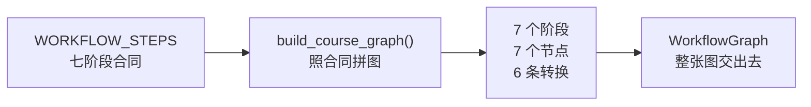
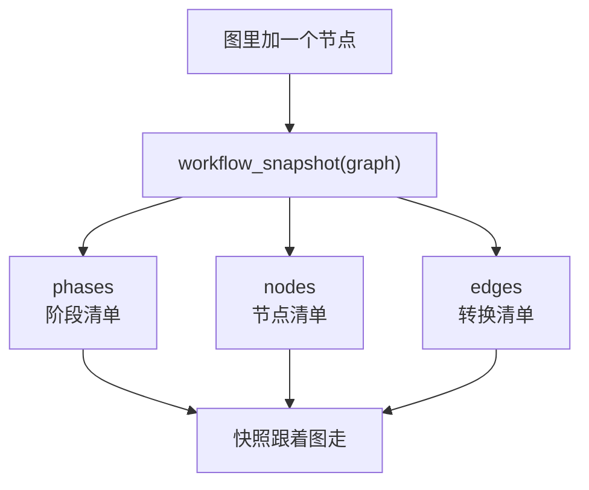
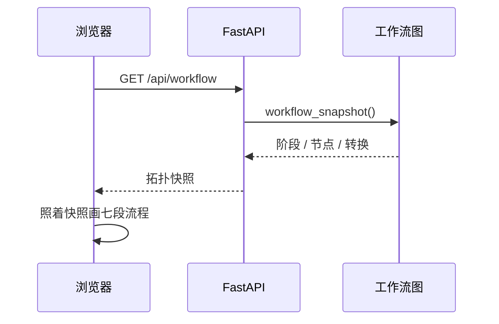

# P2.8 · 从可执行图导出 workflow snapshot

> 这次把「工作流长什么样」这件事收成一份：后端有一张可执行的图，快照是它的投影，前端不再自己抄一份七个阶段的清单。

## 第一部分：Q&A 概览

| Question | Answer |
| --- | --- |
| What changed?【这次改了什么】 | The workflow now has one executable graph in the backend, and the snapshot is only a projection of it. The frontend page reads that projection instead of keeping its own list of seven stages.【工作流的后端现在有一张可执行图，snapshot 只是这张图的投影；前端页面改成读它，不再自己抄一份七个阶段的清单。】 |
| Why a graph and not a list?【为什么要一张图】 | A list of stage names cannot say what follows what. The graph holds the stages, the work units and the transitions, so a later phase can add a batch or a gate without inventing a second description of the flow.【一串阶段名说不出谁接谁。图里装着阶段、工作单元和转换，后面的阶段要加批次或质量门时，不必再另写一份流程说明。】 |
| What is the snapshot?【snapshot 是什么】 | It is the plain dictionary the outside world reads: the phases, the nodes and the edges. It copies the graph and adds nothing, so a node added to the graph shows up in the snapshot right away.【它是给外面看的那份普通字典：阶段、节点、边。它只照抄图，不加任何东西，所以图里一加节点，快照里立刻就有。】 |
| Did the frontend change?【前端改了什么】 | The workflow page now asks the API for the topology and draws the answer. The hand written seven stage array is gone, and the page shows where each phase leads next.【工作流那一页改成向 API 要拓扑，再照着画。原先手写的七阶段数组删掉了，页面上还多出一行「下一步」。】 |
| What was not done?【这次没做什么】 | The graph is still a plain data structure. No runtime walks it, no model is called and nothing was written to the database, because that belongs to the phase that owns the execution.【图现在还是一份普通数据结构。没有运行器去走它，不调模型，也不写库，那些留给真正负责执行的阶段。】 |

## 第二部分：数据流

### 1. 拓扑只有一张图：七段阶段从合同里长出来



```dataflow
1-01 (合同定下七阶段) [[WORKFLOW_STEPS]]七阶段的工作流合同}} 是这里唯一被写下来的阶段文字 <{definitions.py}>
1-02      → [拼图] [[build_course_graph()]]按合同把拓扑拼出来的函数}} 把 [[WORKFLOW_STEPS]]七阶段的工作流合同}} 读成 [[WorkflowStage]]图里的一段阶段}} <{graph.py}>
1-03           ↳ [长节点] 每段阶段长出一个 [[GraphNode]]图里的一个工作单元}}，节点的 id 就是阶段的 id <{graph.py}>
1-04                ↳ [连起来] 相邻两段阶段之间连一条 [[GraphEdge]]图里的一条转换}}，七段链子就有六条边 <{graph.py}>
1-05                     ↳ [交出图] [[WorkflowGraph]]装着阶段、节点和边的那个对象}} 把整张图交出去，谁想加东西自己加 <{graph.py}>
---
{
  "1-01": "The seven stages are written down in one single list, and nowhere else.【WORKFLOW_STEPS[the stage contract of the course workflow]: seven stages, in order】",
  "1-02": "The builder reads that list and turns every stage into a stage object of the graph.【stages[the stages inside the graph]: empty → seven entries\nWORKFLOW_STEPS[the stage contract of the course workflow]: read only, never copied】",
  "1-03": "Every stage also grows one work unit, and that unit takes the id of its stage.【nodes[the work units inside the graph]: empty → seven entries\nnodeId[the name of one work unit]: the id of the stage it belongs to】",
  "1-04": "Neighbouring stages are joined, so seven stages in a row make six transitions.【edges[the transitions inside the graph]: empty → six entries】",
  "1-05": "The whole graph is handed out as one object, and anyone who needs more can add it later.【WorkflowGraph[the object that holds stages, nodes and edges]: built → handed out】",
  "Summary": "One list of seven stages is the only place the wording lives. A small builder reads that list and turns it into a graph: seven stages, seven work units, six transitions. Nothing here calls a model or touches the database; the graph only says what the workflow is."
}
---
// STEP FLOW: 1-01[合同] → 1-02[拼图] → 1-03[长节点] → 1-04[连起来] → 1-05[交出图]

// 整条流程可以想成搭积木:合同清单是那块写着七段名字的底板(1-01),
// 拼图函数照着底板一块一块摆(1-02),每段再给它配一个干活的小人(1-03),
// 小人之间按顺序牵起手(1-04),最后整串交出去(1-05)。

// ===== 📂 app/workflow/definitions.py(七阶段的工作流合同) =====
// 1-01[合同] 阶段文字只在这份清单里被写下来
<*WORKFLOW_STEPS*>: list[dict[str, str]] = [
    {
        "id": "intake",
        "title": "课程需求",
        "description": "确认课程目标、受众、范围、来源与交付形式",
        "user_input": "课程名称、受众、学习目标、内容范围、来源政策",
        "model_output": "结构化任务输入与缺失项",
    },

// ===== 📂 app/workflow/graph.py(可执行拓扑) =====
// 1-02[拼图] 图是从这份清单读出来的
def <*build_course_graph*>() -> <*WorkflowGraph*>:
    """Build the graph of the course generation workflow.

    The stages come from the contract of `app.workflow.definitions`, in the
    order that contract gives them.  Every stage starts as one node, and
    the stages are chained: the work of a stage is followed by the work of
    the next one.

    Args:
        Nothing. The contract of the workflow stages is the only input.

    Returns:
        The graph of the course generation workflow: the seven stages of
        the contract, one node per stage and the six transitions between
        them.
    """
    stages = [
        <*WorkflowStage*>(
            id=step["id"],
            title=step["title"],
            description=step["description"],
            user_input=step["user_input"],
            model_output=step["model_output"],
        )
        for step in <*WORKFLOW_STEPS*>
    ]
# 1-03[长节点] 每段阶段配一个工作单元
    nodes = [
        <*GraphNode*>(
            id=stage.id,
            stage=stage.id,
            title=stage.title,
            description=stage.description,
        )
        for stage in stages
    ]
# 1-04[连起来] 相邻两段之间连一条转换
    edges = [
        <*GraphEdge*>(source=source.id, target=target.id)
        for source, target in zip(nodes, nodes[1:], strict=False)
    ]
# 1-05[交出图] 整张图装在一个对象里
    return <*WorkflowGraph*>(
        id="course",
        name="课程生成主流程",
        stages=stages,
        nodes=nodes,
        edges=edges,
    )
```

### 2. 快照是投影：图里加一个节点，快照里就多一个



```dataflow
2-01 (有人给图加东西) [[add_node()]]往图里加一个工作单元的方法}} 被调用，图里多了一个节点 <{graph.py}>
2-02      → [投影] [[workflow_snapshot()]]把图投影成拓扑快照的函数}} 只看传进来的这张图，不看别处 <{snapshot.py}>
2-03           ↳ [列阶段] 阶段一个一个变成 [[phases]]快照里的阶段清单}}，多一个少一个都不行 <{snapshot.py}>
2-04                ↳ [列节点] 节点变成 [[nodes]]快照里的节点清单}}，刚加的那个节点就在里面 <{snapshot.py}>
2-05                     ↳ [列边] 边变成 [[edges]]快照里的转换清单}}，图里新加的转换也在里面 <{snapshot.py}>
2-06                          ↳ [收口] 图里没有的东西，快照里也不会自己长出来 <{snapshot.py}>
---
{
  "2-01": "Someone adds a new piece of work to the graph, and the graph now holds one more node.【nodes[the work units inside the graph]: seven → eight entries】",
  "2-02": "The snapshot looks at the graph it was handed and at nothing else.【the_graph[the graph being projected]: the one that was passed in, built fresh when nothing was passed】",
  "2-03": "Every stage of that graph becomes one entry of the phase list, no more and no less.【phases[the stages in the snapshot]: one entry per stage of the graph】",
  "2-04": "Every node of that graph becomes one entry of the node list, and the new node is in it.【nodes[the work units in the snapshot]: seven → eight entries, the new node included】",
  "2-05": "Every transition of that graph becomes one entry of the edge list, and the new transition is in it.【edges[the transitions in the snapshot]: six → seven entries, the new transition included】",
  "2-06": "What the graph does not have never shows up in the snapshot.【the_graph[the graph being projected]: the only source of the answer】",
  "Summary": "The snapshot is a copy of the graph, not a second description of it. A node added to the graph shows up in the snapshot, a transition added shows up too, and anything the graph does not hold is never in the answer. That is what makes the topology single sourced."
}
---
// STEP FLOW: 2-01[加节点] → 2-02[投影] → 2-03[列阶段] → 2-04[列节点] → 2-05[列边] → 2-06[收口]

// 这条流程像照相机:图是被拍的东西(2-01),快照是快门按下的那一张(2-02),
// 阶段、节点、边分别落在照片的三个角落(2-03 到 2-05),
// 相机不会拍到画面以外的东西(2-06)。

// ===== 📂 app/workflow/graph.py(可执行拓扑) =====
// 2-01[加节点] 图可以长出新的工作单元
    def <*add_node*>(self, node: GraphNode) -> GraphNode:
        """Add one unit of work to the graph.

        Args:
            node: The node to add, for example a node that writes the
                quality report of one chapter.

        Returns:
            The node that was added.
        Raises ValueError when the id is already taken, or when the stage
        of the node is not one of the stages of the graph.
        """
        if any(existing.id == node.id for existing in self.nodes):
            raise ValueError(f"节点标识重复：{node.id}")
        if all(stage.id != node.stage for stage in self.stages):
            raise ValueError(f"节点不属于任何阶段：{node.stage}")
        self.nodes.append(node)
        return node

// ===== 📂 app/workflow/snapshot.py(把图投影成快照) =====
// 2-02[投影] 只看传进来的这张图
def <*workflow_snapshot*>(graph: WorkflowGraph | None = None) -> dict[str, Any]:
    """Read the topology of the workflow out of its graph.

    Args:
        graph: The graph to project, for example a graph that a test grew
            by one node.  The graph of the course workflow when it is not
            given.

    Returns:
        The topology as a dictionary: the version of the shape, the id and
        the name of the workflow, the phases with the nodes they hold, the
        nodes with the phase they belong to, and the transitions between
        the nodes.  For example
        `{"version": 1, "id": "course", "name": "...",
        "phases": [...], "nodes": [...], "edges": [...]}`.
    """
    the_graph = graph if graph is not None else <*build_course_graph*>()
    return {
        "version": SNAPSHOT_VERSION,
        "id": the_graph.id,
        "name": the_graph.name,
        # 2-03[列阶段] 阶段一个一个变成快照里的阶段
        "phases": [_phase_read(stage, the_graph) for stage in the_graph.stages],
        # 2-04[列节点] 节点变成快照里的节点
        "nodes": [
            {
                "id": node.id,
                "stage": node.stage,
                "title": node.title,
                "description": node.description,
                "position": position,
            }
            for position, node in enumerate(the_graph.nodes)
        ],
        # 2-05[列边] 边变成快照里的转换
        "edges": [
            {"source": edge.source, "target": edge.target}
            for edge in the_graph.edges
        ],
    }
# 2-06[收口] 快照里没有图之外的东西
def <*_phase_read*>(stage: WorkflowStage, graph: WorkflowGraph) -> dict[str, Any]:
    return {
        "id": stage.id,
        "title": stage.title,
        "description": stage.description,
        "user_input": stage.user_input,
        "model_output": stage.model_output,
        "nodes": [node.id for node in graph.nodes_of(stage.id)],
    }
```

### 3. 浏览器不再自己写一遍：工作流页面读后端那张图



```dataflow
3-01 (人点开工作流) 浏览器打开工作流那一页，页面去问后端要拓扑 <{workflow-page.tsx}>
3-02      → [发请求] [[api.workflow()]]前端问后端要拓扑的那个调用}} 走的是 GET /api/workflow <{api.ts}>
3-03           ↳ [路由] [[read_workflow()]]后端那个只做转手的路由}} 把 [[workflow_snapshot()]]把图投影成快照的函数}} 的结果交给浏览器 <{workflow_routes.py}>
3-04                ↳ [照着画] 页面按 [[snapshot]]后端给的那份拓扑}} 的阶段清单一行一行画出来 <{workflow-page.tsx}>
3-05                     ↳ [标下一步] [[nextTargets()]]算出这一步往哪儿走的函数}} 按 [[edges]]快照里的转换}} 把「下一步」写在每一段下面 <{workflow-page.tsx}>
---
{
  "3-01": "The person opens the workflow page and the page asks the backend for the topology.【topology[the answer the page waits for]: not asked yet → asked】",
  "3-02": "The call goes to the one endpoint that hands out the topology.【path[the endpoint the page asks]: not asked yet → /api/workflow】",
  "3-03": "The backend route only passes the snapshot along, it does not write the topology down.【WorkflowSnapshotRead[the shape the browser receives]: the snapshot of the graph, unchanged】",
  "3-04": "The page draws one line per phase, in the order the backend gave them.【snapshot.phases[the phases the page draws]: seven phases, in the order of the graph】",
  "3-05": "Under every phase the page writes down where the work goes next, taken from the transitions.【edges[the transitions of the topology]: the source of every next step label】",
  "Summary": "The browser no longer keeps its own list of the seven stages. It asks the backend, the backend projects the graph it has, and the page draws what comes back. A stage the backend adds or renames shows up here on the next reload, with no second copy to update."
}
---
// STEP FLOW: 3-01[问后端] → 3-02[发请求] → 3-03[路由] → 3-04[照着画] → 3-05[标下一步]

// 这条流程像看导航:页面自己不画地图(3-01),而是问后端要一张(3-02),
// 后端把图投影一下递过来(3-03),页面照着画路(3-04),
// 再在每个路口标一句「往这边」(3-05)。

// ===== 📂 apps/web/src/api.ts(前端调后端的那些函数) =====
// 3-02[发请求] 拓扑只有一个出处：后端那张图
  workflow: () => request<WorkflowSnapshot>("/api/workflow"),

// ===== 📂 apps/api/app/api/workflow_routes.py(后端那个只做转手的路由) =====
// 3-03[路由] 把快照原样交出去
@router.get("", response_model=WorkflowSnapshotRead)
def <*read_workflow*>() -> WorkflowSnapshotRead:
    """Answer with the topology of the course production workflow.

    Returns:
        The phases of the workflow, the nodes they hold and the transitions
        between the nodes, as the graph of the workflow says.  The answer
        is the same every time it is asked: the graph does not change
        while the program runs.
    """
    return WorkflowSnapshotRead(**<*workflow_snapshot*>())

// ===== 📂 apps/web/src/pages/workflow-page.tsx(工作流那一页) =====
// 3-01[问后端] 页面自己去问后端要拓扑
  const topology = useQuery({
    queryKey: ["workflow"],
    queryFn: () => <*api.workflow*>(),
  });

// 3-04[照着画] 后端给的阶段清单，一行一行画出来
function <*WorkflowPhases*>({ snapshot }: { snapshot: WorkflowSnapshot }) {
  return (
    <>
      <ol className="workflow-list">
        {snapshot.phases.map((phase, index) => (
            <span>{String(index + 1).padStart(2, "0")}</span>
            <div>
              <strong>{phase.id}</strong>
              <p>{phase.description}</p>
              <p className="workflow-next">
                下一步：{nextTargets(snapshot, phase.id).join("、") || "流程结束"}
              </p>
            </div>
        ))}
      </ol>
// 3-05[标下一步] 「下一步」是从转换里算出来的
function <*nextTargets*>(snapshot: WorkflowSnapshot, phaseId: string): string[] {
  const sources = new Set(
    snapshot.phases
      .filter((phase) => phase.id === phaseId)
      .flatMap((phase) => phase.nodes),
  );
  return snapshot.edges
    .filter((edge) => sources.has(edge.source))
    .map((edge) => edge.target);
}
```

## 第三部分：其它

#### 这次改动的边界

| 文件 | 动作 | 说明 |
| --- | --- | --- |
| `apps/api/app/workflow/graph.py` | 新建 | 可执行拓扑：阶段、工作单元、转换，以及 `build_course_graph()` |
| `apps/api/app/workflow/snapshot.py` | 新建 | `workflow_snapshot(graph=None)`，把图投影成字典 |
| `apps/api/tests/test_workflow_snapshot.py` | 新建 | 计划里的三条测试，外加三条守卫 |
| `apps/api/app/api/workflow_routes.py` | 新建 | `GET /api/workflow`，只做转手 |
| `apps/api/app/schemas.py` | 改 | 四个拓扑的响应模型 |
| `apps/api/app/main.py` | 改 | 把拓扑路由挂上去 |
| `apps/web/src/api.ts` | 改 | 拓扑的类型，以及 `api.workflow()` |
| `apps/web/src/pages/workflow-page.tsx` | 新建 | 从 API 读拓扑再画出来的工作流页 |
| `apps/web/src/pages/course-pages.tsx` | 改 | 删掉手写的七阶段数组和旧的 `WorkflowPage` |
| `apps/web/src/App.tsx` | 改 | `WorkflowPage` 改从新文件导入 |
| `apps/web/src/styles.css` | 改 | 「下一步」和节点计数的两行样式 |

#### 六条决定

1. **「可执行图」是纯 Python 的数据对象，不是 LangGraph。** AGENTS.md 说没有到那个阶段就不许引入 LangGraph、Worker、队列和质量闭环。所以这张图只说「工作流长什么样」，不带任何执行器；真正走图的那个运行器留给拥有执行的阶段。
2. **图今天是一条七段的链：七个节点、六条边。** 参考版那张图有二十五个节点，因为它的批次循环、质量门和返工都已经实现了。我们照抄那张图，就等于把还没写的代码写进文档里，那本身又是一种「第二份真相」。批次和返工的分支等 P4 把它们真的做出来时，往同一张图上加节点和边就行——图是留了口子的。
3. **阶段和节点分成两样东西。** 阶段是那个人看得见的七段（合同里的文字），节点是运行时要走的一件活。今天两者一对一；以后一段阶段要长出第二件事（一个批次、一道门），加的是节点，不是阶段。
4. **快照模块里一个阶段名字都不许出现。** 这条是测试 `test_snapshot_module_names_no_phase_of_its_own` 守着：它读快照模块的源码，看有没有哪个阶段的 id 以字符串形式出现在里面。计划里那条「不是硬编码常量」的要求，靠这条测试变成会失败的事实，而不是一句约定。
5. **快照的形状也由 Pydantic 守着。** `WorkflowSnapshotRead` 这四个模型是接口的合同，字典只是投影出来的中间物；浏览器拿到的是经过校验的形状。
6. **前端那一页也一起改。** 只加接口不动前端的话，那份手写的七阶段清单还在，「只有一份来源」就是空话；而且新加的快照会是一个没人用的死模块。所以这一页改成问 API 要拓扑再画。

#### 跟参考版的六处不同

1. 参考版的 `snapshot.py` 手写了二十五节点二十四条边，还手写了一份七阶段清单；我们的 `snapshot.py` 一个阶段名字都不写，全从图里投影。
2. 参考版有 `agents` 和 `tools` 两个投影；我们没有——角色要到 P3.1 才定义（`AGENT_DEFINITIONS`），现在投影出来只能是空的。
3. 参考版的拓扑挂在 LangGraph 上；我们挂在一张纯 Python 的图上，等真要走图的时候再换。
4. 参考版的快照把拓扑按 `topologies` 分成建课和 review 两套；我们只投影建课这一套，review 那套等 P3 有角色之后再一起投影。
5. 参考版有 `default_mode`；我们没有「默认模式」这个概念，模式是建课时表单里选的。
6. 我们多了一条参考版没有的东西：快照模块不许出现阶段名字的源码级测试。

#### 这次验证了什么、没验证什么

验证过的：

- `apps/api/.venv/Scripts/python.exe -m pytest apps/api/tests/test_workflow_snapshot.py -v` → 7 passed。计划里点名的三条都在里面：`phases` 长度精确等于 7 且 id 与 `STEP_ORDER` 一致；`nodes` 的 id 全部来自可执行图；图里加一个测试节点后快照里也出现它。
- 那两条「跟着图走」的测试确实会失败：临时把 `workflow_snapshot` 改成不看传进来的图（只 `build_course_graph()`），`test_snapshot_follows_a_node_that_is_added_to_the_graph` 和 `test_snapshot_follows_an_edge_that_is_added_to_the_graph` 立刻红，随后改回来。
- `apps/api/.venv/Scripts/python.exe -m ruff check apps/api/app apps/api/tests` → All checks passed。
- `npm --prefix apps/web run typecheck` → 0 error；`npm --prefix apps/web run build` → 成功。
- `node scripts/check-source-size.mjs` → Source size check passed (41 files, <= 500 lines each)。

没验证的（照实说）：

- 没有在浏览器里打开工作流那一页看效果，也没有对着跑着的开发服务器发一次请求——本阶段按约定不做 E2E。接口本身由 `test_workflow_api_answers_with_the_snapshot_of_the_graph` 用 TestClient 覆盖，跑着的开发服务器会随 `--reload` 自己更新。
- 没有跑整套后端测试，只跑了这次新增的测试文件加上 `test_workflow_definitions.py`。
- 没跑 `check-report.py`（按项目约定，这个检查器不跑），这篇报告是用仓库外的镜像脚本逐条对过的。

#### 留给后面阶段的三件事

1. **谁来走这张图。** 图已经有了，但还没有运行器。P4 的批次执行和质量门落地时，是往这张图上加节点和边，还是换成一个真会跑的图引擎——这个决定要跟 AGENTS.md 里「不许提前引入 LangGraph」那条一起看。
2. **review 那条流程的拓扑。** `REVIEW_WORKFLOW_STEPS` 已经是第二个合同，现在图里只有建课这一套。等 P3 的角色到位，把 review 也投影成第二套拓扑（或者让同一个图带两套阶段）是个现成的活。
3. **Run 记录里的阶段条还没接图。** `repository.get_run_record()` 里的 `workflow_steps` 仍然直接读 `WORKFLOW_STEPS`。它读的是合同不是抄的，所以暂时不会走样；但等节点和阶段不再一对一，那条读法就该改成走图。

#### 报告自检（没跑 `check-report.py`）

按项目约定，`check-report.py` 没有运行。这篇报告是用仓库外的三个镜像脚本逐条对过的：`check_rules.py`（照着检查器的规则重写的一份）、`arrows.py`（箭头列位）、`verbatim2.py`（代码区的每一行是不是源码里真有的那一行）。三样都过了，才发出这份报告。
