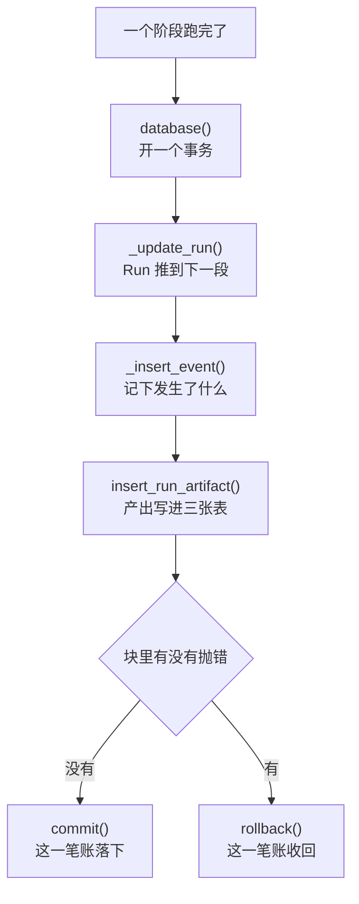
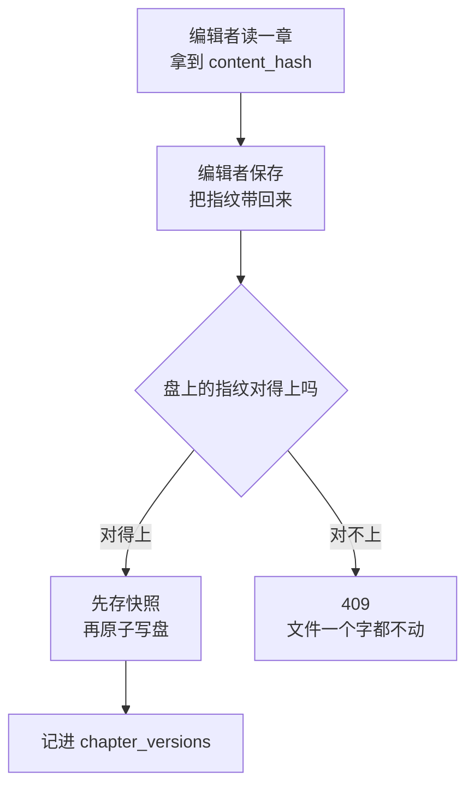
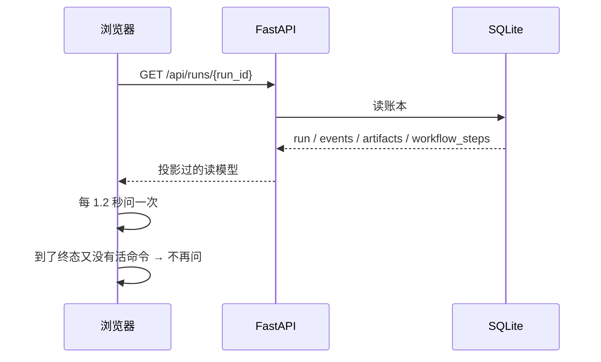

# Phase 2 总结 · 持久化事实与 Run 工作台

> 这一阶段做的是一件很朴素的事：把「一次建课发生了什么」从浏览器页面搬进本地的一个数据库文件。搬完之后，关掉浏览器、重启 API，读到的还是同一份东西。

## 第一部分：Q&A 概览

| Question | Answer |
| --- | --- |
| What did this phase do?【这一阶段做了什么】 | The phase moved the facts of a course run out of the browser and into a local database file. Runs, events, artifacts, chapter versions and the read model all live in one SQLite file now, so closing the browser or restarting the API changes nothing.【这一阶段把「一次建课发生了什么」从浏览器页面搬进了本地的 SQLite：Run、事件、产出、章节版本和读模型都在一个库里，关掉浏览器或者重启 API 都读回同一份东西。】 |
| What is the ledger?【账本是什么】 | Every state change of a run leaves a row behind: the run itself, the events that happened, and the artifacts each stage produced. The three are written in one transaction, so a stage that breaks half way leaves nothing behind, and writing the same output twice does not add a second row.【Run 的每一次状态变化都留下一行：Run 本身、发生过的事件、每个阶段的产出。三件事在同一个事务里写，中途坏掉就什么都不留，同一个产出写两遍也只留一行。】 |
| What happens when two people edit the same chapter?【两个人改同一章会怎样】 | Every read hands out a fingerprint of the text, and every save has to hand that fingerprint back. If the file on the disk changed in the meantime, the save is refused with a 409 and the file keeps the text it had. The replaced text is copied into the history of the course first.【每次读都带上一个内容指纹，每次保存都得把这个指纹带回来。盘上的文件在这期间被动过，保存就被 409 挡下来，文件还是原来那份。要被替换掉的旧正文会先抄进课程自己的历史目录。】 |
| What does the browser get?【浏览器拿到的是什么】 | Only what is on a whitelist: the run, its events, its artifacts and the seven stages with their state. Keys such as the prompt or the api key are dropped wherever they show up, and the paths of the machine are replaced by a placeholder. The frontend never keeps a copy of the topology either, it reads that from the graph in the backend.【浏览器只拿到白名单上的东西：Run、事件、产出和七个阶段各自的状态。prompt、api_key 这些名字出现哪儿都被抹掉，本机路径换成占位符。前端也不再自己抄一份拓扑，改成读后端那张图。】 |
| What was not done?【这一阶段没做什么】 | Nothing runs the workflow yet. No model is called, no batch is produced and no quality gate exists, so a run stays at the first stage after it is created. The ledger, the read model and the workbench are ready for the phase that brings the agent to life.【这一阶段还没有任何东西去跑工作流：不调模型、不产批次、没有质量门，所以 Run 建好之后一直停在第一阶段。账本、读模型和工作台都先备好，等真正把 Agent 叫醒的那一阶段。】 |

## 第二部分：数据流

### 1. 一次阶段跑完，三件事在同一个事务里落账



```dataflow
1-01 (阶段跑完了) 这一步开始落账：谁在跑、跑到哪、产出了什么 <{repository.py}>
1-02      → [开账本] [[database()]]打开数据库并把事务交给调用方的上下文管理器}} 交给调用方一条连接 <{db.py}>
1-03           ↳ [推 Run] [[_update_run()]]改 Run 那一行的函数}} 把状态推到下一段阶段 <{repository.py}>
1-04                ↳ [记事件] [[_insert_event()]]往事件表追加一行的函数}} 把「发生了什么」写下来 <{repository.py}>
1-05                     ↳ [存产出] [[insert_run_artifact()]]把阶段产出写进账本的函数}} 一次写三张表 <{artifacts.py}>
1-06                          ↳ [一起结算] 块里正常走完就 [[commit()]]把这一笔账落下的动作}}；中途抛错就 [[rollback()]]把这一笔账收回的动作}} <{db.py}>
1-07                               ↳ [重复只留一份] 同一个 [[node]]图里的一个工作单元}} 和 [[source]]产出从哪儿来的}} 再写一次，账上不多出一行 <{artifacts.py}>
---
{
  "1-01": "One stage of the course has finished, and now everything about it goes on the books.【stage[the piece of work that just finished]: the one the agent just ran → recorded】",
  "1-02": "The ledger is opened and the transaction is armed, so every write that follows belongs together.【connection[the line to the database file]: closed → open\ntransaction[the group of writes that live or die together]: not started → armed】",
  "1-03": "The run itself moves on to the next stage.【run status[where the run stands]: queued → running\ncurrent_step[the stage the run is at]: intake → the next stage】",
  "1-04": "What happened is written into the event list, so the story of the run can be read back later.【run_events[the list of things that happened]: one row → two rows】",
  "1-05": "The output of the stage is stored, and it is stored last because it is the heaviest of the three writes.【run_artifacts[the outputs of the run]: none → one row\nartifacts[the content records behind the outputs]: none → one row\nartifact_edges[the line from one output to the next]: none → one row】",
  "1-06": "Leaving the block normally commits all three writes, an exception in the middle takes all three back.【transaction[the group of writes]: armed → committed, or armed → rolled back】",
  "1-07": "Writing the same output twice does not make a second row, so a stage that is retried leaves one line on the books.【run_artifacts[the outputs of the run]: one row → one row】",
  "Summary": "A finished stage is written down in one transaction: the run moves on, the event is appended and the output is stored. If any of the three fails, none of them stays. Writing the same output again does not add a second row."
}
---
// STEP FLOW: 1-01[落账] → 1-02[开账本] → 1-03[推 Run] → 1-04[记事件] → 1-05[存产出] → 1-06[一起结算] → 1-07[重复只留一份]

// 这条流程像记账:一次阶段跑完就是一笔生意(1-01),
// 先把账本摊开、笔拿在手里(1-02),再一笔一笔往下写(1-03 到 1-05),
// 写完合上账本才算数(1-06);同一笔生意写两遍,账上只留一条(1-07)。

// ===== 📂 app/workflow/repository.py(Run 的账本) =====
// 1-01[落账] 阶段跑完,三件事在同一个事务里做
    with <*database*>() as connection:
// 1-03[推 Run] 先把 Run 推到下一段阶段
        if status is not None or next_step is not None:
            <*_update_run*>(connection, run_id, status=status, step=next_step)
// 1-04[记事件] 再把「发生了什么」记下来
        <*_insert_event*>(connection, run_id, event_type, step, message or title)
// 1-05[存产出] 最后把这一段的产出存进账本
        return <*insert_run_artifact*>(
            connection, run_id, step, node, title, presentation, raw_output, source
        )

// ===== 📂 app/db.py(SQLite 存储:建表、开连接、管事务) =====
// 1-02[开账本] 打开数据库,把连接交给调用方
@contextmanager
def <*database*>() -> Iterator[sqlite3.Connection]:
    """Open a connection to the business database and hand it to the caller.

    The schema is checked on the way in, so a caller never has to ask
    whether the tables exist.  Leaving the block normally commits what was
    written; an exception inside the block rolls the transaction back, so a
    half finished step leaves no rows behind.

    Args:
        Nothing. The database file comes from the settings.

    Yields:
        An open connection whose rows come back as ``sqlite3.Row`` objects,
        so that ``row_to_dict`` can turn them into plain dictionaries.
    """
    path = get_settings().database_path
    initialize_database(path)
    connection = sqlite3.connect(
        path,
        timeout=30,
        check_same_thread=False,
        isolation_level="",
    )
    connection.row_factory = sqlite3.Row
    connection.execute("PRAGMA foreign_keys=ON")
    try:
        yield connection
        # 1-06[一起结算] 正常走完,这一笔账落下来
        connection.<*commit*>()
    except Exception:
        # 1-06[一起结算] 中途抛错,这一笔账收回去
        connection.<*rollback*>()
        raise
    finally:
        connection.close()

// ===== 📂 app/workflow/artifacts.py(产出写进账本) =====
// 1-07[重复只留一份] 同一个产出再写一次,账上不多出一行
    existing = connection.execute(
        "SELECT * FROM run_artifacts WHERE run_id = ? AND node = ? AND source = ?",
        (run_id, <*node*>, <*source*>),
    ).fetchone()
    if existing is not None:
        return row_to_dict(existing) or {}
```

### 2. 两个人改同一章：后保存的那个拿到 409



```dataflow
2-01 (编辑者读一章) [[read_chapter()]]把一章读出来的函数}} 交出正文和它的 [[content_hash]]内容的指纹}} <{chapters.py}>
2-02      → [比对] [[save_chapter()]]保存一章的函数}} 先看交回来的 [[content_hash]]内容的指纹}} 和盘上的对不对得上 <{chapters.py}>
2-03           ↳ [拒绝] 对不上就抛 [[ConcurrencyConflict]]两个人改同一章的冲突}}，路由一律答 409 <{course_routes.py}>
2-04                ↳ [先存快照] 写之前，旧正文先抄进 [[snapshot_file()]]存一份旧版本的函数}} <{common.py}>
2-05                     ↳ [再落盘] 新正文用 [[write_text_atomic()]]原子写文件的函数}} 写进去 <{common.py}>
2-06                          ↳ [记版本] 写完把这一版记进 [[chapter_versions]]章节版本表}}；记不成就把文件写回去 <{chapters.py}>
---
{
  "2-01": "The editor reads the chapter, and the answer carries a fingerprint of the text next to the text itself.【content[the text of the chapter]: the text on the disk → the same text\ncontent_hash[the fingerprint of that text]: not known → a fresh fingerprint】",
  "2-02": "When the editor saves, it hands that fingerprint back and the file on the disk is checked against it.【expected_hash[the fingerprint the editor read earlier]: what the editor holds → compared with the disk\ncurrent[the text that is on the disk right now]: read → compared】",
  "2-03": "When the two do not match, the save is refused and the answer says so, while the file keeps the text it had.【conflict[whether the file changed under the editor]: no → yes\nstatus code[what the API answers]: 200 → 409】",
  "2-04": "Before anything is written, the text that is about to be replaced is copied into the history of the course.【history folder[the place where the old text is kept]: empty → one new folder with a timestamp】",
  "2-05": "The new text goes in one replacement, so a reader never sees half of the old and half of the new.【file on disk[the chapter file]: the old text → the new text, in one step】",
  "2-06": "The version that was just written is recorded in the table of versions, and if that fails the file is put back the way it was.【chapter_versions[the table of the versions that were written]: one row → two rows\nfile on disk[the chapter file]: the new text → the old text again, only when the record failed】",
  "Summary": "Reading a chapter hands out a fingerprint of its text. Saving has to hand that fingerprint back, and a mismatch means the file changed under the editor, so the save is refused with a 409 and nothing on the disk is touched. A save that does go through keeps the old text in the history of the course and records the new one in the table of versions."
}
---
// STEP FLOW: 2-01[读一章] → 2-02[比对] → 2-03[拒绝] → 2-04[先存快照] → 2-05[再落盘] → 2-06[记版本]

// 这条流程像两个人同时改同一份合同:每个人手上都有一张复印件(2-01),
// 交稿时先对一下指纹(2-02),对不上就说明有人抢先交了,这份不收(2-03),
// 收下来的话先把旧的一份归档(2-04),再整份换新(2-05),
// 最后在登记簿上记一笔,登记簿写不进去就把旧的那份放回去(2-06)。

// ===== 📂 app/courses/chapters.py(读一章与写一章) =====
// 2-01[读一章] 读出来的东西带着内容的指纹
def <*read_chapter*>(course_root: Path, key: str) -> dict[str, Any]:
    """Read one chapter of a course.

    Args:
        course_root: The folder of one course, for example
            courses/python-101/.
        key: The key of the chapter, for example "01".

    Returns:
        The key, the path, the content, the fingerprint of the content and
        the moment the file was changed the last time.
        Raises ValueError when the key is empty or points outside the
        course, and FileNotFoundError when there is no such chapter.
    """
    path = resolve_chapter_path(course_root, key)
    if not path.is_file():
        raise FileNotFoundError(f"章节不存在：{key}")
    content = path.read_text(encoding="utf-8")
    root = course_root.resolve()
    return {
        "key": key,
        "path": path.relative_to(root).as_posix(),
        "content": content,
        "content_hash": <*content_hash*>(content),
        "updated_at": _updated_at(path),
    }

// 2-02[比对] 保存前先看指纹对不对得上
def <*save_chapter*>(
    course_root: Path,
    key: str,
    content: str,
    expected_hash: str,
    *,
    reason: str = DEFAULT_REASON,
) -> dict[str, Any]:
    """Write one chapter of a course, but only when nobody else changed it.

    The fingerprint the caller read has to match the fingerprint of the
    file on the disk.  When it does not, the write is refused and the file
    stays as it is: the person who is behind has to look at both versions
    before they decide which one wins.

    Args:
        course_root: The folder of one course, for example
            courses/python-101/.
        key: The key of the chapter, for example "01".
        content: The new content of the chapter.
        expected_hash: The fingerprint the caller read, for example the
            `content_hash` a read handed out.
        reason: Why the chapter was saved, for example "手工编辑".

    Returns:
        The chapter as it is after the save: the key, the path, the new
        content, its fingerprint, the moment it was changed and the path
        of the snapshot of the content that was replaced.
        Raises ValueError when the key is empty or points outside the
        course, FileNotFoundError when there is no such chapter, and
        ConcurrencyConflict when the fingerprint does not match.
    """
    path = resolve_chapter_path(course_root, key)
    root = course_root.resolve()
    relative = path.relative_to(root).as_posix()

    current = path.read_text(encoding="utf-8") if path.is_file() else ""
    if <*content_hash*>(current) != expected_hash:
        // 2-03[拒绝] 对不上就拒绝,文件一个字都不动
        raise <*ConcurrencyConflict*>("内容已被其他编辑器修改，请刷新并比较后再保存")

    // 2-04[先存快照] 写之前,旧正文先抄一份
    snapshot = <*snapshot_file*>(root, path, relative)
    // 2-05[再落盘] 新正文原子写进去
    <*write_text_atomic*>(path, content)
    try:
        // 2-06[记版本] 写完把这一版记进版本表
        _record_version(
            root,
            key,
            relative,
            content_hash(content),
            snapshot.relative_to(root).as_posix(),
            reason,
        )
    except Exception:
        write_text_atomic(path, current)
        raise

// ===== 📂 app/courses/chapters.py(这一版写进哪张表) =====
// 2-06[记版本] 版本表里多一行,以后查得到
        connection.execute(
            """
            INSERT INTO chapter_versions (
                id, course_slug, chapter_key, source_path, content_hash,
                snapshot_path, reason, created_at
            ) VALUES (?, ?, ?, ?, ?, ?, ?, ?)
            """,

// ===== 📂 app/courses/common.py(路径守卫与原子写) =====
// 2-04[先存快照] 旧正文抄进课程自己的历史目录
def <*snapshot_file*>(root: Path, source: Path, relative: str) -> Path:
    """Copy the content that is about to be replaced into the history folder.

    The copy keeps the name of the file it protects, so the history of a
    course can be read without knowing what was written when.  A file that
    does not exist yet is snapshotted as an empty file, so the history
    always points at a real file.

    Args:
        root: The course folder the history lives in, for example
            courses/python-101/.  It has to be the resolved path, so the
            snapshot can be addressed relative to it.
        source: The file that is about to be overwritten.
        relative: The path of that file inside the course, for example
            "lessons/01.md".

    Returns:
        The path of the snapshot, for example
        courses/python-101/.agent-history/20261027T083105123456Z/lessons/01.md.
    """
    target = root / HISTORY_DIRECTORY / timestamp_slug() / relative
    target.parent.mkdir(parents=True, exist_ok=True)
    if source.is_file():
        shutil.copy2(source, target)
    else:
        target.write_text("", encoding="utf-8")
    return target

// ===== 📂 app/api/course_routes.py(编辑器的路由) =====
// 2-03[拒绝] 冲突一律答 409
def <*_http_error*>(error: Exception) -> HTTPException:
    """Turn a failure of the course service into the answer of the route.

    Args:
        error: The exception the service raised.

    Returns:
        The error to answer with: a 409 when the file on disk changed after
        the caller read it, a 404 when the course or the file is not there,
        and a 400 for everything else, for example a path that points
        outside the course.
    """
    if isinstance(error, ConcurrencyConflict):
        return HTTPException(status_code=409, detail=str(error))
    if isinstance(error, FileNotFoundError):
        return HTTPException(status_code=404, detail=str(error))
    return HTTPException(status_code=400, detail=str(error))
```

### 3. 关掉浏览器，Run 还在：投影、轮询与工作台



```dataflow
3-01 (人打开工作台) 浏览器向后端要一条 [[RunDetail]]一条 Run 的完整读模型}} <{run_routes.py}>
3-02      → [读账本] [[get_run_record()]]把一条 Run 的故事读出来的函数}} 读出 run、events、artifacts 和 [[workflow_steps]]七个阶段各自的状态}} <{repository.py}>
3-03           ↳ [投影] [[_pick()]]按白名单挑字段的函数}} 没写进名单的字段，答案里一律没有 <{run_routes.py}>
3-04                ↳ [擦干净] [[_scrub()]]把内部材料擦掉的函数}} 密钥、提示词和本机路径全擦掉 <{run_routes.py}>
3-05                     ↳ [问够没够] [[shouldPollRun()]]判断还要不要继续问的函数}}：Run 到了终态又没有活命令，就不再问 <{run-polling.ts}>
3-06                          ↳ [画出来] [[RunWorkspace()]]Run 工作台那一页}} 画出阶段条、事件轨和章节正文 <{run-workspace.tsx}>
3-07                               ↳ [拓扑也一份] [[workflow_snapshot()]]把图投影成拓扑的函数}} 阶段清单只有这一个出处 <{snapshot.py}>
---
{
  "3-01": "The person opens the workbench and the browser asks for the whole story of one run.【run[the attempt at building the course]: one of the runs on the books → the full read model】",
  "3-02": "The backend reads the ledger and puts the four parts of the story together.【events[the things that happened]: every row of the run → in order\nartifacts[the outputs of the stages]: every row of the run → in order\nworkflow_steps[the seven stages and where each one stands]: unknown → one state per stage】",
  "3-03": "Only the fields that were named in the whitelist go out, so a field nobody wrote down cannot leak out by accident.【answer[what the browser receives]: the whole row → the named fields only】",
  "3-04": "The material that belongs to the machine is scrubbed out wherever it hides, and the paths of this computer become a placeholder.【prompt[the text that was sent to the model]: kept → dropped\npath[where the file lives on this computer]: the real path → a placeholder】",
  "3-05": "The browser keeps asking while the answer can still change, and stops when the run is over and has nothing left to wait for.【polling[whether the browser asks again]: asking → asking\nstatus[where the run stands]: queued → completed, and the polling stops】",
  "3-06": "The page draws the stages as a bar, the events as a track and the chapters of the course underneath.【workbench[the page the person is looking at]: a blank page → the stages, the events and the chapters】",
  "3-07": "The seven stages are not written down in the browser at all, they are projected out of the graph in the backend.【topology[the list of the seven stages]: a list in the frontend → a projection of the graph】",
  "Summary": "The browser never keeps the truth, it asks for it. The backend reads the ledger, keeps only the fields on a whitelist and scrubs the material that belongs to the machine, and the page draws what comes back. The page keeps asking while the answer can still change and stops as soon as the run is over with nothing left to wait for."
}
---
// STEP FLOW: 3-01[问后端] → 3-02[读账本] → 3-03[投影] → 3-04[擦干净] → 3-05[问够没够] → 3-06[画出来] → 3-07[拓扑也一份]

// 这条流程像取快递:浏览器不下楼,让后端代取(3-01),
// 后端去仓库把单子取出来(3-02),照着清单挑出该给的(3-03),
// 把夹带出来的私人物件没收(3-04),再报一句「还有没有要取」来决定要不要再去一趟(3-05),
// 最后把东西摊在桌上(3-06);连「货架有几层」也是现问现答,不自己背(3-07)。

// ===== 📂 app/api/run_routes.py(读模型的出口) =====
// 3-01[问后端] 一条 Run 的完整读模型
@router.get("/{run_id}", response_model=<*RunDetail*>)
def <*read_run*>(run_id: str) -> RunDetail:
    """Answer with one run and everything that belongs to it.

    Args:
        run_id: The run to read, for example "run-1".

    Returns:
        The run, its events, its artifacts and the seven stages of the
        workflow with the state each one is in.
        Raises HTTPException(404) when there is no such run.
    """
    // 3-02[读账本] 把这条 Run 的故事从账本里读出来
    record = <*get_run_record*>(run_id)
    if record is None:
        raise HTTPException(status_code=404, detail="Run 不存在")
    return RunDetail(
        run=_run_read(record["run"], get_active_command(run_id)),
        events=[
            RunEventRead(**_pick(event, EVENT_FIELDS))
            for event in record["events"]
        ],
        artifacts=[
            RunArtifactRead(**_pick(artifact, ARTIFACT_FIELDS))
            for artifact in record["artifacts"]
        ],
        workflow_steps=[
            _workflow_step_read(step) for step in record["workflow_steps"]
        ],
    )

// 3-03[投影] 没写进名单的字段,答案里一律没有
@router.get("", response_model=RunList)
def <*read_runs*>(course_slug: str | None = None) -> RunList:
    """Answer with the runs of the system.

    Args:
        course_slug: The course whose runs are wanted, for example
            "python-101".  Every run when it is not given.

    Returns:
        The runs, newest first.  Every item says which run this is, which
        course it belongs to and where it stands.
    """
    return RunList(
        items=[
            <*_scrub*>(<*_pick*>(row, SUMMARY_FIELDS))
            for row in list_run_records(course_slug)
        ]
    )

// ===== 📂 app/api/run_routes.py(擦掉内部材料) =====
// 3-04[擦干净] 这些名字永远不进浏览器
HIDDEN_KEYS = frozenset(
    {
        "access_token",
        "api_key",
        "authorization",
        "cookie",
        "messages",
        "password",
        "prompt",
        "raw_output",
        "raw_response",
        "refresh_token",
        "secret",
        "system_prompt",
        "token",
        "user_prompt",
    }
)

// 3-04[擦干净] 本机路径换成占位符
PATH_PLACEHOLDER = "<path>"

// ===== 📂 apps/web/src/features/run/run-polling.ts(什么时候还该继续问) =====
// 3-05[问够没够] 终态但还有活命令,就继续问
export const TERMINAL_RUN_STATUSES = new Set(["COMPLETED", "FAILED", "STOPPED"]);

/**
 * Decide whether the browser should ask about this run again.
 *
 * @param run The run as the read model of P2.5 gives it, or `undefined`
 *   when the run has not been loaded yet.
 * @returns `true` when the answer can still change, `false` when the run is
 *   over and has nothing left to wait for.
 */
export function <*shouldPollRun*>(run: RunPollingState | undefined): boolean {
  const status = run?.status || "";
  if (!TERMINAL_RUN_STATUSES.has(status)) {
    return true;
  }
  return Boolean(run?.active_command);
}

// ===== 📂 apps/web/src/features/run/run-workspace.tsx(Run 工作台) =====
// 3-06[画出来] 页面自己隔一会儿问一次,到头了就不问
/**
 * The workbench of one run.
 *
 * @returns The page of the run, or the reason why there is no page.
 */
export function <*RunWorkspace*>() {
  const { runId = "" } = useParams();
  const [pickedStep, setPickedStep] = useState<string | null>(null);
  const detail = useQuery({
    queryKey: ["run", runId],
    queryFn: () => api.run(runId),
    refetchInterval: (query) =>
      shouldPollRun(query.state.data?.run) ? 1200 : false,
  });

// ===== 📂 app/workflow/snapshot.py(把图投影成拓扑) =====
// 3-07[拓扑也一份] 阶段清单只有这一个出处
def <*workflow_snapshot*>(graph: WorkflowGraph | None = None) -> dict[str, Any]:
    """Read the topology of the workflow out of its graph.

    Args:
        graph: The graph to project, for example a graph that a test grew
            by one node.  The graph of the course workflow when it is not
            given.

    Returns:
        The topology as a dictionary: the version of the shape, the id and
        the name of the workflow, the phases with the nodes they hold, the
        nodes with the phase they belong to, and the transitions between
        the nodes.  For example
        `{"version": 1, "id": "course", "name": "...",
        "phases": [...], "nodes": [...], "edges": [...]}`.
    """
    the_graph = graph if graph is not None else build_course_graph()
```

## 第三部分：第二阶段的手动测试用例

这一部分不是自动测试，是让人照着做一遍、每一步都看着对的清单。每个用例都写了**操作步骤**和**预期结果**。

**通用前置条件**

- 后端和前端已经启动：`bash scripts/start-agent.sh`。按这个脚本起的这一对是 API 在 `http://127.0.0.1:8000`、前端在 `http://127.0.0.1:5173`。脚本会挑第一个没人占的端口，所以要是 8000 / 5173 已经被别的进程占着，它就退到 8001 / 5174 —— **下面写的地址要跟着换成实际那一对**。
- **改完后端代码要重启 API**：这个脚本给 uvicorn 加的 `--reload` 在 Windows + Git Bash 上不生效 —— 它会打出「检测到改动，正在重载」，但服务进程从来没有被换掉，接口还是改动前的那份。所以改了 `apps/api/app/` 里的代码，要停掉脚本重起一次；前端的 vite 是热更新的，不用管。
- 数据库文件在 `.course-agent/agent.db`，可以直接用仓库自己的解释器查：

```bash
apps/api/.venv/Scripts/python.exe -c "import sqlite3; c=sqlite3.connect('.course-agent/agent.db'); print(c.execute('select id,status,current_step from runs').fetchall())"
```

- 下面的用例用同一门测试课，短名统一叫 `p2-manual`。第 5、6 号用例需要这门课有一章，做法见用例 5 的第 1 步。

#### 用例 1 · 建课之后，Run 已经在账上

**操作步骤**

1. 浏览器打开 `http://127.0.0.1:5174/new`，填完三段表单建一门课，短名填 `p2-manual`，提交。
2. 在浏览器开发者工具的 Network 面板里找到 `POST /api/courses` 这一条，记下应答里的 `run_id`。
3. 浏览器打开 `http://127.0.0.1:5174/runs`。

**预期结果**

- 建课成功后页面跳到 `/courses/p2-manual`，首页的课程列表里多出这门课。
- `POST /api/courses` 应答 201，里面有 `run_id`、`course.slug` 和 `status`。这里的 `status` 是**课程**的状态 `preparing`（这门课还没有章节），不是 Run 的状态；Run 的状态要问 `GET /api/runs`。
- `GET http://127.0.0.1:8001/api/runs` 应答 200，`items` 里有这一条：`course_slug` 是 `p2-manual`，`status` 是 `QUEUED`，`current_step` 是 `intake`。
- 「运行记录」页面（`/runs`）上能看到这一条，状态写着 `QUEUED`，阶段写着 `intake`。
- 用上面的数据库命令查 `runs` 表，能查到同一行。

#### 用例 2 · 工作台看得见「跑到哪一步」和「发生了什么」

**操作步骤**

1. 浏览器打开 `http://127.0.0.1:5174/runs/<run_id>`（`<run_id>` 用用例 1 记下的那个）。
2. 看页面顶部的七个阶段条。
3. 看「当前阶段正在发生的事」和「发生了什么」两块。

**预期结果**

- 页面顶部显示状态 `QUEUED`、当前阶段 `intake`，课程那一栏链到 `/courses/p2-manual`。
- 七个阶段条都在，第一个是「当前阶段」，其余六个是「未开始」。
- 「当前阶段正在发生的事」里至少有一条 `run.created`，旁边有一个走动的计时器（本轮已运行）。
- 「发生了什么」里至少有一条 `run.created`，时间戳能和建课时间对上。
- 点第二个阶段条，下面「阶段说明」那一块换成那一段的说明（这一段还没跑，所以状态仍是「未开始」）。
- 最下面「章节正文」那一块写着「这门课还没有章节。」——新建的课 `course.json` 里的 `lessons` 是空的。

#### 用例 3 · 关掉浏览器、重启 API，读到的还是同一条 Run

**操作步骤**

1. 把 `GET http://127.0.0.1:8001/api/runs/<run_id>` 的完整应答存成一个文件。
2. 关掉 API 进程（停 `scripts/start-agent.sh`），再重新起一次。
3. 再调一次同一个接口，把新应答和第 1 步的文件比。
4. 浏览器刷新 `http://127.0.0.1:5174/runs/<run_id>`。

**预期结果**

- 重启后这个接口依然应答 200，不是 404、不是 500。
- 两次应答一模一样：`run`、`events`、`artifacts`、`workflow_steps` 四个部分都没有变。
- 浏览器刷新后页面照旧显示同一条 Run，事件轨还是那一条 `run.created`。

#### 用例 4 · 库里看得到账，而且写的是同一笔

**操作步骤**

1. 用上面的数据库命令，把查询换成 `select event_type, step, message from run_events` 再跑一次。
2. 再查 `select count(*) from run_artifacts`。
3. 再查 `select name from sqlite_master where type='table'`。

**预期结果**

- `run_events` 里有一行 `event_type` 是 `run.created`，`step` 是 `intake`。
- `run_artifacts` 的行数是 0 —— 这一阶段还没有任何阶段产出过东西。
- 表清单里有 13 张表，其中 `runs`、`run_events`、`run_artifacts`、`chapter_versions` 都在。
- 关掉 API 再打开，`.course-agent/agent.db` 里的行数不变（表是幂等建的，不会清空数据）。

#### 用例 5 · 两个人改同一章，后保存的那个拿到 409

**操作步骤**

1. 给测试课准备一章：新建 `courses/p2-manual/lessons/01.md` 写几行字，再把 `courses/p2-manual/course.json` 里的 `"lessons"` 从 `[]` 改成 `[{"number": 1, "title": "第一课", "markdown": "lessons/01.md"}]`。
2. `GET http://127.0.0.1:8001/api/courses/p2-manual/chapters`，记下第一项的 `key`。
3. `GET http://127.0.0.1:8001/api/courses/p2-manual/chapters/<key>`，记下应答里的 `content_hash`（64 位十六进制）。
4. `PUT http://127.0.0.1:8001/api/courses/p2-manual/chapters/<key>`，请求体 `{"content": "编辑器 A 写的正文", "expected_hash": "<第 3 步的 hash>"}`。
5. 再 `PUT` 同一个地址，请求体 `{"content": "编辑器 B 写的正文", "expected_hash": "<第 3 步那个旧 hash>"}`。
6. 再 `GET` 一次这一章，看正文是 A 还是 B。
7. 看 `courses/p2-manual/.agent-history/` 目录。

**预期结果**

- 第 2 步应答 200，`items` 里有一项，`key` 是 `"1"`。
- 第 3 步应答 200，正文和 `content_hash` 都在。
- 第 4 步应答 200，返回的新 `content_hash` 和第 3 步的不一样，还多了一个 `snapshot_path`。
- 第 5 步应答 **409**，`detail` 写的是「内容已被其他编辑器修改，请刷新并比较后再保存」。
- 第 6 步读到的 `content` 还是**编辑器 A 写的正文**，不是 B —— 后保存的那个没有把前面的覆盖掉。
- `.agent-history/` 下多了一个带时间戳的目录，里面有 `lessons/01.md`，内容是被替换掉的那一版。
- 数据库的 `chapter_versions` 表里多了两行。

#### 用例 6 · 工作区的文件也有同样的保护

**操作步骤**

1. `GET http://127.0.0.1:8001/api/courses/p2-manual/workspace/files/NOTES.md`，记下 `content_hash`。
2. `PUT http://127.0.0.1:8001/api/courses/p2-manual/workspace/files/NOTES.md`，请求体 `{"content": "第一版笔记", "expected_hash": "<第 1 步的 hash>"}`。
3. 再 `PUT` 一次，还是带第 1 步那个旧 `expected_hash`。

**预期结果**

- 第 1 步应答 200，`content_hash` 和 `size` 都在。
- 第 2 步应答 200，笔记文件的内容变成「第一版笔记」。
- 第 3 步应答 **409**，文件里的内容没有被第二次的写入改掉。
- `courses/p2-manual/.agent-history/` 下同样多了一份旧笔记。

#### 用例 7 · 越界的路径被挡住

**操作步骤**

1. `GET http://127.0.0.1:8001/api/courses/p2-manual/chapters/..%2F..%2Fcourse.json`。
2. `GET http://127.0.0.1:8001/api/courses/p2-manual/workspace/files/..%2F..%2Fcourse.json`。
3. 看 `courses/` 目录和它的上一层有没有多出文件。

**预期结果**

- 两个请求都是 **400**，`detail` 写的是「文件路径越界」——路径守卫把越界的键挡在了门外。
- `courses/` 外面没有任何文件被创建或修改。
- `courses/p2-manual/` 里面的文件一个都没被动过。

#### 用例 8 · 轮询什么时候停

**操作步骤**

1. 打开 `http://127.0.0.1:5174/runs/<run_id>`，打开开发者工具的 Network 面板，按 `api/runs` 过滤。
2. 看请求是不是在持续来。
3. 用数据库命令把这条 Run 的状态改成终态（命令里的 `RUN_ID` 换成用例 1 记下的那个 id）：

```bash
apps/api/.venv/Scripts/python.exe -c "import sqlite3; c=sqlite3.connect('.course-agent/agent.db'); c.execute(\"update runs set status='COMPLETED' where id='RUN_ID'\"); c.commit()"
```

4. 刷新页面，再看 Network 面板。
5. 把状态改成 `FAILED`，再往 `commands` 表里插一条**不是终态**的命令（终态是 `succeeded` / `failed` / `cancelled` / `waiting_approval` / `retryable` / `done`），然后刷新页面看 Network 面板：

```bash
apps/api/.venv/Scripts/python.exe -c "import sqlite3; c=sqlite3.connect('.course-agent/agent.db'); c.execute(\"update runs set status='FAILED' where id='RUN_ID'\"); c.execute(\"insert into commands (id, run_id, kind, payload_json, status, created_at, updated_at) values ('cmd-manual', 'RUN_ID', 'pause', '{}', 'pending', '2026-10-27T00:00:00Z', '2026-10-27T00:00:00Z')\"); c.commit()"
```

**预期结果**

- 第 2 步：请求在持续来，间隔大约 1.2 秒。
- 第 4 步：请求不再持续来 —— 状态是 `COMPLETED` 而且没有活命令，页面知道「再问也不会变了」。
- 第 5 步：请求又持续来了 —— 状态虽然是 `FAILED`，但它还带着一条 `pending` 的活命令，页面知道「还有活要干」。
- `GET /api/runs/<run_id>` 的应答里，`run.active_command` 从 `null` 变成了那一条命令。
- 把状态改回 `QUEUED` 之后，请求恢复持续来。

#### 用例 9 · 拓扑只有一份

**操作步骤**

1. `GET http://127.0.0.1:8001/api/workflow`。
2. 浏览器打开 `http://127.0.0.1:5174/workflow`。
3. 把页面上列出来的阶段和 JSON 里的 `phases` 一条一条对着看。

**预期结果**

- JSON 里有 `phases` 正好 7 条、`nodes` 7 条、`edges` 6 条，`version` 是 1。
- `phases` 里每一条都有 `id`、`title`、`description`、`user_input`、`model_output` 和它装的 `nodes`；`nodes` 里每一条都有 `id`、`stage`、`title`、`description`、`position`。
- 页面上一段一段列出来的七个阶段，标题是那一段的 `id`（`intake`、`mission`、`blueprint`……），和 JSON 里的 `phases` 一一对应，顺序也一样。
- 每一段下面都写着「下一步：…」，最后一段写的是「下一步：流程结束」。
- 页面末尾写着「节点 7 个 · 转换 6 条」，和 JSON 里的数量一样。

#### 用例 10 · 这一阶段明确没做的事

**操作步骤**

1. 建完课之后，看 `runs` 表里那条 Run 的 `current_step`。
2. 打开 `http://127.0.0.1:5174/runs/<run_id>`，看工作台有没有进度在动。
3. 看 `run_artifacts` 表。

**预期结果**

- `current_step` 一直是 `intake`，不会自己往前走 —— 这一阶段还没有任何东西去跑那七段流程。
- 工作台的阶段条不会往前推进，事件轨也不会长出新的一条。
- `run_artifacts` 是空的：这一阶段只把「产出怎么记账」这件事做对了，还没有阶段真的产出东西。

跑完这十条，这一阶段的边界就是清楚的：事实落了账、并发有人守、浏览器拿的是投影，流程本身还站着没动。
